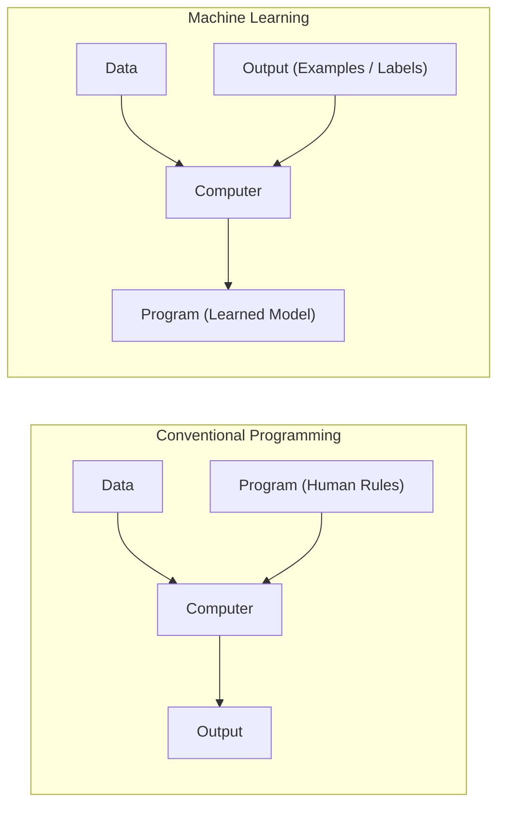
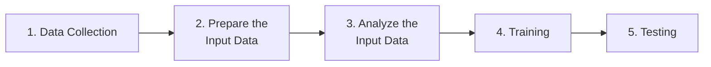

# Lectures 0 & 1: Introduction to Machine Learning, Learning Paradigms & Foundations

> [!info] Navigation & Course Materials
> - **Quiz Hub:** [[ML Quiz 1]] | **Next Lecture:** [[2. Linear Regression & Gradient Descent]] | **Part 3:** [[3. Logistic Regression, Bias-Variance & Regularization]]
> - **Related Class Note:** [[No Fking Clue|Epochs vs. Batches vs. Iterations]]
> - **Original Course Files:** [[BSc_Engg_SWE_Winter_CSE4553_2025.pdf]] | [[ML_Lecture 0.pdf]] | [[ML_Lecture 1.pdf]] | [[SWE_ML_Lab_1_Winter_2026.pdf]]
> - **Course Info:** **CSE 4553 — Machine Learning** (*Dr. Hasan Mahmud*, Room #404 AB2, `hasan@iut-dhaka.edu`) | Google Classroom: `o2sfduqd`
> - **Marks Breakdown (300 Total):** Attendance **30** (10%) | Quizzes/Assignments **90** (30%) | Mid Exam **90** (30%) | Final Exam **90** (30%)
> - **Recommended Textbooks:** Ethem Alpaydin (*Introduction to Machine Learning*), C. M. Bishop (*Pattern Recognition and Machine Learning*), Tom Mitchell (*Machine Learning*), Andrew Ng (*Machine Learning Yearning*)

> [!tip] My In-Class Notes (Preserved & Expanded)
> From the class I attended, these were the exact high-level takeaways written down:
> 1. **Learning Types:** Supervised, Unsupervised, Semi-Supervised, Reinforcement Learning *(covered in [[#4. The 4 Types of Machine Learning (Lec 1, Slides 6–13)]])*.
> 2. **Every ML algorithm should have 3 fundamental things:**
>    1. **Representation of the Model** (Relationship / Hypothesis)
>    2. **Evaluation Criteria** (Performance? Difference / Loss)
>    3. **Optimization Function** (e.g., Least SSE — Sum of Squared Errors)
>    *(Explained in full in [[#3. The 3 Fundamental Pillars of Every ML Algorithm]])*.
> 3. **In-Class Topics / Examples:**
>    - **Gait recognition** *(covered in [[#2.2 Tom Mitchell (1998) — Well-Posed Learning Problem T, P, E (Lec 1, Slides 4–5)]])*
>    - **Leakage in supervised learning** *(covered in [[#Data Leakage in Supervised Learning (In-Class Special Topic)]])*

---

## 1. Course Overview & Why Machine Learning? (Lec 0, Slides 1–12; Lec 1, Slide 3)

> [!abstract] Core Motivation (Lecture 1, Slide 3)
> **"Data is abundant and cheap, but knowledge is scarce and expensive."**
> - **Machine** = Computer / computer program.
> - **Learning** = Improving performance on a given task, based on experience / examples.

### 1.1 Conventional Programming vs. Machine Learning (Lec 0, Slide 3)

In traditional software engineering (**Conventional Programming**), a human programmer must figure out the exact logical rules and manually code them into a program. When we feed **Data + Program** into the computer, it computes the **Output**.

In **Machine Learning**, we flip the paradigm! Instead of writing explicit `if-else` rules ourselves, we feed the computer **Data + Desired Outputs (Examples)**, and the learning algorithm automatically discovers the rules (**Program / Model**) from the data.

![[lec0_slide03_conv_vs_ml.png]]



| Dimension | Conventional Programming | Machine Learning |
| :--- | :--- | :--- |
| **Core Idea** | *"How to program computers"* | *"How to allow them to program themselves"* |
| **Inputs to Computer** | **Data** + **Program** (hand-crafted rules) | **Data** + **Desired Output** (labeled examples) |
| **Produced Artifact** | **Output** | **Program** (a trained predictive/descriptive model) |
| **Example: Sentiment Analysis** | Manually write thousands of fragile `if` rules checking keywords (`"good"`, `"bad"`), which break on sarcasm (*"Yeah, great service, waited 2 hours!"*) or negation (*"not bad"*). | Feed thousands of reviews already labeled `positive` or `negative`; the computer learns word/context weights automatically to classify new reviews. |

---

### 1.2 Human Intelligence vs. Artificial Intelligence (Lec 0, Slides 4–5)

Dr. Hasan Mahmud compares how human cognition processes the world against how modern AI/ML systems mimic each stage. Notice that **Machine Learning sits inside the "Learning" gear of the Processing stage**—it is one crucial engine within the broader AI pipeline!

![[lec0_slide04_human_intelligence.png]]

![[lec0_slide05_artificial_intelligence.png]]

| Cognitive Stage | Human Intelligence (Slide 4) | Artificial Intelligence Equivalent (Slide 5) |
| :--- | :--- | :--- |
| **1. Input** | **Sensing & Perception** (eyes, ears, touch) | **NLP**, **Speech Recognition**, **Visual Recognition**, **Data Sources** |
| **2. Processing — Gear 1** | **Knowledge & Memory** | **Knowledge Representation**, Ontologies, Graph Databases, etc. |
| **2. Processing — Gear 2** | **Decision & Inference** | **Prescriptive Analytics**, Optimization, Decision Making, etc. |
| **2. Processing — Gear 3** | **Learning** | **Machine Learning** (*supervised, unsupervised*) |
| **3. Output** | **Output & Interaction** (speech, movement) | **Robotics**, **Navigation Systems**, **Speech Generation**, **Threat Leads** |

---

### 1.3 Machine Learning Research Venues (Lec 0, Slide 12)

Good to know for introductory/multiple-choice background questions:
- **Top ML Conferences:**
  - **ICML** — International Conference on Machine Learning
  - **KDD** — ACM SIGKDD Conference on Knowledge Discovery and Data Mining
  - **NeurIPS (formerly NIPS)** — Conference on Neural Information Processing Systems
  - **ACML** — Asian Conference on Machine Learning
  - **ECML** — European Conference on Machine Learning
- **Top ML Journals:**
  - **IEEE TKDE** — IEEE Transactions on Knowledge and Data Engineering
  - **JMLR** — Journal of Machine Learning Research
  - **JAIR** — Journal of Artificial Intelligence Research

---

## 2. Formal Definitions of Machine Learning (Lec 0, Slide 6; Lec 1, Slides 4–5)

### 2.1 Three Classic Textbook Definitions

1. **Arthur Samuel (1959) (Lec 1, Slide 4):**
   > *"Field of study that gives computers the ability to learn **without being explicitly programmed**."*
   *(Coined while Samuel built a self-playing Checkers program that eventually beat him by playing thousands of games against itself.)*

2. **Ethem Alpaydin — "Machine Learning in a Nutshell" (Lec 0, Slide 6):**
   - *"Machine learning is programming computers to **optimize a performance criterion** using example data or past experience."*
   - We define a **model** up to some **parameters**, and **learning** is the execution of a computer program to optimize those parameters using training data or past experience.
   - **Two Roles a Learned Model Can Play:**
     - **Predictive:** To make predictions in the future (e.g., predicting tomorrow's stock price or whether a transaction is fraud).
     - **Descriptive:** To gain knowledge/insights from data (e.g., discovering which customer segments exist or which medical symptoms cluster together).
     - **Or Both!**

3. **Tom Mitchell (1998) — Well-Posed Learning Problem (Lec 1, Slide 4):**
   > *"A computer program is said to learn from experience **$E$** with respect to some class of tasks **$T$** and some performance measure **$P$**, if its performance on **$T$**, as measured by **$P$**, improves with experience **$E$**."*

---

### 2.2 Tom Mitchell's $\langle T, P, E \rangle$ Framework: Worked Examples (Lec 1, Slide 5 + In-Class)

Whenever a quiz asks you to formulate a problem as a "well-posed learning problem", you must explicitly state all three components **$T$**, **$P$**, and **$E$**:

| Problem Scenario | Task ($T$) | Performance Measure ($P$) | Training Experience ($E$) |
| :--- | :--- | :--- | :--- |
| **1. Traffic Prediction** *(Slide 5)* | Predict future traffic patterns at a busy intersection. | Accuracy (or inverse error) of predicting future traffic volume/congestion. | Historical data of past traffic patterns at that intersection. |
| **2. Credit Card Fraud Detection** *(Slide 5)* | Assign a label of `fraud` or `not fraud` to each credit card transaction. | Accuracy of the fraud classifier **with a higher penalty when `fraud` is mislabeled as `not fraud`** (asymmetric cost: missing real fraud is far worse than a false alarm). | Historical credit card transactions labeled as `fraud` or `not fraud`. |
| **3. Gait Recognition** *(In-Class Example)* | Identify a person (or detect a walking disorder) from their walking pattern (video silhouettes or inertial sensor time series). | Recognition accuracy / correct identification rate on unseen walking sequences. | A dataset of recorded walking sequences (`gait cycles`) labeled with each person's identity. |

> [!note] Why Did Sir Mention Gait Recognition in Class?
> Gait recognition is a great real-world bridge between **Supervised Learning** and feature extraction: unlike face recognition (which fails from far away or at low resolution), a person's walking stride, joint angles, and cadence can be captured at a distance without cooperation. Given labeled gait sequences $D = \{(x^{(i)}, y^{(i)})\}$, a classifier learns to map motion features $x$ to a person's ID $y$.

---

## 3. The 3 Fundamental Pillars of Every ML Algorithm

> [!important] Core In-Class Insight (From `1. Intro.md`)
> Regardless of whether you are building Linear Regression, Logistic Regression, a Decision Tree, or a Deep Neural Network, **every ML algorithm is built out of three components**:
> 1. **Representation of the Model (Hypothesis / Relationship)**
> 2. **Evaluation Criteria (Loss / Cost / Performance Metric)**
> 3. **Optimization Function (Search Algorithm)**

Let's map these 3 pillars to the concrete algorithms we study in Lectures 1 and 2 so you can see the big picture immediately:

| Pillar | What Question Does It Answer? | Example: Linear Regression | Example: Logistic Regression |
| :--- | :--- | :--- | :--- |
| **1. Representation** | *What mathematical shape or family of functions $h_\theta(x)$ can the model express?* | A straight line / hyperplane:<br>$h_\theta(x) = \theta_0 + \theta_1 x = \boldsymbol{\theta}^T \mathbf{x}$ | Sigmoid applied to linear combination:<br>$h_\theta(x) = \dfrac{1}{1 + e^{-\boldsymbol{\theta}^T \mathbf{x}}}$ |
| **2. Evaluation Criteria** | *How do we score how good or bad a candidate model is against the ground truth $y$?* | **SSE / MSE** (Sum or Mean Squared Error):<br>$J(\theta) = \frac{1}{2m}\sum_{i=1}^m (h_\theta(x^{(i)}) - y^{(i)})^2$ | **Binary Cross-Entropy / Log-Loss** (or Log-Likelihood $\ell(\theta)$):<br>$J(\theta) = -\frac{1}{m}\sum [y\log h + (1-y)\log(1-h)]$ |
| **3. Optimization Function** | *How do we search for the exact parameters $\theta^*$ that minimize the loss?* | **OLS Calculus**, **Normal Equation** $(X^TX)^{-1}X^Ty$, or **Gradient Descent** (Batch / SGD) | **Gradient Descent** / Maximum Likelihood Estimation (no closed-form equation!) |

---

## 4. The 4 Types of Machine Learning (Lec 1, Slides 6–13)

At the highest level, Machine Learning problems are categorized by **what kind of feedback / labels are available in the training data**:

| Learning Type | Training Data Format | Desired Output / Labels Included? | Core Goal | Key Algorithms / Subtasks |
| :--- | :--- | :--- | :--- | :--- |
| **1. Supervised (Inductive)** | $D = \{(x^{(i)}, y^{(i)})\}_{i=1}^n$ | **Yes** — every input has a target label $y^{(i)}$. | Learn a mapping $h: x \to y$ to predict unseen inputs. | **Classification** (discrete $y$), **Regression** (continuous $y$). Examples: Linear/Logistic Regression, Decision Trees, Random Forest, k-NN, SVM, Neural Nets. |
| **2. Unsupervised** | $D = \{x^{(i)}\}_{i=1}^n$ | **No** — unlabeled inputs only. | Discover hidden structure, groups, or compact features in $x$. | **Clustering** (discrete cluster ID), **Dimensionality Reduction** (continuous compressed features), K-Means, PCA. |
| **3. Semi-Supervised** | $D_L = \{(x^{(i)}, y^{(i)})\}_{i=1}^{n_l}$ **+** $D_U = \{x^{(j)}\}_{j=1}^{n_u}$ *(where $n_l \ll n_u$)* | **Partially** — a **few** labeled examples + a **large** pool of unlabeled data. | Leverage cheap unlabeled data alongside expensive expert labels to build a better classifier. | Pseudo-labeling, semi-supervised classification (e.g., face vs. non-face with few expert labels). |
| **4. Reinforcement Learning** | Trajectory of $(s_t, a_t, r_t, s_{t+1})$ | **No static labels** — **delayed scalar rewards** $r_t \in \mathbb{R}$ from an environment. | Learn a policy $\pi: \mathcal{S} \to \mathcal{A}$ choosing a sequence of actions to maximize long-term reward. | Game playing (Chess, Go), robotics, autonomous navigation. |

---

### 4.1 Supervised (Inductive) Learning (Lec 1, Slides 6–9)

Why is it called **inductive** learning? Because from specific labeled observations $(x^{(i)}, y^{(i)})$, the learner *induces* a general hypothesis function $h(x)$ that works on new, unseen examples.

#### Workflow & Train/Test Split (Slide 7)

![[lec1_slide07_supervised_workflow.png]]

Follow the 4 numbered steps on Slide 7:
1. **Collect Labeled Observations:** Gather pairs of inputs and known ground-truth answers (e.g., emails labeled `spam` / `not spam`, houses with known sale prices).
2. **Split into Training Set & Test Set:** Partition the labeled data across the dashed boundary. The model is **only allowed to learn from the Training Set**; the **Test Set** is locked away to simulate unseen future data.
3. **Training (`Machine learner` $\to$ `Prediction model`):** The algorithm optimizes model parameters on the Training Set.
4. **Evaluation (`Test set` $\to$ `Prediction model` $\to$ `stats`):** Run the trained model on the held-out Test Set and compare its predictions against the true test labels to report honest accuracy/error statistics.

#### Classification vs. Regression (Slide 7)
- **Classification ($x \to y$ where $y$ is Discrete):** Output belongs to a finite set of categories, e.g., $y \in \{0, 1\}$ (`benign` vs. `malignant`), or `{"cat", "dog", "bird"}`.
- **Regression ($x \to y$ where $y$ is Continuous):** Output is a real-valued number $y \in \mathbb{R}$, e.g., predicting a house price ($245,000$), temperature, or stock value.

#### Feature Space Representation & Prediction Error (Slide 8)

![[lec1_slide08_supervised_car_plot.png]]

- **Dataset Notation:** $D = \{x^{(i)}, y^{(i)}\}_{i=1}^n$ (or $m$ examples), where:
  - $x^{(i)}$ is the **input** (can be a vector of multiple features, e.g., on Slide 8 from Alpaydin Ch. 2: $x_1 = \text{Price}$ and $x_2 = \text{Engine power}$ for classifying whether a car is a `family car` $\oplus$ or not $\ominus$).
  - $y^{(i)}$ is the **target label**.
- **Goal:** Estimate a prediction function (**hypothesis**) $h$ by minimizing total prediction error across the training set, e.g., sum of squared errors $\sum (y^{(i)} - h(x^{(i)}))^2$.

#### Expected Loss Minimization & Loss Functions (Slide 9)

![[lec1_slide09_expected_loss.png]]

Mathematically, the idealized goal of supervised learning is **Expected Risk Minimization**:

$$\min_{f} \; \mathbb{E}_{(x,y)\sim D}\bigl[\ell(f(x), y)\bigr]$$

Let's decode every single symbol (annotated with red arrows on Slide 9):
- $(x, y) \sim D$: Input-label pairs drawn from the **true underlying data distribution** $D$.
- $x$: **Input** features.
- $y$: **Target label** (ground truth).
- $f(x)$: **Model** (our candidate prediction $\hat{y} = f(x)$).
- $\ell(\cdot)$: **Loss function** — measures the penalty for predicting $\hat{y} = f(x)$ when the truth is $y$.
- **Training:** Find the model $f$ that minimizes the expected loss over the data distribution! *(Since we don't have infinite samples from $D$, in practice we minimize the **average loss on our finite training set**, called Empirical Risk Minimization.)*

Two fundamental loss functions shown on Slide 9:

1. **Zero/One Loss (Classification):** Simply counts whether a prediction is right ($0$ penalty) or wrong ($1$ penalty):
   $$\ell(y, \hat{y}) = \begin{cases} 0 & \text{if } y = \hat{y} \\ 1 & \text{otherwise} \end{cases}$$
2. **Squared Loss (Regression):** Penalizes predictions quadratically by how far off the predicted number is from the true number:
   $$\ell(y, \hat{y}) = (y - \hat{y})^2$$

---

#### Data Leakage in Supervised Learning (In-Class Special Topic)

> [!error] High-Yield In-Class Concept: What is Data Leakage?
> **Data Leakage** happens when information from outside the training dataset (from the **Test Set** or from the **future / target itself**) accidentally sneaks into the model's training features or preprocessing steps.
>
> **Why It Is Dangerous:** Your model gets unrealistically high accuracy during training/testing (it "cheats" by peeking at the answer), then fails catastrophically on real unseen production data where that leaked information does not exist!

There are **two classic ways** data leakage happens in supervised learning:

1. **Train–Test Contamination (Preprocessing Leakage):**
   - Look back at Slide 7's dashed line separating the **Training Set** and **Test Set**.
   - Suppose you want to fill missing values using the column mean or normalize features using `StandardScaler` ($x_{\text{scaled}} = \frac{x - \mu}{\sigma}$).
   - **WRONG (Leakage!):** Compute $\mu$ and $\sigma$ on the **entire dataset first**, *then* split into train and test. Now the test set's distribution ($\mu, \sigma$) has leaked into the training set!
   - **RIGHT (Zero Leakage):** Split into `train` and `test` **first**. Compute $\mu_{\text{train}}$ and $\sigma_{\text{train}}$ *only* on `X_train` (`scaler.fit_transform(X_train)`), and apply those exact training statistics to `X_test` (`scaler.transform(X_test)`).

2. **Target Leakage (Feature Leakage):**
   - A training feature contains information that is only created **after** (or as a direct consequence of) the target event $y$ you are trying to predict.
   - **Classic Example:** Predicting whether a patient `has_pneumonia` ($y$) using a feature `took_antibiotics` ($x_j$). Patients take antibiotics *after* being diagnosed with pneumonia! At real-world prediction time (before diagnosis), you won't have that feature—so the model looks 99% accurate in testing and is useless in the hospital.

---

### 4.2 Unsupervised Learning (Lec 1, Slide 10)

![[lec1_slide10_unsupervised.png]]

- **Dataset:** $D = \{x^{(i)}\}_{i=1}^n$ — notice there are **NO target labels $y^{(i)}$**!
- **Goal:** Find hidden patterns, groupings, or compact internal representations inside unlabeled data $\{x^{(1)}, x^{(2)}, \dots, x^{(m)}\}$.
- **Hierarchical Pattern Discovery (Middle Diagram on Slide 10):** Even without labels, an unsupervised model fed raw face images discovers patterns layer by layer:
  1. **Low-level features:** oriented edges and lines.
  2. **Mid-level features:** object parts (eyes, noses, mouths).
  3. **High-level features:** whole face prototypes.
- **Two Main Subtasks (Bottom Diagram on Slide 10):**
  1. **Clustering ($x \to x'$ where $x'$ is a Discrete Cluster ID):** Groups similar data points together (e.g., K-Means grouping customers into segments `Cluster 0`, `Cluster 1`, `Cluster 2`).
  2. **Dimensionality Reduction ($x \to x'$ where $x'$ is Continuous):** Compresses high-dimensional inputs (e.g., 1,000 features) into fewer continuous features (e.g., 2D or 10D) while preserving as much information as possible (e.g., PCA — Principal Component Analysis).

---

### 4.3 Semi-Supervised Learning (Lec 1, Slide 11)

![[lec1_slide11_semisupervised.png]]

- **Why Semi-Supervised Learning Exists:** Collecting raw unlabeled data (photos, web text, audio) is **cheap and abundant**, whereas paying human experts to manually label every single item is **slow and expensive** (remember Slide 3!).
- **How It Works (Slide 11 Pipeline):**
  1. Start with a **large pool of raw data**.
  2. Send only a **small fraction** to an **Expert Labeler** to produce a small **Labeled Data** set (e.g., portrait $\to$ `face`, house $\to$ `not face`).
  3. Keep the vast majority as **Unlabeled Data**.
  4. Feed **both** the huge Unlabeled pool and the tiny Labeled pool into the **Learning Algorithm** to train a much sharper **Classifier** than could be learned from the tiny labeled subset alone.

---

### 4.4 Reinforcement Learning (Lec 1, Slides 12–13)

Unlike Supervised Learning (which tells the model the right answer $y$ on every input) or Unsupervised Learning (which finds patterns with no feedback), **Reinforcement Learning (RL)** learns by **trial and error through interacting with a dynamic environment** and receiving **rewards** over a sequence of actions.

![[lec1_slide12_rl_loop.png]]

![[lec1_slide13_rl_elements.png]]

#### The 5 Basic Elements of a Reinforcement Learning Problem (Slide 13)

| Element | Formal Symbol | Meaning & Examples |
| :--- | :---: | :--- |
| **1. Agent** | — | The **decision maker** (e.g., game player, robot). Has *sensors* to observe the environment (e.g., robot camera). |
| **2. Environment & State** | $s_t \in \mathcal{S}$ | The external world (e.g., chess board, maze). At time $t$, the environment is in **state** $s_t$ from possible states $\mathcal{S}$ (often includes an *initial state* and *goal state*). |
| **3. Actions & Transition** | $a_t \in \mathcal{A}$<br>$s_{t+1} = \delta(s_t, a_t)$ | Set $\mathcal{A}$ of legal **actions** (e.g., chess moves, robot steps). Choosing action $a_t$ moves the environment to next state $s_{t+1} = \delta(s_t, a_t)$. The solution requires a **sequence of actions**. |
| **4. Reward** | $r_t = r(s_t, a_t) \in \mathbb{R}$ | The **scalar feedback signal** received from the environment (often delayed until the end of the game, e.g., `+1` win / `-1` loss). Guides policy improvement. |
| **5. Policy** | $\pi: \mathcal{S} \to \mathcal{A}$ | The **control strategy** telling the agent which action $a_t = \pi(s_t)$ to take in each state to achieve the goal / maximize cumulative reward. |

**Trajectory Rollout over Time:**
$$s_0 \xrightarrow[r_0]{a_0} s_1 \xrightarrow[r_1]{a_1} s_2 \xrightarrow[r_2]{a_2} \cdots$$
Notice the time-step shift in Slide 12: at time $t$, the agent observes $(s_t, r_t)$, picks action $a_t$, and the environment returns the resulting next state $s_{t+1}$ and reward $r_{t+1}$.

---

## 5. Steps in Developing a Machine Learning Application (Lec 1, Slide 14)

![[lec1_slide14_ml_steps.png]]



1. **Data Collection:** Gather raw data (APIs, web scraping, sensors, CSVs, public datasets like UCI Iris or California Housing in Lab 1).
2. **Prepare the Input Data:** Handle missing values (`dropna` or mean/mode imputation), format into feature matrices $\mathbf{X}$ and label vectors $\mathbf{y}$, encode categories, split into train/test **before** scaling (`StandardScaler`) to avoid data leakage!
3. **Analyze the Input Data (EDA — Exploratory Data Analysis):** Inspect distributions, summary statistics (mean, median, std, percentiles), check correlations (e.g., `median_income` vs. `median_house_value`), and catch anomalies/outliers visually.
4. **Training:** Feed the **Training Set** into the learning algorithm to optimize parameters (e.g., via OLS, Normal Equation, or Gradient Descent).
5. **Testing:** Evaluate the trained model on the held-out **Test Set** using appropriate metrics (Zero/One accuracy for classification; MAE/MSE/RMSE for regression).

---

## 6. Practice Problems (Lectures 0 & 1)

> [!question]- Problem 1: Conventional Programming vs. Machine Learning & Model Roles (Lec 0, Slides 3 & 6)
> 1. Contrast **Conventional Programming** and **Machine Learning** in terms of inputs and outputs to the computer, using **Sentiment Analysis** as an example.
> 2. According to **Ethem Alpaydin**, what are the two main purposes of a learned ML model (**predictive** vs. **descriptive**)? Give one concrete example of each.
>
> > [!success]- Answer & Step-by-Step Solution
> > 1. **Conventional Programming vs. Machine Learning:**
> >    - **Conventional Programming:** Inputs are **Data + Program (human-written rules)** $\to$ Computer $\to$ **Output**. For Sentiment Analysis, humans would have to manually write brittle keyword rules (`if "good" in text: positive`), which break on sarcasm or negations (`"not bad"`).
> >    - **Machine Learning:** Inputs are **Data + Desired Output (labeled reviews)** $\to$ Computer $\to$ **Program (learned model)**. The model automatically discovers linguistic patterns from labeled examples and generalizes to unseen reviews.
> > 2. **Predictive vs. Descriptive (Alpaydin, Slide 6):**
> >    - **Predictive Model:** Used to forecast outcomes for new/future inputs (e.g., predicting whether a new email is spam, or predicting a house's selling price from square footage).
> >    - **Descriptive Model:** Used to uncover hidden structure or gain interpretable knowledge from existing data (e.g., clustering shoppers into distinct spending personas, or identifying which features correlate most strongly with customer churn).

> [!question]- Problem 2: Human Intelligence vs. AI Mapping (Lec 0, Slides 4–5)
> In Slide 5's diagram mapping **Human Intelligence** to **Artificial Intelligence**, identify the three interlocking gears in the **Processing** stage and state the exact AI/ML discipline corresponding to each gear. Where does **Supervised/Unsupervised Machine Learning** sit in this architecture?
>
> > [!success]- Answer & Step-by-Step Solution
> > The **Processing** stage consists of three interlocking gears:
> > 1. **Knowledge & Memory** $\longleftrightarrow$ **Knowledge Representation, Ontologies, Graph Databases, etc.**
> > 2. **Decision & Inference** $\longleftrightarrow$ **Prescriptive Analytics, Optimization, Decision Making, etc.**
> > 3. **Learning** $\longleftrightarrow$ **Machine Learning (Supervised, Unsupervised)**.
> >
> > **Key Takeaway:** Machine Learning specifically models the **Learning** gear (converting data/experience into adaptive models), working alongside symbolic Knowledge Representation and Optimization, fed by Input perception (`NLP`, `Speech Recognition`, `Visual Recognition`, `Data Sources`) and driving Output interaction (`Robotics`, `Navigation`, `Speech Generation`, `Threat Leads`).

> [!question]- Problem 3: Tom Mitchell's Well-Posed Learning Problem $\langle T, P, E \rangle$ (Lec 1, Slides 4–5 + In-Class)
> State Tom Mitchell's (1998) formal definition of Machine Learning, and formulate **Task ($T$)**, **Performance Measure ($P$)**, and **Experience ($E$)** for:
> 1. **Credit Card Fraud Detection** (include the crucial asymmetric penalty detail from Slide 5).
> 2. **Gait Recognition** (our in-class biometric example).
> 3. **Autonomous Email Spam Filter**.
>
> > [!success]- Answer & Step-by-Step Solution
> > **Mitchell's Definition:** A computer program is said to learn from experience $E$ with respect to some class of tasks $T$ and performance measure $P$, if its performance at tasks in $T$, as measured by $P$, improves with experience $E$.
> >
> > 1. **Credit Card Fraud Detection (Slide 5):**
> >    - **$T$:** Assigning the label `fraud` or `not fraud` to any incoming credit card transaction.
> >    - **$P$:** Classification accuracy of the fraud detector **with a higher penalty when `fraud` is misclassified as `not fraud`** (false negative).
> >    - **$E$:** Historical credit card transactions labeled as `fraud` or `not fraud`.
> > 2. **Gait Recognition (In-Class):**
> >    - **$T$:** Identifying a person's identity from a sequence of walking frames or inertial gait sensor readings.
> >    - **$P$:** Percentage of individuals correctly identified on unseen walking sequences.
> >    - **$E$:** Database of recorded gait sequences labeled with each person's true identity.
> > 3. **Email Spam Filter:**
> >    - **$T$:** Classifying incoming emails as `spam` or `not spam` (`ham`).
> >    - **$P$:** Percentage of emails correctly classified (possibly weighting false positives—marking real mail as spam—higher).
> >    - **$E$:** A database of historical emails that users manually marked as `spam` or `not spam`.

> [!question]- Problem 4: The 3 Fundamental Pillars of Every ML Algorithm (In-Class Framework)
> Suppose a company builds a system to predict university students' final GPA ($y \in [0.0, 4.0]$) from their weekly study hours ($x_1$) and attendance percentage ($x_2$) by fitting $\hat{y} = w_0 + w_1 x_1 + w_2 x_2$ so that $\sum_{i=1}^m (y^{(i)} - \hat{y}^{(i)})^2$ is minimized via Gradient Descent.
>
> Identify the **3 fundamental components** of this ML algorithm from your class notes.
>
> > [!success]- Answer & Step-by-Step Solution
> > 1. **Representation of the Model (Hypothesis / Relationship):** Linear multivariate function $\hat{y} = w_0 + w_1 x_1 + w_2 x_2$.
> > 2. **Evaluation Criteria (Loss / Cost Function):** Sum of Squared Errors (SSE), $E = \sum_{i=1}^m (y^{(i)} - \hat{y}^{(i)})^2$, measuring the difference between true GPA and predicted GPA.
> > 3. **Optimization Function:** Gradient Descent (or Ordinary Least Squares), iteratively updating $w_0, w_1, w_2$ to find the minimum SSE.

> [!question]- Problem 5: Identifying Learning Paradigms & Subtasks (Lec 1, Slides 6–13)
> For each scenario below, classify the learning paradigm (**Supervised**, **Unsupervised**, **Semi-Supervised**, or **Reinforcement Learning**) and, where applicable, the specific subtype (**Classification**, **Regression**, **Clustering**, or **Dimensionality Reduction**):
> - **(a)** A dataset of 50,000 brain MRI scans where only 500 scans were labeled by radiologists (`tumor` / `healthy`) and 49,500 scans are unlabeled.
> - **(b)** Predicting the continuous water consumption (in liters) of a city tomorrow from weather and population data, trained on 5 years of historical logs.
> - **(c)** Compressing 1,000-dimensional gene expression vectors down to 3 continuous principal components for visualization, with no disease labels provided.
> - **(d)** An AI robot dog learning to walk over rocky terrain by receiving `+1` reward for forward stability and `-10` penalty whenever it falls.
> - **(e)** Grouping 100,000 unlabeled e-commerce shoppers into 5 behavioral segments based on browsing and purchase histories.
>
> > [!success]- Answer & Step-by-Step Solution
> > - **(a) Semi-Supervised Learning** (Classification): Combines a small pool of expensive expert-labeled scans with a massive pool of unlabeled scans.
> > - **(b) Supervised Learning — Regression:** Historical labeled pairs $(x, y)$ where the target $y$ (liters of water) is **continuous**.
> > - **(c) Unsupervised Learning — Dimensionality Reduction:** No labels $y$; maps high-dimensional $x$ to a **continuous** lower-dimensional representation $x'$ (3D).
> > - **(d) Reinforcement Learning:** Agent (robot dog) interacts with an environment through sequences of actions and receives scalar rewards/penalties ($+1, -10$) without labeled ground-truth actions.
> > - **(e) Unsupervised Learning — Clustering:** No labels $y$; assigns each shopper a **discrete cluster ID** ($1$ through $5$).

> [!question]- Problem 6: Computing Zero/One Loss vs. Squared Loss (Lec 1, Slide 9)
> A model makes predictions $\hat{y}$ on 4 test instances with ground truth $y$:
>
> | Instance $i$ | Ground Truth $y^{(i)}$ | Predicted $\hat{y}^{(i)}$ |
> | :---: | :---: | :---: |
> | 1 | `1` | `1` |
> | 2 | `0` | `1` |
> | 3 | `1` | `0` |
> | 4 | `1` | `1` |
>
> 1. Compute the **average Zero/One Loss** across the 4 instances.
> 2. Now suppose a regression model predicts continuous scores $\hat{y}_{\text{reg}} = [2.0, 5.0, 1.0, 3.0]$ for true targets $y_{\text{reg}} = [2.5, 3.0, 1.0, 6.0]$. Compute the **average Squared Loss** (empirical risk $\frac{1}{4}\sum (y - \hat{y})^2$).
>
> > [!success]- Answer & Step-by-Step Solution
> > 1. **Zero/One Loss:** $\ell(y, \hat{y}) = 0$ if $y = \hat{y}$, else $1$.
> >    - Instance 1: $1 = 1 \implies \ell = 0$
> >    - Instance 2: $0 \neq 1 \implies \ell = 1$
> >    - Instance 3: $1 \neq 0 \implies \ell = 1$
> >    - Instance 4: $1 = 1 \implies \ell = 0$
> >    - Average Zero/One Loss $= \dfrac{0 + 1 + 1 + 0}{4} = \dfrac{2}{4} = \mathbf{0.50}$ ($50\%$ error rate).
> > 2. **Squared Loss:** $\ell(y, \hat{y}) = (y - \hat{y})^2$.
> >    - Instance 1: $(2.5 - 2.0)^2 = (0.5)^2 = 0.25$
> >    - Instance 2: $(3.0 - 5.0)^2 = (-2.0)^2 = 4.00$
> >    - Instance 3: $(1.0 - 1.0)^2 = 0^2 = 0.00$
> >    - Instance 4: $(6.0 - 3.0)^2 = (3.0)^2 = 9.00$
> >    - Sum $= 0.25 + 4.00 + 0 + 9.00 = 13.25$
> >    - Average Squared Loss $= \dfrac{13.25}{4} = \mathbf{3.3125}$.

> [!question]- Problem 7: Spotting Data Leakage in Supervised Learning (In-Class Topic)
> Consider the following Python preprocessing snippet on `california_housing_test.csv` to predict `median_house_value`:
> ```python
> # Step A: Impute missing values across the entire DataFrame
> df = df.fillna(df.mean(numeric_only=True))
>
> # Step B: Standardize features on the entire dataset
> scaler = StandardScaler()
> X_scaled = scaler.fit_transform(X)
>
> # Step C: Split into train and test
> X_train, X_test, y_train, y_test = train_test_split(X_scaled, y, test_size=0.2)
> ```
> 1. Explain **why** this code suffers from **Data Leakage** (specifically Train–Test Contamination).
> 2. Rewrite the exact order of operations to fix the leakage completely.
> 3. Give an example of **Target Leakage** (a leaked feature) in a loan-default prediction dataset.
>
> > [!success]- Answer & Step-by-Step Solution
> > 1. **Why It Leaks:** Both `df.mean()` (Step A) and `scaler.fit_transform(X)` (Step B) are computed **before** `train_test_split` (Step C). That means the mean $\mu$ and standard deviation $\sigma$ computed during preprocessing include information from the 20% held-out `X_test` rows! Those test-set statistics leak into `X_train`, making test evaluation overly optimistic.
> > 2. **Fixed Zero-Leakage Order:**
> >    ```python
> >    # Step 1: Split FIRST!
> >    X_train, X_test, y_train, y_test = train_test_split(X, y, test_size=0.2)
> >
> >    # Step 2: Fit imputer and scaler ONLY on X_train
> >    train_means = X_train.mean(numeric_only=True)
> >    X_train = X_train.fillna(train_means)
> >    X_test  = X_test.fillna(train_means)  # apply train_means to test!
> >
> >    scaler = StandardScaler()
> >    X_train_scaled = scaler.fit_transform(X_train)
> >    X_test_scaled  = scaler.transform(X_test)  # transform ONLY, never fit on test!
> >    ```
> > 3. **Target Leakage Example:** Suppose you want to predict whether a bank customer **will default on a loan** ($y \in \{0, 1\}$), and you include the column `late_collection_fees_charged` as an input feature. Collection fees are only charged *after* the borrower has already defaulted—so this feature leaks the future target and would not exist when evaluating a new loan applicant!

> [!question]- Problem 8: Formalizing Reinforcement Learning Elements (Lec 1, Slides 12–13)
> A warehouse robot navigates a $5 \times 5$ grid from start cell $(0,0)$ to a charging dock at $(4,4)$, avoiding obstacles. At each step, it can move `Up`, `Down`, `Left`, or `Right`. Each normal step gives $-1$ reward, hitting an obstacle gives $-10$, and reaching $(4,4)$ gives $+50$.
>
> Map this scenario to the **5 formal RL elements** from Slide 13 ($\text{Agent}$, $\mathcal{S}$, $\mathcal{A}$, $\delta$, $r_t$, $\pi$), and write one example trajectory step $s_0 \xrightarrow[r_0]{a_0} s_1$.
>
> > [!success]- Answer & Step-by-Step Solution
> > - **Agent:** The warehouse robot (decision maker using camera/LiDAR sensors).
> > - **Environment & State Space ($\mathcal{S}$):** The $5 \times 5$ warehouse grid; state $s_t = (\text{row}, \text{col})$ with initial state $s_0 = (0,0)$ and goal state $(4,4)$.
> > - **Action Set ($\mathcal{A}$):** $\{\text{Up}, \text{Down}, \text{Left}, \text{Right}\}$.
> > - **Transition Function ($\delta$):** $s_{t+1} = \delta(s_t, a_t)$, e.g., moving `Right` from $(0,0)$ transitions to $(0,1)$.
> > - **Reward ($r_t = r(s_t, a_t) \in \mathbb{R}$):** $-1$ for a normal step, $-10$ for hitting an obstacle, $+50$ upon reaching $(4,4)$.
> > - **Policy ($\pi: \mathcal{S} \to \mathcal{A}$):** The learned navigation strategy mapping any grid coordinate $s_t$ to the best direction $a_t$ that reaches $(4,4)$ with highest total reward.
> > - **Example Trajectory Step:** $(0,0) \xrightarrow[-1]{\text{Right}} (0,1) \xrightarrow[-1]{\text{Down}} (1,1) \cdots$
