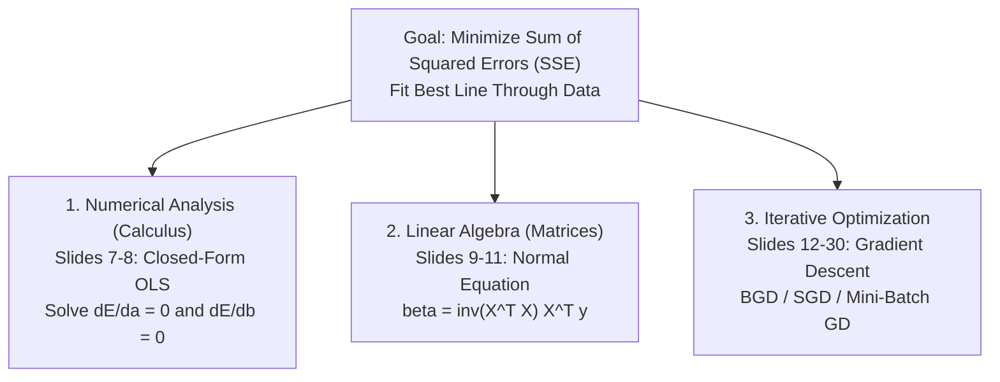

# Lecture 2 (Part 1): Linear Regression, Normal Equation & Gradient Descent

> [!info] Navigation & Course Materials
> - **Quiz Hub:** [[ML Quiz 1]] | **Previous:** [[1. Intro|Lectures 0 & 1: Intro to ML]] | **Next:** [[3. Logistic Regression, Bias-Variance & Regularization]]
> - **Related Class Note:** [[No Fking Clue|Epochs vs. Batches vs. Iterations]]
> - **Source Slides:** [[ML_Lecture 2.pdf]] (Slides 1–33)

---

## 1. What is Regression & The Notation Rosetta Stone (Slides 1–6)

### 1.1 Intuition & Historical Background (Slides 3–4)
- **Origin:** What we know today as **regression** was invented by **Francis Galton** (cousin of Charles Darwin).
- **Definition:** Regression is a **parametric supervised learning technique** used to predict a **continuous (dependent) real-valued output** ($y \in \mathbb{R}$) given a set of independent input variables ($x$).
  - *"Parametric"* means we commit to a fixed mathematical formula with a fixed number of adjustable numbers (**parameters**) — unlike non-parametric models whose size grows with the dataset.
- **Motivating Example (Slide 4):** Predicting **House Price in \$1000s ($Y$)** from **Square Feet ($X$)** using a straight line:
  $$y(x) = w_0 + w_1 x$$

![[lec2_slide04_house_price_table.png]]

---

### 1.2 Formal Supervised Regression Notation & Noise (Slide 5)
- Given $N$ labeled training examples $\{(x^{(i)}, y^{(i)})\}_{i=1}^N$:
  - $N$ (or $m$) = total number of training examples/instances.
  - $x_j^{(n)}$ = value of feature $j$ in training example $n$, where $x^{(n)}$ is a $d$-dimensional feature vector $(x_1, x_2, \dots, x_d)$.
  - $y^{(n)} \in \mathbb{R}$ = continuous target output.
  - $(x^{(n)}, y^{(n)})$ = one **training example**; the full collection is the **training set**.
- **Linear Hypothesis with Noise:**
  $$g_{w,b}(x) = wx + b + \epsilon$$
  where $w = (w_1, \dots, w_d)$ is the **$d$-dimensional weight vector**, $b \in \mathbb{R}$ is the **bias (intercept)**, and $\epsilon$ represents random **noise** in real-world observations.

---

### 1.3 The Parameter Notation Rosetta Stone (Slide 6 + Sir's Handwritten Annotations)

![[lec2_slide06_lr_fit_annotations.png]]

> [!tip] Don't Get Confused by Changing Symbols Across Lecture 2!
> On the right side of Slide 6, Dr. Hasan Mahmud hand-wrote all the equivalent parameter symbols used across different parts of the lecture (because the slides synthesize Alpaydin, Bishop, and Andrew Ng). **They all describe the exact same straight line $\text{Prediction} = \text{Intercept} + \text{Slope} \cdot x$!**

| Slide Range | Section / Textbook Flavor | Hypothesis Formula | Intercept (Bias) | Slope (Weight) | Cost / Error Formula |
| :--- | :--- | :--- | :---: | :---: | :--- |
| **Slide 4** | Regression Intro | $y(x) = w_0 + w_1 x$ | $w_0$ | $w_1$ | — |
| **Slides 5–6** | Parametric Linear Model | $g_{w,b}(x) = wx + b$ | $b$ | $w$ | $E(g\mid X) = \frac{1}{N}\sum_{i=1}^N [y^{(i)} - (wx^{(i)}+b)]^2$ |
| **Slides 7–8** | Numerical Analysis (OLS) | $y(x) = a + bx$ | $a$ | $b$ | $E(a,b) = \sum_{n=1}^N (y^n - a - bx^n)^2$ *(SSE)* |
| **Slides 9–11** | Linear Algebra (Normal Eq.) | $\vec{y} = X\vec{\beta}$ *(i.e. $\beta_0 + \beta_1 x_i$)* | $\beta_0$ | $\beta_1$ | $\sum \varepsilon_i^2 = \sum (y_i - (\beta_0 + \beta_1 x_i))^2$ |
| **Slides 13–22, 28–32** | Gradient Descent (Ng style) | $h_\theta(x) = \theta_0 + \theta_1 x = \boldsymbol{\theta}^T\mathbf{x}$ | $\theta_0$ | $\theta_1$ | $J(\theta_0,\theta_1) = \frac{1}{2m}\sum_{i=1}^m (h_\theta(x^{(i)}) - y^{(i)})^2$ |
| **Slides 23–26** | SGD & BGD Worked Tables | $\hat{y} = w_0 + w_1 x_1 + w_2 x_2$ | $w_0$ | $w_1, w_2$ | $L^{(i)} = \frac{1}{2}(\hat{y}^{(i)}-y^{(i)})^2$ *(SGD)*; $\text{MSE}$ *(BGD)* |

---

### 1.4 Three Ways to Find Optimal Parameters in Linear Regression



---

## 2. Method 1: Through Numerical Analysis — Closed-Form OLS (Slides 7–8)

### 2.1 Geometric Meaning of Ordinary Least Squares (Slide 7)

![[lec2_slide07_ols_residuals.png]]

For a line $y(x) = a + bx$, the error on data point $n$ is the **vertical distance (residual)** between the observed value $y^n$ and the line's prediction $y(x^n) = a + bx^n$.
We sum the squares of all vertical residuals to get the **Sum of Squared Errors (SSE)** — called **Ordinary Least Squares (OLS)**:
$$E(a, b) = \sum_{n=1}^N \bigl[y^n - y(x^n)\bigr]^2 = \sum_{n=1}^N (y^n - a - bx^n)^2$$
*(Why square the errors instead of just adding them? Because positive and negative vertical deviations would cancel out!)*

---

### 2.2 Complete Step-by-Step Closed-Form Derivation (Slide 8)

![[lec2_slide08_ols_derivation.png]]

To minimize $E(a, b)$ using calculus, we take partial derivatives with respect to both parameters $a$ and $b$, and set them equal to $0$:

**Step 1 — Differentiate with respect to $a$ and $b$:**
$$\frac{\partial}{\partial a}E(a, b) = -2\sum_{n=1}^N (y^n - a - bx^n) = 0$$
$$\frac{\partial}{\partial b}E(a, b) = -2\sum_{n=1}^N (y^n - a - bx^n)x^n = 0$$

**Step 2 — Introduce the Empirical Average Notation $\langle \cdot \rangle$:**
Divide both equations by $-2N$, defining the average over the $N$ training points as $\langle f(x, y) \rangle \equiv \frac{1}{N}\sum_{n=1}^N f(x^n, y^n)$:
1. From $\frac{\partial E}{\partial a} = 0$:
   $$\langle y \rangle - a - b\langle x \rangle = 0 \implies \boxed{a = \langle y \rangle - b\langle x \rangle}$$
2. From $\frac{\partial E}{\partial b} = 0$:
   $$\langle xy \rangle - a\langle x \rangle - b\langle x^2 \rangle = 0$$

**Step 3 — Substitute $a = \langle y \rangle - b\langle x \rangle$ into the second equation to solve for $b$:**
$$b\langle x^2 \rangle = \langle xy \rangle - \langle x \rangle\bigl(\langle y \rangle - b\langle x \rangle\bigr)$$
$$b\langle x^2 \rangle = \langle xy \rangle - \langle x \rangle\langle y \rangle + b\langle x \rangle^2$$
Move $b\langle x \rangle^2$ to the left side and factor out $b$:
$$b\bigl[\langle x^2 \rangle - \langle x \rangle^2\bigr] = \langle xy \rangle - \langle x \rangle\langle y \rangle$$

**Final Closed-Form OLS Formulas:**
$$\boxed{b = \frac{\langle xy \rangle - \langle x \rangle\langle y \rangle}{\langle x^2 \rangle - \langle x \rangle^2}}, \qquad \boxed{a = \langle y \rangle - b\langle x \rangle}$$

> [!tip] Statistical Meaning ($E(\cdot)$ Expectation Refresher)
> In expectation notation where $\langle \cdot \rangle \equiv E(\cdot)$ (the empirical mean $\frac{1}{N}\sum$):
> - **Variance:** $\text{Var}(x) = E\bigl[(x - E(x))^2\bigr] = E(x^2) - [E(x)]^2 = \langle x^2 \rangle - \langle x \rangle^2$
> - **Covariance:** $\text{Cov}(x, y) = E\bigl[(x - E(x))(y - E(y))\bigr] = E(xy) - E(x)E(y) = \langle xy \rangle - \langle x \rangle\langle y \rangle$
>
> So the OLS slope is simply:
> $$b = \frac{\text{Cov}(x, y)}{\text{Var}(x)} = \frac{E(xy) - E(x)E(y)}{E(x^2) - [E(x)]^2}$$
> And $a = E(y) - b\,E(x)$ guarantees the OLS regression line **always passes directly through the centroid $(E(x), E(y))$**.

---

## 3. Method 2: Through Linear Algebra — The Normal Equation (Slides 9–11)

### 3.1 Matrix Setup (Slides 9–10)

![[lec2_slide09_linalg_setup.png]]

For $n$ data points $(x_1, y_1), \dots, (x_n, y_n)$ with residual errors $\varepsilon_i = y_i - (\beta_0 + \beta_1 x_i)$, we want the predicted vector to be as close as possible to the target vector $\vec{y}$:

$$\underbrace{\begin{bmatrix} 1 & x_1 \\ 1 & x_2 \\ \vdots & \vdots \\ 1 & x_n \end{bmatrix}}_{X \ [n \times 2]} \underbrace{\begin{bmatrix} \beta_0 \\ \beta_1 \end{bmatrix}}_{\vec{\beta} \ [2 \times 1]} \approx \underbrace{\begin{bmatrix} y_1 \\ y_2 \\ \vdots \\ y_n \end{bmatrix}}_{\vec{y} \ [n \times 1]}$$

Notice the **column of $1$s** in the design matrix $X$! Why is it there? Because multiplying row $i$ $[1, x_i]$ by $[\beta_0, \beta_1]^T$ produces $1 \cdot \beta_0 + x_i \cdot \beta_1 = \beta_0 + \beta_1 x_i$.

---

### 3.2 Deriving the Normal Equation (Slide 11)

![[lec2_slide11_normal_equation.png]]

Because $X$ is a tall rectangular matrix ($n \times 2$, where typically $n \gg 2$), **$X$ does not have an inverse!**
How do we turn $X$ into a square invertible matrix? **Left-multiply both sides of $X\vec{\beta} = \vec{y}$ by $X^T$ ($[2 \times n]$):**

$$X^T X \vec{\beta} = X^T \vec{y}$$

Let's inspect the exact matrix products and dimensions from Slide 11:
1. **$X^T X$ (Square Symmetric Matrix $[2 \times 2]$):**
   $$X^T X = \underbrace{\begin{bmatrix} 1 & 1 & \dots & 1 \\ x_1 & x_2 & \dots & x_n \end{bmatrix}}_{[2 \times n]} \underbrace{\begin{bmatrix} 1 & x_1 \\ 1 & x_2 \\ \vdots & \vdots \\ 1 & x_n \end{bmatrix}}_{[n \times 2]} = \underbrace{\begin{bmatrix} N & \sum x_i \\ \sum x_i & \sum x_i^2 \end{bmatrix}}_{[2 \times 2]}$$
2. **$X^T \vec{y}$ (Column Vector $[2 \times 1]$):**
   $$X^T \vec{y} = \underbrace{\begin{bmatrix} 1 & 1 & \dots & 1 \\ x_1 & x_2 & \dots & x_n \end{bmatrix}}_{[2 \times n]} \underbrace{\begin{bmatrix} y_1 \\ y_2 \\ \vdots \\ y_n \end{bmatrix}}_{[n \times 1]} = \underbrace{\begin{bmatrix} \sum y_i \\ \sum x_i y_i \end{bmatrix}}_{[2 \times 1]}$$

Assuming $X^T X$ is invertible, multiply both sides by $(X^T X)^{-1}$ to obtain **The Normal Equation**:

$$\boxed{\vec{\beta} = (X^T X)^{-1} X^T \vec{y}}$$

For univariate regression ($[2 \times 2]$ case):
$$\begin{bmatrix} \beta_0 \\ \beta_1 \end{bmatrix} = \begin{bmatrix} N & \sum x_i \\ \sum x_i & \sum x_i^2 \end{bmatrix}^{-1} \begin{bmatrix} \sum y_i \\ \sum x_i y_i \end{bmatrix}$$

> [!tip] Fast $2 \times 2$ Inverse Shortcut for Quizzes
> For any $2 \times 2$ matrix $A = \begin{bmatrix} p & q \\ r & s \end{bmatrix}$, its inverse is:
> $$A^{-1} = \frac{1}{ps - qr} \begin{bmatrix} s & -q \\ -r & p \end{bmatrix}$$
> *(Swap main diagonal entries, negate off-diagonal entries, divide by determinant $ps - qr$!)*

---

## 4. Method 3: Through Gradient Descent (Slides 12–21, 28)

Unlike closed-form formulas (which try to jump directly to the answer in one algebraic step), **Gradient Descent** starts with arbitrary initial guesses for the parameters and iteratively rolls downhill along the slope of the cost surface $J(\theta)$ until it reaches the minimum!

### 4.1 Univariate Setup & Cost Function (Slide 13)

![[lec2_slide13_univariate_cost_annotations.png]]

- **Hypothesis:** $h_\theta(x) = \theta_0 + \theta_1 x$ (with parameter vector $\Theta = [\theta_0, \theta_1]$).
- **Cost Function (Half-MSE):**
  $$J(\theta_0, \theta_1) = \frac{1}{2m} \sum_{i=1}^m \bigl(y_i - h_\theta(x_i)\bigr)^2 = \frac{1}{2m} \sum_{i=1}^m \bigl(h_\theta(x_i) - y_i\bigr)^2$$
- **Why is there a $\frac{1}{2}$ in $\frac{1}{2m}$?** Purely for derivative convenience! When you differentiate a squared term $(\dots)^2$, the exponent $2$ drops down and cancels $\frac{1}{2}$ ($2 \cdot \frac{1}{2m} = \frac{1}{m}$). Minimizing $\frac{1}{2}\text{MSE}$ gives the **exact same optimal parameters $(\theta_0^*, \theta_1^*)$** as minimizing $\text{MSE}$ or $\text{SSE}$.

---

### 4.2 Complete Derivation of $\frac{\partial J}{\partial \theta_0}$ and $\frac{\partial J}{\partial \theta_1}$ (Slides 14–15)

#### Derivation 1: Partial Derivative with Respect to Intercept $\theta_0$ (Slide 14)

![[lec2_slide14_intercept_derivative.png]]

$$\begin{aligned}
\frac{\partial J}{\partial \theta_0} &= \frac{\partial}{\partial \theta_0}\left[\frac{1}{2m}\sum_{i=1}^m \bigl(y_i - (\theta_0 + \theta_1 x_i)\bigr)^2\right] \\
&= \frac{1}{2m}\sum_{i=1}^m \frac{\partial}{\partial \theta_0}\bigl[(y_i - \theta_0 - \theta_1 x_i)^2\bigr] \\
&= \frac{1}{2m}\sum_{i=1}^m 2(y_i - \theta_0 - \theta_1 x_i) \cdot \frac{\partial}{\partial \theta_0}(y_i - \theta_0 - \theta_1 x_i) \quad \text{(Chain Rule)} \\
&= \frac{1}{2m}\sum_{i=1}^m 2(y_i - \theta_0 - \theta_1 x_i) \cdot (-1) \quad \left(\text{since } \frac{\partial}{\partial \theta_0}(-\theta_0) = -1\right) \\
&= \frac{1}{m}\sum_{i=1}^m \bigl(-(y_i - \theta_0 - \theta_1 x_i)\bigr) \\
&= \frac{1}{m}\sum_{i=1}^m \bigl((\theta_0 + \theta_1 x_i) - y_i\bigr) \\
\Aboxed{\frac{\partial J}{\partial \theta_0} &= \frac{1}{m}\sum_{i=1}^m \bigl(h_\theta(x_i) - y_i\bigr)}
\end{aligned}$$

- **Intuition (Slide 14 Box):** $\frac{\partial J}{\partial \theta_0}$ is simply the **average of $(\text{predicted} - \text{actual})$** over all examples.
  - If average error is **positive** ($h_\theta(x) > y$), predictions are too high $\implies$ Gradient Descent subtracts a positive step, **decreasing** the intercept $\theta_0$.
  - If **negative**, predictions are too low $\implies$ Gradient Descent **increases** $\theta_0$.

---

#### Derivation 2: Partial Derivative with Respect to Slope $\theta_1$ (Slide 15)

![[lec2_slide15_slope_derivative_sketch.png]]

$$\begin{aligned}
\frac{\partial J}{\partial \theta_1} &= \frac{\partial}{\partial \theta_1}\left[\frac{1}{2m}\sum_{i=1}^m \bigl(y_i - (\theta_0 + \theta_1 x_i)\bigr)^2\right] \\
&= \frac{1}{2m}\sum_{i=1}^m \frac{\partial}{\partial \theta_1}\bigl[(y_i - \theta_0 - \theta_1 x_i)^2\bigr] \\
&= \frac{1}{2m}\sum_{i=1}^m 2(y_i - \theta_0 - \theta_1 x_i) \cdot \frac{\partial}{\partial \theta_1}(y_i - \theta_0 - \theta_1 x_i) \quad \text{(Chain Rule)} \\
&= \frac{1}{2m}\sum_{i=1}^m 2(y_i - \theta_0 - \theta_1 x_i) \cdot (-x_i) \quad \left(\text{since } \frac{\partial}{\partial \theta_1}(-\theta_1 x_i) = -x_i\right) \\
&= \frac{1}{m}\sum_{i=1}^m \bigl(-x_i(y_i - \theta_0 - \theta_1 x_i)\bigr) \\
&= \frac{1}{m}\sum_{i=1}^m x_i\bigl((\theta_0 + \theta_1 x_i) - y_i\bigr) \\
\Aboxed{\frac{\partial J}{\partial \theta_1} &= \frac{1}{m}\sum_{i=1}^m x_i\bigl(h_\theta(x_i) - y_i\bigr)}
\end{aligned}$$

- **Intuition (Slide 15 Box):** $\frac{\partial J}{\partial \theta_1}$ is the average of $(\text{prediction error}) \times (\text{input } x_i)$.
  - $x_i$ acts as a **weighting (leverage) factor**: points at large $x_i$ have much more leverage on rotating the slope $\theta_1$.
  - If the model under-predicts at large positive $x_i$, $(h_\theta(x_i) - y_i)x_i < 0$, so subtracting $\alpha \frac{\partial J}{\partial \theta_1}$ **increases $\theta_1$** (steeper upward slope).

---

### 4.3 Simultaneous Gradient Descent Update & The Implementation Trap (Slides 16 & 28)

![[lec2_slide16_univariate_gd_annotations.png]]

The Gradient Descent algorithm repeats until convergence:
$$\theta_0 := \theta_0 - \alpha \frac{1}{m}\sum_{i=1}^m \bigl(h_\theta(x^{(i)}) - y^{(i)}\bigr)$$
$$\theta_1 := \theta_1 - \alpha \frac{1}{m}\sum_{i=1}^m \bigl(h_\theta(x^{(i)}) - y^{(i)}\bigr)x^{(i)}$$
where $\alpha > 0$ is the **Learning Rate** (controls step size; typically small values like $0.001, 0.01, 0.1$).

> [!error] Exam Trap — Correct vs. Incorrect Implementation (Slide 28)
> Both $\theta_0$ and $\theta_1$ MUST be updated **simultaneously** using temporary variables (`temp0`, `temp1`), so both partial derivatives evaluate $J$ at the **same old $(\theta_0, \theta_1)$**:
>
> **CORRECT (Simultaneous Update):**
> ```text
> temp0 := θ0 - α * (∂/∂θ0) J(θ0, θ1)
> temp1 := θ1 - α * (∂/∂θ1) J(θ0, θ1)   // uses OLD θ0!
> θ0    := temp0
> θ1    := temp1
> ```
>
> **INCORRECT (Sequential / Buggy Update):**
> ```text
> temp0 := θ0 - α * (∂/∂θ0) J(θ0, θ1)
> θ0    := temp0                        // overwrites θ0 TOO EARLY!
> temp1 := θ1 - α * (∂/∂θ1) J(θ0, θ1)   // BUG: uses NEW θ0 inside h_θ(x)!
> θ1    := temp1
> ```

---

### 4.4 Multivariate Linear Regression & Vectorization (Slides 17–21)

When predicting a target from $n$ features (e.g., Slide 17's house dataset: $x_1=$ Area of site, $x_2=$ Size of living place, $x_3=$ Number of rooms, $x_4=$ Age in years):

![[lec2_slide17_multivariate_table.png]]

- **Indexing Convention (Slide 17):**
  - $n =$ number of features ($4$ on Slide 17).
  - $m =$ number of training examples (rows).
  - $\mathbf{x}^{(i)} =$ column vector of all input features for the **$i$-th training example** (e.g., $x^{(3)} = [2.275, 1.175, 6, 40]^T$).
  - $x_j^{(i)} =$ value of **feature $j$** in the **$i$-th training example** (e.g., $x_2^{(4)} = 1.232$).

![[lec2_slide18_multivariate_vectorized.png]]

By prepending a **bias dummy feature $x_0^{(i)} = 1$** to every example $\mathbf{x}^{(i)}$, we unify the intercept $\theta_0$ and feature weights $\theta_1, \dots, \theta_n$ into one clean dot product:

$$\mathbf{x}^{(i)} = \begin{bmatrix} x_0^{(i)} \\ x_1^{(i)} \\ \vdots \\ x_n^{(i)} \end{bmatrix} \quad (\text{with } x_0^{(i)} = 1), \qquad \boldsymbol{\theta} = \begin{bmatrix} \theta_0 \\ \theta_1 \\ \vdots \\ \theta_n \end{bmatrix}$$

- **Vectorized Hypothesis:**
  $$h_\theta(\mathbf{x}^{(i)}) = \boldsymbol{\theta}^T\mathbf{x}^{(i)} = \theta_0(1) + \theta_1 x_1^{(i)} + \theta_2 x_2^{(i)} + \dots + \theta_n x_n^{(i)}$$
- **Cost Function:**
  $$J(\boldsymbol{\theta}) = \frac{1}{2m}\sum_{i=1}^m \bigl(y^{(i)} - \boldsymbol{\theta}^T\mathbf{x}^{(i)}\bigr)^2$$
- **Unified Partial Derivative (Slide 19 — works for ALL $j = 0, 1, \dots, n$!):**
  $$\frac{\partial J}{\partial \theta_j} = \frac{1}{2m}\sum_{i=1}^m 2\bigl(y^{(i)} - \boldsymbol{\theta}^T\mathbf{x}^{(i)}\bigr)\bigl(-x_j^{(i)}\bigr) = \boxed{\frac{1}{m}\sum_{i=1}^m \bigl(h_\theta(\mathbf{x}^{(i)}) - y^{(i)}\bigr)x_j^{(i)}}$$
  Notice how setting $j=0$ gives $x_0^{(i)} = 1$, automatically recovering $\frac{\partial J}{\partial \theta_0} = \frac{1}{m}\sum (h_\theta(\mathbf{x}^{(i)}) - y^{(i)})$!

![[lec2_slide21_uni_vs_multi_sketches.png]]

---

## 5. Batch GD vs. Stochastic GD (SGD) vs. Mini-Batch GD & Worked Numerical Examples (Slides 20, 22–27)

### 5.1 Epochs vs. Batches vs. Iterations (Slide 22 + In-Class Note `No Fking Clue.md`)

![[lec2_slide22_batch_vs_sgd_annotations.png]]

> [!important] Master Formula (From Your Class Note & Slide 22 Red Ink)
> - **Epoch:** **One full pass** over the entire training dataset ($m$ examples).
> - **Batch Size ($B$):** Number of training examples examined before making **1 parameter update**.
> - **Iteration:** **One single parameter update step** ($\boldsymbol{\theta} \leftarrow \boldsymbol{\theta} - \alpha \nabla J$).
>
> $$\boxed{\text{Iterations} = \text{Epochs} \times \text{Batches per Epoch} = \text{Epochs} \times \left\lceil \frac{m}{B} \right\rceil}$$

| Gradient Descent Variant | How Many Samples Per Update? | Update Formula (Simultaneous $\forall j$) | Path to Minimum & Key Properties |
| :--- | :--- | :--- | :--- |
| **1. Batch Gradient Descent (BGD / "Vanilla")** | **All $m$ examples** (*"many-at-a-time"*)<br>($1\text{ Epoch} = 1\text{ Iteration}$) | $\theta_j := \theta_j - \alpha \dfrac{1}{m}\sum_{i=1}^m \bigl(h_\theta(\mathbf{x}^{(i)}) - y^{(i)}\bigr)x_j^{(i)}$ | Smooth, deterministic path directly downhill, but **very slow** per step on huge datasets ($m = 10^7$). |
| **2. Stochastic Gradient Descent (SGD)** | **Only $1$ example at a time** (*"one-at-a-time"*)<br>($1\text{ Epoch} = m\text{ Iterations}$) | $\theta_j := \theta_j - \alpha\bigl(h_\theta(\mathbf{x}^{(i)}) - y^{(i)}\bigr)x_j^{(i)}$ | Called **Least Mean Squares (LMS)** / **Widrow-Hoff learning rule** *(Slide 20)*. **Must randomly shuffle data before looping!** Path is noisy, but much faster training on big data. |
| **3. Mini-Batch Gradient Descent** | **$B$ examples** ($1 < B < m$, e.g., $B = 32, 64$)<br>($1\text{ Epoch} = \lceil m/B \rceil \text{ Iterations}$) | $\theta_j := \theta_j - \alpha\dfrac{1}{B}\sum_{i \in \text{batch}}\bigl(h_\theta(\mathbf{x}^{(i)}) - y^{(i)}\bigr)x_j^{(i)}$ | Best of both worlds: vectorized GPU speed + smoother updates than pure SGD. |

---

### 5.2 Worked Numerical Example 1: Stochastic Gradient Descent (SGD) (Slides 23–24)

![[lec2_slide23_sgd_numerical_example.png]]

Let's trace Slide 23 **line by line** so you can execute an SGD table on paper in the quiz without a single mistake!

- **Dataset ($N = 3$ samples, $2$ features $x_1, x_2$):**
  - Sample 1: $(x_1, x_2) = (2, 1),\; y = 5$
  - Sample 2: $(x_1, x_2) = (3, 2),\; y = 8$
  - Sample 3: $(x_1, x_2) = (1, 1),\; y = 3$
- **Initial Weights:** $(w_0, w_1, w_2) = (1, 0, 0)$ | **Learning Rate:** $\alpha = 0.1$
- **Hypothesis:** $\hat{y} = w_0 + w_1 x_1 + w_2 x_2$
- **SGD Weight Update Formulas (for each sample $i$):**
  $$\Delta w_0 = -\alpha(\hat{y} - y)\cdot 1, \qquad \Delta w_1 = -\alpha(\hat{y} - y)\cdot x_1, \qquad \Delta w_2 = -\alpha(\hat{y} - y)\cdot x_2$$
  $$\mathbf{w}^{\text{new}} = \mathbf{w}^{\text{old}} + \Delta\mathbf{w}$$

> [!error] #1 Exam Rule for SGD Tables
> In **SGD**, as soon as you finish Sample 1, **immediately pass its New Weights into Sample 2 as Old Weights!** Never keep the weights frozen inside an SGD epoch!

#### **Epoch 1 Trace (Iterations 1–3):**
1. **Sample 1** $(x_1=2, x_2=1, y=5)$, Old Weights $(1.00, 0.00, 0.00)$:
   - $\hat{y} = 1 + 0(2) + 0(1) = \mathbf{1.0}$
   - $\text{Error } (\hat{y} - y) = 1.0 - 5 = \mathbf{-4.0}$
   - $\Delta w_0 = -0.1(-4)(1) = +0.40$, $\;\Delta w_1 = -0.1(-4)(2) = +0.80$, $\;\Delta w_2 = -0.1(-4)(1) = +0.40$
   - **New Weights:** $(1+0.40,\; 0+0.80,\; 0+0.40) = \mathbf{(1.40,\; 0.80,\; 0.40)}$ $\longrightarrow$ *passed immediately to Sample 2!*
   - Step Half-Squared Loss: $L^{(1)} = \frac{1}{2}(-4)^2 = \mathbf{8.0000}$

2. **Sample 2** $(x_1=3, x_2=2, y=8)$, Old Weights $(1.40, 0.80, 0.40)$:
   - $\hat{y} = 1.40 + 0.80(3) + 0.40(2) = 1.40 + 2.40 + 0.80 = \mathbf{4.60}$
   - $\text{Error } (\hat{y} - y) = 4.60 - 8 = \mathbf{-3.40}$
   - $\Delta w_0 = -0.1(-3.4)(1) = +0.34$, $\;\Delta w_1 = -0.1(-3.4)(3) = +1.02$, $\;\Delta w_2 = -0.1(-3.4)(2) = +0.68$
   - **New Weights:** $(1.40+0.34,\; 0.80+1.02,\; 0.40+0.68) = \mathbf{(1.74,\; 1.82,\; 1.08)}$ $\longrightarrow$ *passed immediately to Sample 3!*
   - Step Half-Squared Loss: $L^{(2)} = \frac{1}{2}(-3.4)^2 = \mathbf{5.7800}$

3. **Sample 3** $(x_1=1, x_2=1, y=3)$, Old Weights $(1.74, 1.82, 1.08)$:
   - $\hat{y} = 1.74 + 1.82(1) + 1.08(1) = \mathbf{4.64}$
   - $\text{Error } (\hat{y} - y) = 4.64 - 3 = \mathbf{+1.64}$
   - $\Delta w_0 = -0.1(1.64)(1) = -0.164$, $\;\Delta w_1 = -0.1(1.64)(1) = -0.164$, $\;\Delta w_2 = -0.1(1.64)(1) = -0.164$
   - **New Weights (End of Epoch 1):** $\mathbf{(1.576,\; 1.656,\; 0.916)}$
   - Step Half-Squared Loss: $L^{(3)} = \frac{1}{2}(1.64)^2 = \mathbf{1.3448}$

- **Epoch 1 Average SGD Loss (Slide 24):**
  $$J_{\text{Epoch 1}} = \frac{8.0000 + 5.7800 + 1.3448}{3} = \frac{15.1248}{3} = \mathbf{5.0416}$$

#### **Epoch 2 Trace (Iterations 4–6, continuing from $(1.576, 1.656, 0.916)$):**
- **Sample 1:** $\hat{y} = 1.576 + 1.656(2) + 0.916(1) = 5.804 \implies \text{Err} = +0.804 \implies \Delta\mathbf{w} = (-0.0804, -0.1608, -0.0804) \implies \mathbf{w} = (1.4956, 1.4952, 0.8356)$, $\;L^{(4)} = 0.3232$.
- **Sample 2:** $\hat{y} = 1.4956 + 1.4952(3) + 0.8356(2) = 7.6696 \implies \text{Err} = -0.3304 \implies \Delta\mathbf{w} = (+0.03304, +0.09912, +0.06608) \implies \mathbf{w} = (1.52864, 1.59432, 0.90168)$, $\;L^{(5)} = 0.0546$.
- **Sample 3:** $\hat{y} = 1.52864 + 1.59432(1) + 0.90168(1) = 4.02464 \implies \text{Err} = +1.02464 \implies \Delta\mathbf{w} = (-0.10246, -0.10246, -0.10246) \implies \mathbf{w} = \mathbf{(1.42618, 1.49186, 0.79922)}$, $\;L^{(6)} = 0.5249$.
- **Epoch 2 Average SGD Loss:** $J_{\text{Epoch 2}} = \frac{0.3232 + 0.0546 + 0.5249}{3} = \frac{0.9027}{3} = \mathbf{0.3009}$.

![[lec2_slide24_sgd_loss_curve.png]]

---

### 5.3 Worked Numerical Example 2: Batch Gradient Descent (BGD) (Slides 25–26)

![[lec2_slide25_bgd_numerical_example.png]]

> [!error] #1 Exam Rule for BGD Tables
> In **BGD**, **ALL samples in an epoch share the EXACT SAME frozen Old Weights!** You compute $(\hat{y}^{(i)} - y^{(i)})\cdot x_j^{(i)}$ for all $3$ samples, **sum and divide by $N=3$**, and update the weights **ONLY ONCE** at the end of the epoch!

#### **Epoch 1 Trace (1 Iteration, Frozen Old Weights $= (1.0, 0.0, 0.0)$):**
1. **Sample 1** $(2, 1, y=5)$: $\hat{y} = 1 + 0(2) + 0(1) = 1 \implies \text{Err} = 1 - 5 = -4$.
   - Gradient terms: $\text{Err}\cdot 1 = -4$, $\;\text{Err}\cdot x_1 = -8$, $\;\text{Err}\cdot x_2 = -4$.
2. **Sample 2** $(3, 2, y=8)$: $\hat{y} = 1 + 0(3) + 0(2) = 1 \implies \text{Err} = 1 - 8 = -7$. *(Still uses $(1,0,0)$!)*
   - Gradient terms: $\text{Err}\cdot 1 = -7$, $\;\text{Err}\cdot x_1 = -21$, $\;\text{Err}\cdot x_2 = -14$.
3. **Sample 3** $(1, 1, y=3)$: $\hat{y} = 1 + 0(1) + 0(1) = 1 \implies \text{Err} = 1 - 3 = -2$. *(Still uses $(1,0,0)$!)*
   - Gradient terms: $\text{Err}\cdot 1 = -2$, $\;\text{Err}\cdot x_1 = -2$, $\;\text{Err}\cdot x_2 = -2$.
4. **End-of-Epoch 1 Average Gradient & Weight Update:**
   - **Sum of gradient terms:** $(-4-7-2,\; -8-21-2,\; -4-14-2) = (-13,\; -31,\; -20)$
   - **Average Gradient ($\div 3$):** $(-4.333,\; -10.333,\; -6.667)$
   - **Update $\Delta\mathbf{w} = -\alpha \cdot \text{Avg. Grad}$ ($\alpha=0.1$):** $(+0.433,\; +1.033,\; +0.667)$
   - **New Weights (End of Epoch 1):** $(1.0+0.433,\; 0+1.033,\; 0+0.667) = \mathbf{(1.433,\; 1.033,\; 0.667)}$
- **Epoch 1 BGD Loss (MSE, Slide 26):**
  $$\text{MSE}_{\text{Epoch 1}} = \frac{(-4)^2 + (-7)^2 + (-2)^2}{3} = \frac{16 + 49 + 4}{3} = \frac{69}{3} = \mathbf{23.000}$$

#### **Epoch 2 Trace (Frozen Old Weights $= (1.433, 1.033, 0.667)$):**
- **Sample 1:** $\hat{y} = 1.433 + 1.033(2) + 0.667(1) = 4.166 \implies \text{Err} = -0.834 \implies (-0.834, -1.668, -0.834)$
- **Sample 2:** $\hat{y} = 1.433 + 1.033(3) + 0.667(2) = 6.466 \implies \text{Err} \approx -1.54 \implies (-1.54, -4.62, -3.08)$
- **Sample 3:** $\hat{y} = 1.433 + 1.033(1) + 0.667(1) = 3.133 \implies \text{Err} = +0.133 \implies (+0.133, +0.133, +0.133)$
- **Sum:** $(-2.241, -6.155, -3.781)$ $\xrightarrow{\div 3}$ **Avg Grad:** $(-0.747, -2.052, -1.260)$ $\xrightarrow{\times (-0.1)}$ **Update:** $(+0.075, +0.205, +0.126)$
- **New Weights (End of Epoch 2):** $\mathbf{(1.508,\; 1.238,\; 0.793)}$
- **Epoch 2 BGD Loss (MSE):** $\frac{0.696 + 2.372 + 0.018}{3} \approx \mathbf{1.0284}$ *(note Slide 26 uses exact unrounded values giving $23.0062$ / $1.0284$ across 4 epochs: $23.0062 \to 1.0284 \to 0.0460 \to 0.0021$)*.

![[lec2_slide26_bgd_loss_curve.png]]

---

### 5.4 SGD vs. BGD Loss Curves Showdown (Slide 27)

![[lec2_slide27_sgd_vs_bgd_loss.png]]

Look carefully at the crossover in Slide 27's plot:
- **At Epoch 1:** SGD Average Loss ($5.0416$) is **much lower** than BGD MSE ($23.0062$), because SGD already updated its weights twice *during* Epoch 1 before evaluating Samples 2 and 3, whereas BGD evaluated all 3 samples at the terrible initial weights $(1,0,0)$.
- **At Epochs 3–4:** BGD ($0.0460 \to \mathbf{0.0021}$) drops cleanly below SGD ($0.2688 \to 0.2364$) and converges tightly to the exact global minimum, whereas SGD continues bouncing noisily around the minimum due to single-sample updates and constant $\alpha$.

---

## 6. Loss Functions, Learning Rate $\alpha$, Polynomial Regression & GD vs. Normal Equation (Slides 29–33)

### 6.1 MSE vs. MAE Loss — Answering Sir's Red-Ink Question (Slide 29)

![[lec2_slide29_mse_vs_mae_plot.png]]

On Slide 29, Dr. Hasan Mahmud hand-wrote in red ink: ***"When should we use which loss function?"*** Here is the complete exam answer:

| Property | MSE (Mean Squared Error) | MAE (Mean Absolute Error) |
| :--- | :--- | :--- |
| **Formula** | $\text{MSE} = \frac{1}{n}\sum_{i=1}^n (\hat{y}_i - y_i)^2$ | $\text{MAE} = \frac{1}{n}\sum_{i=1}^n \lvert \hat{y}_i - y_i \rvert$ |
| **Curve Shape (Slide 29)** | **U-shaped Parabola** (Quadratic penalty: error $= 10 \implies \text{penalty} = 100$) | **V-shaped Straight Lines** (Linear penalty: error $= 10 \implies \text{penalty} = 10$) |
| **Sensitivity to Outliers** | **Very sensitive** — squaring makes outliers dominate the gradient and pull the line toward them. | **Robust to outliers** — outliers exert only a constant-magnitude pull regardless of how extreme they are. |
| **Calculus / Optimization** | **Smooth and differentiable everywhere**; gradient scales nicely ($2(\hat{y}-y)$) so steps shrink smoothly near the minimum. | **Not differentiable at error $= 0$** (sharp V-corner); gradient magnitude stays constant everywhere else. |
| **When to Use It?** | **Use MSE** when data is clean/Gaussian, large errors are exponentially worse than small ones, and smooth optimization is desired. | **Use MAE** when your dataset contains **significant outliers** or noisy extreme spikes that must NOT distort the fitted line. |

---

### 6.2 Effect of Learning Rate $\alpha$ (Slide 30)

![[lec2_slide30_learning_rate.png]]

- **If $\alpha$ is too small:** Gradient descent takes tiny baby steps and converges **very slowly** (needs way more iterations/epochs).
- **If $\alpha$ is too large:** Gradient descent **overshoots** the valley floor, bounces back and forth up the opposite walls with increasing cost, and can **fail to converge / diverge**!

---

### 6.3 Polynomial Regression (Slide 31)

![[lec2_slide31_polynomial_regression.png]]

What if the relationship between $x$ and $y$ is curved, not straight? We can still use the **exact same Linear Regression machinery** by engineering polynomial features ($x^2, x^3, \dots$):
- **Linear Fit:** $h_\theta(x) = \theta_0 + \theta_1 x$ *(black line — underfits curved data)*
- **Quadratic Fit:** $h_\theta(x) = \theta_0 + \theta_1 x + \theta_2 x^2$ *(green curve)*
- **Cubic Fit:** $h_\theta(x) = \theta_0 + \theta_1 x + \theta_2 x^2 + \theta_3 x^3$ *(red curve)*

> [!warning] Overfitting Risk & Defense (Slide 31)
> Higher-order polynomials fit training curves more closely, **but risk severe overfitting** (memorizing noise instead of the true trend). **Cross-validation** is the standard method used to pick the right polynomial degree and prevent overfitting.

---

### 6.4 Gradient Descent vs. Normal Equation Showdown (Slide 32)

| Comparison Dimension | Gradient Descent | Normal Equation |
| :--- | :--- | :--- |
| **Update / Formula** | $\theta_j := \theta_j - \alpha \frac{\partial}{\partial \theta_j}J(\theta)$ | $\vec{\beta} = (X^T X)^{-1} X^T \vec{y}$ *(written $F_{\text{MLR}} = (X^TX)^{-1}X^T Y$ on slide)* |
| **How It Solves** | **Iterative** — needs many iterations to converge. | **One-step analytical** — jumps directly to exact global minimum. |
| **Need Learning Rate $\alpha$?** | **Yes** — must choose and tune $\alpha$. | **No** — zero hyperparameters needed! |
| **Large Number of Features ($n$)** | **Works well** even when $n$ is huge ($n = 10^5$ or $10^6$). | **Very slow** when $n$ is large (e.g., $n > 10,000$). |
| **Time Complexity** | **$O(n)$** per iteration *(or $O(mn)$ per epoch)*. | **$O(n^3)$** due to computing $(X^T X)^{-1}$! |
| **Non-Differentiable / General Models** | **Works** whenever gradients/subgradients exist (e.g., Logistic Regression, Neural Nets, MAE $\|y - f(x)\|$ where no closed form exists). | **Fails** if no closed-form solution exists (cannot be used for Logistic Regression!). |
| **Singular / Non-Invertible $X^T X$** | No matrix inversion required — unaffected! | Fails if $X^T X$ is **non-invertible (singular)** (caused by redundant/collinear features or $m \le n$); requires pseudoinverse (`pinv`) or removing redundant features. |

---

### 6.5 Advantages & Disadvantages of Linear Regression (Slide 33)

- **Advantages (Pros):**
  1. Simple to understand, explain, and interpret (each weight $\theta_j$ directly shows how feature $x_j$ affects $y$).
  2. Fast to train and fast to make predictions.
  3. Requires minimal/no hyperparameter tuning (unless adding regularization).
  4. Does not strictly require feature scaling (for closed-form OLS / Normal Equation, though scaling speeds up Gradient Descent!).
  5. Works well even on small datasets and is well-understood mathematically.
- **Disadvantages (Cons):**
  1. Assumes a **strictly linear** relationship between features and target.
  2. Often has **lower predictive accuracy** than more flexible non-linear algorithms due to high bias.
  3. **Cannot automatically capture feature interactions** (e.g., $x_1 \cdot x_2$) unless a human manually engineers those interaction features.

---

## 7. Practice Problems (Linear Regression & Gradient Descent)

> [!question]- Problem 1: Closed-Form OLS Derivation (Slide 8)
> Starting from the Sum of Squared Errors $E(a, b) = \sum_{n=1}^N (y^n - a - bx^n)^2$, derive the closed-form formulas for the intercept $a$ and slope $b$ using the average notation $\langle f(x, y) \rangle = \frac{1}{N}\sum_{n=1}^N f(x^n, y^n)$.
>
> > [!success]- Answer & Step-by-Step Solution
> > 1. Take partial derivatives and set to $0$:
> >    $$\frac{\partial E}{\partial a} = -2\sum_{n=1}^N (y^n - a - bx^n) = 0 \implies \frac{1}{N}\sum_{n=1}^N (y^n - a - bx^n) = 0$$
> >    $$\langle y \rangle - a - b\langle x \rangle = 0 \implies \mathbf{a = \langle y \rangle - b\langle x \rangle}$$
> > 2. Differentiate with respect to $b$:
> >    $$\frac{\partial E}{\partial b} = -2\sum_{n=1}^N (y^n - a - bx^n)x^n = 0 \implies \langle xy \rangle - a\langle x \rangle - b\langle x^2 \rangle = 0$$
> > 3. Substitute $a = \langle y \rangle - b\langle x \rangle$:
> >    $$\langle xy \rangle - (\langle y \rangle - b\langle x \rangle)\langle x \rangle - b\langle x^2 \rangle = 0$$
> >    $$\langle xy \rangle - \langle x \rangle\langle y \rangle = b\bigl(\langle x^2 \rangle - \langle x \rangle^2\bigr)$$
> >    $$\mathbf{b = \frac{\langle xy \rangle - \langle x \rangle\langle y \rangle}{\langle x^2 \rangle - \langle x \rangle^2}}$$

> [!question]- Problem 2: Hand-Computing OLS Regression Line (Slides 7–8)
> Given $N = 4$ training points: $(1, 3),\; (2, 5),\; (3, 7),\; (4, 9)$ *(wait—let's make it realistic with slight noise!)*:
> $$(x, y) \in \{(1, 2),\; (2, 4),\; (3, 5),\; (4, 8)\}$$
> 1. Compute $\langle x \rangle$, $\langle y \rangle$, $\langle x^2 \rangle$, and $\langle xy \rangle$.
> 2. Find the OLS slope $b$ and intercept $a$ for $y(x) = a + bx$.
> 3. Predict $y(5)$ and compute the total SSE $E(a, b)$ on the training set.
>
> > [!success]- Answer & Step-by-Step Solution
> > 1. **Compute Sums and Averages ($N = 4$):**
> >    - $\sum x = 1 + 2 + 3 + 4 = 10 \implies \langle x \rangle = \frac{10}{4} = \mathbf{2.5}$
> >    - $\sum y = 2 + 4 + 5 + 8 = 19 \implies \langle y \rangle = \frac{19}{4} = \mathbf{4.75}$
> >    - $\sum x^2 = 1 + 4 + 9 + 16 = 30 \implies \langle x^2 \rangle = \frac{30}{4} = \mathbf{7.5}$
> >    - $\sum xy = (1)(2) + (2)(4) + (3)(5) + (4)(8) = 2 + 8 + 15 + 32 = 57 \implies \langle xy \rangle = \frac{57}{4} = \mathbf{14.25}$
> > 2. **Solve for $b$ and $a$:**
> >    $$b = \frac{\langle xy \rangle - \langle x \rangle\langle y \rangle}{\langle x^2 \rangle - \langle x \rangle^2} = \frac{14.25 - (2.5)(4.75)}{7.5 - (2.5)^2} = \frac{14.25 - 11.875}{7.5 - 6.25} = \frac{2.375}{1.25} = \mathbf{1.9}$$
> >    $$a = \langle y \rangle - b\langle x \rangle = 4.75 - 1.9(2.5) = 4.75 - 4.75 = \mathbf{0.0}$$
> >    So the best-fit line is **$y(x) = 0 + 1.9x = 1.9x$**.
> > 3. **Prediction & SSE:**
> >    - $y(5) = 1.9(5) = \mathbf{9.5}$.
> >    - Predictions: $\hat{y} = [1.9, 3.8, 5.7, 7.6]$.
> >    - $\text{SSE} = (2 - 1.9)^2 + (4 - 3.8)^2 + (5 - 5.7)^2 + (8 - 7.6)^2 = 0.01 + 0.04 + 0.49 + 0.16 = \mathbf{0.70}$.

> [!question]- Problem 3: Solving Linear Regression via the Normal Equation (Slides 9–11 & Mid Exam Pattern)
> Using the exact same dataset $\{(1, 2), (2, 4), (3, 5), (4, 8)\}$ from Problem 2:
> 1. Construct the design matrix $X$ and target vector $\vec{y}$.
> 2. Compute $X^T X$ and $X^T \vec{y}$ explicitly.
> 3. Compute $(X^T X)^{-1}$ and solve $\vec{\beta} = (X^T X)^{-1} X^T \vec{y}$ to verify you get the exact same parameters $\beta_0 = a, \beta_1 = b$.
> 4. Using the learned model, predict $\hat{y}_{\text{new}}$ for input $\mathbf{x}_{\text{new}} = [1\;\; 5]$, and compute the **Mean Squared Error (MSE)** $= \frac{1}{n}\sum_{i=1}^n (y_i - \hat{y}_i)^2$ on the training data.
>
> > [!success]- Answer & Step-by-Step Solution
> > 1. **Design Matrix $X$ ($4 \times 2$) & Target Vector $\vec{y}$ ($4 \times 1$):**
> >    $$X = \begin{bmatrix} 1 & 1 \\ 1 & 2 \\ 1 & 3 \\ 1 & 4 \end{bmatrix}, \qquad \vec{y} = \begin{bmatrix} 2 \\ 4 \\ 5 \\ 8 \end{bmatrix}$$
> > 2. **Compute $X^T X$ and $X^T \vec{y}$:**
> >    $$X^T X = \begin{bmatrix} N & \sum x_i \\ \sum x_i & \sum x_i^2 \end{bmatrix} = \begin{bmatrix} 4 & 10 \\ 10 & 30 \end{bmatrix}$$
> >    $$X^T \vec{y} = \begin{bmatrix} \sum y_i \\ \sum x_i y_i \end{bmatrix} = \begin{bmatrix} 19 \\ 57 \end{bmatrix}$$
> > 3. **Invert $X^T X$ and Solve:**
> >    - Determinant: $\det(X^T X) = (4)(30) - (10)(10) = 120 - 100 = 20$.
> >    - Inverse:
> >      $$(X^T X)^{-1} = \frac{1}{20}\begin{bmatrix} 30 & -10 \\ -10 & 4 \end{bmatrix}$$
> >    - Multiply by $X^T \vec{y}$:
> >      $$\vec{\beta} = \frac{1}{20}\begin{bmatrix} 30 & -10 \\ -10 & 4 \end{bmatrix}\begin{bmatrix} 19 \\ 57 \end{bmatrix} = \frac{1}{20}\begin{bmatrix} 570 - 570 \\ -190 + 228 \end{bmatrix} = \frac{1}{20}\begin{bmatrix} 0 \\ 38 \end{bmatrix} = \begin{bmatrix} \mathbf{0.0} \\ \mathbf{1.9} \end{bmatrix}$$
> >    Matches Problem 2 identically: $\beta_0 = 0.0,\; \beta_1 = 1.9$!
> > 4. **Prediction & Training MSE:**
> >    - For $\mathbf{x}_{\text{new}} = [1\;\; 5]$: $\hat{y}_{\text{new}} = 0.0(1) + 1.9(5) = \mathbf{9.5}$.
> >    - Training predictions $\hat{y}_i = 1.9 x_i$: $[1.9,\; 3.8,\; 5.7,\; 7.6]$.
> >    - Residuals $y_i - \hat{y}_i$: $[0.1,\; 0.2,\; -0.7,\; 0.4]$.
> >    - $\text{MSE} = \dfrac{0.1^2 + 0.2^2 + (-0.7)^2 + 0.4^2}{4} = \dfrac{0.01 + 0.04 + 0.49 + 0.16}{4} = \dfrac{0.70}{4} = \mathbf{0.175}$.

> [!question]- Problem 4: Partial Derivatives & Why $\frac{1}{2}$ Is Used (Slides 13–15)
> 1. Derive $\frac{\partial J}{\partial \theta_0}$ and $\frac{\partial J}{\partial \theta_1}$ from $J(\theta_0, \theta_1) = \frac{1}{2m}\sum_{i=1}^m (y_i - (\theta_0 + \theta_1 x_i))^2$.
> 2. Suppose instead a textbook defines the MSE cost without the $\frac{1}{2}$ factor: $J_{\text{MSE}}(\theta) = \frac{1}{m}\sum_{i=1}^m (y_i - h_\theta(x_i))^2$. Write the resulting Gradient Descent update rule for $\theta_j$, and explain whether the optimal minimum $(\theta_0^*, \theta_1^*)$ changes.
>
> > [!success]- Answer & Step-by-Step Solution
> > 1. **Derivation:** Using the chain rule on $(y_i - \theta_0 - \theta_1 x_i)^2$:
> >    - $\frac{\partial J}{\partial \theta_0} = \frac{1}{2m}\sum_{i=1}^m 2(y_i - \theta_0 - \theta_1 x_i)(-1) = \frac{1}{m}\sum_{i=1}^m (h_\theta(x_i) - y_i)$
> >    - $\frac{\partial J}{\partial \theta_1} = \frac{1}{2m}\sum_{i=1}^m 2(y_i - \theta_0 - \theta_1 x_i)(-x_i) = \frac{1}{m}\sum_{i=1}^m x_i(h_\theta(x_i) - y_i)$
> > 2. **Without $\frac{1}{2}$:** A factor of $2$ remains in the derivative:
> >    $$\theta_j := \theta_j - \alpha \frac{2}{m}\sum_{i=1}^m \bigl(h_\theta(x^{(i)}) - y^{(i)}\bigr)x_j^{(i)}$$
> >    The **optimal minimum $(\theta_0^*, \theta_1^*)$ does NOT change**, because multiplying a cost function by a positive constant ($2$) only scales the steepness vertically without shifting where the minimum lies (and using $\alpha' = \alpha / 2$ yields identical gradient descent steps!).

> [!question]- Problem 5: Hand-Trace 1 Epoch of Stochastic Gradient Descent (SGD) (Slides 23–24)
> Given 3 training examples with 1 feature ($x_1$) and hypothesis $\hat{y} = w_0 + w_1 x_1$:
> - Sample 1: $x_1 = 1,\; y = 3$
> - Sample 2: $x_1 = 2,\; y = 5$
> - Sample 3: $x_1 = 3,\; y = 7$
>
> Initial weights: $w_0 = 0,\; w_1 = 0$, learning rate $\alpha = 0.1$.
> Perform **1 full epoch of SGD** (show $\hat{y}$, Error $(\hat{y}-y)$, $\Delta w_0$, $\Delta w_1$, New Weights after every sample, and compute the Epoch 1 Average Loss using $L^{(i)} = \frac{1}{2}(\hat{y}^{(i)} - y^{(i)})^2$).
>
> > [!success]- Answer & Step-by-Step Solution
> > Update rule per sample: $\Delta w_0 = -0.1(\hat{y} - y)$, $\;\Delta w_1 = -0.1(\hat{y} - y)x_1$.
> >
> > - **Sample 1** ($x_1=1, y=3$), Old Weights $(0.000, 0.000)$:
> >   - $\hat{y} = 0 + 0(1) = 0$
> >   - $\text{Err} = 0 - 3 = -3$
> >   - $\Delta w_0 = -0.1(-3) = +0.300$, $\;\Delta w_1 = -0.1(-3)(1) = +0.300$
> >   - **New Weights:** $(0.300,\; 0.300)$
> >   - $L^{(1)} = 0.5(-3)^2 = \mathbf{4.5000}$
> >
> > - **Sample 2** ($x_1=2, y=5$), Old Weights $(0.300, 0.300)$ *(immediately updated!)*:
> >   - $\hat{y} = 0.300 + 0.300(2) = 0.900$
> >   - $\text{Err} = 0.900 - 5 = -4.100$
> >   - $\Delta w_0 = -0.1(-4.1) = +0.410$, $\;\Delta w_1 = -0.1(-4.1)(2) = +0.820$
> >   - **New Weights:** $(0.300+0.410,\; 0.300+0.820) = (0.710,\; 1.120)$
> >   - $L^{(2)} = 0.5(-4.1)^2 = \mathbf{8.4050}$
> >
> > - **Sample 3** ($x_1=3, y=7$), Old Weights $(0.710, 1.120)$:
> >   - $\hat{y} = 0.710 + 1.120(3) = 4.070$
> >   - $\text{Err} = 4.070 - 7 = -2.930$
> >   - $\Delta w_0 = -0.1(-2.93) = +0.293$, $\;\Delta w_1 = -0.1(-2.93)(3) = +0.879$
> >   - **New Weights (End of Epoch 1):** $\mathbf{(1.003,\; 1.999)}$ *(already super close to the true $y = 1 + 2x$!)*
> >   - $L^{(3)} = 0.5(-2.93)^2 = \mathbf{4.29245}$
> >
> > - **Epoch 1 Average SGD Loss:**
> >   $$J_{\text{Epoch 1}} = \frac{4.5000 + 8.4050 + 4.29245}{3} = \frac{17.19745}{3} \approx \mathbf{5.7325}$$

> [!question]- Problem 6: Hand-Trace 1 Epoch of Batch Gradient Descent (BGD) (Slides 25–26)
> Repeat Problem 5 on the **exact same dataset** ($\{(1,3), (2,5), (3,7)\}$, initial weights $w_0 = 0, w_1 = 0$, $\alpha = 0.1$) using **Batch Gradient Descent (BGD)** for **1 epoch**. Compute the new weights and the BGD MSE loss for Epoch 1.
>
> > [!success]- Answer & Step-by-Step Solution
> > In BGD, all 3 samples use the frozen initial weights $(0.0, 0.0)$, so $\hat{y} = 0$ for all 3 samples:
> > - **Sample 1** ($x_1=1, y=3$): $\text{Err} = 0 - 3 = -3 \implies \text{Err}\cdot 1 = -3,\; \text{Err}\cdot x_1 = -3$.
> > - **Sample 2** ($x_1=2, y=5$): $\text{Err} = 0 - 5 = -5 \implies \text{Err}\cdot 1 = -5,\; \text{Err}\cdot x_1 = -10$.
> > - **Sample 3** ($x_1=3, y=7$): $\text{Err} = 0 - 7 = -7 \implies \text{Err}\cdot 1 = -7,\; \text{Err}\cdot x_1 = -21$.
> > - **Sum:** $\sum \text{Err} = -3 - 5 - 7 = -15$; $\;\sum \text{Err}\cdot x_1 = -3 - 10 - 21 = -34$.
> > - **Average Gradient ($\div 3$):**
> >   $$\frac{\partial J}{\partial w_0} = \frac{-15}{3} = -5.0, \qquad \frac{\partial J}{\partial w_1} = \frac{-34}{3} \approx -11.333$$
> > - **Single Weight Update at End of Epoch 1 ($\alpha = 0.1$):**
> >   $$w_0^{\text{new}} = 0 - 0.1(-5.0) = \mathbf{0.500}, \qquad w_1^{\text{new}} = 0 - 0.1(-11.333) = \mathbf{1.133}$$
> > - **Epoch 1 BGD MSE Loss:**
> >   $$\text{MSE}_{\text{Epoch 1}} = \frac{(-3)^2 + (-5)^2 + (-7)^2}{3} = \frac{9 + 25 + 49}{3} = \frac{83}{3} \approx \mathbf{27.667}$$

> [!question]- Problem 7: Epochs vs. Batches vs. Iterations (Slide 22 & Class Note)
> A dataset has **$m = 2,400$ training examples**, and you train a model for **$10$ epochs**. Calculate **(a) Batches per Epoch**, **(b) Iterations per Epoch**, and **(c) Total Weight Updates (Iterations)** for:
> 1. Batch Gradient Descent (BGD)
> 2. Stochastic Gradient Descent (SGD)
> 3. Mini-Batch Gradient Descent with Batch Size $B = 64$ *(note: last batch can be a partial remainder batch!)*
>
> > [!success]- Answer & Step-by-Step Solution
> > Formula: $\text{Batches} = \lceil m / B \rceil$, $\;\text{Total Iterations} = \text{Epochs} \times \text{Batches}$.
> > 1. **BGD ($B = 2,400$):**
> >    - Batches/Epoch $= 1$, Iterations/Epoch $= 1$, Total Iterations $= 10 \times 1 = \mathbf{10}$.
> > 2. **SGD ($B = 1$):**
> >    - Batches/Epoch $= 2,400$, Iterations/Epoch $= 2,400$, Total Iterations $= 10 \times 2,400 = \mathbf{24,000}$.
> > 3. **Mini-Batch GD ($B = 64$):**
> >    - $2400 / 64 = 37.5 \implies \lceil 37.5 \rceil = \mathbf{38}$ Batches/Epoch ($37$ batches of $64$ + $1$ remainder batch of $32$).
> >    - Iterations/Epoch $= \mathbf{38}$, Total Iterations $= 10 \times 38 = \mathbf{380}$.

> [!question]- Problem 8: Spotting the Bug in Non-Simultaneous GD (Slide 28)
> Given $(x^{(1)}, y^{(1)}) = (2, 5)$ ($m = 1$), initial $\theta_0 = 0, \theta_1 = 0$, and $\alpha = 0.1$, compute the updated $(\theta_0, \theta_1)$ after 1 iteration using:
> 1. The **correct simultaneous update**
> 2. The **incorrect sequential update** (updating $\theta_0$ first and plugging the new $\theta_0$ into the derivative for $\theta_1$).
>
> > [!success]- Answer & Step-by-Step Solution
> > 1. **Correct Simultaneous Update:**
> >    - At $(\theta_0, \theta_1) = (0, 0)$: $h_\theta(2) = 0 + 0(2) = 0 \implies h_\theta(2) - y = -5$.
> >    - $\theta_0 := 0 - 0.1(-5) = \mathbf{0.5}$
> >    - $\theta_1 := 0 - 0.1(-5)(2) = \mathbf{1.0}$
> > 2. **Incorrect Sequential Update:**
> >    - First updates $\theta_0 := 0 - 0.1(-5) = \mathbf{0.5}$.
> >    - Now computes $h_\theta(2)$ using the **already updated** $\theta_0 = 0.5$: $h_\theta(2) = 0.5 + 0(2) = 0.5 \implies h_\theta(2) - y = -4.5$!
> >    - $\theta_1 := 0 - 0.1(-4.5)(2) = \mathbf{0.9}$ *(wrong update — did not follow the true negative gradient $(-(-5), -(-10))$!)*.

> [!question]- Problem 9: Answering Sir's Red-Ink Question — MSE vs. MAE (Slide 29)
> You are training a linear regression model to predict apartment rents from square footage. $95\%$ of the data is well-behaved, while $5\%$ contains extreme data-entry errors (e.g., an apartment priced $100\times$ too high). Should you train with **MSE** or **MAE**, and why? Refer to the Slide 29 error-vs-loss curves.
>
> > [!success]- Answer & Step-by-Step Solution
> > You should choose **MAE ($\frac{1}{n}\sum |\hat{y}_i - y_i|$)**.
> >
> > **Why:** On Slide 29, MSE grows **quadratically** ($e^2$: an error of $10$ causes penalty $100$, and an error of $100$ causes penalty $10,000$), meaning those $5\%$ corrupted outliers will dominate the gradient and drag the fitted regression line heavily off-course. MAE grows **linearly** ($|e|$), limiting the influence of outliers so the fitted line stays faithful to the $95\%$ normal apartments. *(Use MSE when data has clean Gaussian noise with no extreme outliers and smooth differentiability at $0$ is preferred.)*

> [!question]- Problem 10: Gradient Descent vs. Normal Equation Decision (Slide 32)
> For each scenario, decide whether **Gradient Descent** or the **Normal Equation** is better and state the exact computational reason from Slide 32:
> 1. Predicting house prices with $m = 500$ houses and $n = 12$ features.
> 2. Predicting click-through price with $m = 50,000$ ads and $n = 50,000$ features (one-hot encoded).
> 3. Fitting a model where two columns are exact duplicates ($x_2 = 2x_1$, or $m < n$) using standard OLS matrix inversion.
>
> > [!success]- Answer & Step-by-Step Solution
> > 1. **Normal Equation:** Since $n = 12$ is very small, $O(n^3) = 12^3 = 1,728$ operations is instantaneous, requires no iterations, and avoids tuning a learning rate $\alpha$.
> > 2. **Gradient Descent:** Inverting a $50,000 \times 50,000$ matrix $X^TX$ takes $O(n^3) \approx 1.25 \times 10^{14}$ operations (intractable in time and RAM!). Gradient Descent runs in $O(n)$ per iteration and scales smoothly.
> > 3. **Gradient Descent (or Pseudoinverse / Regularization):** When features are linearly dependent or $m < n$, $X^T X$ is **singular (non-invertible)**, so $(X^T X)^{-1}$ fails unless replaced by the pseudoinverse or Ridge regularization. Gradient Descent requires no matrix inversion!
