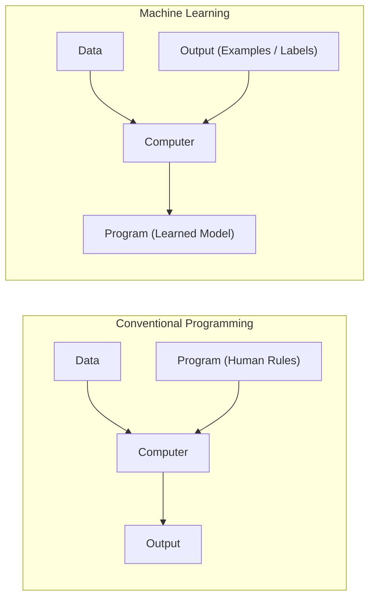
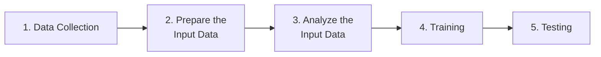
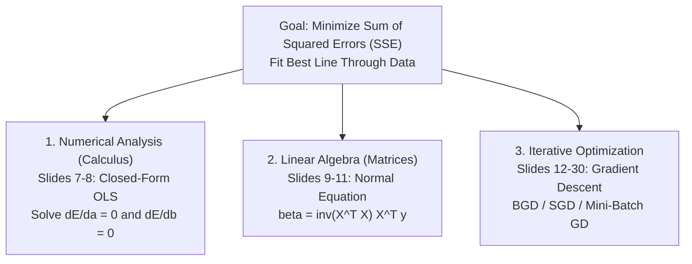

# CSE 4553 Machine Learning — Complete Quiz 1 Handoff & All-in-One Study Export

## Section A: Chat Handoff Prompt & Complete Context Summary

Use this file to continue studying or ask follow-up questions in another chat. It contains **everything produced in our session**: course metadata, workspace file map, all 43 slide screenshot references, preserved in-class notes, full explanations, derivations, worked numerical examples, and all 33 practice/mock questions with solutions.

### 1. Course & Quiz Logistics
- **Course:** CSE 4553 — Machine Learning (Islamic University of Technology, Winter 2025–2026)
- **Instructor:** Dr. Hasan Mahmud (Room #404, AB2 | `hasan@iut-dhaka.edu` | Google Classroom: `o2sfduqd`)
- **Quiz Date:** Tuesday, 17 November 2026 (Class time)
- **Syllabus:** Everything covered in class (`ML_Lecture 0.pdf` [13 slides], `ML_Lecture 1.pdf` [15 slides], `ML_Lecture 2.pdf` [49 slides], plus in-class notes)
- **Marks Breakdown (300 Total):** Attendance 30 (10%) | Quizzes/Assignments 90 (30%) | Mid Exam 90 (30%) | Final Exam 90 (30%)

### 2. Workspace File Map (`/home/smtemon/Documents/Obs/3-1/ML/`)
- `ML Quiz 1.md` — Master Quiz Study Hub, Formula Cram Sheet & 25-Mark Mock Quiz
- `1. Intro.md` — Lectures 0 & 1: Intro to ML, 4 Learning Paradigms, 3 Pillars, Gait Recognition & Data Leakage
- `2. Linear Regression & Gradient Descent.md` — Lecture 2 (Part 1, Slides 1-33): Linear Regression, OLS, Normal Equation & BGD/SGD/Mini-Batch
- `3. Logistic Regression, Bias-Variance & Regularization.md` — Lecture 2 (Part 2, Slides 34-49): Logistic Regression, Sigmoid, MLE Log-Loss, Bias-Variance, Regularization & AR(p)
- `No Fking Clue.md` — Quick Note: Epochs vs. Batches vs. Iterations
- `attachments/` — **43 extracted PNG slide screenshots** (200 DPI via `pdftoppm`)

### 3. Preserved In-Class Notes
- **From `1. Intro.md`:**
  1. **4 Learning Types:** Supervised, Unsupervised, Semi-Supervised, Reinforcement Learning
  2. **3 Fundamental Pillars of Every ML Algorithm:** (1) Representation of the Model (Relationship/Hypothesis), (2) Evaluation Criteria (Loss/Difference), (3) Optimization Function (e.g., Least SSE / Gradient Descent)
  3. **In-Class Special Topics:** *Gait Recognition* (formulated as `<T, P, E>`) and *Data Leakage in Supervised Learning* (Train-Test Contamination vs. Target Leakage)
- **From `No Fking Clue.md`:**
  - **Epochs vs. Iteration:** `iterations = Epoch * Batches` (`Total Iterations = Epochs * ceil(m / Batch Size)`), also annotated in red ink on Lecture 2 Slide 22.

### 4. The 5 Core Derivations & 33 Practice/Mock Problems
- **5 Derivations Covered Step-by-Step:**
  1. Closed-Form OLS `a` and `b` from `E(a,b) = sum (y^n - a - b x^n)^2` (Lec 2, Slide 8)
  2. Normal Equation `beta = (X^T X)^(-1) X^T y` from `X beta = y` (Lec 2, Slide 11)
  3. Gradient Descent Partial Derivatives `dJ/dtheta_0`, `dJ/dtheta_1`, `dJ/dtheta_j` (Lec 2, Slides 14, 15, 19)
  4. Sigmoid Derivative `g'(z) = g(z)(1 - g(z))` (Lec 2, Slide 39)
  5. Logistic Regression MLE Log-Likelihood `l(theta)` from Bernoulli PMF (Lec 2, Slide 43)
- **Practice & Mock Problems Included:**
  - `1. Intro.md`: 8 practice problems (hidden answers)
  - `2. Linear Regression & Gradient Descent.md`: 10 practice problems (hidden answers)
  - `3. Logistic Regression, Bias-Variance & Regularization.md`: 10 practice problems (hidden answers)
  - `ML Quiz 1.md`: 5-question (25-mark) Timed Mock Quiz with step-by-step grading rubrics

### 5. Complete Catalog of Extracted Slide Screenshots (`43` PNGs in `attachments/`)
- `lec0_slide03_conv_vs_ml.png`
- `lec0_slide04_human_intelligence.png`
- `lec0_slide05_artificial_intelligence.png`
- `lec1_slide07_supervised_workflow.png`
- `lec1_slide08_supervised_car_plot.png`
- `lec1_slide09_expected_loss.png`
- `lec1_slide10_unsupervised.png`
- `lec1_slide11_semisupervised.png`
- `lec1_slide12_rl_loop.png`
- `lec1_slide13_rl_elements.png`
- `lec1_slide14_ml_steps.png`
- `lec2_slide04_house_price_table.png`
- `lec2_slide06_lr_fit_annotations.png`
- `lec2_slide07_ols_residuals.png`
- `lec2_slide08_ols_derivation.png`
- `lec2_slide09_linalg_setup.png`
- `lec2_slide11_normal_equation.png`
- `lec2_slide13_univariate_cost_annotations.png`
- `lec2_slide14_intercept_derivative.png`
- `lec2_slide15_slope_derivative_sketch.png`
- `lec2_slide16_univariate_gd_annotations.png`
- `lec2_slide17_multivariate_table.png`
- `lec2_slide18_multivariate_vectorized.png`
- `lec2_slide21_uni_vs_multi_sketches.png`
- `lec2_slide22_batch_vs_sgd_annotations.png`
- `lec2_slide23_sgd_numerical_example.png`
- `lec2_slide24_sgd_loss_curve.png`
- `lec2_slide25_bgd_numerical_example.png`
- `lec2_slide26_bgd_loss_curve.png`
- `lec2_slide27_sgd_vs_bgd_loss.png`
- `lec2_slide29_mse_vs_mae_plot.png`
- `lec2_slide30_learning_rate.png`
- `lec2_slide31_polynomial_regression.png`
- `lec2_slide35_logistic_intro.png`
- `lec2_slide36_why_lr_fails_classification.png`
- `lec2_slide37_hyperplane_geometry.png`
- `lec2_slide38_sigmoid_curve.png`
- `lec2_slide39_sigmoid_derivative.png`
- `lec2_slide40_convex_vs_nonconvex.png`
- `lec2_slide41_logistic_logloss_plots.png`
- `lec2_slide43_mle_loglikelihood.png`
- `lec2_slide46_bias_variance_fits.png`
- `lec2_slide47_bias_variance_tradeoff.png`

---

## Section B: Full Combined Content of All Notes

<!-- BEGIN FILE 1: ML Quiz 1.md -->
### File 1: `ML Quiz 1.md`
*Master Quiz Study Hub, Formula Cram Sheet & 25-Mark Mock Quiz*

---
title: "CSE 4553: Machine Learning — Quiz 1 Master Study Hub"
course: CSE 4553 (Machine Learning)
date: 2026-11-16
tags:
  - machine-learning
  - cse-4553
  - quiz-1
  - exam-prep
  - formula-sheet
  - mock-exam
aliases:
  - ML Quiz 1
  - Machine Learning Quiz 1
  - Quiz 1 Hub
---

# CSE 4553: Machine Learning — Quiz 1 Master Study Hub

> [!important] Quiz 1 Logistics & Syllabus
> - **Course:** CSE 4553 — Machine Learning (*Dr. Hasan Mahmud*, Room #404 AB2, `hasan@iut-dhaka.edu`)
> - **Date:** **Tuesday, 17th November 2026** (Class Time)
> - **Syllabus:** **Everything covered in class** (`ML_Lecture 0.pdf`, `ML_Lecture 1.pdf`, `ML_Lecture 2.pdf`)
> - **Separated Self-Contained Topic Notes (with all Slide Screenshots Embedded):**
>   1. **[[1. Intro|Lectures 0 & 1: Intro to ML, 4 Learning Paradigms, 3 Pillars, Gait Recognition & Data Leakage]]**
>   2. **[[2. Linear Regression & Gradient Descent|Lecture 2 (Part 1): Linear Regression, OLS, Normal Equation & BGD/SGD/Mini-Batch]]**
>   3. **[[3. Logistic Regression, Bias-Variance & Regularization|Lecture 2 (Part 2): Logistic Regression, Sigmoid, MLE Log-Loss, Bias-Variance, Regularization & AR(p)]]**
>   4. **[[No Fking Clue|Quick Note: Epochs vs. Batches vs. Iterations]]**
> - **Original Course PDFs:** [[BSc_Engg_SWE_Winter_CSE4553_2025.pdf]] | [[ML_Lecture 0.pdf]] | [[ML_Lecture 1.pdf]] | [[ML_Lecture 2.pdf]] | [[SWE_ML_Lab_1_Winter_2026.pdf]]

---

## 1. Master Formula & Notation Cram Sheet

### A. Foundations & Learning Paradigms *(Lectures 0 & 1 — [[1. Intro]])*

| Concept | Exact Formula / Framework | Key Exam Detail |
| :--- | :--- | :--- |
| **Well-Posed Learning (Mitchell, 1998)** | $\langle T,\; P,\; E \rangle$ | Performance on **Task $T$**, measured by **Performance $P$**, improves with **Experience $E$**. |
| **3 Pillars of Every ML Algorithm** | **1. Representation** $\to$ **2. Evaluation** $\to$ **3. Optimization** | Hypothesis shape $\to$ Loss/Cost function $\to$ Search algorithm (e.g., Least SSE / GD). |
| **Supervised Dataset** | $D = \{(x^{(i)}, y^{(i)})\}_{i=1}^n$ | Labeled data: **Classification** ($y$ discrete) vs. **Regression** ($y \in \mathbb{R}$ continuous). |
| **Expected Risk Minimization** | $\min_f \; \mathbb{E}_{(x,y)\sim D}\bigl[\ell(f(x), y)\bigr]$ | True distribution $(x,y)\sim D$; model $f(x)$; loss $\ell(\cdot)$. |
| **Zero/One Loss** | $\ell(y,\hat{y}) = 0 \text{ if } y=\hat{y},\; \text{else } 1$ | Used for Classification accuracy/error. |
| **Squared Loss** | $\ell(y,\hat{y}) = (y - \hat{y})^2$ | Used for Regression (penalizes large errors quadratically). |
| **Unsupervised Dataset** | $D = \{x^{(i)}\}_{i=1}^n$ | No labels: **Clustering** (discrete ID $x'$) vs. **Dimensionality Reduction** (continuous $x'$). |
| **Reinforcement Learning (RL)** | $s_{t+1} = \delta(s_t, a_t),\; r_t = r(s_t,a_t),\; \pi:\mathcal{S}\to\mathcal{A}$ | Trajectory $s_0 \xrightarrow[r_0]{a_0} s_1 \xrightarrow[r_1]{a_1} s_2 \cdots$; delayed scalar rewards. |

---

### B. Linear Regression & Gradient Descent *(Lecture 2, Slides 1–33 — [[2. Linear Regression & Gradient Descent]])*

| Concept | Formula | Key Detail / Trap |
| :--- | :--- | :--- |
| **Hypothesis (Univariate / Multi)** | $h_\theta(x) = \theta_0 + \theta_1 x = \boldsymbol{\theta}^T\mathbf{x}$ | Prepend $x_0^{(i)} = 1$ (bias dummy feature). Equivalent to $a+bx$, $w_0+w_1x$, $\beta_0+\beta_1x$. |
| **Closed-Form OLS (Numerical Analysis)** | $b = \dfrac{\langle xy \rangle - \langle x \rangle\langle y \rangle}{\langle x^2 \rangle - \langle x \rangle^2}, \qquad a = \langle y \rangle - b\langle x \rangle$ | $\langle f \rangle = \frac{1}{N}\sum_{n=1}^N f(x^n, y^n)$; line passes through $(\langle x\rangle, \langle y\rangle)$. |
| **Normal Equation (Linear Algebra)** | $\vec{\beta} = (X^T X)^{-1} X^T \vec{y}$ | $2\times 2$ form: $\begin{bmatrix} N & \sum x_i \\ \sum x_i & \sum x_i^2 \end{bmatrix}^{-1}\begin{bmatrix} \sum y_i \\ \sum x_i y_i \end{bmatrix}$. Fails if $X^TX$ is singular ($O(n^3)$!). |
| **Half-MSE Cost Function** | $J(\boldsymbol{\theta}) = \dfrac{1}{2m}\sum_{i=1}^m \bigl(h_\theta(\mathbf{x}^{(i)}) - y^{(i)}\bigr)^2$ | The $\frac{1}{2}$ cancels the exponent $2$ during differentiation. |
| **Univariate Partial Derivatives** | $\dfrac{\partial J}{\partial \theta_0} = \dfrac{1}{m}\sum (h_\theta - y)$, $\quad \dfrac{\partial J}{\partial \theta_1} = \dfrac{1}{m}\sum x_i(h_\theta - y)$ | $\theta_0$ adjusts average bias; $\theta_1$ weights error by $x_i$. |
| **Batch GD Update (Simultaneous!)** | $\theta_j := \theta_j - \alpha \dfrac{1}{m}\sum_{i=1}^m \bigl(h_\theta(\mathbf{x}^{(i)}) - y^{(i)}\bigr)x_j^{(i)}$ | Must compute `temp0, temp1` before overwriting $\theta_0$! $1\text{ Epoch} = 1\text{ Iteration}$. |
| **Stochastic GD (Widrow-Hoff / LMS)** | $\theta_j := \theta_j - \alpha\bigl(h_\theta(\mathbf{x}^{(i)}) - y^{(i)}\bigr)x_j^{(i)}$ | Shuffle before looping; updates **after every single sample**! $1\text{ Epoch} = m\text{ Iterations}$. |
| **Iterations Formula** | $\text{Iterations} = \text{Epochs} \times \text{Batches} = \text{Epochs} \times \left\lceil \dfrac{m}{B} \right\rceil$ | BGD: $B=m$; SGD: $B=1$; Mini-Batch: $1 < B < m$. |

---

### C. Logistic Regression, Metrics, Bias–Variance & Regularization *(Lecture 2, Slides 34–49 — [[3. Logistic Regression, Bias-Variance & Regularization]])*

| Concept | Formula | Key Detail |
| :--- | :--- | :--- |
| **Signed Distance to Hyperplane** | $\pm \dfrac{\mathbf{w}^T\mathbf{x} + b}{\|\mathbf{w}\|}$ | Hyperplane $\mathbf{w}^T\mathbf{x} + b = 0$; positive on $\mathbf{w}$ side, negative on opposite side. |
| **Sigmoid Function & Hypothesis** | $g(z) = \dfrac{1}{1 + e^{-z}}, \quad h_\theta(\mathbf{x}) = g(\boldsymbol{\theta}^T\mathbf{x})$ | Maps $(-\infty,\infty) \to (0,1)$. Predict $y=1$ iff $h_\theta(\mathbf{x}) \ge 0.5 \iff \boldsymbol{\theta}^T\mathbf{x} \ge 0$. |
| **Sigmoid Derivative** | $g'(z) = g(z)\bigl(1 - g(z)\bigr)$ | Maximum slope is $g'(0) = 0.25$ at $z = 0$. |
| **Binary Cross-Entropy (Log-Loss)** | $J(\theta) = -\dfrac{1}{m}\sum_{i=1}^m \Bigl[y^{(i)}\log h_\theta(x^{(i)}) + (1-y^{(i)})\log(1-h_\theta(x^{(i)}))\Bigr]$ | Convex! Avoids local minima caused by squared error + sigmoid. |
| **MLE Log-Likelihood** | $\ell(\theta) = \sum_{i=1}^m \Bigl[y^{(i)}\log h_\theta(x^{(i)}) + (1-y^{(i)})\log(1-h_\theta(x^{(i)}))\Bigr]$ | Derived from $p(y\mid x;\theta) = h^y(1-h)^{1-y}$. Note $J(\theta) = -\frac{1}{m}\ell(\theta)$. |
| **MAE / MSE / RMSE** | $\frac{1}{n}\sum\lvert y_i-\hat{y}_i\rvert \;\big|\; \frac{1}{n}\sum(y_i-\hat{y}_i)^2 \;\big|\; \sqrt{\text{MSE}}$ | $\text{RMSE} \ge \text{MAE}$ always; MAE is outlier-robust; RMSE restores units of $y$. |
| **L1 (Lasso) / L2 (Ridge) / Elastic Net** | $\text{Cost}_{\text{MSE}} + \lambda\sum\lvert w_i\rvert \;\big|\; +\lambda\sum w_i^2 \;\big|\; +\lambda_1\sum\lvert w_i\rvert + \lambda_2\sum w_i^2$ | L1 gives **sparse weights (exact 0, feature selection)**; L2 shrinks smoothly; $\lambda\uparrow \implies$ bias$\uparrow$, variance$\downarrow$. |
| **Autoregression $\text{AR}(1)$ & $\text{AR}(p)$** | $X_t = c + \phi_1 X_{t-1} + \dots + \phi_p X_{t-p} + \varepsilon_t$ | Predicts time series from its own $p$ past lags + white noise $\varepsilon_t$. |

---

## 2. The 5 "Must-Memorize" Derivations for Quiz 1

Make sure you can reproduce every one of these **5 exact slide derivations** cleanly on blank paper:

1. **Closed-Form OLS Parameters $a$ and $b$** *(Lec 2, Slide 8)* $\longrightarrow$ [[2. Linear Regression & Gradient Descent#2.2 Complete Step-by-Step Closed-Form Derivation (Slide 8)|Full Steps]]
2. **Matrix Normal Equation $\vec{\beta} = (X^T X)^{-1} X^T \vec{y}$** *(Lec 2, Slide 11)* $\longrightarrow$ [[2. Linear Regression & Gradient Descent#3.2 Deriving the Normal Equation (Slide 11)|Full Steps]]
3. **Gradient Descent Partial Derivatives $\frac{\partial J}{\partial \theta_0}, \frac{\partial J}{\partial \theta_1}, \frac{\partial J}{\partial \theta_j}$** *(Lec 2, Slides 14, 15, 19)* $\longrightarrow$ [[2. Linear Regression & Gradient Descent#4.2 Complete Derivation of partial J / partial theta_0 and partial J / partial theta_1 (Slides 14–15)|Full Steps]]
4. **Sigmoid Derivative $g'(z) = g(z)\bigl(1 - g(z)\bigr)$** *(Lec 2, Slide 39)* $\longrightarrow$ [[3. Logistic Regression, Bias-Variance & Regularization#3.2 Complete Derivation of the Sigmoid Derivative (Slide 39)|Full Steps]]
5. **Logistic Regression MLE Log-Likelihood $\ell(\theta)$** *(Lec 2, Slide 43)* $\longrightarrow$ [[3. Logistic Regression, Bias-Variance & Regularization#4.3 Maximum Likelihood Estimation (MLE) & Log-Likelihood Derivation (Slides 42–43)|Full Steps]]

---

## 3. High-Yield Exam Traps & Quick Showdowns

> [!error] 7 Classic Quiz Traps to Watch Out For!
> 1. **SGD vs. BGD Hand-Trace Trap:** In **SGD**, weights update **after every single sample** (Sample 1's New Weights become Sample 2's Old Weights). In **BGD**, weights stay **frozen across every sample in the epoch** and update **only once** using the average gradient at the end!
> 2. **Simultaneous Update Trap:** Never compute $\theta_1$'s derivative using the already-updated $\theta_0$; compute both `temp0` and `temp1` from old $(\theta_0, \theta_1)$ first!
> 3. **Logistic Regression Is CLASSIFICATION:** Despite its name, it solves **classification** ($y \in \{0,1\}$), not regression!
> 4. **Why Linear Regression Fails Classification (2 Reasons):** (a) Far-right outliers tilt the line and shift the $0.5$ boundary, and (b) linear predictions exceed $[0, 1]$.
> 5. **Why Squared Error Fails Logistic Regression:** Sigmoid makes squared error **non-convex** with local minima; Binary Cross-Entropy / Log-Loss is convex.
> 6. **Data Leakage in Supervised Learning:** Fitting scalers (`StandardScaler`) or imputers (`df.mean()`) **before** splitting train/test leaks test statistics into training! Always split first!
> 7. **Training Error Alone Can't Spot Overfitting:** Training error keeps dropping to $0$ in the overfitting zone (Slide 47). Always check **Test / Validation Error** (High Train + High Test = **High Bias / Underfitting**; Low Train + High Test = **High Variance / Overfitting**).

### Gradient Descent vs. Normal Equation vs. Loss Functions

| Showdown | Option A | Option B | Winning Choice |
| :--- | :--- | :--- | :--- |
| **Small $n$ ($n \le 10^3$) vs. Huge $n$ ($n > 10^4$)** | Normal Eq. ($O(n^3)$, no $\alpha$) | Gradient Descent ($O(n)$/iter, needs $\alpha$) | Normal Eq. for small $n$; **GD for large $n$** or non-invertible $X^TX$. |
| **Clean data vs. Extreme outliers (Regression)** | MSE ($\frac{1}{n}\sum e_i^2$, quadratic) | MAE ($\frac{1}{n}\sum \lvert e_i\rvert$, linear) | MSE for clean data & smooth gradients; **MAE when outliers exist**. |
| **Sparse feature selection vs. Smooth shrinkage** | L1 Lasso ($\lambda\sum\lvert w_i\rvert$) | L2 Ridge ($\lambda\sum w_i^2$) | **L1** zeros out irrelevant weights; **L2** shrinks all weights smoothly. |

---

## 4. Full Timed 25-Mark Mock Quiz (Exam Simulation)

> [!tip] How to Use This Mock Quiz
> Grab blank paper and a calculator, set a **35-minute timer**, and solve all 5 questions completely before expanding the answer callouts!

### Mock Q1 [5 Marks — Foundations, $\langle T,P,E \rangle$ & Data Leakage]
1. **[2 Marks]** Contrast **Conventional Programming** and **Machine Learning** in terms of computer inputs and outputs, and state Alpaydin's distinction between **predictive** and **descriptive** models.
2. **[2 Marks]** Formulate **Credit Card Fraud Detection** (including the slide's asymmetric penalty detail) AND **Gait Recognition** as well-posed learning problems $\langle T, P, E \rangle$.
3. **[1 Mark]** Explain what **Data Leakage** is in supervised learning and why calling `StandardScaler().fit_transform(X)` before `train_test_split` causes it.

> [!success]- Answer & Rubric (Mock Q1 — 5 Marks)
> 1. **[2 Marks]** Conventional Programming takes **Data + Program (human rules)** $\to$ **Output**; ML takes **Data + Desired Output (examples)** $\to$ **Program (learned model)** (`1 mark`). A **predictive** model forecasts future outcomes, while a **descriptive** model extracts knowledge/patterns from existing data (`1 mark`).
> 2. **[2 Marks]**
>    - **Credit Card Fraud (`1 mark`):** $T =$ classify transactions as `fraud`/`not fraud`; $P =$ classifier accuracy **with higher penalty when fraud is labeled as not fraud**; $E =$ historical labeled transactions.
>    - **Gait Recognition (`1 mark`):** $T =$ identify a person from walking pattern sequences; $P =$ identification accuracy on unseen gait sequences; $E =$ labeled database of walking sequences.
> 3. **[1 Mark]** Data leakage occurs when test-set or future target information contaminates training. Calling `.fit_transform(X)` before splitting computes $\mu$ and $\sigma$ using test rows, leaking test distribution info into training.

---

### Mock Q2 [5 Marks — Linear Regression Calculus & Simultaneous Update]
1. **[3 Marks]** Starting from $J(\theta_0, \theta_1) = \frac{1}{2m}\sum_{i=1}^m (y_i - (\theta_0 + \theta_1 x_i))^2$, derive both $\frac{\partial J}{\partial \theta_0}$ and $\frac{\partial J}{\partial \theta_1}$ step by step, and briefly interpret what each term measures physically.
2. **[2 Marks]** Write the **correct simultaneous** Gradient Descent update pseudocode for $(\theta_0, \theta_1)$ and explain the bug caused by updating $\theta_0$ in place before computing $\text{temp1}$.

> [!success]- Answer & Rubric (Mock Q2 — 5 Marks)
> 1. **[3 Marks]**
>    - $\frac{\partial J}{\partial \theta_0} = \frac{1}{2m}\sum_{i=1}^m 2(y_i - \theta_0 - \theta_1 x_i)(-1) = \mathbf{\frac{1}{m}\sum_{i=1}^m (h_\theta(x_i) - y_i)}$ (`1 mark`). Measures the average prediction error (whether predictions are overall too high/low) (`0.5 mark`).
>    - $\frac{\partial J}{\partial \theta_1} = \frac{1}{2m}\sum_{i=1}^m 2(y_i - \theta_0 - \theta_1 x_i)(-x_i) = \mathbf{\frac{1}{m}\sum_{i=1}^m x_i(h_\theta(x_i) - y_i)}$ (`1 mark`). Measures the error weighted by input $x_i$ (high-$x_i$ points have stronger leverage on slope) (`0.5 mark`).
> 2. **[2 Marks]**
>    - Correct pseudocode (`1 mark`): compute `temp0 := θ0 - α*(∂J/∂θ0)` and `temp1 := θ1 - α*(∂J/∂θ1)` first, then assign `θ0 := temp0; θ1 := temp1`.
>    - Bug explanation (`1 mark`): updating $\theta_0$ immediately causes $\frac{\partial J}{\partial \theta_1}$ to evaluate $h_\theta(x_i)$ using the **new** $\theta_0$ instead of the **old** $(\theta_0, \theta_1)$, violating true gradient descent.

---

### Mock Q3 [6 Marks — Numerical Hand-Trace: SGD vs. BGD]
Consider the dataset with $2$ features ($x_1, x_2$) and hypothesis $\hat{y} = w_0 + w_1 x_1 + w_2 x_2$:
- Sample 1: $(x_1, x_2) = (1, 2),\; y = 5$
- Sample 2: $(x_1, x_2) = (2, 1),\; y = 4$
- Sample 3: $(x_1, x_2) = (1, 1),\; y = 3$

Given initial weights $(w_0, w_1, w_2) = (0, 0, 0)$ and learning rate $\alpha = 0.1$:
1. **[3 Marks]** Perform **1 full epoch of Stochastic Gradient Descent (SGD)**, showing the weights after every sample and the **Epoch 1 Average SGD Loss** ($L^{(i)} = \frac{1}{2}(\hat{y}^{(i)} - y^{(i)})^2$).
2. **[3 Marks]** Perform **1 full epoch of Batch Gradient Descent (BGD)**, showing the gradient terms per sample, the single end-of-epoch weight update, and the **Epoch 1 BGD MSE**.

> [!success]- Answer & Rubric (Mock Q3 — 6 Marks)
> 1. **SGD Epoch 1 [3 Marks]:** ($\Delta w_j = -0.1(\hat{y}-y)x_j$)
>    - **Sample 1** $(1, 2, y=5)$, old $(0, 0, 0)$: $\hat{y}=0$, Err $=-5$, $\Delta w = (0.5, 0.5, 1.0) \implies$ **New $(0.5, 0.5, 1.0)$**, $L^{(1)} = 0.5(25) = 12.5$.
>    - **Sample 2** $(2, 1, y=4)$, old $(0.5, 0.5, 1.0)$: $\hat{y} = 0.5 + 0.5(2) + 1.0(1) = 2.5$, Err $= -1.5$, $\Delta w = (0.15, 0.30, 0.15) \implies$ **New $(0.65, 0.80, 1.15)$**, $L^{(2)} = 0.5(2.25) = 1.125$.
>    - **Sample 3** $(1, 1, y=3)$, old $(0.65, 0.80, 1.15)$: $\hat{y} = 0.65 + 0.80 + 1.15 = 2.60$, Err $= -0.40$, $\Delta w = (0.04, 0.04, 0.04) \implies$ **New $(0.69, 0.84, 1.19)$**, $L^{(3)} = 0.5(0.16) = 0.08$.
>    - **Avg SGD Loss:** $(12.5 + 1.125 + 0.08)/3 = 13.705 / 3 \approx \mathbf{4.5683}$.
> 2. **BGD Epoch 1 [3 Marks]:** (All 3 samples use frozen $(0, 0, 0) \implies \hat{y} = 0$)
>    - **Sample 1:** Err $= -5 \implies (\text{Err}\cdot 1, \text{Err}\cdot x_1, \text{Err}\cdot x_2) = (-5, -5, -10)$
>    - **Sample 2:** Err $= -4 \implies (-4, -8, -4)$
>    - **Sample 3:** Err $= -3 \implies (-3, -3, -3)$
>    - **Sum:** $(-12, -16, -17)$ $\xrightarrow{\div 3}$ **Avg Grad:** $(-4.000, -5.333, -5.667)$
>    - **New Weights ($\times (-0.1)$):** **$(0.400,\; 0.533,\; 0.567)$**
>    - **Epoch 1 BGD MSE:** $\dfrac{(-5)^2 + (-4)^2 + (-3)^2}{3} = \dfrac{25 + 16 + 9}{3} = \dfrac{50}{3} \approx \mathbf{16.667}$.

---

### Mock Q4 [5 Marks — Logistic Regression, Sigmoid & MLE]
1. **[2 Marks]** Prove that $g'(z) = g(z)\bigl(1 - g(z)\bigr)$ for $g(z) = \dfrac{1}{1 + e^{-z}}$.
2. **[2 Marks]** Starting from $P(y=1\mid x;\theta) = h_\theta(x)$ and $P(y=0\mid x;\theta) = 1 - h_\theta(x)$, derive the Log-Likelihood function $\ell(\theta)$ for $m$ examples.
3. **[1 Mark]** Given separating hyperplane $2x_1 - 2x_2 + 1 = 0$, compute the signed perpendicular distance of point $(3, 1)$ from the boundary.

> [!success]- Answer & Rubric (Mock Q4 — 5 Marks)
> 1. **[2 Marks]** $g'(z) = \frac{e^{-z}}{(1+e^{-z})^2} = \frac{1}{1+e^{-z}} \cdot \frac{(1+e^{-z})-1}{1+e^{-z}} = g(z)(1-g(z))$.
> 2. **[2 Marks]** Bernoulli form $p(y\mid x;\theta) = h_\theta(x)^y(1-h_\theta(x))^{1-y}$; $L(\theta) = \prod_{i=1}^m h_\theta(x^{(i)})^{y^{(i)}}(1-h_\theta(x^{(i)}))^{1-y^{(i)}}$; taking $\log$ yields $\ell(\theta) = \sum_{i=1}^m [y^{(i)}\log h_\theta(x^{(i)}) + (1-y^{(i)})\log(1-h_\theta(x^{(i)}))]$.
> 3. **[1 Mark]** $\|\mathbf{w}\| = \sqrt{2^2 + (-2)^2} = \sqrt{8} = 2\sqrt{2}$; $\;\text{Signed Distance} = \dfrac{2(3) - 2(1) + 1}{2\sqrt{2}} = \dfrac{5}{2\sqrt{2}} \approx \mathbf{+1.768}$ (positive side).

---

### Mock Q5 [4 Marks — Bias–Variance, Regularization & Metrics]
1. **[2 Marks]** Sketch/describe the **Bias–Variance Trade-off** (Slide 47): how do $\text{Bias}^2$, $\text{Variance}$, Training Error, and Generalization (Test) Error behave as model complexity increases?
2. **[2 Marks]** Write the regularized Linear Regression cost functions for **L1 (Lasso)** and **L2 (Ridge)**, and state one key difference in how they affect model weights $w_i$.

> [!success]- Answer & Rubric (Mock Q5 — 4 Marks)
> 1. **[2 Marks]** As complexity increases: $\text{Bias}^2$ strictly decreases, $\text{Variance}$ strictly increases, Training Error monotonically decreases toward zero, and Test Error ($\text{Bias}^2 + \text{Variance} + \text{Irreducible Error}$) forms a **U-shaped curve**—high on the left (**underfitting zone**), minimized at the middle sweet spot, and high again on the right (**overfitting zone**).
> 2. **[2 Marks]**
>    - **L1 (Lasso):** $\frac{1}{2m}\sum (y_i - h(x_i))^2 + \lambda \sum_{i=1}^n |w_i|$ (`0.5 mark`)
>    - **L2 (Ridge):** $\frac{1}{2m}\sum (y_i - h(x_i))^2 + \lambda \sum_{i=1}^n w_i^2$ (`0.5 mark`)
>    - **Key Difference (`1 mark`):** L1 forces unimportant weights to **exact $0$** (producing sparse models / automatic feature selection), whereas L2 shrinks weights smoothly toward zero without forcing them strictly to zero.

---

## 5. All-in-One Continuous Reader (Full Syllabus Embedded)

If you want to read **every single lecture, slide screenshot, derivation, and practice problem continuously in one single note** without switching files, the three complete lecture notes are embedded below:

### Part 1: Lectures 0 & 1 (`1. Intro`)
![[1. Intro]]

---

### Part 2: Lecture 2 — Linear Regression & Gradient Descent
![[2. Linear Regression & Gradient Descent]]

---

### Part 3: Lecture 2 — Logistic Regression, Bias–Variance & Regularization
![[3. Logistic Regression, Bias-Variance & Regularization]]

<!-- END FILE 1: ML Quiz 1.md -->

---

<!-- BEGIN FILE 2: 1. Intro.md -->
### File 2: `1. Intro.md`
*Lectures 0 & 1: Intro to ML, 4 Learning Paradigms, 3 Pillars, Gait Recognition & Data Leakage*

---
title: "Lectures 0 & 1: Introduction to Machine Learning, Learning Paradigms & Foundations"
course: CSE 4553 (Machine Learning)
lecture: 0-1
date: 2026-11-16
tags:
  - machine-learning
  - cse-4553
  - lecture-0
  - lecture-1
  - quiz-1
  - supervised-learning
  - unsupervised-learning
  - reinforcement-learning
aliases:
  - Lecture 0
  - Lecture 1
  - Intro to Machine Learning
  - 1. Intro
---

# Lectures 0 & 1: Introduction to Machine Learning, Learning Paradigms & Foundations

> [!info] Navigation & Course Materials
> - **Quiz Hub:** [[ML Quiz 1]] | **Next Lecture:** [[2. Linear Regression & Gradient Descent]] | **Part 3:** [[3. Logistic Regression, Bias-Variance & Regularization]]
> - **Related Class Note:** [[No Fking Clue|Epochs vs. Batches vs. Iterations]]
> - **Original Course Files:** [[BSc_Engg_SWE_Winter_CSE4553_2025.pdf]] | [[ML_Lecture 0.pdf]] | [[ML_Lecture 1.pdf]] | [[SWE_ML_Lab_1_Winter_2026.pdf]]
> - **Course Info:** **CSE 4553 — Machine Learning** (*Dr. Hasan Mahmud*, Room #404 AB2, `hasan@iut-dhaka.edu`) | Google Classroom: `o2sfduqd`
> - **Marks Breakdown (300 Total):** Attendance **30** (10%) | Quizzes/Assignments **90** (30%) | Mid Exam **90** (30%) | Final Exam **90** (30%)
> - **Recommended Textbooks:** Ethem Alpaydin (*Introduction to Machine Learning*), C. M. Bishop (*Pattern Recognition and Machine Learning*), Tom Mitchell (*Machine Learning*), Andrew Ng (*Machine Learning Yearning*)

> [!tip] My In-Class Notes (Preserved & Expanded)
> From the class I attended, these were the exact high-level takeaways written down:
> 1. **Learning Types:** Supervised, Unsupervised, Semi-Supervised, Reinforcement Learning *(covered in [[#4. The 4 Types of Machine Learning (Lec 1, Slides 6–13)]])*.
> 2. **Every ML algorithm should have 3 fundamental things:**
>    1. **Representation of the Model** (Relationship / Hypothesis)
>    2. **Evaluation Criteria** (Performance? Difference / Loss)
>    3. **Optimization Function** (e.g., Least SSE — Sum of Squared Errors)
>    *(Explained in full in [[#3. The 3 Fundamental Pillars of Every ML Algorithm]])*.
> 3. **In-Class Topics / Examples:**
>    - **Gait recognition** *(covered in [[#2.2 Tom Mitchell (1998) — Well-Posed Learning Problem T, P, E (Lec 1, Slides 4–5)]])*
>    - **Leakage in supervised learning** *(covered in [[#Data Leakage in Supervised Learning (In-Class Special Topic)]])*

---

## 1. Course Overview & Why Machine Learning? (Lec 0, Slides 1–12; Lec 1, Slide 3)

> [!abstract] Core Motivation (Lecture 1, Slide 3)
> **"Data is abundant and cheap, but knowledge is scarce and expensive."**
> - **Machine** = Computer / computer program.
> - **Learning** = Improving performance on a given task, based on experience / examples.

### 1.1 Conventional Programming vs. Machine Learning (Lec 0, Slide 3)

In traditional software engineering (**Conventional Programming**), a human programmer must figure out the exact logical rules and manually code them into a program. When we feed **Data + Program** into the computer, it computes the **Output**.

In **Machine Learning**, we flip the paradigm! Instead of writing explicit `if-else` rules ourselves, we feed the computer **Data + Desired Outputs (Examples)**, and the learning algorithm automatically discovers the rules (**Program / Model**) from the data.

![[lec0_slide03_conv_vs_ml.png]]



| Dimension | Conventional Programming | Machine Learning |
| :--- | :--- | :--- |
| **Core Idea** | *"How to program computers"* | *"How to allow them to program themselves"* |
| **Inputs to Computer** | **Data** + **Program** (hand-crafted rules) | **Data** + **Desired Output** (labeled examples) |
| **Produced Artifact** | **Output** | **Program** (a trained predictive/descriptive model) |
| **Example: Sentiment Analysis** | Manually write thousands of fragile `if` rules checking keywords (`"good"`, `"bad"`), which break on sarcasm (*"Yeah, great service, waited 2 hours!"*) or negation (*"not bad"*). | Feed thousands of reviews already labeled `positive` or `negative`; the computer learns word/context weights automatically to classify new reviews. |

---

### 1.2 Human Intelligence vs. Artificial Intelligence (Lec 0, Slides 4–5)

Dr. Hasan Mahmud compares how human cognition processes the world against how modern AI/ML systems mimic each stage. Notice that **Machine Learning sits inside the "Learning" gear of the Processing stage**—it is one crucial engine within the broader AI pipeline!

![[lec0_slide04_human_intelligence.png]]

![[lec0_slide05_artificial_intelligence.png]]

| Cognitive Stage | Human Intelligence (Slide 4) | Artificial Intelligence Equivalent (Slide 5) |
| :--- | :--- | :--- |
| **1. Input** | **Sensing & Perception** (eyes, ears, touch) | **NLP**, **Speech Recognition**, **Visual Recognition**, **Data Sources** |
| **2. Processing — Gear 1** | **Knowledge & Memory** | **Knowledge Representation**, Ontologies, Graph Databases, etc. |
| **2. Processing — Gear 2** | **Decision & Inference** | **Prescriptive Analytics**, Optimization, Decision Making, etc. |
| **2. Processing — Gear 3** | **Learning** | **Machine Learning** (*supervised, unsupervised*) |
| **3. Output** | **Output & Interaction** (speech, movement) | **Robotics**, **Navigation Systems**, **Speech Generation**, **Threat Leads** |

---

### 1.3 Machine Learning Research Venues (Lec 0, Slide 12)

Good to know for introductory/multiple-choice background questions:
- **Top ML Conferences:**
  - **ICML** — International Conference on Machine Learning
  - **KDD** — ACM SIGKDD Conference on Knowledge Discovery and Data Mining
  - **NeurIPS (formerly NIPS)** — Conference on Neural Information Processing Systems
  - **ACML** — Asian Conference on Machine Learning
  - **ECML** — European Conference on Machine Learning
- **Top ML Journals:**
  - **IEEE TKDE** — IEEE Transactions on Knowledge and Data Engineering
  - **JMLR** — Journal of Machine Learning Research
  - **JAIR** — Journal of Artificial Intelligence Research

---

## 2. Formal Definitions of Machine Learning (Lec 0, Slide 6; Lec 1, Slides 4–5)

### 2.1 Three Classic Textbook Definitions

1. **Arthur Samuel (1959) (Lec 1, Slide 4):**
   > *"Field of study that gives computers the ability to learn **without being explicitly programmed**."*
   *(Coined while Samuel built a self-playing Checkers program that eventually beat him by playing thousands of games against itself.)*

2. **Ethem Alpaydin — "Machine Learning in a Nutshell" (Lec 0, Slide 6):**
   - *"Machine learning is programming computers to **optimize a performance criterion** using example data or past experience."*
   - We define a **model** up to some **parameters**, and **learning** is the execution of a computer program to optimize those parameters using training data or past experience.
   - **Two Roles a Learned Model Can Play:**
     - **Predictive:** To make predictions in the future (e.g., predicting tomorrow's stock price or whether a transaction is fraud).
     - **Descriptive:** To gain knowledge/insights from data (e.g., discovering which customer segments exist or which medical symptoms cluster together).
     - **Or Both!**

3. **Tom Mitchell (1998) — Well-Posed Learning Problem (Lec 1, Slide 4):**
   > *"A computer program is said to learn from experience **$E$** with respect to some class of tasks **$T$** and some performance measure **$P$**, if its performance on **$T$**, as measured by **$P$**, improves with experience **$E$**."*

---

### 2.2 Tom Mitchell's $\langle T, P, E \rangle$ Framework: Worked Examples (Lec 1, Slide 5 + In-Class)

Whenever a quiz asks you to formulate a problem as a "well-posed learning problem", you must explicitly state all three components **$T$**, **$P$**, and **$E$**:

| Problem Scenario | Task ($T$) | Performance Measure ($P$) | Training Experience ($E$) |
| :--- | :--- | :--- | :--- |
| **1. Traffic Prediction** *(Slide 5)* | Predict future traffic patterns at a busy intersection. | Accuracy (or inverse error) of predicting future traffic volume/congestion. | Historical data of past traffic patterns at that intersection. |
| **2. Credit Card Fraud Detection** *(Slide 5)* | Assign a label of `fraud` or `not fraud` to each credit card transaction. | Accuracy of the fraud classifier **with a higher penalty when `fraud` is mislabeled as `not fraud`** (asymmetric cost: missing real fraud is far worse than a false alarm). | Historical credit card transactions labeled as `fraud` or `not fraud`. |
| **3. Gait Recognition** *(In-Class Example)* | Identify a person (or detect a walking disorder) from their walking pattern (video silhouettes or inertial sensor time series). | Recognition accuracy / correct identification rate on unseen walking sequences. | A dataset of recorded walking sequences (`gait cycles`) labeled with each person's identity. |

> [!note] Why Did Sir Mention Gait Recognition in Class?
> Gait recognition is a great real-world bridge between **Supervised Learning** and feature extraction: unlike face recognition (which fails from far away or at low resolution), a person's walking stride, joint angles, and cadence can be captured at a distance without cooperation. Given labeled gait sequences $D = \{(x^{(i)}, y^{(i)})\}$, a classifier learns to map motion features $x$ to a person's ID $y$.

---

## 3. The 3 Fundamental Pillars of Every ML Algorithm

> [!important] Core In-Class Insight (From `1. Intro.md`)
> Regardless of whether you are building Linear Regression, Logistic Regression, a Decision Tree, or a Deep Neural Network, **every ML algorithm is built out of three components**:
> 1. **Representation of the Model (Hypothesis / Relationship)**
> 2. **Evaluation Criteria (Loss / Cost / Performance Metric)**
> 3. **Optimization Function (Search Algorithm)**

Let's map these 3 pillars to the concrete algorithms we study in Lectures 1 and 2 so you can see the big picture immediately:

| Pillar | What Question Does It Answer? | Example: Linear Regression | Example: Logistic Regression |
| :--- | :--- | :--- | :--- |
| **1. Representation** | *What mathematical shape or family of functions $h_\theta(x)$ can the model express?* | A straight line / hyperplane:<br>$h_\theta(x) = \theta_0 + \theta_1 x = \boldsymbol{\theta}^T \mathbf{x}$ | Sigmoid applied to linear combination:<br>$h_\theta(x) = \dfrac{1}{1 + e^{-\boldsymbol{\theta}^T \mathbf{x}}}$ |
| **2. Evaluation Criteria** | *How do we score how good or bad a candidate model is against the ground truth $y$?* | **SSE / MSE** (Sum or Mean Squared Error):<br>$J(\theta) = \frac{1}{2m}\sum_{i=1}^m (h_\theta(x^{(i)}) - y^{(i)})^2$ | **Binary Cross-Entropy / Log-Loss** (or Log-Likelihood $\ell(\theta)$):<br>$J(\theta) = -\frac{1}{m}\sum [y\log h + (1-y)\log(1-h)]$ |
| **3. Optimization Function** | *How do we search for the exact parameters $\theta^*$ that minimize the loss?* | **OLS Calculus**, **Normal Equation** $(X^TX)^{-1}X^Ty$, or **Gradient Descent** (Batch / SGD) | **Gradient Descent** / Maximum Likelihood Estimation (no closed-form equation!) |

---

## 4. The 4 Types of Machine Learning (Lec 1, Slides 6–13)

At the highest level, Machine Learning problems are categorized by **what kind of feedback / labels are available in the training data**:

| Learning Type | Training Data Format | Desired Output / Labels Included? | Core Goal | Key Algorithms / Subtasks |
| :--- | :--- | :--- | :--- | :--- |
| **1. Supervised (Inductive)** | $D = \{(x^{(i)}, y^{(i)})\}_{i=1}^n$ | **Yes** — every input has a target label $y^{(i)}$. | Learn a mapping $h: x \to y$ to predict unseen inputs. | **Classification** (discrete $y$), **Regression** (continuous $y$). Examples: Linear/Logistic Regression, Decision Trees, Random Forest, k-NN, SVM, Neural Nets. |
| **2. Unsupervised** | $D = \{x^{(i)}\}_{i=1}^n$ | **No** — unlabeled inputs only. | Discover hidden structure, groups, or compact features in $x$. | **Clustering** (discrete cluster ID), **Dimensionality Reduction** (continuous compressed features), K-Means, PCA. |
| **3. Semi-Supervised** | $D_L = \{(x^{(i)}, y^{(i)})\}_{i=1}^{n_l}$ **+** $D_U = \{x^{(j)}\}_{j=1}^{n_u}$ *(where $n_l \ll n_u$)* | **Partially** — a **few** labeled examples + a **large** pool of unlabeled data. | Leverage cheap unlabeled data alongside expensive expert labels to build a better classifier. | Pseudo-labeling, semi-supervised classification (e.g., face vs. non-face with few expert labels). |
| **4. Reinforcement Learning** | Trajectory of $(s_t, a_t, r_t, s_{t+1})$ | **No static labels** — **delayed scalar rewards** $r_t \in \mathbb{R}$ from an environment. | Learn a policy $\pi: \mathcal{S} \to \mathcal{A}$ choosing a sequence of actions to maximize long-term reward. | Game playing (Chess, Go), robotics, autonomous navigation. |

---

### 4.1 Supervised (Inductive) Learning (Lec 1, Slides 6–9)

Why is it called **inductive** learning? Because from specific labeled observations $(x^{(i)}, y^{(i)})$, the learner *induces* a general hypothesis function $h(x)$ that works on new, unseen examples.

#### Workflow & Train/Test Split (Slide 7)

![[lec1_slide07_supervised_workflow.png]]

Follow the 4 numbered steps on Slide 7:
1. **Collect Labeled Observations:** Gather pairs of inputs and known ground-truth answers (e.g., emails labeled `spam` / `not spam`, houses with known sale prices).
2. **Split into Training Set & Test Set:** Partition the labeled data across the dashed boundary. The model is **only allowed to learn from the Training Set**; the **Test Set** is locked away to simulate unseen future data.
3. **Training (`Machine learner` $\to$ `Prediction model`):** The algorithm optimizes model parameters on the Training Set.
4. **Evaluation (`Test set` $\to$ `Prediction model` $\to$ `stats`):** Run the trained model on the held-out Test Set and compare its predictions against the true test labels to report honest accuracy/error statistics.

#### Classification vs. Regression (Slide 7)
- **Classification ($x \to y$ where $y$ is Discrete):** Output belongs to a finite set of categories, e.g., $y \in \{0, 1\}$ (`benign` vs. `malignant`), or `{"cat", "dog", "bird"}`.
- **Regression ($x \to y$ where $y$ is Continuous):** Output is a real-valued number $y \in \mathbb{R}$, e.g., predicting a house price ($245,000$), temperature, or stock value.

#### Feature Space Representation & Prediction Error (Slide 8)

![[lec1_slide08_supervised_car_plot.png]]

- **Dataset Notation:** $D = \{x^{(i)}, y^{(i)}\}_{i=1}^n$ (or $m$ examples), where:
  - $x^{(i)}$ is the **input** (can be a vector of multiple features, e.g., on Slide 8 from Alpaydin Ch. 2: $x_1 = \text{Price}$ and $x_2 = \text{Engine power}$ for classifying whether a car is a `family car` $\oplus$ or not $\ominus$).
  - $y^{(i)}$ is the **target label**.
- **Goal:** Estimate a prediction function (**hypothesis**) $h$ by minimizing total prediction error across the training set, e.g., sum of squared errors $\sum (y^{(i)} - h(x^{(i)}))^2$.

#### Expected Loss Minimization & Loss Functions (Slide 9)

![[lec1_slide09_expected_loss.png]]

Mathematically, the idealized goal of supervised learning is **Expected Risk Minimization**:

$$\min_{f} \; \mathbb{E}_{(x,y)\sim D}\bigl[\ell(f(x), y)\bigr]$$

Let's decode every single symbol (annotated with red arrows on Slide 9):
- $(x, y) \sim D$: Input-label pairs drawn from the **true underlying data distribution** $D$.
- $x$: **Input** features.
- $y$: **Target label** (ground truth).
- $f(x)$: **Model** (our candidate prediction $\hat{y} = f(x)$).
- $\ell(\cdot)$: **Loss function** — measures the penalty for predicting $\hat{y} = f(x)$ when the truth is $y$.
- **Training:** Find the model $f$ that minimizes the expected loss over the data distribution! *(Since we don't have infinite samples from $D$, in practice we minimize the **average loss on our finite training set**, called Empirical Risk Minimization.)*

Two fundamental loss functions shown on Slide 9:

1. **Zero/One Loss (Classification):** Simply counts whether a prediction is right ($0$ penalty) or wrong ($1$ penalty):
   $$\ell(y, \hat{y}) = \begin{cases} 0 & \text{if } y = \hat{y} \\ 1 & \text{otherwise} \end{cases}$$
2. **Squared Loss (Regression):** Penalizes predictions quadratically by how far off the predicted number is from the true number:
   $$\ell(y, \hat{y}) = (y - \hat{y})^2$$

---

#### Data Leakage in Supervised Learning (In-Class Special Topic)

> [!error] High-Yield In-Class Concept: What is Data Leakage?
> **Data Leakage** happens when information from outside the training dataset (from the **Test Set** or from the **future / target itself**) accidentally sneaks into the model's training features or preprocessing steps.
>
> **Why It Is Dangerous:** Your model gets unrealistically high accuracy during training/testing (it "cheats" by peeking at the answer), then fails catastrophically on real unseen production data where that leaked information does not exist!

There are **two classic ways** data leakage happens in supervised learning:

1. **Train–Test Contamination (Preprocessing Leakage):**
   - Look back at Slide 7's dashed line separating the **Training Set** and **Test Set**.
   - Suppose you want to fill missing values using the column mean or normalize features using `StandardScaler` ($x_{\text{scaled}} = \frac{x - \mu}{\sigma}$).
   - **WRONG (Leakage!):** Compute $\mu$ and $\sigma$ on the **entire dataset first**, *then* split into train and test. Now the test set's distribution ($\mu, \sigma$) has leaked into the training set!
   - **RIGHT (Zero Leakage):** Split into `train` and `test` **first**. Compute $\mu_{\text{train}}$ and $\sigma_{\text{train}}$ *only* on `X_train` (`scaler.fit_transform(X_train)`), and apply those exact training statistics to `X_test` (`scaler.transform(X_test)`).

2. **Target Leakage (Feature Leakage):**
   - A training feature contains information that is only created **after** (or as a direct consequence of) the target event $y$ you are trying to predict.
   - **Classic Example:** Predicting whether a patient `has_pneumonia` ($y$) using a feature `took_antibiotics` ($x_j$). Patients take antibiotics *after* being diagnosed with pneumonia! At real-world prediction time (before diagnosis), you won't have that feature—so the model looks 99% accurate in testing and is useless in the hospital.

---

### 4.2 Unsupervised Learning (Lec 1, Slide 10)

![[lec1_slide10_unsupervised.png]]

- **Dataset:** $D = \{x^{(i)}\}_{i=1}^n$ — notice there are **NO target labels $y^{(i)}$**!
- **Goal:** Find hidden patterns, groupings, or compact internal representations inside unlabeled data $\{x^{(1)}, x^{(2)}, \dots, x^{(m)}\}$.
- **Hierarchical Pattern Discovery (Middle Diagram on Slide 10):** Even without labels, an unsupervised model fed raw face images discovers patterns layer by layer:
  1. **Low-level features:** oriented edges and lines.
  2. **Mid-level features:** object parts (eyes, noses, mouths).
  3. **High-level features:** whole face prototypes.
- **Two Main Subtasks (Bottom Diagram on Slide 10):**
  1. **Clustering ($x \to x'$ where $x'$ is a Discrete Cluster ID):** Groups similar data points together (e.g., K-Means grouping customers into segments `Cluster 0`, `Cluster 1`, `Cluster 2`).
  2. **Dimensionality Reduction ($x \to x'$ where $x'$ is Continuous):** Compresses high-dimensional inputs (e.g., 1,000 features) into fewer continuous features (e.g., 2D or 10D) while preserving as much information as possible (e.g., PCA — Principal Component Analysis).

---

### 4.3 Semi-Supervised Learning (Lec 1, Slide 11)

![[lec1_slide11_semisupervised.png]]

- **Why Semi-Supervised Learning Exists:** Collecting raw unlabeled data (photos, web text, audio) is **cheap and abundant**, whereas paying human experts to manually label every single item is **slow and expensive** (remember Slide 3!).
- **How It Works (Slide 11 Pipeline):**
  1. Start with a **large pool of raw data**.
  2. Send only a **small fraction** to an **Expert Labeler** to produce a small **Labeled Data** set (e.g., portrait $\to$ `face`, house $\to$ `not face`).
  3. Keep the vast majority as **Unlabeled Data**.
  4. Feed **both** the huge Unlabeled pool and the tiny Labeled pool into the **Learning Algorithm** to train a much sharper **Classifier** than could be learned from the tiny labeled subset alone.

---

### 4.4 Reinforcement Learning (Lec 1, Slides 12–13)

Unlike Supervised Learning (which tells the model the right answer $y$ on every input) or Unsupervised Learning (which finds patterns with no feedback), **Reinforcement Learning (RL)** learns by **trial and error through interacting with a dynamic environment** and receiving **rewards** over a sequence of actions.

![[lec1_slide12_rl_loop.png]]

![[lec1_slide13_rl_elements.png]]

#### The 5 Basic Elements of a Reinforcement Learning Problem (Slide 13)

| Element | Formal Symbol | Meaning & Examples |
| :--- | :---: | :--- |
| **1. Agent** | — | The **decision maker** (e.g., game player, robot). Has *sensors* to observe the environment (e.g., robot camera). |
| **2. Environment & State** | $s_t \in \mathcal{S}$ | The external world (e.g., chess board, maze). At time $t$, the environment is in **state** $s_t$ from possible states $\mathcal{S}$ (often includes an *initial state* and *goal state*). |
| **3. Actions & Transition** | $a_t \in \mathcal{A}$<br>$s_{t+1} = \delta(s_t, a_t)$ | Set $\mathcal{A}$ of legal **actions** (e.g., chess moves, robot steps). Choosing action $a_t$ moves the environment to next state $s_{t+1} = \delta(s_t, a_t)$. The solution requires a **sequence of actions**. |
| **4. Reward** | $r_t = r(s_t, a_t) \in \mathbb{R}$ | The **scalar feedback signal** received from the environment (often delayed until the end of the game, e.g., `+1` win / `-1` loss). Guides policy improvement. |
| **5. Policy** | $\pi: \mathcal{S} \to \mathcal{A}$ | The **control strategy** telling the agent which action $a_t = \pi(s_t)$ to take in each state to achieve the goal / maximize cumulative reward. |

**Trajectory Rollout over Time:**
$$s_0 \xrightarrow[r_0]{a_0} s_1 \xrightarrow[r_1]{a_1} s_2 \xrightarrow[r_2]{a_2} \cdots$$
Notice the time-step shift in Slide 12: at time $t$, the agent observes $(s_t, r_t)$, picks action $a_t$, and the environment returns the resulting next state $s_{t+1}$ and reward $r_{t+1}$.

---

## 5. Steps in Developing a Machine Learning Application (Lec 1, Slide 14)

![[lec1_slide14_ml_steps.png]]



1. **Data Collection:** Gather raw data (APIs, web scraping, sensors, CSVs, public datasets like UCI Iris or California Housing in Lab 1).
2. **Prepare the Input Data:** Handle missing values (`dropna` or mean/mode imputation), format into feature matrices $\mathbf{X}$ and label vectors $\mathbf{y}$, encode categories, split into train/test **before** scaling (`StandardScaler`) to avoid data leakage!
3. **Analyze the Input Data (EDA — Exploratory Data Analysis):** Inspect distributions, summary statistics (mean, median, std, percentiles), check correlations (e.g., `median_income` vs. `median_house_value`), and catch anomalies/outliers visually.
4. **Training:** Feed the **Training Set** into the learning algorithm to optimize parameters (e.g., via OLS, Normal Equation, or Gradient Descent).
5. **Testing:** Evaluate the trained model on the held-out **Test Set** using appropriate metrics (Zero/One accuracy for classification; MAE/MSE/RMSE for regression).

---

## 6. Practice Problems (Lectures 0 & 1)

> [!question]- Problem 1: Conventional Programming vs. Machine Learning & Model Roles (Lec 0, Slides 3 & 6)
> 1. Contrast **Conventional Programming** and **Machine Learning** in terms of inputs and outputs to the computer, using **Sentiment Analysis** as an example.
> 2. According to **Ethem Alpaydin**, what are the two main purposes of a learned ML model (**predictive** vs. **descriptive**)? Give one concrete example of each.
>
> > [!success]- Answer & Step-by-Step Solution
> > 1. **Conventional Programming vs. Machine Learning:**
> >    - **Conventional Programming:** Inputs are **Data + Program (human-written rules)** $\to$ Computer $\to$ **Output**. For Sentiment Analysis, humans would have to manually write brittle keyword rules (`if "good" in text: positive`), which break on sarcasm or negations (`"not bad"`).
> >    - **Machine Learning:** Inputs are **Data + Desired Output (labeled reviews)** $\to$ Computer $\to$ **Program (learned model)**. The model automatically discovers linguistic patterns from labeled examples and generalizes to unseen reviews.
> > 2. **Predictive vs. Descriptive (Alpaydin, Slide 6):**
> >    - **Predictive Model:** Used to forecast outcomes for new/future inputs (e.g., predicting whether a new email is spam, or predicting a house's selling price from square footage).
> >    - **Descriptive Model:** Used to uncover hidden structure or gain interpretable knowledge from existing data (e.g., clustering shoppers into distinct spending personas, or identifying which features correlate most strongly with customer churn).

> [!question]- Problem 2: Human Intelligence vs. AI Mapping (Lec 0, Slides 4–5)
> In Slide 5's diagram mapping **Human Intelligence** to **Artificial Intelligence**, identify the three interlocking gears in the **Processing** stage and state the exact AI/ML discipline corresponding to each gear. Where does **Supervised/Unsupervised Machine Learning** sit in this architecture?
>
> > [!success]- Answer & Step-by-Step Solution
> > The **Processing** stage consists of three interlocking gears:
> > 1. **Knowledge & Memory** $\longleftrightarrow$ **Knowledge Representation, Ontologies, Graph Databases, etc.**
> > 2. **Decision & Inference** $\longleftrightarrow$ **Prescriptive Analytics, Optimization, Decision Making, etc.**
> > 3. **Learning** $\longleftrightarrow$ **Machine Learning (Supervised, Unsupervised)**.
> >
> > **Key Takeaway:** Machine Learning specifically models the **Learning** gear (converting data/experience into adaptive models), working alongside symbolic Knowledge Representation and Optimization, fed by Input perception (`NLP`, `Speech Recognition`, `Visual Recognition`, `Data Sources`) and driving Output interaction (`Robotics`, `Navigation`, `Speech Generation`, `Threat Leads`).

> [!question]- Problem 3: Tom Mitchell's Well-Posed Learning Problem $\langle T, P, E \rangle$ (Lec 1, Slides 4–5 + In-Class)
> State Tom Mitchell's (1998) formal definition of Machine Learning, and formulate **Task ($T$)**, **Performance Measure ($P$)**, and **Experience ($E$)** for:
> 1. **Credit Card Fraud Detection** (include the crucial asymmetric penalty detail from Slide 5).
> 2. **Gait Recognition** (our in-class biometric example).
> 3. **Autonomous Email Spam Filter**.
>
> > [!success]- Answer & Step-by-Step Solution
> > **Mitchell's Definition:** A computer program is said to learn from experience $E$ with respect to some class of tasks $T$ and performance measure $P$, if its performance at tasks in $T$, as measured by $P$, improves with experience $E$.
> >
> > 1. **Credit Card Fraud Detection (Slide 5):**
> >    - **$T$:** Assigning the label `fraud` or `not fraud` to any incoming credit card transaction.
> >    - **$P$:** Classification accuracy of the fraud detector **with a higher penalty when `fraud` is misclassified as `not fraud`** (false negative).
> >    - **$E$:** Historical credit card transactions labeled as `fraud` or `not fraud`.
> > 2. **Gait Recognition (In-Class):**
> >    - **$T$:** Identifying a person's identity from a sequence of walking frames or inertial gait sensor readings.
> >    - **$P$:** Percentage of individuals correctly identified on unseen walking sequences.
> >    - **$E$:** Database of recorded gait sequences labeled with each person's true identity.
> > 3. **Email Spam Filter:**
> >    - **$T$:** Classifying incoming emails as `spam` or `not spam` (`ham`).
> >    - **$P$:** Percentage of emails correctly classified (possibly weighting false positives—marking real mail as spam—higher).
> >    - **$E$:** A database of historical emails that users manually marked as `spam` or `not spam`.

> [!question]- Problem 4: The 3 Fundamental Pillars of Every ML Algorithm (In-Class Framework)
> Suppose a company builds a system to predict university students' final GPA ($y \in [0.0, 4.0]$) from their weekly study hours ($x_1$) and attendance percentage ($x_2$) by fitting $\hat{y} = w_0 + w_1 x_1 + w_2 x_2$ so that $\sum_{i=1}^m (y^{(i)} - \hat{y}^{(i)})^2$ is minimized via Gradient Descent.
>
> Identify the **3 fundamental components** of this ML algorithm from your class notes.
>
> > [!success]- Answer & Step-by-Step Solution
> > 1. **Representation of the Model (Hypothesis / Relationship):** Linear multivariate function $\hat{y} = w_0 + w_1 x_1 + w_2 x_2$.
> > 2. **Evaluation Criteria (Loss / Cost Function):** Sum of Squared Errors (SSE), $E = \sum_{i=1}^m (y^{(i)} - \hat{y}^{(i)})^2$, measuring the difference between true GPA and predicted GPA.
> > 3. **Optimization Function:** Gradient Descent (or Ordinary Least Squares), iteratively updating $w_0, w_1, w_2$ to find the minimum SSE.

> [!question]- Problem 5: Identifying Learning Paradigms & Subtasks (Lec 1, Slides 6–13)
> For each scenario below, classify the learning paradigm (**Supervised**, **Unsupervised**, **Semi-Supervised**, or **Reinforcement Learning**) and, where applicable, the specific subtype (**Classification**, **Regression**, **Clustering**, or **Dimensionality Reduction**):
> - **(a)** A dataset of 50,000 brain MRI scans where only 500 scans were labeled by radiologists (`tumor` / `healthy`) and 49,500 scans are unlabeled.
> - **(b)** Predicting the continuous water consumption (in liters) of a city tomorrow from weather and population data, trained on 5 years of historical logs.
> - **(c)** Compressing 1,000-dimensional gene expression vectors down to 3 continuous principal components for visualization, with no disease labels provided.
> - **(d)** An AI robot dog learning to walk over rocky terrain by receiving `+1` reward for forward stability and `-10` penalty whenever it falls.
> - **(e)** Grouping 100,000 unlabeled e-commerce shoppers into 5 behavioral segments based on browsing and purchase histories.
>
> > [!success]- Answer & Step-by-Step Solution
> > - **(a) Semi-Supervised Learning** (Classification): Combines a small pool of expensive expert-labeled scans with a massive pool of unlabeled scans.
> > - **(b) Supervised Learning — Regression:** Historical labeled pairs $(x, y)$ where the target $y$ (liters of water) is **continuous**.
> > - **(c) Unsupervised Learning — Dimensionality Reduction:** No labels $y$; maps high-dimensional $x$ to a **continuous** lower-dimensional representation $x'$ (3D).
> > - **(d) Reinforcement Learning:** Agent (robot dog) interacts with an environment through sequences of actions and receives scalar rewards/penalties ($+1, -10$) without labeled ground-truth actions.
> > - **(e) Unsupervised Learning — Clustering:** No labels $y$; assigns each shopper a **discrete cluster ID** ($1$ through $5$).

> [!question]- Problem 6: Computing Zero/One Loss vs. Squared Loss (Lec 1, Slide 9)
> A model makes predictions $\hat{y}$ on 4 test instances with ground truth $y$:
>
> | Instance $i$ | Ground Truth $y^{(i)}$ | Predicted $\hat{y}^{(i)}$ |
> | :---: | :---: | :---: |
> | 1 | `1` | `1` |
> | 2 | `0` | `1` |
> | 3 | `1` | `0` |
> | 4 | `1` | `1` |
>
> 1. Compute the **average Zero/One Loss** across the 4 instances.
> 2. Now suppose a regression model predicts continuous scores $\hat{y}_{\text{reg}} = [2.0, 5.0, 1.0, 3.0]$ for true targets $y_{\text{reg}} = [2.5, 3.0, 1.0, 6.0]$. Compute the **average Squared Loss** (empirical risk $\frac{1}{4}\sum (y - \hat{y})^2$).
>
> > [!success]- Answer & Step-by-Step Solution
> > 1. **Zero/One Loss:** $\ell(y, \hat{y}) = 0$ if $y = \hat{y}$, else $1$.
> >    - Instance 1: $1 = 1 \implies \ell = 0$
> >    - Instance 2: $0 \neq 1 \implies \ell = 1$
> >    - Instance 3: $1 \neq 0 \implies \ell = 1$
> >    - Instance 4: $1 = 1 \implies \ell = 0$
> >    - Average Zero/One Loss $= \dfrac{0 + 1 + 1 + 0}{4} = \dfrac{2}{4} = \mathbf{0.50}$ ($50\%$ error rate).
> > 2. **Squared Loss:** $\ell(y, \hat{y}) = (y - \hat{y})^2$.
> >    - Instance 1: $(2.5 - 2.0)^2 = (0.5)^2 = 0.25$
> >    - Instance 2: $(3.0 - 5.0)^2 = (-2.0)^2 = 4.00$
> >    - Instance 3: $(1.0 - 1.0)^2 = 0^2 = 0.00$
> >    - Instance 4: $(6.0 - 3.0)^2 = (3.0)^2 = 9.00$
> >    - Sum $= 0.25 + 4.00 + 0 + 9.00 = 13.25$
> >    - Average Squared Loss $= \dfrac{13.25}{4} = \mathbf{3.3125}$.

> [!question]- Problem 7: Spotting Data Leakage in Supervised Learning (In-Class Topic)
> Consider the following Python preprocessing snippet on `california_housing_test.csv` to predict `median_house_value`:
> ```python
> # Step A: Impute missing values across the entire DataFrame
> df = df.fillna(df.mean(numeric_only=True))
>
> # Step B: Standardize features on the entire dataset
> scaler = StandardScaler()
> X_scaled = scaler.fit_transform(X)
>
> # Step C: Split into train and test
> X_train, X_test, y_train, y_test = train_test_split(X_scaled, y, test_size=0.2)
> ```
> 1. Explain **why** this code suffers from **Data Leakage** (specifically Train–Test Contamination).
> 2. Rewrite the exact order of operations to fix the leakage completely.
> 3. Give an example of **Target Leakage** (a leaked feature) in a loan-default prediction dataset.
>
> > [!success]- Answer & Step-by-Step Solution
> > 1. **Why It Leaks:** Both `df.mean()` (Step A) and `scaler.fit_transform(X)` (Step B) are computed **before** `train_test_split` (Step C). That means the mean $\mu$ and standard deviation $\sigma$ computed during preprocessing include information from the 20% held-out `X_test` rows! Those test-set statistics leak into `X_train`, making test evaluation overly optimistic.
> > 2. **Fixed Zero-Leakage Order:**
> >    ```python
> >    # Step 1: Split FIRST!
> >    X_train, X_test, y_train, y_test = train_test_split(X, y, test_size=0.2)
> >
> >    # Step 2: Fit imputer and scaler ONLY on X_train
> >    train_means = X_train.mean(numeric_only=True)
> >    X_train = X_train.fillna(train_means)
> >    X_test  = X_test.fillna(train_means)  # apply train_means to test!
> >
> >    scaler = StandardScaler()
> >    X_train_scaled = scaler.fit_transform(X_train)
> >    X_test_scaled  = scaler.transform(X_test)  # transform ONLY, never fit on test!
> >    ```
> > 3. **Target Leakage Example:** Suppose you want to predict whether a bank customer **will default on a loan** ($y \in \{0, 1\}$), and you include the column `late_collection_fees_charged` as an input feature. Collection fees are only charged *after* the borrower has already defaulted—so this feature leaks the future target and would not exist when evaluating a new loan applicant!

> [!question]- Problem 8: Formalizing Reinforcement Learning Elements (Lec 1, Slides 12–13)
> A warehouse robot navigates a $5 \times 5$ grid from start cell $(0,0)$ to a charging dock at $(4,4)$, avoiding obstacles. At each step, it can move `Up`, `Down`, `Left`, or `Right`. Each normal step gives $-1$ reward, hitting an obstacle gives $-10$, and reaching $(4,4)$ gives $+50$.
>
> Map this scenario to the **5 formal RL elements** from Slide 13 ($\text{Agent}$, $\mathcal{S}$, $\mathcal{A}$, $\delta$, $r_t$, $\pi$), and write one example trajectory step $s_0 \xrightarrow[r_0]{a_0} s_1$.
>
> > [!success]- Answer & Step-by-Step Solution
> > - **Agent:** The warehouse robot (decision maker using camera/LiDAR sensors).
> > - **Environment & State Space ($\mathcal{S}$):** The $5 \times 5$ warehouse grid; state $s_t = (\text{row}, \text{col})$ with initial state $s_0 = (0,0)$ and goal state $(4,4)$.
> > - **Action Set ($\mathcal{A}$):** $\{\text{Up}, \text{Down}, \text{Left}, \text{Right}\}$.
> > - **Transition Function ($\delta$):** $s_{t+1} = \delta(s_t, a_t)$, e.g., moving `Right` from $(0,0)$ transitions to $(0,1)$.
> > - **Reward ($r_t = r(s_t, a_t) \in \mathbb{R}$):** $-1$ for a normal step, $-10$ for hitting an obstacle, $+50$ upon reaching $(4,4)$.
> > - **Policy ($\pi: \mathcal{S} \to \mathcal{A}$):** The learned navigation strategy mapping any grid coordinate $s_t$ to the best direction $a_t$ that reaches $(4,4)$ with highest total reward.
> > - **Example Trajectory Step:** $(0,0) \xrightarrow[-1]{\text{Right}} (0,1) \xrightarrow[-1]{\text{Down}} (1,1) \cdots$

<!-- END FILE 2: 1. Intro.md -->

---

<!-- BEGIN FILE 3: 2. Linear Regression & Gradient Descent.md -->
### File 3: `2. Linear Regression & Gradient Descent.md`
*Lecture 2 (Part 1, Slides 1-33): Linear Regression, OLS, Normal Equation & BGD/SGD/Mini-Batch*

---
title: "Lecture 2 (Part 1): Linear Regression, Normal Equation & Gradient Descent"
course: CSE 4553 (Machine Learning)
lecture: 2
date: 2026-11-16
tags:
  - machine-learning
  - cse-4553
  - lecture-2
  - quiz-1
  - linear-regression
  - gradient-descent
  - normal-equation
aliases:
  - Lecture 2 Part 1
  - Linear Regression
  - Gradient Descent
  - 2. Linear Regression & Gradient Descent
---

# Lecture 2 (Part 1): Linear Regression, Normal Equation & Gradient Descent

> [!info] Navigation & Course Materials
> - **Quiz Hub:** [[ML Quiz 1]] | **Previous:** [[1. Intro|Lectures 0 & 1: Intro to ML]] | **Next:** [[3. Logistic Regression, Bias-Variance & Regularization]]
> - **Related Class Note:** [[No Fking Clue|Epochs vs. Batches vs. Iterations]]
> - **Source Slides:** [[ML_Lecture 2.pdf]] (Slides 1–33)

---

## 1. What is Regression & The Notation Rosetta Stone (Slides 1–6)

### 1.1 Intuition & Historical Background (Slides 3–4)
- **Origin:** What we know today as **regression** was invented by **Francis Galton** (cousin of Charles Darwin).
- **Definition:** Regression is a **parametric supervised learning technique** used to predict a **continuous (dependent) real-valued output** ($y \in \mathbb{R}$) given a set of independent input variables ($x$).
  - *"Parametric"* means we commit to a fixed mathematical formula with a fixed number of adjustable numbers (**parameters**) — unlike non-parametric models whose size grows with the dataset.
- **Motivating Example (Slide 4):** Predicting **House Price in \$1000s ($Y$)** from **Square Feet ($X$)** using a straight line:
  $$y(x) = w_0 + w_1 x$$

![[lec2_slide04_house_price_table.png]]

---

### 1.2 Formal Supervised Regression Notation & Noise (Slide 5)
- Given $N$ labeled training examples $\{(x^{(i)}, y^{(i)})\}_{i=1}^N$:
  - $N$ (or $m$) = total number of training examples/instances.
  - $x_j^{(n)}$ = value of feature $j$ in training example $n$, where $x^{(n)}$ is a $d$-dimensional feature vector $(x_1, x_2, \dots, x_d)$.
  - $y^{(n)} \in \mathbb{R}$ = continuous target output.
  - $(x^{(n)}, y^{(n)})$ = one **training example**; the full collection is the **training set**.
- **Linear Hypothesis with Noise:**
  $$g_{w,b}(x) = wx + b + \epsilon$$
  where $w = (w_1, \dots, w_d)$ is the **$d$-dimensional weight vector**, $b \in \mathbb{R}$ is the **bias (intercept)**, and $\epsilon$ represents random **noise** in real-world observations.

---

### 1.3 The Parameter Notation Rosetta Stone (Slide 6 + Sir's Handwritten Annotations)

![[lec2_slide06_lr_fit_annotations.png]]

> [!tip] Don't Get Confused by Changing Symbols Across Lecture 2!
> On the right side of Slide 6, Dr. Hasan Mahmud hand-wrote all the equivalent parameter symbols used across different parts of the lecture (because the slides synthesize Alpaydin, Bishop, and Andrew Ng). **They all describe the exact same straight line $\text{Prediction} = \text{Intercept} + \text{Slope} \cdot x$!**

| Slide Range | Section / Textbook Flavor | Hypothesis Formula | Intercept (Bias) | Slope (Weight) | Cost / Error Formula |
| :--- | :--- | :--- | :---: | :---: | :--- |
| **Slide 4** | Regression Intro | $y(x) = w_0 + w_1 x$ | $w_0$ | $w_1$ | — |
| **Slides 5–6** | Parametric Linear Model | $g_{w,b}(x) = wx + b$ | $b$ | $w$ | $E(g\mid X) = \frac{1}{N}\sum_{i=1}^N [y^{(i)} - (wx^{(i)}+b)]^2$ |
| **Slides 7–8** | Numerical Analysis (OLS) | $y(x) = a + bx$ | $a$ | $b$ | $E(a,b) = \sum_{n=1}^N (y^n - a - bx^n)^2$ *(SSE)* |
| **Slides 9–11** | Linear Algebra (Normal Eq.) | $\vec{y} = X\vec{\beta}$ *(i.e. $\beta_0 + \beta_1 x_i$)* | $\beta_0$ | $\beta_1$ | $\sum \varepsilon_i^2 = \sum (y_i - (\beta_0 + \beta_1 x_i))^2$ |
| **Slides 13–22, 28–32** | Gradient Descent (Ng style) | $h_\theta(x) = \theta_0 + \theta_1 x = \boldsymbol{\theta}^T\mathbf{x}$ | $\theta_0$ | $\theta_1$ | $J(\theta_0,\theta_1) = \frac{1}{2m}\sum_{i=1}^m (h_\theta(x^{(i)}) - y^{(i)})^2$ |
| **Slides 23–26** | SGD & BGD Worked Tables | $\hat{y} = w_0 + w_1 x_1 + w_2 x_2$ | $w_0$ | $w_1, w_2$ | $L^{(i)} = \frac{1}{2}(\hat{y}^{(i)}-y^{(i)})^2$ *(SGD)*; $\text{MSE}$ *(BGD)* |

---

### 1.4 Three Ways to Find Optimal Parameters in Linear Regression



---

## 2. Method 1: Through Numerical Analysis — Closed-Form OLS (Slides 7–8)

### 2.1 Geometric Meaning of Ordinary Least Squares (Slide 7)

![[lec2_slide07_ols_residuals.png]]

For a line $y(x) = a + bx$, the error on data point $n$ is the **vertical distance (residual)** between the observed value $y^n$ and the line's prediction $y(x^n) = a + bx^n$.
We sum the squares of all vertical residuals to get the **Sum of Squared Errors (SSE)** — called **Ordinary Least Squares (OLS)**:
$$E(a, b) = \sum_{n=1}^N \bigl[y^n - y(x^n)\bigr]^2 = \sum_{n=1}^N (y^n - a - bx^n)^2$$
*(Why square the errors instead of just adding them? Because positive and negative vertical deviations would cancel out!)*

---

### 2.2 Complete Step-by-Step Closed-Form Derivation (Slide 8)

![[lec2_slide08_ols_derivation.png]]

To minimize $E(a, b)$ using calculus, we take partial derivatives with respect to both parameters $a$ and $b$, and set them equal to $0$:

**Step 1 — Differentiate with respect to $a$ and $b$:**
$$\frac{\partial}{\partial a}E(a, b) = -2\sum_{n=1}^N (y^n - a - bx^n) = 0$$
$$\frac{\partial}{\partial b}E(a, b) = -2\sum_{n=1}^N (y^n - a - bx^n)x^n = 0$$

**Step 2 — Introduce the Empirical Average Notation $\langle \cdot \rangle$:**
Divide both equations by $-2N$, defining the average over the $N$ training points as $\langle f(x, y) \rangle \equiv \frac{1}{N}\sum_{n=1}^N f(x^n, y^n)$:
1. From $\frac{\partial E}{\partial a} = 0$:
   $$\langle y \rangle - a - b\langle x \rangle = 0 \implies \boxed{a = \langle y \rangle - b\langle x \rangle}$$
2. From $\frac{\partial E}{\partial b} = 0$:
   $$\langle xy \rangle - a\langle x \rangle - b\langle x^2 \rangle = 0$$

**Step 3 — Substitute $a = \langle y \rangle - b\langle x \rangle$ into the second equation to solve for $b$:**
$$b\langle x^2 \rangle = \langle xy \rangle - \langle x \rangle\bigl(\langle y \rangle - b\langle x \rangle\bigr)$$
$$b\langle x^2 \rangle = \langle xy \rangle - \langle x \rangle\langle y \rangle + b\langle x \rangle^2$$
Move $b\langle x \rangle^2$ to the left side and factor out $b$:
$$b\bigl[\langle x^2 \rangle - \langle x \rangle^2\bigr] = \langle xy \rangle - \langle x \rangle\langle y \rangle$$

**Final Closed-Form OLS Formulas:**
$$\boxed{b = \frac{\langle xy \rangle - \langle x \rangle\langle y \rangle}{\langle x^2 \rangle - \langle x \rangle^2}}, \qquad \boxed{a = \langle y \rangle - b\langle x \rangle}$$

> [!tip] Statistical Meaning
> Notice that $\langle xy \rangle - \langle x \rangle\langle y \rangle$ is the **sample covariance** $\text{Cov}(x, y)$ and $\langle x^2 \rangle - \langle x \rangle^2$ is the **sample variance** $\text{Var}(x)$, so $b = \frac{\text{Cov}(x, y)}{\text{Var}(x)}$! And $a = \bar{y} - b\bar{x}$ guarantees the OLS regression line **always passes directly through the centroid $(\langle x \rangle, \langle y \rangle)$**.

---

## 3. Method 2: Through Linear Algebra — The Normal Equation (Slides 9–11)

### 3.1 Matrix Setup (Slides 9–10)

![[lec2_slide09_linalg_setup.png]]

For $n$ data points $(x_1, y_1), \dots, (x_n, y_n)$ with residual errors $\varepsilon_i = y_i - (\beta_0 + \beta_1 x_i)$, we want the predicted vector to be as close as possible to the target vector $\vec{y}$:

$$\underbrace{\begin{bmatrix} 1 & x_1 \\ 1 & x_2 \\ \vdots & \vdots \\ 1 & x_n \end{bmatrix}}_{X \ [n \times 2]} \underbrace{\begin{bmatrix} \beta_0 \\ \beta_1 \end{bmatrix}}_{\vec{\beta} \ [2 \times 1]} \approx \underbrace{\begin{bmatrix} y_1 \\ y_2 \\ \vdots \\ y_n \end{bmatrix}}_{\vec{y} \ [n \times 1]}$$

Notice the **column of $1$s** in the design matrix $X$! Why is it there? Because multiplying row $i$ $[1, x_i]$ by $[\beta_0, \beta_1]^T$ produces $1 \cdot \beta_0 + x_i \cdot \beta_1 = \beta_0 + \beta_1 x_i$.

---

### 3.2 Deriving the Normal Equation (Slide 11)

![[lec2_slide11_normal_equation.png]]

Because $X$ is a tall rectangular matrix ($n \times 2$, where typically $n \gg 2$), **$X$ does not have an inverse!**
How do we turn $X$ into a square invertible matrix? **Left-multiply both sides of $X\vec{\beta} = \vec{y}$ by $X^T$ ($[2 \times n]$):**

$$X^T X \vec{\beta} = X^T \vec{y}$$

Let's inspect the exact matrix products and dimensions from Slide 11:
1. **$X^T X$ (Square Symmetric Matrix $[2 \times 2]$):**
   $$X^T X = \underbrace{\begin{bmatrix} 1 & 1 & \dots & 1 \\ x_1 & x_2 & \dots & x_n \end{bmatrix}}_{[2 \times n]} \underbrace{\begin{bmatrix} 1 & x_1 \\ 1 & x_2 \\ \vdots & \vdots \\ 1 & x_n \end{bmatrix}}_{[n \times 2]} = \underbrace{\begin{bmatrix} N & \sum x_i \\ \sum x_i & \sum x_i^2 \end{bmatrix}}_{[2 \times 2]}$$
2. **$X^T \vec{y}$ (Column Vector $[2 \times 1]$):**
   $$X^T \vec{y} = \underbrace{\begin{bmatrix} 1 & 1 & \dots & 1 \\ x_1 & x_2 & \dots & x_n \end{bmatrix}}_{[2 \times n]} \underbrace{\begin{bmatrix} y_1 \\ y_2 \\ \vdots \\ y_n \end{bmatrix}}_{[n \times 1]} = \underbrace{\begin{bmatrix} \sum y_i \\ \sum x_i y_i \end{bmatrix}}_{[2 \times 1]}$$

Assuming $X^T X$ is invertible, multiply both sides by $(X^T X)^{-1}$ to obtain **The Normal Equation**:

$$\boxed{\vec{\beta} = (X^T X)^{-1} X^T \vec{y}}$$

For univariate regression ($[2 \times 2]$ case):
$$\begin{bmatrix} \beta_0 \\ \beta_1 \end{bmatrix} = \begin{bmatrix} N & \sum x_i \\ \sum x_i & \sum x_i^2 \end{bmatrix}^{-1} \begin{bmatrix} \sum y_i \\ \sum x_i y_i \end{bmatrix}$$

> [!tip] Fast $2 \times 2$ Inverse Shortcut for Quizzes
> For any $2 \times 2$ matrix $A = \begin{bmatrix} p & q \\ r & s \end{bmatrix}$, its inverse is:
> $$A^{-1} = \frac{1}{ps - qr} \begin{bmatrix} s & -q \\ -r & p \end{bmatrix}$$
> *(Swap main diagonal entries, negate off-diagonal entries, divide by determinant $ps - qr$!)*

---

## 4. Method 3: Through Gradient Descent (Slides 12–21, 28)

Unlike closed-form formulas (which try to jump directly to the answer in one algebraic step), **Gradient Descent** starts with arbitrary initial guesses for the parameters and iteratively rolls downhill along the slope of the cost surface $J(\theta)$ until it reaches the minimum!

### 4.1 Univariate Setup & Cost Function (Slide 13)

![[lec2_slide13_univariate_cost_annotations.png]]

- **Hypothesis:** $h_\theta(x) = \theta_0 + \theta_1 x$ (with parameter vector $\Theta = [\theta_0, \theta_1]$).
- **Cost Function (Half-MSE):**
  $$J(\theta_0, \theta_1) = \frac{1}{2m} \sum_{i=1}^m \bigl(y_i - h_\theta(x_i)\bigr)^2 = \frac{1}{2m} \sum_{i=1}^m \bigl(h_\theta(x_i) - y_i\bigr)^2$$
- **Why is there a $\frac{1}{2}$ in $\frac{1}{2m}$?** Purely for derivative convenience! When you differentiate a squared term $(\dots)^2$, the exponent $2$ drops down and cancels $\frac{1}{2}$ ($2 \cdot \frac{1}{2m} = \frac{1}{m}$). Minimizing $\frac{1}{2}\text{MSE}$ gives the **exact same optimal parameters $(\theta_0^*, \theta_1^*)$** as minimizing $\text{MSE}$ or $\text{SSE}$.

---

### 4.2 Complete Derivation of $\frac{\partial J}{\partial \theta_0}$ and $\frac{\partial J}{\partial \theta_1}$ (Slides 14–15)

#### Derivation 1: Partial Derivative with Respect to Intercept $\theta_0$ (Slide 14)

![[lec2_slide14_intercept_derivative.png]]

$$\begin{aligned}
\frac{\partial J}{\partial \theta_0} &= \frac{\partial}{\partial \theta_0}\left[\frac{1}{2m}\sum_{i=1}^m \bigl(y_i - (\theta_0 + \theta_1 x_i)\bigr)^2\right] \\
&= \frac{1}{2m}\sum_{i=1}^m \frac{\partial}{\partial \theta_0}\bigl[(y_i - \theta_0 - \theta_1 x_i)^2\bigr] \\
&= \frac{1}{2m}\sum_{i=1}^m 2(y_i - \theta_0 - \theta_1 x_i) \cdot \frac{\partial}{\partial \theta_0}(y_i - \theta_0 - \theta_1 x_i) \quad \text{(Chain Rule)} \\
&= \frac{1}{2m}\sum_{i=1}^m 2(y_i - \theta_0 - \theta_1 x_i) \cdot (-1) \quad \left(\text{since } \frac{\partial}{\partial \theta_0}(-\theta_0) = -1\right) \\
&= \frac{1}{m}\sum_{i=1}^m \bigl(-(y_i - \theta_0 - \theta_1 x_i)\bigr) \\
&= \frac{1}{m}\sum_{i=1}^m \bigl((\theta_0 + \theta_1 x_i) - y_i\bigr) \\
\Aboxed{\frac{\partial J}{\partial \theta_0} &= \frac{1}{m}\sum_{i=1}^m \bigl(h_\theta(x_i) - y_i\bigr)}
\end{aligned}$$

- **Intuition (Slide 14 Box):** $\frac{\partial J}{\partial \theta_0}$ is simply the **average of $(\text{predicted} - \text{actual})$** over all examples.
  - If average error is **positive** ($h_\theta(x) > y$), predictions are too high $\implies$ Gradient Descent subtracts a positive step, **decreasing** the intercept $\theta_0$.
  - If **negative**, predictions are too low $\implies$ Gradient Descent **increases** $\theta_0$.

---

#### Derivation 2: Partial Derivative with Respect to Slope $\theta_1$ (Slide 15)

![[lec2_slide15_slope_derivative_sketch.png]]

$$\begin{aligned}
\frac{\partial J}{\partial \theta_1} &= \frac{\partial}{\partial \theta_1}\left[\frac{1}{2m}\sum_{i=1}^m \bigl(y_i - (\theta_0 + \theta_1 x_i)\bigr)^2\right] \\
&= \frac{1}{2m}\sum_{i=1}^m \frac{\partial}{\partial \theta_1}\bigl[(y_i - \theta_0 - \theta_1 x_i)^2\bigr] \\
&= \frac{1}{2m}\sum_{i=1}^m 2(y_i - \theta_0 - \theta_1 x_i) \cdot \frac{\partial}{\partial \theta_1}(y_i - \theta_0 - \theta_1 x_i) \quad \text{(Chain Rule)} \\
&= \frac{1}{2m}\sum_{i=1}^m 2(y_i - \theta_0 - \theta_1 x_i) \cdot (-x_i) \quad \left(\text{since } \frac{\partial}{\partial \theta_1}(-\theta_1 x_i) = -x_i\right) \\
&= \frac{1}{m}\sum_{i=1}^m \bigl(-x_i(y_i - \theta_0 - \theta_1 x_i)\bigr) \\
&= \frac{1}{m}\sum_{i=1}^m x_i\bigl((\theta_0 + \theta_1 x_i) - y_i\bigr) \\
\Aboxed{\frac{\partial J}{\partial \theta_1} &= \frac{1}{m}\sum_{i=1}^m x_i\bigl(h_\theta(x_i) - y_i\bigr)}
\end{aligned}$$

- **Intuition (Slide 15 Box):** $\frac{\partial J}{\partial \theta_1}$ is the average of $(\text{prediction error}) \times (\text{input } x_i)$.
  - $x_i$ acts as a **weighting (leverage) factor**: points at large $x_i$ have much more leverage on rotating the slope $\theta_1$.
  - If the model under-predicts at large positive $x_i$, $(h_\theta(x_i) - y_i)x_i < 0$, so subtracting $\alpha \frac{\partial J}{\partial \theta_1}$ **increases $\theta_1$** (steeper upward slope).

---

### 4.3 Simultaneous Gradient Descent Update & The Implementation Trap (Slides 16 & 28)

![[lec2_slide16_univariate_gd_annotations.png]]

The Gradient Descent algorithm repeats until convergence:
$$\theta_0 := \theta_0 - \alpha \frac{1}{m}\sum_{i=1}^m \bigl(h_\theta(x^{(i)}) - y^{(i)}\bigr)$$
$$\theta_1 := \theta_1 - \alpha \frac{1}{m}\sum_{i=1}^m \bigl(h_\theta(x^{(i)}) - y^{(i)}\bigr)x^{(i)}$$
where $\alpha > 0$ is the **Learning Rate** (controls step size; typically small values like $0.001, 0.01, 0.1$).

> [!error] Exam Trap — Correct vs. Incorrect Implementation (Slide 28)
> Both $\theta_0$ and $\theta_1$ MUST be updated **simultaneously** using temporary variables (`temp0`, `temp1`), so both partial derivatives evaluate $J$ at the **same old $(\theta_0, \theta_1)$**:
>
> **CORRECT (Simultaneous Update):**
> ```text
> temp0 := θ0 - α * (∂/∂θ0) J(θ0, θ1)
> temp1 := θ1 - α * (∂/∂θ1) J(θ0, θ1)   // uses OLD θ0!
> θ0    := temp0
> θ1    := temp1
> ```
>
> **INCORRECT (Sequential / Buggy Update):**
> ```text
> temp0 := θ0 - α * (∂/∂θ0) J(θ0, θ1)
> θ0    := temp0                        // overwrites θ0 TOO EARLY!
> temp1 := θ1 - α * (∂/∂θ1) J(θ0, θ1)   // BUG: uses NEW θ0 inside h_θ(x)!
> θ1    := temp1
> ```

---

### 4.4 Multivariate Linear Regression & Vectorization (Slides 17–21)

When predicting a target from $n$ features (e.g., Slide 17's house dataset: $x_1=$ Area of site, $x_2=$ Size of living place, $x_3=$ Number of rooms, $x_4=$ Age in years):

![[lec2_slide17_multivariate_table.png]]

- **Indexing Convention (Slide 17):**
  - $n =$ number of features ($4$ on Slide 17).
  - $m =$ number of training examples (rows).
  - $\mathbf{x}^{(i)} =$ column vector of all input features for the **$i$-th training example** (e.g., $x^{(3)} = [2.275, 1.175, 6, 40]^T$).
  - $x_j^{(i)} =$ value of **feature $j$** in the **$i$-th training example** (e.g., $x_2^{(4)} = 1.232$).

![[lec2_slide18_multivariate_vectorized.png]]

By prepending a **bias dummy feature $x_0^{(i)} = 1$** to every example $\mathbf{x}^{(i)}$, we unify the intercept $\theta_0$ and feature weights $\theta_1, \dots, \theta_n$ into one clean dot product:

$$\mathbf{x}^{(i)} = \begin{bmatrix} x_0^{(i)} \\ x_1^{(i)} \\ \vdots \\ x_n^{(i)} \end{bmatrix} \quad (\text{with } x_0^{(i)} = 1), \qquad \boldsymbol{\theta} = \begin{bmatrix} \theta_0 \\ \theta_1 \\ \vdots \\ \theta_n \end{bmatrix}$$

- **Vectorized Hypothesis:**
  $$h_\theta(\mathbf{x}^{(i)}) = \boldsymbol{\theta}^T\mathbf{x}^{(i)} = \theta_0(1) + \theta_1 x_1^{(i)} + \theta_2 x_2^{(i)} + \dots + \theta_n x_n^{(i)}$$
- **Cost Function:**
  $$J(\boldsymbol{\theta}) = \frac{1}{2m}\sum_{i=1}^m \bigl(y^{(i)} - \boldsymbol{\theta}^T\mathbf{x}^{(i)}\bigr)^2$$
- **Unified Partial Derivative (Slide 19 — works for ALL $j = 0, 1, \dots, n$!):**
  $$\frac{\partial J}{\partial \theta_j} = \frac{1}{2m}\sum_{i=1}^m 2\bigl(y^{(i)} - \boldsymbol{\theta}^T\mathbf{x}^{(i)}\bigr)\bigl(-x_j^{(i)}\bigr) = \boxed{\frac{1}{m}\sum_{i=1}^m \bigl(h_\theta(\mathbf{x}^{(i)}) - y^{(i)}\bigr)x_j^{(i)}}$$
  Notice how setting $j=0$ gives $x_0^{(i)} = 1$, automatically recovering $\frac{\partial J}{\partial \theta_0} = \frac{1}{m}\sum (h_\theta(\mathbf{x}^{(i)}) - y^{(i)})$!

![[lec2_slide21_uni_vs_multi_sketches.png]]

---

## 5. Batch GD vs. Stochastic GD (SGD) vs. Mini-Batch GD & Worked Numerical Examples (Slides 20, 22–27)

### 5.1 Epochs vs. Batches vs. Iterations (Slide 22 + In-Class Note `No Fking Clue.md`)

![[lec2_slide22_batch_vs_sgd_annotations.png]]

> [!important] Master Formula (From Your Class Note & Slide 22 Red Ink)
> - **Epoch:** **One full pass** over the entire training dataset ($m$ examples).
> - **Batch Size ($B$):** Number of training examples examined before making **1 parameter update**.
> - **Iteration:** **One single parameter update step** ($\boldsymbol{\theta} \leftarrow \boldsymbol{\theta} - \alpha \nabla J$).
>
> $$\boxed{\text{Iterations} = \text{Epochs} \times \text{Batches per Epoch} = \text{Epochs} \times \left\lceil \frac{m}{B} \right\rceil}$$

| Gradient Descent Variant | How Many Samples Per Update? | Update Formula (Simultaneous $\forall j$) | Path to Minimum & Key Properties |
| :--- | :--- | :--- | :--- |
| **1. Batch Gradient Descent (BGD / "Vanilla")** | **All $m$ examples** (*"many-at-a-time"*)<br>($1\text{ Epoch} = 1\text{ Iteration}$) | $\theta_j := \theta_j - \alpha \dfrac{1}{m}\sum_{i=1}^m \bigl(h_\theta(\mathbf{x}^{(i)}) - y^{(i)}\bigr)x_j^{(i)}$ | Smooth, deterministic path directly downhill, but **very slow** per step on huge datasets ($m = 10^7$). |
| **2. Stochastic Gradient Descent (SGD)** | **Only $1$ example at a time** (*"one-at-a-time"*)<br>($1\text{ Epoch} = m\text{ Iterations}$) | $\theta_j := \theta_j - \alpha\bigl(h_\theta(\mathbf{x}^{(i)}) - y^{(i)}\bigr)x_j^{(i)}$ | Called **Least Mean Squares (LMS)** / **Widrow-Hoff learning rule** *(Slide 20)*. **Must randomly shuffle data before looping!** Path is noisy, but much faster training on big data. |
| **3. Mini-Batch Gradient Descent** | **$B$ examples** ($1 < B < m$, e.g., $B = 32, 64$)<br>($1\text{ Epoch} = \lceil m/B \rceil \text{ Iterations}$) | $\theta_j := \theta_j - \alpha\dfrac{1}{B}\sum_{i \in \text{batch}}\bigl(h_\theta(\mathbf{x}^{(i)}) - y^{(i)}\bigr)x_j^{(i)}$ | Best of both worlds: vectorized GPU speed + smoother updates than pure SGD. |

---

### 5.2 Worked Numerical Example 1: Stochastic Gradient Descent (SGD) (Slides 23–24)

![[lec2_slide23_sgd_numerical_example.png]]

Let's trace Slide 23 **line by line** so you can execute an SGD table on paper in the quiz without a single mistake!

- **Dataset ($N = 3$ samples, $2$ features $x_1, x_2$):**
  - Sample 1: $(x_1, x_2) = (2, 1),\; y = 5$
  - Sample 2: $(x_1, x_2) = (3, 2),\; y = 8$
  - Sample 3: $(x_1, x_2) = (1, 1),\; y = 3$
- **Initial Weights:** $(w_0, w_1, w_2) = (1, 0, 0)$ | **Learning Rate:** $\alpha = 0.1$
- **Hypothesis:** $\hat{y} = w_0 + w_1 x_1 + w_2 x_2$
- **SGD Weight Update Formulas (for each sample $i$):**
  $$\Delta w_0 = -\alpha(\hat{y} - y)\cdot 1, \qquad \Delta w_1 = -\alpha(\hat{y} - y)\cdot x_1, \qquad \Delta w_2 = -\alpha(\hat{y} - y)\cdot x_2$$
  $$\mathbf{w}^{\text{new}} = \mathbf{w}^{\text{old}} + \Delta\mathbf{w}$$

> [!error] #1 Exam Rule for SGD Tables
> In **SGD**, as soon as you finish Sample 1, **immediately pass its New Weights into Sample 2 as Old Weights!** Never keep the weights frozen inside an SGD epoch!

#### **Epoch 1 Trace (Iterations 1–3):**
1. **Sample 1** $(x_1=2, x_2=1, y=5)$, Old Weights $(1.00, 0.00, 0.00)$:
   - $\hat{y} = 1 + 0(2) + 0(1) = \mathbf{1.0}$
   - $\text{Error } (\hat{y} - y) = 1.0 - 5 = \mathbf{-4.0}$
   - $\Delta w_0 = -0.1(-4)(1) = +0.40$, $\;\Delta w_1 = -0.1(-4)(2) = +0.80$, $\;\Delta w_2 = -0.1(-4)(1) = +0.40$
   - **New Weights:** $(1+0.40,\; 0+0.80,\; 0+0.40) = \mathbf{(1.40,\; 0.80,\; 0.40)}$ $\longrightarrow$ *passed immediately to Sample 2!*
   - Step Half-Squared Loss: $L^{(1)} = \frac{1}{2}(-4)^2 = \mathbf{8.0000}$

2. **Sample 2** $(x_1=3, x_2=2, y=8)$, Old Weights $(1.40, 0.80, 0.40)$:
   - $\hat{y} = 1.40 + 0.80(3) + 0.40(2) = 1.40 + 2.40 + 0.80 = \mathbf{4.60}$
   - $\text{Error } (\hat{y} - y) = 4.60 - 8 = \mathbf{-3.40}$
   - $\Delta w_0 = -0.1(-3.4)(1) = +0.34$, $\;\Delta w_1 = -0.1(-3.4)(3) = +1.02$, $\;\Delta w_2 = -0.1(-3.4)(2) = +0.68$
   - **New Weights:** $(1.40+0.34,\; 0.80+1.02,\; 0.40+0.68) = \mathbf{(1.74,\; 1.82,\; 1.08)}$ $\longrightarrow$ *passed immediately to Sample 3!*
   - Step Half-Squared Loss: $L^{(2)} = \frac{1}{2}(-3.4)^2 = \mathbf{5.7800}$

3. **Sample 3** $(x_1=1, x_2=1, y=3)$, Old Weights $(1.74, 1.82, 1.08)$:
   - $\hat{y} = 1.74 + 1.82(1) + 1.08(1) = \mathbf{4.64}$
   - $\text{Error } (\hat{y} - y) = 4.64 - 3 = \mathbf{+1.64}$
   - $\Delta w_0 = -0.1(1.64)(1) = -0.164$, $\;\Delta w_1 = -0.1(1.64)(1) = -0.164$, $\;\Delta w_2 = -0.1(1.64)(1) = -0.164$
   - **New Weights (End of Epoch 1):** $\mathbf{(1.576,\; 1.656,\; 0.916)}$
   - Step Half-Squared Loss: $L^{(3)} = \frac{1}{2}(1.64)^2 = \mathbf{1.3448}$

- **Epoch 1 Average SGD Loss (Slide 24):**
  $$J_{\text{Epoch 1}} = \frac{8.0000 + 5.7800 + 1.3448}{3} = \frac{15.1248}{3} = \mathbf{5.0416}$$

#### **Epoch 2 Trace (Iterations 4–6, continuing from $(1.576, 1.656, 0.916)$):**
- **Sample 1:** $\hat{y} = 1.576 + 1.656(2) + 0.916(1) = 5.804 \implies \text{Err} = +0.804 \implies \Delta\mathbf{w} = (-0.0804, -0.1608, -0.0804) \implies \mathbf{w} = (1.4956, 1.4952, 0.8356)$, $\;L^{(4)} = 0.3232$.
- **Sample 2:** $\hat{y} = 1.4956 + 1.4952(3) + 0.8356(2) = 7.6696 \implies \text{Err} = -0.3304 \implies \Delta\mathbf{w} = (+0.03304, +0.09912, +0.06608) \implies \mathbf{w} = (1.52864, 1.59432, 0.90168)$, $\;L^{(5)} = 0.0546$.
- **Sample 3:** $\hat{y} = 1.52864 + 1.59432(1) + 0.90168(1) = 4.02464 \implies \text{Err} = +1.02464 \implies \Delta\mathbf{w} = (-0.10246, -0.10246, -0.10246) \implies \mathbf{w} = \mathbf{(1.42618, 1.49186, 0.79922)}$, $\;L^{(6)} = 0.5249$.
- **Epoch 2 Average SGD Loss:** $J_{\text{Epoch 2}} = \frac{0.3232 + 0.0546 + 0.5249}{3} = \frac{0.9027}{3} = \mathbf{0.3009}$.

![[lec2_slide24_sgd_loss_curve.png]]

---

### 5.3 Worked Numerical Example 2: Batch Gradient Descent (BGD) (Slides 25–26)

![[lec2_slide25_bgd_numerical_example.png]]

> [!error] #1 Exam Rule for BGD Tables
> In **BGD**, **ALL samples in an epoch share the EXACT SAME frozen Old Weights!** You compute $(\hat{y}^{(i)} - y^{(i)})\cdot x_j^{(i)}$ for all $3$ samples, **sum and divide by $N=3$**, and update the weights **ONLY ONCE** at the end of the epoch!

#### **Epoch 1 Trace (1 Iteration, Frozen Old Weights $= (1.0, 0.0, 0.0)$):**
1. **Sample 1** $(2, 1, y=5)$: $\hat{y} = 1 + 0(2) + 0(1) = 1 \implies \text{Err} = 1 - 5 = -4$.
   - Gradient terms: $\text{Err}\cdot 1 = -4$, $\;\text{Err}\cdot x_1 = -8$, $\;\text{Err}\cdot x_2 = -4$.
2. **Sample 2** $(3, 2, y=8)$: $\hat{y} = 1 + 0(3) + 0(2) = 1 \implies \text{Err} = 1 - 8 = -7$. *(Still uses $(1,0,0)$!)*
   - Gradient terms: $\text{Err}\cdot 1 = -7$, $\;\text{Err}\cdot x_1 = -21$, $\;\text{Err}\cdot x_2 = -14$.
3. **Sample 3** $(1, 1, y=3)$: $\hat{y} = 1 + 0(1) + 0(1) = 1 \implies \text{Err} = 1 - 3 = -2$. *(Still uses $(1,0,0)$!)*
   - Gradient terms: $\text{Err}\cdot 1 = -2$, $\;\text{Err}\cdot x_1 = -2$, $\;\text{Err}\cdot x_2 = -2$.
4. **End-of-Epoch 1 Average Gradient & Weight Update:**
   - **Sum of gradient terms:** $(-4-7-2,\; -8-21-2,\; -4-14-2) = (-13,\; -31,\; -20)$
   - **Average Gradient ($\div 3$):** $(-4.333,\; -10.333,\; -6.667)$
   - **Update $\Delta\mathbf{w} = -\alpha \cdot \text{Avg. Grad}$ ($\alpha=0.1$):** $(+0.433,\; +1.033,\; +0.667)$
   - **New Weights (End of Epoch 1):** $(1.0+0.433,\; 0+1.033,\; 0+0.667) = \mathbf{(1.433,\; 1.033,\; 0.667)}$
- **Epoch 1 BGD Loss (MSE, Slide 26):**
  $$\text{MSE}_{\text{Epoch 1}} = \frac{(-4)^2 + (-7)^2 + (-2)^2}{3} = \frac{16 + 49 + 4}{3} = \frac{69}{3} = \mathbf{23.000}$$

#### **Epoch 2 Trace (Frozen Old Weights $= (1.433, 1.033, 0.667)$):**
- **Sample 1:** $\hat{y} = 1.433 + 1.033(2) + 0.667(1) = 4.166 \implies \text{Err} = -0.834 \implies (-0.834, -1.668, -0.834)$
- **Sample 2:** $\hat{y} = 1.433 + 1.033(3) + 0.667(2) = 6.466 \implies \text{Err} \approx -1.54 \implies (-1.54, -4.62, -3.08)$
- **Sample 3:** $\hat{y} = 1.433 + 1.033(1) + 0.667(1) = 3.133 \implies \text{Err} = +0.133 \implies (+0.133, +0.133, +0.133)$
- **Sum:** $(-2.241, -6.155, -3.781)$ $\xrightarrow{\div 3}$ **Avg Grad:** $(-0.747, -2.052, -1.260)$ $\xrightarrow{\times (-0.1)}$ **Update:** $(+0.075, +0.205, +0.126)$
- **New Weights (End of Epoch 2):** $\mathbf{(1.508,\; 1.238,\; 0.793)}$
- **Epoch 2 BGD Loss (MSE):** $\frac{0.696 + 2.372 + 0.018}{3} \approx \mathbf{1.0284}$ *(note Slide 26 uses exact unrounded values giving $23.0062$ / $1.0284$ across 4 epochs: $23.0062 \to 1.0284 \to 0.0460 \to 0.0021$)*.

![[lec2_slide26_bgd_loss_curve.png]]

---

### 5.4 SGD vs. BGD Loss Curves Showdown (Slide 27)

![[lec2_slide27_sgd_vs_bgd_loss.png]]

Look carefully at the crossover in Slide 27's plot:
- **At Epoch 1:** SGD Average Loss ($5.0416$) is **much lower** than BGD MSE ($23.0062$), because SGD already updated its weights twice *during* Epoch 1 before evaluating Samples 2 and 3, whereas BGD evaluated all 3 samples at the terrible initial weights $(1,0,0)$.
- **At Epochs 3–4:** BGD ($0.0460 \to \mathbf{0.0021}$) drops cleanly below SGD ($0.2688 \to 0.2364$) and converges tightly to the exact global minimum, whereas SGD continues bouncing noisily around the minimum due to single-sample updates and constant $\alpha$.

---

## 6. Loss Functions, Learning Rate $\alpha$, Polynomial Regression & GD vs. Normal Equation (Slides 29–33)

### 6.1 MSE vs. MAE Loss — Answering Sir's Red-Ink Question (Slide 29)

![[lec2_slide29_mse_vs_mae_plot.png]]

On Slide 29, Dr. Hasan Mahmud hand-wrote in red ink: ***"When should we use which loss function?"*** Here is the complete exam answer:

| Property | MSE (Mean Squared Error) | MAE (Mean Absolute Error) |
| :--- | :--- | :--- |
| **Formula** | $\text{MSE} = \frac{1}{n}\sum_{i=1}^n (\hat{y}_i - y_i)^2$ | $\text{MAE} = \frac{1}{n}\sum_{i=1}^n \lvert \hat{y}_i - y_i \rvert$ |
| **Curve Shape (Slide 29)** | **U-shaped Parabola** (Quadratic penalty: error $= 10 \implies \text{penalty} = 100$) | **V-shaped Straight Lines** (Linear penalty: error $= 10 \implies \text{penalty} = 10$) |
| **Sensitivity to Outliers** | **Very sensitive** — squaring makes outliers dominate the gradient and pull the line toward them. | **Robust to outliers** — outliers exert only a constant-magnitude pull regardless of how extreme they are. |
| **Calculus / Optimization** | **Smooth and differentiable everywhere**; gradient scales nicely ($2(\hat{y}-y)$) so steps shrink smoothly near the minimum. | **Not differentiable at error $= 0$** (sharp V-corner); gradient magnitude stays constant everywhere else. |
| **When to Use It?** | **Use MSE** when data is clean/Gaussian, large errors are exponentially worse than small ones, and smooth optimization is desired. | **Use MAE** when your dataset contains **significant outliers** or noisy extreme spikes that must NOT distort the fitted line. |

---

### 6.2 Effect of Learning Rate $\alpha$ (Slide 30)

![[lec2_slide30_learning_rate.png]]

- **If $\alpha$ is too small:** Gradient descent takes tiny baby steps and converges **very slowly** (needs way more iterations/epochs).
- **If $\alpha$ is too large:** Gradient descent **overshoots** the valley floor, bounces back and forth up the opposite walls with increasing cost, and can **fail to converge / diverge**!

---

### 6.3 Polynomial Regression (Slide 31)

![[lec2_slide31_polynomial_regression.png]]

What if the relationship between $x$ and $y$ is curved, not straight? We can still use the **exact same Linear Regression machinery** by engineering polynomial features ($x^2, x^3, \dots$):
- **Linear Fit:** $h_\theta(x) = \theta_0 + \theta_1 x$ *(black line — underfits curved data)*
- **Quadratic Fit:** $h_\theta(x) = \theta_0 + \theta_1 x + \theta_2 x^2$ *(green curve)*
- **Cubic Fit:** $h_\theta(x) = \theta_0 + \theta_1 x + \theta_2 x^2 + \theta_3 x^3$ *(red curve)*

> [!warning] Overfitting Risk & Defense (Slide 31)
> Higher-order polynomials fit training curves more closely, **but risk severe overfitting** (memorizing noise instead of the true trend). **Cross-validation** is the standard method used to pick the right polynomial degree and prevent overfitting.

---

### 6.4 Gradient Descent vs. Normal Equation Showdown (Slide 32)

| Comparison Dimension | Gradient Descent | Normal Equation |
| :--- | :--- | :--- |
| **Update / Formula** | $\theta_j := \theta_j - \alpha \frac{\partial}{\partial \theta_j}J(\theta)$ | $\vec{\beta} = (X^T X)^{-1} X^T \vec{y}$ *(written $F_{\text{MLR}} = (X^TX)^{-1}X^T Y$ on slide)* |
| **How It Solves** | **Iterative** — needs many iterations to converge. | **One-step analytical** — jumps directly to exact global minimum. |
| **Need Learning Rate $\alpha$?** | **Yes** — must choose and tune $\alpha$. | **No** — zero hyperparameters needed! |
| **Large Number of Features ($n$)** | **Works well** even when $n$ is huge ($n = 10^5$ or $10^6$). | **Very slow** when $n$ is large (e.g., $n > 10,000$). |
| **Time Complexity** | **$O(n)$** per iteration *(or $O(mn)$ per epoch)*. | **$O(n^3)$** due to computing $(X^T X)^{-1}$! |
| **Non-Differentiable / General Models** | **Works** whenever gradients/subgradients exist (e.g., Logistic Regression, Neural Nets, MAE $\|y - f(x)\|$ where no closed form exists). | **Fails** if no closed-form solution exists (cannot be used for Logistic Regression!). |
| **Singular / Non-Invertible $X^T X$** | No matrix inversion required — unaffected! | Fails if $X^T X$ is **non-invertible (singular)** (caused by redundant/collinear features or $m \le n$); requires pseudoinverse (`pinv`) or removing redundant features. |

---

### 6.5 Advantages & Disadvantages of Linear Regression (Slide 33)

- **Advantages (Pros):**
  1. Simple to understand, explain, and interpret (each weight $\theta_j$ directly shows how feature $x_j$ affects $y$).
  2. Fast to train and fast to make predictions.
  3. Requires minimal/no hyperparameter tuning (unless adding regularization).
  4. Does not strictly require feature scaling (for closed-form OLS / Normal Equation, though scaling speeds up Gradient Descent!).
  5. Works well even on small datasets and is well-understood mathematically.
- **Disadvantages (Cons):**
  1. Assumes a **strictly linear** relationship between features and target.
  2. Often has **lower predictive accuracy** than more flexible non-linear algorithms due to high bias.
  3. **Cannot automatically capture feature interactions** (e.g., $x_1 \cdot x_2$) unless a human manually engineers those interaction features.

---

## 7. Practice Problems (Linear Regression & Gradient Descent)

> [!question]- Problem 1: Closed-Form OLS Derivation (Slide 8)
> Starting from the Sum of Squared Errors $E(a, b) = \sum_{n=1}^N (y^n - a - bx^n)^2$, derive the closed-form formulas for the intercept $a$ and slope $b$ using the average notation $\langle f(x, y) \rangle = \frac{1}{N}\sum_{n=1}^N f(x^n, y^n)$.
>
> > [!success]- Answer & Step-by-Step Solution
> > 1. Take partial derivatives and set to $0$:
> >    $$\frac{\partial E}{\partial a} = -2\sum_{n=1}^N (y^n - a - bx^n) = 0 \implies \frac{1}{N}\sum_{n=1}^N (y^n - a - bx^n) = 0$$
> >    $$\langle y \rangle - a - b\langle x \rangle = 0 \implies \mathbf{a = \langle y \rangle - b\langle x \rangle}$$
> > 2. Differentiate with respect to $b$:
> >    $$\frac{\partial E}{\partial b} = -2\sum_{n=1}^N (y^n - a - bx^n)x^n = 0 \implies \langle xy \rangle - a\langle x \rangle - b\langle x^2 \rangle = 0$$
> > 3. Substitute $a = \langle y \rangle - b\langle x \rangle$:
> >    $$\langle xy \rangle - (\langle y \rangle - b\langle x \rangle)\langle x \rangle - b\langle x^2 \rangle = 0$$
> >    $$\langle xy \rangle - \langle x \rangle\langle y \rangle = b\bigl(\langle x^2 \rangle - \langle x \rangle^2\bigr)$$
> >    $$\mathbf{b = \frac{\langle xy \rangle - \langle x \rangle\langle y \rangle}{\langle x^2 \rangle - \langle x \rangle^2}}$$

> [!question]- Problem 2: Hand-Computing OLS Regression Line (Slides 7–8)
> Given $N = 4$ training points: $(1, 3),\; (2, 5),\; (3, 7),\; (4, 9)$ *(wait—let's make it realistic with slight noise!)*:
> $$(x, y) \in \{(1, 2),\; (2, 4),\; (3, 5),\; (4, 8)\}$$
> 1. Compute $\langle x \rangle$, $\langle y \rangle$, $\langle x^2 \rangle$, and $\langle xy \rangle$.
> 2. Find the OLS slope $b$ and intercept $a$ for $y(x) = a + bx$.
> 3. Predict $y(5)$ and compute the total SSE $E(a, b)$ on the training set.
>
> > [!success]- Answer & Step-by-Step Solution
> > 1. **Compute Sums and Averages ($N = 4$):**
> >    - $\sum x = 1 + 2 + 3 + 4 = 10 \implies \langle x \rangle = \frac{10}{4} = \mathbf{2.5}$
> >    - $\sum y = 2 + 4 + 5 + 8 = 19 \implies \langle y \rangle = \frac{19}{4} = \mathbf{4.75}$
> >    - $\sum x^2 = 1 + 4 + 9 + 16 = 30 \implies \langle x^2 \rangle = \frac{30}{4} = \mathbf{7.5}$
> >    - $\sum xy = (1)(2) + (2)(4) + (3)(5) + (4)(8) = 2 + 8 + 15 + 32 = 57 \implies \langle xy \rangle = \frac{57}{4} = \mathbf{14.25}$
> > 2. **Solve for $b$ and $a$:**
> >    $$b = \frac{\langle xy \rangle - \langle x \rangle\langle y \rangle}{\langle x^2 \rangle - \langle x \rangle^2} = \frac{14.25 - (2.5)(4.75)}{7.5 - (2.5)^2} = \frac{14.25 - 11.875}{7.5 - 6.25} = \frac{2.375}{1.25} = \mathbf{1.9}$$
> >    $$a = \langle y \rangle - b\langle x \rangle = 4.75 - 1.9(2.5) = 4.75 - 4.75 = \mathbf{0.0}$$
> >    So the best-fit line is **$y(x) = 0 + 1.9x = 1.9x$**.
> > 3. **Prediction & SSE:**
> >    - $y(5) = 1.9(5) = \mathbf{9.5}$.
> >    - Predictions: $\hat{y} = [1.9, 3.8, 5.7, 7.6]$.
> >    - $\text{SSE} = (2 - 1.9)^2 + (4 - 3.8)^2 + (5 - 5.7)^2 + (8 - 7.6)^2 = 0.01 + 0.04 + 0.49 + 0.16 = \mathbf{0.70}$.

> [!question]- Problem 3: Solving Linear Regression via the Normal Equation (Slides 9–11)
> Using the exact same dataset $\{(1, 2), (2, 4), (3, 5), (4, 8)\}$ from Problem 2:
> 1. Construct the design matrix $X$ and target vector $\vec{y}$.
> 2. Compute $X^T X$ and $X^T \vec{y}$ explicitly.
> 3. Compute $(X^T X)^{-1}$ and solve $\vec{\beta} = (X^T X)^{-1} X^T \vec{y}$ to verify you get the exact same parameters $\beta_0 = a, \beta_1 = b$.
>
> > [!success]- Answer & Step-by-Step Solution
> > 1. **Design Matrix $X$ ($4 \times 2$) & Target Vector $\vec{y}$ ($4 \times 1$):**
> >    $$X = \begin{bmatrix} 1 & 1 \\ 1 & 2 \\ 1 & 3 \\ 1 & 4 \end{bmatrix}, \qquad \vec{y} = \begin{bmatrix} 2 \\ 4 \\ 5 \\ 8 \end{bmatrix}$$
> > 2. **Compute $X^T X$ and $X^T \vec{y}$:**
> >    $$X^T X = \begin{bmatrix} N & \sum x_i \\ \sum x_i & \sum x_i^2 \end{bmatrix} = \begin{bmatrix} 4 & 10 \\ 10 & 30 \end{bmatrix}$$
> >    $$X^T \vec{y} = \begin{bmatrix} \sum y_i \\ \sum x_i y_i \end{bmatrix} = \begin{bmatrix} 19 \\ 57 \end{bmatrix}$$
> > 3. **Invert $X^T X$ and Solve:**
> >    - Determinant: $\det(X^T X) = (4)(30) - (10)(10) = 120 - 100 = 20$.
> >    - Inverse:
> >      $$(X^T X)^{-1} = \frac{1}{20}\begin{bmatrix} 30 & -10 \\ -10 & 4 \end{bmatrix}$$
> >    - Multiply by $X^T \vec{y}$:
> >      $$\vec{\beta} = \frac{1}{20}\begin{bmatrix} 30 & -10 \\ -10 & 4 \end{bmatrix}\begin{bmatrix} 19 \\ 57 \end{bmatrix} = \frac{1}{20}\begin{bmatrix} 570 - 570 \\ -190 + 228 \end{bmatrix} = \frac{1}{20}\begin{bmatrix} 0 \\ 38 \end{bmatrix} = \begin{bmatrix} \mathbf{0.0} \\ \mathbf{1.9} \end{bmatrix}$$
> >    Matches Problem 2 identically: $\beta_0 = 0.0,\; \beta_1 = 1.9$!

> [!question]- Problem 4: Partial Derivatives & Why $\frac{1}{2}$ Is Used (Slides 13–15)
> 1. Derive $\frac{\partial J}{\partial \theta_0}$ and $\frac{\partial J}{\partial \theta_1}$ from $J(\theta_0, \theta_1) = \frac{1}{2m}\sum_{i=1}^m (y_i - (\theta_0 + \theta_1 x_i))^2$.
> 2. Suppose instead a textbook defines the MSE cost without the $\frac{1}{2}$ factor: $J_{\text{MSE}}(\theta) = \frac{1}{m}\sum_{i=1}^m (y_i - h_\theta(x_i))^2$. Write the resulting Gradient Descent update rule for $\theta_j$, and explain whether the optimal minimum $(\theta_0^*, \theta_1^*)$ changes.
>
> > [!success]- Answer & Step-by-Step Solution
> > 1. **Derivation:** Using the chain rule on $(y_i - \theta_0 - \theta_1 x_i)^2$:
> >    - $\frac{\partial J}{\partial \theta_0} = \frac{1}{2m}\sum_{i=1}^m 2(y_i - \theta_0 - \theta_1 x_i)(-1) = \frac{1}{m}\sum_{i=1}^m (h_\theta(x_i) - y_i)$
> >    - $\frac{\partial J}{\partial \theta_1} = \frac{1}{2m}\sum_{i=1}^m 2(y_i - \theta_0 - \theta_1 x_i)(-x_i) = \frac{1}{m}\sum_{i=1}^m x_i(h_\theta(x_i) - y_i)$
> > 2. **Without $\frac{1}{2}$:** A factor of $2$ remains in the derivative:
> >    $$\theta_j := \theta_j - \alpha \frac{2}{m}\sum_{i=1}^m \bigl(h_\theta(x^{(i)}) - y^{(i)}\bigr)x_j^{(i)}$$
> >    The **optimal minimum $(\theta_0^*, \theta_1^*)$ does NOT change**, because multiplying a cost function by a positive constant ($2$) only scales the steepness vertically without shifting where the minimum lies (and using $\alpha' = \alpha / 2$ yields identical gradient descent steps!).

> [!question]- Problem 5: Hand-Trace 1 Epoch of Stochastic Gradient Descent (SGD) (Slides 23–24)
> Given 3 training examples with 1 feature ($x_1$) and hypothesis $\hat{y} = w_0 + w_1 x_1$:
> - Sample 1: $x_1 = 1,\; y = 3$
> - Sample 2: $x_1 = 2,\; y = 5$
> - Sample 3: $x_1 = 3,\; y = 7$
>
> Initial weights: $w_0 = 0,\; w_1 = 0$, learning rate $\alpha = 0.1$.
> Perform **1 full epoch of SGD** (show $\hat{y}$, Error $(\hat{y}-y)$, $\Delta w_0$, $\Delta w_1$, New Weights after every sample, and compute the Epoch 1 Average Loss using $L^{(i)} = \frac{1}{2}(\hat{y}^{(i)} - y^{(i)})^2$).
>
> > [!success]- Answer & Step-by-Step Solution
> > Update rule per sample: $\Delta w_0 = -0.1(\hat{y} - y)$, $\;\Delta w_1 = -0.1(\hat{y} - y)x_1$.
> >
> > - **Sample 1** ($x_1=1, y=3$), Old Weights $(0.000, 0.000)$:
> >   - $\hat{y} = 0 + 0(1) = 0$
> >   - $\text{Err} = 0 - 3 = -3$
> >   - $\Delta w_0 = -0.1(-3) = +0.300$, $\;\Delta w_1 = -0.1(-3)(1) = +0.300$
> >   - **New Weights:** $(0.300,\; 0.300)$
> >   - $L^{(1)} = 0.5(-3)^2 = \mathbf{4.5000}$
> >
> > - **Sample 2** ($x_1=2, y=5$), Old Weights $(0.300, 0.300)$ *(immediately updated!)*:
> >   - $\hat{y} = 0.300 + 0.300(2) = 0.900$
> >   - $\text{Err} = 0.900 - 5 = -4.100$
> >   - $\Delta w_0 = -0.1(-4.1) = +0.410$, $\;\Delta w_1 = -0.1(-4.1)(2) = +0.820$
> >   - **New Weights:** $(0.300+0.410,\; 0.300+0.820) = (0.710,\; 1.120)$
> >   - $L^{(2)} = 0.5(-4.1)^2 = \mathbf{8.4050}$
> >
> > - **Sample 3** ($x_1=3, y=7$), Old Weights $(0.710, 1.120)$:
> >   - $\hat{y} = 0.710 + 1.120(3) = 4.070$
> >   - $\text{Err} = 4.070 - 7 = -2.930$
> >   - $\Delta w_0 = -0.1(-2.93) = +0.293$, $\;\Delta w_1 = -0.1(-2.93)(3) = +0.879$
> >   - **New Weights (End of Epoch 1):** $\mathbf{(1.003,\; 1.999)}$ *(already super close to the true $y = 1 + 2x$!)*
> >   - $L^{(3)} = 0.5(-2.93)^2 = \mathbf{4.29245}$
> >
> > - **Epoch 1 Average SGD Loss:**
> >   $$J_{\text{Epoch 1}} = \frac{4.5000 + 8.4050 + 4.29245}{3} = \frac{17.19745}{3} \approx \mathbf{5.7325}$$

> [!question]- Problem 6: Hand-Trace 1 Epoch of Batch Gradient Descent (BGD) (Slides 25–26)
> Repeat Problem 5 on the **exact same dataset** ($\{(1,3), (2,5), (3,7)\}$, initial weights $w_0 = 0, w_1 = 0$, $\alpha = 0.1$) using **Batch Gradient Descent (BGD)** for **1 epoch**. Compute the new weights and the BGD MSE loss for Epoch 1.
>
> > [!success]- Answer & Step-by-Step Solution
> > In BGD, all 3 samples use the frozen initial weights $(0.0, 0.0)$, so $\hat{y} = 0$ for all 3 samples:
> > - **Sample 1** ($x_1=1, y=3$): $\text{Err} = 0 - 3 = -3 \implies \text{Err}\cdot 1 = -3,\; \text{Err}\cdot x_1 = -3$.
> > - **Sample 2** ($x_1=2, y=5$): $\text{Err} = 0 - 5 = -5 \implies \text{Err}\cdot 1 = -5,\; \text{Err}\cdot x_1 = -10$.
> > - **Sample 3** ($x_1=3, y=7$): $\text{Err} = 0 - 7 = -7 \implies \text{Err}\cdot 1 = -7,\; \text{Err}\cdot x_1 = -21$.
> > - **Sum:** $\sum \text{Err} = -3 - 5 - 7 = -15$; $\;\sum \text{Err}\cdot x_1 = -3 - 10 - 21 = -34$.
> > - **Average Gradient ($\div 3$):**
> >   $$\frac{\partial J}{\partial w_0} = \frac{-15}{3} = -5.0, \qquad \frac{\partial J}{\partial w_1} = \frac{-34}{3} \approx -11.333$$
> > - **Single Weight Update at End of Epoch 1 ($\alpha = 0.1$):**
> >   $$w_0^{\text{new}} = 0 - 0.1(-5.0) = \mathbf{0.500}, \qquad w_1^{\text{new}} = 0 - 0.1(-11.333) = \mathbf{1.133}$$
> > - **Epoch 1 BGD MSE Loss:**
> >   $$\text{MSE}_{\text{Epoch 1}} = \frac{(-3)^2 + (-5)^2 + (-7)^2}{3} = \frac{9 + 25 + 49}{3} = \frac{83}{3} \approx \mathbf{27.667}$$

> [!question]- Problem 7: Epochs vs. Batches vs. Iterations (Slide 22 & Class Note)
> A dataset has **$m = 2,400$ training examples**, and you train a model for **$10$ epochs**. Calculate **(a) Batches per Epoch**, **(b) Iterations per Epoch**, and **(c) Total Weight Updates (Iterations)** for:
> 1. Batch Gradient Descent (BGD)
> 2. Stochastic Gradient Descent (SGD)
> 3. Mini-Batch Gradient Descent with Batch Size $B = 64$ *(note: last batch can be a partial remainder batch!)*
>
> > [!success]- Answer & Step-by-Step Solution
> > Formula: $\text{Batches} = \lceil m / B \rceil$, $\;\text{Total Iterations} = \text{Epochs} \times \text{Batches}$.
> > 1. **BGD ($B = 2,400$):**
> >    - Batches/Epoch $= 1$, Iterations/Epoch $= 1$, Total Iterations $= 10 \times 1 = \mathbf{10}$.
> > 2. **SGD ($B = 1$):**
> >    - Batches/Epoch $= 2,400$, Iterations/Epoch $= 2,400$, Total Iterations $= 10 \times 2,400 = \mathbf{24,000}$.
> > 3. **Mini-Batch GD ($B = 64$):**
> >    - $2400 / 64 = 37.5 \implies \lceil 37.5 \rceil = \mathbf{38}$ Batches/Epoch ($37$ batches of $64$ + $1$ remainder batch of $32$).
> >    - Iterations/Epoch $= \mathbf{38}$, Total Iterations $= 10 \times 38 = \mathbf{380}$.

> [!question]- Problem 8: Spotting the Bug in Non-Simultaneous GD (Slide 28)
> Given $(x^{(1)}, y^{(1)}) = (2, 5)$ ($m = 1$), initial $\theta_0 = 0, \theta_1 = 0$, and $\alpha = 0.1$, compute the updated $(\theta_0, \theta_1)$ after 1 iteration using:
> 1. The **correct simultaneous update**
> 2. The **incorrect sequential update** (updating $\theta_0$ first and plugging the new $\theta_0$ into the derivative for $\theta_1$).
>
> > [!success]- Answer & Step-by-Step Solution
> > 1. **Correct Simultaneous Update:**
> >    - At $(\theta_0, \theta_1) = (0, 0)$: $h_\theta(2) = 0 + 0(2) = 0 \implies h_\theta(2) - y = -5$.
> >    - $\theta_0 := 0 - 0.1(-5) = \mathbf{0.5}$
> >    - $\theta_1 := 0 - 0.1(-5)(2) = \mathbf{1.0}$
> > 2. **Incorrect Sequential Update:**
> >    - First updates $\theta_0 := 0 - 0.1(-5) = \mathbf{0.5}$.
> >    - Now computes $h_\theta(2)$ using the **already updated** $\theta_0 = 0.5$: $h_\theta(2) = 0.5 + 0(2) = 0.5 \implies h_\theta(2) - y = -4.5$!
> >    - $\theta_1 := 0 - 0.1(-4.5)(2) = \mathbf{0.9}$ *(wrong update — did not follow the true negative gradient $(-(-5), -(-10))$!)*.

> [!question]- Problem 9: Answering Sir's Red-Ink Question — MSE vs. MAE (Slide 29)
> You are training a linear regression model to predict apartment rents from square footage. $95\%$ of the data is well-behaved, while $5\%$ contains extreme data-entry errors (e.g., an apartment priced $100\times$ too high). Should you train with **MSE** or **MAE**, and why? Refer to the Slide 29 error-vs-loss curves.
>
> > [!success]- Answer & Step-by-Step Solution
> > You should choose **MAE ($\frac{1}{n}\sum |\hat{y}_i - y_i|$)**.
> >
> > **Why:** On Slide 29, MSE grows **quadratically** ($e^2$: an error of $10$ causes penalty $100$, and an error of $100$ causes penalty $10,000$), meaning those $5\%$ corrupted outliers will dominate the gradient and drag the fitted regression line heavily off-course. MAE grows **linearly** ($|e|$), limiting the influence of outliers so the fitted line stays faithful to the $95\%$ normal apartments. *(Use MSE when data has clean Gaussian noise with no extreme outliers and smooth differentiability at $0$ is preferred.)*

> [!question]- Problem 10: Gradient Descent vs. Normal Equation Decision (Slide 32)
> For each scenario, decide whether **Gradient Descent** or the **Normal Equation** is better and state the exact computational reason from Slide 32:
> 1. Predicting house prices with $m = 500$ houses and $n = 12$ features.
> 2. Predicting click-through price with $m = 50,000$ ads and $n = 50,000$ features (one-hot encoded).
> 3. Fitting a model where two columns are exact duplicates ($x_2 = 2x_1$, or $m < n$) using standard OLS matrix inversion.
>
> > [!success]- Answer & Step-by-Step Solution
> > 1. **Normal Equation:** Since $n = 12$ is very small, $O(n^3) = 12^3 = 1,728$ operations is instantaneous, requires no iterations, and avoids tuning a learning rate $\alpha$.
> > 2. **Gradient Descent:** Inverting a $50,000 \times 50,000$ matrix $X^TX$ takes $O(n^3) \approx 1.25 \times 10^{14}$ operations (intractable in time and RAM!). Gradient Descent runs in $O(n)$ per iteration and scales smoothly.
> > 3. **Gradient Descent (or Pseudoinverse / Regularization):** When features are linearly dependent or $m < n$, $X^T X$ is **singular (non-invertible)**, so $(X^T X)^{-1}$ fails unless replaced by the pseudoinverse or Ridge regularization. Gradient Descent requires no matrix inversion!

<!-- END FILE 3: 2. Linear Regression & Gradient Descent.md -->

---

<!-- BEGIN FILE 4: 3. Logistic Regression, Bias-Variance & Regularization.md -->
### File 4: `3. Logistic Regression, Bias-Variance & Regularization.md`
*Lecture 2 (Part 2, Slides 34-49): Logistic Regression, Sigmoid, MLE Log-Loss, Bias-Variance, Regularization & AR(p)*

---
title: "Lecture 2 (Part 2): Logistic Regression, Bias-Variance & Regularization"
course: CSE 4553 (Machine Learning)
lecture: 2
date: 2026-11-16
tags:
  - machine-learning
  - cse-4553
  - lecture-2
  - quiz-1
  - logistic-regression
  - bias-variance
  - regularization
  - autoregression
aliases:
  - Lecture 2 Part 2
  - Logistic Regression
  - Bias-Variance Trade-off
  - 3. Logistic Regression, Bias-Variance & Regularization
---

# Lecture 2 (Part 2): Logistic Regression, Bias–Variance & Regularization

> [!info] Navigation & Course Materials
> - **Quiz Hub:** [[ML Quiz 1]] | **Previous:** [[2. Linear Regression & Gradient Descent]] | **Intro:** [[1. Intro|Lectures 0 & 1]]
> - **Source Slides:** [[ML_Lecture 2.pdf]] (Slides 34–49)

---

## 1. Introduction to Logistic Regression & Why Linear Regression Fails (Slides 34–36)

> [!error] #1 Conceptual Trap (Slides 35–36)
> Despite having the word **"regression"** in its name, **Logistic Regression is a CLASSIFICATION algorithm, NOT a regression algorithm!**

### 1.1 Classification Setup & Thresholding (Slide 35)

![[lec2_slide35_logistic_intro.png]]

- **Binary Classification:** $y \in \{0, 1\}$
  - `0`: **"Negative Class"** (e.g., benign tumor, not obese, not spam)
  - `1`: **"Positive Class"** (e.g., malignant tumor, obese, spam)
- **Multi-Class Classification:** $y \in \{0, 1, 2, 3, \dots\}$
- **Threshold Decision Rule:** Given a model outputting a score/probability $h_\theta(x)$:
  - If $h_\theta(x) \ge 0.5 \implies$ predict $y = 1$
  - If $h_\theta(x) < 0.5 \implies$ predict $y = 0$

---

### 1.2 Two Fatal Reasons Linear Regression Fails for Classification (Slide 36)

![[lec2_slide36_why_lr_fails_classification.png]]

Why can't we just run Linear Regression ($h_\theta(x) = \theta_0 + \theta_1 x$) and threshold at $0.5$? Slide 36 shows **two devastating failures**:

1. **Outliers Shift the Decision Boundary (Left Plot on Slide 36):**
   - Look at the tumor size plot: suppose we add just **one extreme far-right malignant tumor** ($y = 1$, circled in green).
   - Because Linear Regression minimizes vertical squared error, adding that far-right point pulls the blue fitted line downward and flattens its slope!
   - As a result, the $h_\theta(x) = 0.5$ vertical decision boundary shifts far to the right—causing clearly malignant tumors in the middle to now fall below $0.5$ and get **misclassified as benign ($y = 0$)**!
2. **Unbounded Predictions Violate Probability Axioms (Right Plot on Slide 36):**
   - Look at the `Weight` vs. `Probability(OBESE)` plot: valid probabilities **must lie strictly between $0$ and $1$**:
     $$0 \le h_\theta(x) \le 1$$
   - A straight line $y = mx + c$ shoots off to $-\infty$ on the left and $+\infty$ on the right, producing nonsensical "probabilities" like $1.8$ or $-0.4$!

---

## 2. Geometric Interpretation of Linear Decision Boundaries (Slide 37)

![[lec2_slide37_hyperplane_geometry.png]]

In $d$-dimensional space, a linear classifier separates the positive class from the negative class using a **separating hyperplane**:
$$\mathbf{w}^T\mathbf{x} + b = 0$$

- The weight vector $\mathbf{w}$ is **normal (perpendicular)** to the separating hyperplane and points toward the **positive half-space** ($\mathbf{w}^T\mathbf{x} + b > 0$).
- The **signed perpendicular Euclidean distance** from any point $\mathbf{x}$ to the hyperplane $\mathbf{w}^T\mathbf{x} + b = 0$ is:
  - On the positive side (same direction as $\mathbf{w}$): $\;+\dfrac{\mathbf{w}^T\mathbf{x} + b}{\|\mathbf{w}\|}$
  - On the negative side (opposite direction to $\mathbf{w}$): $\;-\dfrac{\mathbf{w}^T\mathbf{x} + b}{\|\mathbf{w}\|}$
  where $\|\mathbf{w}\| = \sqrt{w_1^2 + w_2^2 + \dots + w_d^2}$ is the $L_2$ Euclidean norm of $\mathbf{w}$.

---

## 3. Logistic Regression Hypothesis, Sigmoid Function & Derivative (Slides 38–39)

### 3.1 The Sigmoid (Logistic) Function (Slide 38)

![[lec2_slide38_sigmoid_curve.png]]

To squash any real number $z = \boldsymbol{\theta}^T\mathbf{x} \in (-\infty, +\infty)$ cleanly into the valid probability interval $(0, 1)$, Logistic Regression wraps the linear combination inside the **Sigmoid (Logistic) Function** $\sigma(z)$ / $g(z)$:

$$g(z) = \sigma(z) = \frac{1}{1 + e^{-z}} = \frac{e^z}{e^z + 1}$$

$$\boxed{h_\theta(\mathbf{x}) = g(\boldsymbol{\theta}^T\mathbf{x}) = \frac{1}{1 + e^{-\boldsymbol{\theta}^T\mathbf{x}}}}$$

#### Key Properties of Sigmoid $g(z)$
| Input $z = \boldsymbol{\theta}^T\mathbf{x}$ | Output $g(z) = h_\theta(\mathbf{x})$ | Prediction (Threshold $0.5$) |
| :---: | :---: | :---: |
| $z \to -\infty$ | $g(z) \to 0$ | $y = 0$ (Confident Negative) |
| $z < 0$ | $0 < g(z) < 0.5$ | $y = 0$ |
| $z = 0$ | $g(0) = \dfrac{1}{1 + e^0} = \mathbf{0.5}$ | **Decision Boundary** ($\boldsymbol{\theta}^T\mathbf{x} = 0$) |
| $z > 0$ | $0.5 < g(z) < 1$ | $y = 1$ |
| $z \to +\infty$ | $g(z) \to 1$ | $y = 1$ (Confident Positive) |

- **Probability Interpretation:** $h_\theta(\mathbf{x}) = P(y = 1 \mid \mathbf{x}; \boldsymbol{\theta})$ — the estimated probability that $y = 1$ given input $\mathbf{x}$.
- **Decision Boundary Equivalence:** Because $g(z) \ge 0.5 \iff z \ge 0$, Logistic Regression predicts:
  $$\text{Predict } y = 1 \iff \boldsymbol{\theta}^T\mathbf{x} \ge 0, \qquad \text{Predict } y = 0 \iff \boldsymbol{\theta}^T\mathbf{x} < 0$$
  Notice that $\boldsymbol{\theta}^T\mathbf{x} = 0$ is still a **linear decision boundary** in feature space!

---

### 3.2 Complete Derivation of the Sigmoid Derivative (Slide 39)

![[lec2_slide39_sigmoid_derivative.png]]

> [!important] Must-Know Exam Derivation: Prove $g'(z) = g(z)\bigl(1 - g(z)\bigr)$
> $$\begin{aligned}
> g'(z) &= \frac{d}{dz}\left(\frac{1}{1 + e^{-z}}\right) = \frac{d}{dz}(1 + e^{-z})^{-1} \\
> &= -(1 + e^{-z})^{-2} \cdot \frac{d}{dz}(1 + e^{-z}) \\
> &= -(1 + e^{-z})^{-2} \cdot (-e^{-z}) = \frac{e^{-z}}{(1 + e^{-z})^2} \\
> &= \frac{1}{1 + e^{-z}} \cdot \frac{e^{-z}}{1 + e^{-z}} \\
> &= \frac{1}{1 + e^{-z}} \cdot \left(\frac{(1 + e^{-z}) - 1}{1 + e^{-z}}\right) \\
> &= \frac{1}{1 + e^{-z}} \cdot \left(1 - \frac{1}{1 + e^{-z}}\right) \\
> \Aboxed{g'(z) &= g(z)\bigl(1 - g(z)\bigr)}
> \end{aligned}$$

---

## 4. Cost Function of Logistic Regression: Non-Convexity, Log-Loss & MLE (Slides 40–44)

### 4.1 Why Squared Error Fails for Logistic Regression (Slide 40)

![[lec2_slide40_convex_vs_nonconvex.png]]

In Linear Regression, $h_\theta(x) = \boldsymbol{\theta}^T\mathbf{x}$ is linear, so the squared error cost $J(\theta) = \frac{1}{2m}\sum (h_\theta(x^{(i)}) - y^{(i)})^2$ forms a smooth **convex bowl** with **one single global minimum**.

However, in Logistic Regression $h_\theta(x) = \frac{1}{1 + e^{-\boldsymbol{\theta}^T\mathbf{x}}}$ is **non-linear**. Plugging that sigmoid into squared error produces a wavy, **non-convex** cost surface with many **local minima**—so Gradient Descent starting at a bad point gets trapped in a local minimum instead of reaching the global minimum!

---

### 4.2 Binary Cross-Entropy / Log-Loss Cost Function (Slide 41)

![[lec2_slide41_logistic_logloss_plots.png]]

Instead of squared error, we define a piecewise logarithmic cost for a single training example $(x, y)$:

$$\text{Cost}(h_\theta(x), y) = \begin{cases} -\log\bigl(h_\theta(x)\bigr) & \text{if } y = 1 \\ -\log\bigl(1 - h_\theta(x)\bigr) & \text{if } y = 0 \end{cases}$$

Look at the two plots on Slide 41 to see how beautifully this behaves:
- **When true label $y = 1$ (Left Plot):**
  - If the model predicts $h_\theta(x) = 1$, $\text{Cost} = -\log(1) = \mathbf{0}$ (zero penalty!).
  - As the model predicts $h_\theta(x) \to 0$ (confidently wrong!), $\text{Cost} \to \mathbf{+\infty}$ (huge penalty!).
- **When true label $y = 0$ (Right Plot):**
  - If the model predicts $h_\theta(x) = 0$, $\text{Cost} = -\log(1 - 0) = -\log(1) = \mathbf{0}$.
  - As the model predicts $h_\theta(x) \to 1$ (confidently wrong!), $\text{Cost} \to \mathbf{+\infty}$.

#### Combining Both Cases Into One Single Formula
Because $y \in \{0, 1\}$, we can merge the two branches into one line ($y$ turns off the second term when $y=1$, and $1-y$ turns off the first term when $y=0$):
$$\text{Cost}(h_\theta(x), y) = -y\log h_\theta(x) - (1 - y)\log\bigl(1 - h_\theta(x)\bigr)$$

Averaging over all $m$ training examples gives the **convex Binary Cross-Entropy (Log-Loss) Cost Function**:
$$\boxed{J(\theta) = -\frac{1}{m}\sum_{i=1}^m \Bigl[y^{(i)}\log h_\theta(x^{(i)}) + (1 - y^{(i)})\log\bigl(1 - h_\theta(x^{(i)})\bigr)\Bigr]}$$

---

### 4.3 Maximum Likelihood Estimation (MLE) & Log-Likelihood Derivation (Slides 42–43)

![[lec2_slide43_mle_loglikelihood.png]]

Where does that Binary Cross-Entropy formula come from mathematically? It comes directly from **Maximum Likelihood Estimation (MLE)** (Slide 42: $\max_{\mathbf{w}, b} L_{\mathbf{w}, b}$, choosing parameters that make the observed labels most probable)!

**Complete Derivation (Slide 43):**
1. **Write both class probabilities:**
   $$P(y = 1 \mid x; \theta) = h_\theta(x)$$
   $$P(y = 0 \mid x; \theta) = 1 - h_\theta(x)$$
2. **Combine into a single Bernoulli Probability Mass Function (valid for $y \in \{0, 1\}$):**
   $$p(y \mid x; \theta) = \bigl(h_\theta(x)\bigr)^y \bigl(1 - h_\theta(x)\bigr)^{1 - y}$$
   *(Check: if $y=1$, $h^1(1-h)^0 = h$; if $y=0$, $h^0(1-h)^1 = 1-h$!)*
3. **Form the Likelihood Function $L(\theta)$ assuming $m$ independent (i.i.d.) training examples:**
   $$L(\theta) = p(\vec{y} \mid X; \theta) = \prod_{i=1}^m p(y^{(i)} \mid x^{(i)}; \theta) = \prod_{i=1}^m \bigl(h_\theta(x^{(i)})\bigr)^{y^{(i)}} \bigl(1 - h_\theta(x^{(i)})\bigr)^{1 - y^{(i)}}$$
4. **Take the logarithm to obtain the Log-Likelihood $\ell(\theta) = \log L(\theta)$** *(turning the product $\prod$ into a sum $\sum$ via $\log(AB) = \log A + \log B$ and $\log(A^c) = c\log A$)*:
   $$\boxed{\ell(\theta) = \log L(\theta) = \sum_{i=1}^m \Bigl[y^{(i)}\log h_\theta(x^{(i)}) + (1 - y^{(i)})\log\bigl(1 - h_\theta(x^{(i)})\bigr)\Bigr]}$$
5. **Equivalence with $J(\theta)$:** Notice that $J(\theta) = -\frac{1}{m}\ell(\theta)$. Therefore, **maximizing Log-Likelihood $\ell(\theta)$ is 100% equivalent to minimizing Binary Cross-Entropy $J(\theta)$!**

---

### 4.4 Advantages & Disadvantages of Logistic Regression (Slide 44)

- **Advantages (Pros):**
  1. Easy to interpret (weights represent log-odds contributions).
  2. Very fast to train and fast at prediction time.
  3. Requires no hyperparameter tuning (unless adding regularization).
  4. Does not require feature scaling in basic settings.
  5. Works well even with small datasets.
  6. **Outputs well-calibrated predicted probabilities** (not just hard class labels!).
- **Disadvantages (Cons):**
  1. Assumes a **linear relationship** between input features and the **log-odds** of the outcome.
  2. Often achieves lower accuracy than more flexible non-linear supervised models.
  3. Cannot automatically learn interaction effects between features without manual feature engineering.

---

## 5. Evaluation Metrics for Regression Problems (Slide 45)

Classification accuracy only works for discrete categories—it doesn't work when predicting continuous numbers like house prices! Slide 45 gives **three core regression evaluation metrics**:

| Metric | Formula | Units | How It Treats Errors & Outliers |
| :--- | :--- | :--- | :--- |
| **1. Mean Absolute Error (MAE)** | $\text{MAE} = \dfrac{1}{n}\sum_{i=1}^n \lvert y_i - \hat{y}_i \rvert$ | Same units as target $y$ (e.g., $\$$) | Average magnitude of errors without considering direction; treats all errors linearly (**robust to outliers**). |
| **2. Mean Squared Error (MSE)** | $\text{MSE} = \dfrac{1}{n}\sum_{i=1}^n (y_i - \hat{y}_i)^2$ | **Squared units** of $y$ (e.g., $\$^2$) | Squares errors before averaging; **heavily penalizes large errors / outliers**. Harder to interpret because units are squared. |
| **3. Root Mean Squared Error (RMSE)** | $\text{RMSE} = \sqrt{\dfrac{1}{n}\sum_{i=1}^n (y_i - \hat{y}_i)^2} = \sqrt{\text{MSE}}$ | Same units as target $y$ (e.g., $\$$) | Square root of MSE: **keeps MSE's strong penalty on large errors**, while bringing the error back to the **original interpretable units of $y$**! |

> [!tip] Quick Check Inequality
> For any set of predictions on a dataset, $\text{RMSE} \ge \text{MAE}$ always holds (equality only when every error has the exact same magnitude)!

---

## 6. Bias–Variance Trade-off: Underfitting vs. Overfitting (Slides 46–47)

![[lec2_slide46_bias_variance_fits.png]]

### 6.1 Bias vs. Variance Comparison (Slide 46)

| Dimension | Bias $\longrightarrow$ **Underfitting** | Variance $\longrightarrow$ **Overfitting** |
| :--- | :--- | :--- |
| **Definition** | How far the model's average predictions are from the true target values (caused by overly simplistic assumptions). | How much the model's predictions fluctuate/vary if retrained on different training subsets (sensitivity to random noise). |
| **Model Complexity** | **Too simple** (e.g., fitting a straight line $h_\theta(x) = \theta_0 + \theta_1 x$ to strongly curved data). | **Too complex** (e.g., fitting a 4th-degree polynomial $\theta_0 + \theta_1 x + \dots + \theta_4 x^4$ that wiggles wildly through every point). |
| **Training Error** | **High** (fails to capture patterns even in training data). | **Very Low / Near Zero** (memorizes training points and noise!). |
| **Test (Generalization) Error** | **High**. | **High** (fails to generalize to unseen test data). |
| **Goal** | Keep bias low to avoid underfitting. | Keep variance controlled to avoid overfitting. |

---

### 6.2 The Bias–Variance Trade-off Graph (Slide 47)

![[lec2_slide47_bias_variance_tradeoff.png]]

Look carefully at the 5 curves plotted against **Model Complexity** on Slide 47:
1. **$\text{Bias}^2$** *(yellow dashed)*: Starts high on the left (simple models) and drops steadily as complexity grows.
2. **$\text{Variance}$** *(blue dashed)*: Starts near zero on the left and shoots upward as complexity grows.
3. **$\text{Training Error}$** *(black dotted)*: Drops monotonically toward zero as complexity increases—which is why **training error alone CANNOT detect overfitting!**
4. **$\text{Irreducible Error}$** *(red horizontal dotted)*: Unavoidable baseline noise $\epsilon$ in the data itself that no model can eliminate.
5. **$\text{Generalization (Test) Error}$** *(green solid U-curve)*:
   $$\text{Total Expected Test Error} = \text{Bias}^2 + \text{Variance} + \text{Irreducible Error}$$
   - **Left (`Underfitting Zone`):** High Bias + Low Variance $\implies$ High Test Error.
   - **Middle (`Sweet Spot`):** Balanced Bias & Variance $\implies$ **Minimum Test Error** (optimal complexity!).
   - **Right (`Overfitting Zone`):** Low Bias + High Variance $\implies$ High Test Error.

---

## 7. Regularization: L1 (Lasso), L2 (Ridge) & Elastic Net (Slide 48)

How do we cure **Overfitting (High Variance)** when we have many features or high-degree polynomials without throwing features away blindly? We add a **regularization penalty** to the cost function that discourages large weights $w_i$!

Slide 48 presents the **3 core Regularization formulas** for Linear Regression:

| Regularization Type | Cost Function Formula | Key Behavior & Effect on Weights $w_i$ |
| :--- | :--- | :--- |
| **1. L1 Regularization (Lasso)** | $\text{Cost} = \dfrac{1}{2m}\sum_{i=1}^m (y_i - h(x_i))^2 + \lambda \sum_{i=1}^n \lvert w_i \rvert$ | Penalizes sum of **absolute** weights ($\ell_1$ norm). Forces irrelevant feature weights to **exact $0$**, producing **sparse models** (automatic feature selection!). |
| **2. L2 Regularization (Ridge)** | $\text{Cost} = \dfrac{1}{2m}\sum_{i=1}^m (y_i - h(x_i))^2 + \lambda \sum_{i=1}^n w_i^2$ | Penalizes sum of **squared** weights ($\ell_2$ norm). Shrinks weights smoothly close to $0$ (rarely exact $0$); differentiable everywhere; keeps all features balanced. |
| **3. Elastic Net Regularization** | $\text{Cost} = \dfrac{1}{2m}\sum_{i=1}^m (y_i - h(x_i))^2 + \lambda_1 \sum_{i=1}^n \lvert w_i \rvert + \lambda_2 \sum_{i=1}^n w_i^2$ | Combines **both L1 and L2 penalties** using two tuning strengths $\lambda_1, \lambda_2$ — gets sparsity from L1 while handling correlated features smoothly like L2. |

> [!tip] How Does the Regularization Hyperparameter $\lambda$ Control Bias vs. Variance?
> - **$\lambda = 0$:** No penalty at all $\implies$ ordinary unregularized regression (risks **overfitting / high variance** if model is complex).
> - **Small/Medium $\lambda$:** Shrinks oversized weights and smooths the curve $\implies$ reduces variance without hurting bias (**sweet spot!**).
> - **$\lambda \to \infty$ (too large):** Penalizes weights so severely that all weights $w_1, \dots, w_n \to 0$, collapsing the model to a flat horizontal line $h(x) = w_0$ (**underfitting / high bias**!).

---

## 8. Autoregression (AR) Model (Slide 49)

- **Core Idea:** An **Autoregressive (AR)** model is a time-series regression technique where *"auto"* means *self*: it predicts the current/future value $X_t$ of a sequence as a **linear combination of its own past (lagged) values** plus random noise!
- **First-Order Autoregression — $\text{AR}(1)$:** Uses 1 previous time step ($X_{t-1}$):
  $$X_t = c + \phi X_{t-1} + \varepsilon_t$$
- **$p$-th Order Autoregression — $\text{AR}(p)$:** Uses the past $p$ time steps ($X_{t-1}, X_{t-2}, \dots, X_{t-p}$):
  $$\boxed{X_t = c + \phi_1 X_{t-1} + \phi_2 X_{t-2} + \dots + \phi_p X_{t-p} + \varepsilon_t}$$
  where $c$ is a constant intercept, $\phi_1, \dots, \phi_p$ are lag weights/parameters, and $\varepsilon_t$ is white noise.
- **Common Applications (Slide 49):** Financial market modeling (stock prices, economic indicators) and weather forecasting.

---

## 9. Practice Problems (Logistic Regression, Metrics, Bias–Variance & Regularization)

> [!question]- Problem 1: Why Linear Regression Fails for Classification (Slide 36)
> Give **two distinct reasons** why ordinary Linear Regression ($h_\theta(x) = \theta_0 + \theta_1 x$ with threshold $0.5$) is unsuitable for binary classification ($y \in \{0, 1\}$), referencing the tumor-size and obesity examples from Slide 36.
>
> > [!success]- Answer & Step-by-Step Solution
> > 1. **Sensitivity to Far-Right Outliers Shifting the Boundary:** Adding a single clear positive example far to the right (e.g., a very large malignant tumor with $y = 1$) pulls the OLS regression line downward to reduce squared error, flattening its slope and shifting the $h_\theta(x) = 0.5$ threshold to the right—causing previously well-classified positive cases to be misclassified as $0$.
> > 2. **Unbounded Outputs Outside $[0, 1]$:** A linear function $h_\theta(x) = \theta_0 + \theta_1 x$ can output values $< 0$ or $> 1$ (e.g., `Probability(OBESE) = 1.6` or `-0.3`), which violates the fundamental requirement that predicted class probabilities lie in $0 \le h_\theta(x) \le 1$.

> [!question]- Problem 2: Geometric Signed Distance to a Hyperplane (Slide 37)
> A linear classifier has the decision boundary $3x_1 - 4x_2 + 2 = 0$ (i.e., $\mathbf{w} = [3, -4]^T,\; b = 2$).
> 1. Compute $\|\mathbf{w}\|$.
> 2. Compute the **signed perpendicular distance** from points $A = (2, 1)$ and $B = (0, 3)$ to the hyperplane, and state which side (positive or negative) each point lies on.
>
> > [!success]- Answer & Step-by-Step Solution
> > 1. **Norm of $\mathbf{w}$:**
> >    $$\|\mathbf{w}\| = \sqrt{3^2 + (-4)^2} = \sqrt{9 + 16} = \sqrt{25} = \mathbf{5}$$
> > 2. **Signed Distances:** Using $\text{Signed Distance} = \dfrac{\mathbf{w}^T\mathbf{x} + b}{\|\mathbf{w}\|}$:
> >    - **Point $A(2, 1)$:**
> >      $$\mathbf{w}^T\mathbf{x}_A + b = 3(2) - 4(1) + 2 = 6 - 4 + 2 = +4$$
> >      $$\text{Signed Distance} = \frac{+4}{5} = \mathbf{+0.8} \quad (\text{Positive side — same side as } \mathbf{w})$$
> >    - **Point $B(0, 3)$:**
> >      $$\mathbf{w}^T\mathbf{x}_B + b = 3(0) - 4(3) + 2 = 0 - 12 + 2 = -10$$
> >      $$\text{Signed Distance} = \frac{-10}{5} = \mathbf{-2.0} \quad (\text{Negative side — opposite side of } \mathbf{w})$$

> [!question]- Problem 3: Sigmoid Derivative Derivation (Slide 39)
> Prove step-by-step that for the sigmoid function $g(z) = \dfrac{1}{1 + e^{-z}}$, its derivative satisfies $g'(z) = g(z)\bigl(1 - g(z)\bigr)$, and evaluate $g(0)$ and $g'(0)$.
>
> > [!success]- Answer & Step-by-Step Solution
> > **Derivation:**
> > $$\begin{aligned}
> > g'(z) &= \frac{d}{dz}(1 + e^{-z})^{-1} = -(1 + e^{-z})^{-2}(-e^{-z}) = \frac{e^{-z}}{(1 + e^{-z})^2} \\
> > &= \frac{1}{1 + e^{-z}} \cdot \frac{e^{-z}}{1 + e^{-z}} = \frac{1}{1 + e^{-z}} \cdot \frac{(1 + e^{-z}) - 1}{1 + e^{-z}} \\
> > &= \frac{1}{1 + e^{-z}} \left(1 - \frac{1}{1 + e^{-z}}\right) = \mathbf{g(z)\bigl(1 - g(z)\bigr)}
> > \end{aligned}$$
> > **At $z = 0$:**
> > - $g(0) = \dfrac{1}{1 + e^0} = \dfrac{1}{2} = \mathbf{0.5}$
> > - $g'(0) = g(0)(1 - g(0)) = 0.5(1 - 0.5) = \mathbf{0.25}$ *(the steepest slope of the sigmoid curve!)*.

> [!question]- Problem 4: Logistic Regression Prediction & Log-Loss Calculation (Slides 38 & 41)
> A trained logistic regression model has parameters $\boldsymbol{\theta} = [-2,\; 1,\; 0.5]^T$ (with $x_0 = 1$). You evaluate a test point $\mathbf{x} = [1,\; 1,\; 2]^T$ whose true label is $y = 1$.
> 1. Compute $z = \boldsymbol{\theta}^T\mathbf{x}$.
> 2. Compute the predicted probability $h_\theta(\mathbf{x}) = g(z)$ and the predicted class $\hat{y}$ using threshold $0.5$.
> 3. Compute the single-example Binary Cross-Entropy cost $\text{Cost}(h_\theta(\mathbf{x}), y)$ (using natural logarithm $\ln$, and check what happens if $y$ had been $0$ instead).
>
> > [!success]- Answer & Step-by-Step Solution
> > 1. **Linear Score $z$:**
> >    $$z = \boldsymbol{\theta}^T\mathbf{x} = (-2)(1) + (1)(1) + (0.5)(2) = -2 + 1 + 1 = \mathbf{0}$$
> > 2. **Predicted Probability & Class:**
> >    $$h_\theta(\mathbf{x}) = g(0) = \frac{1}{1 + e^0} = \mathbf{0.5}$$
> >    Since $h_\theta(\mathbf{x}) = 0.5 \ge 0.5$, the predicted class is **$\hat{y} = 1$** (lies right on the decision boundary!).
> > 3. **Single-Example Cost:**
> >    - For true $y = 1$: $\text{Cost} = -\ln(h_\theta(\mathbf{x})) = -\ln(0.5) = \ln(2) \approx \mathbf{0.6931}$.
> >    - If true $y$ were $0$: $\text{Cost} = -\ln(1 - 0.5) = -\ln(0.5) \approx \mathbf{0.6931}$.

> [!question]- Problem 5: Deriving Logistic Regression Log-Likelihood from MLE (Slides 42–43)
> Starting from $P(y = 1 \mid x; \theta) = h_\theta(x)$ and $P(y = 0 \mid x; \theta) = 1 - h_\theta(x)$, derive the Log-Likelihood function $\ell(\theta)$ for $m$ i.i.d. training examples, and explain how maximizing $\ell(\theta)$ relates to minimizing Binary Cross-Entropy $J(\theta)$.
>
> > [!success]- Answer & Step-by-Step Solution
> > 1. Since $y \in \{0, 1\}$, combine the two class probabilities into one Bernoulli PMF:
> >    $$p(y \mid x; \theta) = \bigl(h_\theta(x)\bigr)^y \bigl(1 - h_\theta(x)\bigr)^{1-y}$$
> > 2. Assuming $m$ independent examples, the Likelihood function $L(\theta)$ is the product of individual probabilities:
> >    $$L(\theta) = \prod_{i=1}^m p(y^{(i)} \mid x^{(i)}; \theta) = \prod_{i=1}^m \bigl(h_\theta(x^{(i)})\bigr)^{y^{(i)}} \bigl(1 - h_\theta(x^{(i)})\bigr)^{1-y^{(i)}}$$
> > 3. Take $\log$ on both sides to obtain the Log-Likelihood $\ell(\theta)$:
> >    $$\ell(\theta) = \log L(\theta) = \sum_{i=1}^m \Bigl[y^{(i)}\log h_\theta(x^{(i)}) + (1 - y^{(i)})\log\bigl(1 - h_\theta(x^{(i)})\bigr)\Bigr]$$
> > 4. Because $J(\theta) = -\frac{1}{m}\ell(\theta)$, **maximizing $\ell(\theta)$** (MLE) is mathematically identical to **minimizing the Binary Cross-Entropy cost $J(\theta)$**!

> [!question]- Problem 6: Non-Convexity of Squared Error in Logistic Regression (Slide 40)
> Explain why we cannot simply reuse the Linear Regression squared-error cost function $J(\theta) = \frac{1}{2m}\sum_{i=1}^m (h_\theta(x^{(i)}) - y^{(i)})^2$ for Logistic Regression with $h_\theta(x) = \frac{1}{1 + e^{-\theta^T x}}$.
>
> > [!success]- Answer & Step-by-Step Solution
> > Because $h_\theta(x) = \frac{1}{1 + e^{-\theta^T x}}$ is a **non-linear** function of $\theta$, plugging it into the squared error formula produces a **non-convex** cost surface $J(\theta)$ with multiple **local minima** (Slide 40). Gradient Descent is therefore not guaranteed to find the global minimum and can get trapped in poor local minima depending on initial weights. Binary Cross-Entropy $J(\theta) = -\frac{1}{m}\ell(\theta)$ restores **convexity**, guaranteeing a single global minimum!

> [!question]- Problem 7: Computing MAE, MSE, and RMSE by Hand (Slide 45)
> For $n = 3$ house price predictions ($y$ = actual, $\hat{y}$ = predicted, in \$1000s):
>
> | Sample $i$ | Actual $y_i$ | Predicted $\hat{y}_i$ |
> | :---: | :---: | :---: |
> | 1 | $10$ | $12$ |
> | 2 | $20$ | $18$ |
> | 3 | $30$ | $36$ |
>
> Compute **MAE**, **MSE**, and **RMSE**, and explain why RMSE is larger than MAE.
>
> > [!success]- Answer & Step-by-Step Solution
> > Errors $(y_i - \hat{y}_i)$:
> > - Sample 1: $10 - 12 = -2 \implies \lvert e_1 \rvert = 2,\; e_1^2 = 4$
> > - Sample 2: $20 - 18 = +2 \implies \lvert e_2 \rvert = 2,\; e_2^2 = 4$
> > - Sample 3: $30 - 36 = -6 \implies \lvert e_3 \rvert = 6,\; e_3^2 = 36$
> >
> > Calculations ($n = 3$):
> > 1. **MAE** $= \dfrac{2 + 2 + 6}{3} = \dfrac{10}{3} \approx \mathbf{3.333}$ (\$1000s)
> > 2. **MSE** $= \dfrac{4 + 4 + 36}{3} = \dfrac{44}{3} \approx \mathbf{14.667}$ (\$1000s$^2$)
> > 3. **RMSE** $= \sqrt{\dfrac{44}{3}} = \sqrt{14.667} \approx \mathbf{3.830}$ (\$1000s)
> >
> > **Why RMSE > MAE:** Because MSE squares the larger error ($6^2 = 36$) before averaging and taking the square root, giving disproportionally higher weight to larger errors/outliers.

> [!question]- Problem 8: Diagnosing Bias vs. Variance from Train/Test Errors (Slides 46–47)
> Suppose human-level / Bayes irreducible error on a task is $\approx 1\%$. Diagnose each model below as **High Bias (Underfitting)**, **High Variance (Overfitting)**, or **Balanced (Good Fit)**, and suggest one concrete remedy for each problematic model:
> - **Model A:** Train Error = $18\%$, Test Error = $20\%$
> - **Model B:** Train Error = $0.5\%$, Test Error = $24\%$
> - **Model C:** Train Error = $1.5\%$, Test Error = $2.5\%$
>
> > [!success]- Answer & Step-by-Step Solution
> > - **Model A (Train $18\%$, Test $20\%$): High Bias (Underfitting).** Both training and test errors are much higher than the $1\%$ baseline, with almost no gap between them. *Remedy:* Increase model complexity (e.g., add polynomial/interaction features, use a more expressive model, or decrease regularization $\lambda$).
> > - **Model B (Train $0.5\%$, Test $24\%$): High Variance (Overfitting).** Training error is tiny ($< 1\%$), but test error explodes ($24\%$ gap). The model memorized noise! *Remedy:* Add **Regularization (L1 Lasso / L2 Ridge / Elastic Net)**, collect more training data, use **cross-validation** to choose a lower polynomial degree, or remove noisy features.
> > - **Model C (Train $1.5\%$, Test $2.5\%$): Balanced (Good Fit / Sweet Spot).** Both errors are low and close to the $1\%$ irreducible error floor.

> [!question]- Problem 9: L1 (Lasso), L2 (Ridge) & Elastic Net Calculations (Slide 48)
> A linear regression model has weights $\mathbf{w} = [2,\; -3,\; 0.5]^T$ (excluding bias) and an unregularized MSE cost $\frac{1}{2m}\sum_{i=1}^m (y_i - h(x_i))^2 = 4.0$.
> Compute the total regularized cost using:
> 1. **L1 (Lasso)** with $\lambda = 0.5$
> 2. **L2 (Ridge)** with $\lambda = 0.5$
> 3. **Elastic Net** with $\lambda_1 = 0.2,\; \lambda_2 = 0.4$
>
> Also explain what happens to weights if $\lambda \to \infty$, and compare L1 vs. L2 for feature selection.
>
> > [!success]- Answer & Step-by-Step Solution
> > First compute the norms of $\mathbf{w} = [2, -3, 0.5]^T$:
> > - $\sum |w_i| = |2| + |-3| + |0.5| = 2 + 3 + 0.5 = \mathbf{5.5}$
> > - $\sum w_i^2 = 2^2 + (-3)^2 + (0.5)^2 = 4 + 9 + 0.25 = \mathbf{13.25}$
> >
> > Calculations:
> > 1. **L1 (Lasso) Cost** $= 4.0 + 0.5(5.5) = 4.0 + 2.75 = \mathbf{6.75}$
> > 2. **L2 (Ridge) Cost** $= 4.0 + 0.5(13.25) = 4.0 + 6.625 = \mathbf{10.625}$
> > 3. **Elastic Net Cost** $= 4.0 + 0.2(5.5) + 0.4(13.25) = 4.0 + 1.1 + 5.3 = \mathbf{10.40}$
> >
> > **Effect of $\lambda \to \infty$:** All weights $w_i$ are forced to $0$, leaving a constant line $h(x) = w_0$ (**severe underfitting / high bias**). **L1 vs. L2:** L1 drives unimportant weights to **exact zero** (performs **feature selection / sparsity**), whereas L2 shrinks weights smoothly toward zero without zeroing them out.

> [!question]- Problem 10: Autoregression $\text{AR}(p)$ Prediction (Slide 49)
> A weather forecasting system models daily temperature ($^{\circ}\text{C}$) using a 2nd-order autoregressive model $\text{AR}(2)$:
> $$X_t = 2.0 + 0.6 X_{t-1} - 0.1 X_{t-2} + \varepsilon_t$$
> Given observations $X_1 = 20^\circ\text{C}$ and $X_2 = 25^\circ\text{C}$, and assuming expected future white noise $\mathbb{E}[\varepsilon_t] = 0$:
> 1. Forecast $\hat{X}_3$.
> 2. Using $\hat{X}_3$ and $X_2$, forecast $\hat{X}_4$.
> 3. Identify the order $p$, constant $c$, and lag parameters $\phi_1, \phi_2$.
>
> > [!success]- Answer & Step-by-Step Solution
> > 1. **Forecast $\hat{X}_3$:**
> >    $$\hat{X}_3 = 2.0 + 0.6(X_2) - 0.1(X_1) = 2.0 + 0.6(25) - 0.1(20) = 2.0 + 15.0 - 2.0 = \mathbf{15.0^\circ\text{C}}$$
> > 2. **Forecast $\hat{X}_4$:**
> >    $$\hat{X}_4 = 2.0 + 0.6(\hat{X}_3) - 0.1(X_2) = 2.0 + 0.6(15.0) - 0.1(25) = 2.0 + 9.0 - 2.5 = \mathbf{8.5^\circ\text{C}}$$
> > 3. **Parameters:** Order $p = \mathbf{2}$, constant $c = \mathbf{2.0}$, lag weights $\phi_1 = \mathbf{0.6},\; \phi_2 = \mathbf{-0.1}$.

<!-- END FILE 4: 3. Logistic Regression, Bias-Variance & Regularization.md -->

---

<!-- BEGIN FILE 5: No Fking Clue.md -->
### File 5: `No Fking Clue.md`
*Quick Note: Epochs vs. Batches vs. Iterations*

---
title: "Epochs vs. Batches vs. Iterations (In-Class Quick Note)"
course: CSE 4553 (Machine Learning)
lecture: 2
date: 2026-11-16
tags:
  - machine-learning
  - cse-4553
  - gradient-descent
  - quiz-1
aliases:
  - Epochs vs Iteration
  - No Fking Clue
---

# Epochs vs. Batches vs. Iterations

> [!info] Connected Full Lecture Note
> This quick note expands directly on **[[2. Linear Regression & Gradient Descent#5. Batch GD vs. Stochastic GD (SGD) vs. Mini-Batch GD & Worked Numerical Examples (Slides 20, 22–27)|Lecture 2: Batch vs. Stochastic vs. Mini-Batch Gradient Descent]]** and **[[ML Quiz 1]]**.

> [!note] My Original In-Class Note
> ```text
> Epochs vs Iteration
> - iterations = Epoch * Batchs
> ```

---

## Why That Single Formula Solves Everything!

That exact formula you wrote in class (`iterations = Epoch * Batches`, written by Dr. Hasan Mahmud in red ink on **Slide 22** of `ML_Lecture 2.pdf`) is the master relationship linking **Epochs**, **Batch Size**, and **Iterations**:

![[lec2_slide22_batch_vs_sgd_annotations.png]]

### The 4 Terms Decoded

Suppose your training dataset has **$m$ training examples** (say $m = 1000$):

1. **Epoch:** **One full pass** through all $m$ training examples in the dataset.
2. **Batch Size ($B$):** How many examples the algorithm looks at **before doing 1 weight update**.
3. **Number of Batches (per Epoch):** How many chunks of size $B$ it takes to cover all $m$ examples:
   $$\text{Batches per Epoch} = \left\lceil \frac{m}{B} \right\rceil$$
4. **Iteration:** **One single weight update step** ($\theta_j := \theta_j - \alpha \frac{\partial J}{\partial \theta_j}$). Each batch produces **1 iteration**!

Therefore:
$$\boxed{\text{Total Iterations} = \text{Epochs} \times \text{Batches per Epoch} = \text{Epochs} \times \left\lceil \frac{m}{B} \right\rceil}$$

---

### How It Applies to the 3 Gradient Descent Variants ($m = 1000$, $5$ Epochs)

| Variant | Slide Nickname | Batch Size ($B$) | Batches per Epoch | Iterations per Epoch | Total Iterations in 5 Epochs |
| :--- | :--- | :---: | :---: | :---: | :---: |
| **Batch Gradient Descent (BGD)** | *"Many-at-a-time"* | $B = m = 1000$ | $1$ | $1$ | $5 \times 1 = \mathbf{5}$ |
| **Stochastic Gradient Descent (SGD)** | *"One-at-a-time"* | $B = 1$ | $1000$ | $1000$ | $5 \times 1000 = \mathbf{5,000}$ |
| **Mini-Batch Gradient Descent** | *"Mini-batch of $n$ points"* | e.g., $B = 100$ | $1000 / 100 = 10$ | $10$ | $5 \times 10 = \mathbf{50}$ |

> [!tip] Quick Intuition Check
> - In **Slide 23 (SGD numerical example)**, there are $m = 3$ training samples. So **$1\text{ Epoch} = 3\text{ Iterations}$** (weights update after Sample 1, Sample 2, and Sample 3). Over 4 epochs (Slide 24), that is $4 \times 3 = \mathbf{12\text{ iterations}}$!
> - In **Slide 25–26 (BGD numerical example)**, there are $m = 3$ training samples, and the batch size is all $3$. So **$1\text{ Epoch} = 1\text{ Iteration}$** (all 3 samples use the same frozen weights, and weights update once at the end of the epoch). Over 4 epochs (Slide 26), that is $4 \times 1 = \mathbf{4\text{ iterations}}$!

<!-- END FILE 5: No Fking Clue.md -->

---
