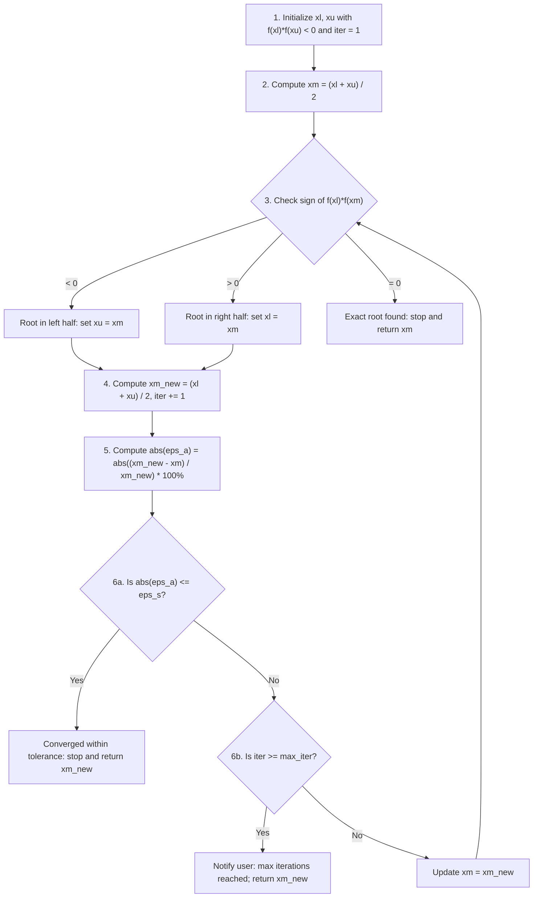

> [!info] Navigation & Sources
> - **Quiz Hub:** [[NM Quiz 1]] | **Next Lecture:** [[2. Errors]]
> - **Course Materials:** [[SWE Math 4543 - OBE Course Outline.pdf]] | [[SWE-Math4543-Lecture1.pdf]] | [[1. bisection.pdf]]
> - **External Practice (Holistic Numerical Methods):**
>   - Textbook: [Numerical Methods with Applications (Autar Kaw)](http://nm.mathforcollege.com/NumericalMethodsTextbookUnabridged/)
>   - Video Channel: [numericalmethodsguy (YouTube)](https://www.youtube.com/@numericalmethodsguy)
>   - Problem Sets: [Holistic Numerical Methods — Physical Problems](https://nm.mathforcollege.com/physical-problems/) | [Chemical Engineering MWS](http://nm.mathforcollege.com/mws/che/)

---

## 1. Solving Engineering Problems & Role of Numerical Methods

**Numerical methods** are techniques by which mathematical problems are formulated so they can be solved using repeated arithmetic and logical operations, producing controlled **approximations** when exact analytical formulas do not exist or are impractical to compute.

Every engineering computation follows four systematic steps:

![[lec1_slide05_problem_solving_steps.png]]

1. **Problem Description:** Identify the physical scenario, given parameters, assumptions, and what quantity needs to be found.
2. **Mathematical Model:** Translate the physical laws (conservation, geometry, kinematics, Archimedes' principle) into algebraic, differential, or integral equations.
3. **Solution of Mathematical Model:** Solve the equations using either an **analytical** method or a **numerical** method.
4. **Using the Solution:** Interpret the numerical output with physical units, check plausibility, and apply it to engineering design or decision-making.

### Analytical vs. Numerical Methods

*(Frequently tested in Mid Exam Q1a)*

| Dimension | Analytical Method | Numerical Method |
| :--- | :--- | :--- |
| **Nature of Solution** | Exact, closed-form symbolic formula | Approximate numerical value (converges iteratively) |
| **Core Mechanism** | Algebraic/calculus manipulation | Arithmetic operations repeated over iterations |
| **When You Stop** | Immediately after substituting numbers into the formula | When approximate relative error falls below tolerance ($\lvert \epsilon_a \rvert \le \epsilon_s$) or max iterations reached |
| **Scope / Generality** | Limited to special equations that admit closed forms | Broadly applicable to nonlinear, coupled, or non-elementary problems |
| **Error Profile** | No method/truncation error in the formula itself | Introduces **truncation error** and **round-off error** (see [[2. Errors]]) |
| **Classic Example** | Quadratic formula: $x = \dfrac{-b \pm \sqrt{b^2 - 4ac}}{2a}$ | Bisection Method, Newton–Raphson, Secant Method |

### Two Core Reasons We Need Numerical Methods

1. **No Analytical Solution Exists:**
   Even simple-looking engineering expressions have no elementary closed-form solution.
   - *Example (Standard Normal CDF):*
     $$\Phi(x) = \frac{1}{\sqrt{2\pi}} \int_{-\infty}^{x} e^{-t^2/2}\, dt$$
     The integrand $e^{-t^2/2}$ has ==no elementary antiderivative==, so probabilities must be computed numerically (which is where $z$-tables and statistical software come from).

   ![[lec1_slide09_normal_cdf.png]]

   - *Other examples:* Transcendental root equations such as $x - \cos x = 0$, or general polynomials of degree $\ge 5$ (Abel–Ruffini theorem).

2. **Analytical Solution Exists, But Is Computationally Intractable:**
   - *Example:* Solving **$1000$ simultaneous linear equations with $1000$ unknowns**. Exact determinant/Cramer's rule formulas exist in theory, but computing $1001$ determinants of size $1000 \times 1000$ by cofactor expansion takes $\sim 1000!$ operations—longer than the age of the universe. Numerical algorithms like Gaussian Elimination solve it in $\sim \frac{2}{3}(1000)^3 \approx 6.7 \times 10^8$ operations (fractions of a second).

> [!question]- Mini-Quiz: Error Formulas Preview
> Match the metrics on Slide 8 (**True Error**, **Relative True Error**, **Relative Approximate Error**) and identify why physics lab pendulum experiments motivated them:
>
> ![[lec1_slide08_miniquiz_approx.png]]
>
> > [!success]- Answer
> > - **True Error:** $E_t = \text{True Value} - \text{Approximate Value}$
> > - **Relative True Error:** $\epsilon_t = \dfrac{\text{True Value} - \text{Approximate Value}}{\text{True Value}}$
> > - **Approximate Error:** $E_a = \text{Present Approximation} - \text{Previous Approximation}$
> > - **Relative Approximate Error:** $\epsilon_a = \dfrac{\text{Present Approximation} - \text{Previous Approximation}}{\text{Present Approximation}}$
> >
> > *(Full derivations, percentage forms, and significant digits rules are covered in [[2. Errors]].)*

---

## 2. Root Finding & The Intermediate Value Theorem (IVT)

A **root** of a function $f(x)$ (also called a *zero* of $f$) is any value $x$ satisfying:
$$f(x) = 0$$
Geometrically, it is an $x$-intercept where the curve $y = f(x)$ crosses or touches the $x$-axis.

Nonlinear root-finding algorithms split into two families:
- **Bracketing Methods** (require two initial guesses that trap a root between them): **Bisection**, [[4. Secant & False Position Method#2. False Position Method (Regula Falsi)|False Position]].
- **Open Methods** (do not need a bracket; faster, but may diverge): [[3. Newton- Raphson Method|Newton–Raphson]], [[4. Secant & False Position Method#1. The Secant Method|Secant]].

### The Intermediate Value Theorem (Basis of Bisection)

> [!important] Theorem (Guarantee of at Least One Root)
> An equation $f(x) = 0$, where $f(x)$ is a ==real and continuous== function on the closed interval $[x_l, x_u]$, has **at least one root** between $x_l$ and $x_u$ if:
> $$f(x_l)\, f(x_u) < 0$$
> In plain terms: if $f$ is continuous and has **opposite signs** at the endpoints, the curve cannot get from one side of the $x$-axis to the other without crossing it at least once.

![[lec1_slide10_ivt_theorem.png]]

### Interpreting Endpoint Signs

Assuming $f(x)$ is **continuous** on $[x_l, x_u]$ and touches are treated carefully:

| Endpoint Product | Visual Meaning | Number of Crossings (Simple Roots) | Implication for Bracketing |
| :--- | :--- | :--- | :--- |
| $f(x_l)\, f(x_u) < 0$ | Opposite signs (one above, one below $x$-axis) | **At least one** (typically an odd number: $1, 3, 5, \dots$) | Safe starting bracket for Bisection |
| $f(x_l)\, f(x_u) > 0$ | Same sign (both above or both below $x$-axis) | **$0$ roots or an even number** of crossings ($2, 4, \dots$), or a **tangent touch** | **Cannot** use Bisection directly (may miss roots!) |
| $f(x_l)\, f(x_u) = 0$ | One or both endpoints sit right on the $x$-axis | Endpoint itself is an exact root | No search needed—return the endpoint where $f = 0$ |

![[lec1_slide11_sign_cases_1.png]]

![[lec1_slide12_sign_cases_2.png]]

> [!question]- Mini-Quiz: Discontinuous Function Edge Case
> Look at Slide 13 below: $f(x_l) > 0$ at $x_l \approx 3.5$ and $f(x_u) < 0$ at $x_u \approx 5.8$, so $f(x_l)\, f(x_u) < 0$, **except** the curve has a vertical jump discontinuity and never crosses the $x$-axis. Does $f(x) = 0$ have a root in $[x_l, x_u]$, and **does the Intermediate Value Theorem fail here**?
>
> ![[lec1_slide13_miniquiz_discontinuous.png]]
>
> > [!success]- Answer
> > **No root exists** in $[x_l, x_u]$, and **the Intermediate Value Theorem itself does NOT fail/break**—its **continuity hypothesis is simply violated**.
> >
> > **Why:** IVT guarantees a root **if and only if** both $f(x_l)f(x_u) < 0$ **and** $f(x)$ is continuous on $[x_l, x_u]$. Because this curve jumps across the $x$-axis without touching it, the theorem does not apply in the first place.

---

## 3. The Bisection Method (Algorithm & Error Analysis)

The **Bisection Method** (also called *binary chopping* or *half-interval method*) repeatedly halves an interval $[x_l, x_u]$ known to bracket a root, always retaining the half where the sign change persists.

### 6-Step Algorithm

1. **Bracket Initialization:** Choose lower guess $x_l$ and upper guess $x_u$ such that $f(x)$ is continuous on $[x_l, x_u]$ and:
   $$f(x_l)\, f(x_u) < 0$$
2. **Midpoint Estimate:** Compute the root estimate as the interval midpoint:
   $$x_m = \frac{x_l + x_u}{2}$$
3. **Subinterval Selection:** Evaluate $f(x_l)\, f(x_m)$ to determine which half keeps the sign change:
   - If $f(x_l)\, f(x_m) < 0$: root is in $[x_l, x_m]$ $\implies$ update $x_u = x_m$ ($x_l$ stays unchanged).
   - If $f(x_l)\, f(x_m) > 0$: root is in $[x_m, x_u]$ $\implies$ update $x_l = x_m$ ($x_u$ stays unchanged).
   - If $f(x_l)\, f(x_m) = 0$: $x_m$ is the **exact root** $\implies$ stop!
4. **New Midpoint Estimate:** Compute the updated midpoint from the new bracket:
   $$x_m^{\text{new}} = \frac{x_l + x_u}{2}$$
5. **Compute Relative Approximate Error** *(meaningful from Iteration 2 onward)*:
   $$\lvert \epsilon_a \rvert = \left| \frac{x_m^{\text{new}} - x_m^{\text{old}}}{x_m^{\text{new}}} \right| \times 100\%$$
6. **Stopping Check:** Check tolerances and iteration limit:
   - If $\lvert \epsilon_a \rvert \le \epsilon_s$: convergence achieved $\implies$ stop and report $x_m^{\text{new}}$.
   - Else if $\text{iter} \ge \text{max\_iter}$: stop and **notify the user** that the maximum iteration limit was reached before reaching $\epsilon_s$.
   - Otherwise, set $x_m^{\text{old}} = x_m^{\text{new}}$, increment $\text{iter}$, and repeat from Step 3.

> [!note] Guaranteed Minimum Significant Digits ($m$)
> Whenever your stopping criterion satisfies:
> $$\lvert \epsilon_a \rvert \le 0.5 \times 10^{2-m}\%$$
> the result has at least **$m$ significant digits** correct (covered in detail in [[2. Errors]]). Solving for $m$ from a non-zero percentage $\lvert \epsilon_a \rvert > 0$ gives:
> $$m = \max\!\left(0,\ \left\lfloor 2 - \log_{10}\!\left(2 \lvert \epsilon_a \rvert\%\right) \right\rfloor\right)$$
> *(Why $5\%$ is the cutoff for $m = 1$: substituting $m = 1$ gives $0.5 \times 10^{2-1}\% = 5\%$, so any $\lvert \epsilon_a \rvert > 5\%$ guarantees $m = 0$.)*

> [!tip] Interval Width Property (Bounds Absolute True Error $\lvert E_t \rvert$)
> Before testing the $n$-th midpoint $x_m^{(n)}$ (after $n-1$ halvings), the active bracket has width $\dfrac{x_u - x_l}{2^{n-1}}$, so the midpoint $x_m^{(n)}$ sits within half that width of any root inside it:
> $$\lvert E_t^{(n)} \rvert = \lvert x_{\text{true}} - x_m^{(n)} \rvert \le \frac{x_u - x_l}{2^n}$$
> After the $n$-th sign check selects the better half, the updated bracket shrinks to width $\dfrac{x_u - x_l}{2^n}$.
> - Note carefully: this formula bounds the **absolute true error** $\lvert E_t \rvert$, **not** the percentage approximate error $\lvert \epsilon_a \rvert\%$.
> - Bisection converges **linearly**—each iteration gains $1$ binary bit ($\approx 0.301$ decimal digits) of accuracy.

> [!tip] 35-Minute Exam Speed Workflow (`Casio fx-991ES / EX` + Sign-Only Tracking)
> 1. **Check `RAD` mode first** whenever trig functions ($\sin, \cos, \tan$) appear!
> 2. **Type $f(X)$ once and use `CALC`:** Enter your expression with `ALPHA )` ($X$), press `CALC`, test $x_l$ and $x_u$, and from then on only press `CALC` at each new $x_m$.
> 3. **Skip multiplying $f(x_l)\cdot f(x_m)$:** Just write **`(+)`** or **`(-)`** beside $x_l$ and $x_u$ in your table margin—whichever endpoint matches the sign of $f(x_m)$ gets replaced by $x_m$. That cuts function evaluations to **1 per row**!
> 4. **Keep full calculator digits when evaluating $f(x_m)$:** Even if the question asks to display 4 decimals in the table, keep full precision in $x_m$ before substituting into $f(x_m)$ unless told otherwise.

---

## 4. Worked Examples

### Worked Example 1: Finding $\sqrt[3]{20}$

**Problem:** Find a root of $f(x) = x^3 - 20 = 0$ using Bisection starting with $[x_l, x_u] = [1, 4]$. Conduct 3 iterations.

*(Convention note: Slides 17–21 treat computing $x_m = 2.5$ alone as Iteration 1 and evaluate $f(2.5)$ at the start of Iteration 2; `1. bisection.pdf` Table 1 and the tables below complete the midpoint, function value, and bracket update cleanly inside each row.)*

- **Check Starting Bracket:**
  $$f(1) = 1^3 - 20 = -19 < 0, \qquad f(4) = 4^3 - 20 = 44 > 0$$
  Since $f(1)f(4) = -836 < 0$ and $f(x)$ is a polynomial (continuous everywhere), a root is guaranteed in $[1, 4]$. *(True root: $\sqrt[3]{20} \approx 2.7144176$.)*

- **Iteration 1:**
  $$x_m = \frac{1 + 4}{2} = 2.5$$
  $$f(2.5) = (2.5)^3 - 20 = 15.625 - 20 = -4.375$$
  Check sign: $f(1)f(2.5) = (-19)(-4.375) > 0 \implies$ root is in $[2.5, 4]$, so set $x_l = 2.5, x_u = 4$.
  $\lvert \epsilon_a \rvert$: Not defined on Iteration 1.

- **Iteration 2:**
  $$x_m = \frac{2.5 + 4}{2} = 3.25$$
  $$\lvert \epsilon_a \rvert = \left|\frac{3.25 - 2.5}{3.25}\right| \times 100\% = 23.0769\% \approx 23.1\% \quad (m = 0)$$
  $$f(3.25) = (3.25)^3 - 20 = 34.328125 - 20 = +14.328125$$
  Check sign: $f(2.5)f(3.25) = (-4.375)(+14.328125) < 0 \implies$ root is in $[2.5, 3.25]$, so set $x_u = 3.25$.

- **Iteration 3:**
  $$x_m = \frac{2.5 + 3.25}{2} = 2.875$$
  $$\lvert \epsilon_a \rvert = \left|\frac{2.875 - 3.25}{2.875}\right| \times 100\% = 13.0435\% \approx 13.0\% \quad (m = 0)$$
  $$f(2.875) = (2.875)^3 - 20 = 23.76367 - 20 = +3.76367$$
  Check sign: $f(2.5)f(2.875) < 0 \implies$ next bracket is $[2.5, 2.875]$.

| Iteration | $x_l$ | $x_u$ | $x_m$ | $f(x_m)$ | $\lvert \epsilon_a \rvert$ (%) | Significant Digits ($m$) |
| :---: | :---: | :---: | :---: | :---: | :---: | :---: |
| 1 | $1$ | $4$ | $2.5$ | $-4.375$ | N/A | N/A |
| 2 | $2.5$ | $4$ | $3.25$ | $+14.3281$ | $23.08\%$ | $0$ |
| 3 | $2.5$ | $3.25$ | $2.875$ | $+3.7637$ | $13.04\%$ | $0$ |

---

### Worked Example 2: Floating Toilet Ball

![[lec1_floating_ball_diagram.png]]

**Problem:** A spherical ball of specific gravity $SG = 0.6$ and radius $R = 5.5\text{ cm} = 0.055\text{ m}$ floats in water. From Archimedes' principle, the submerged depth $x$ satisfies:
$$f(x) = x^3 - 0.165x^2 + 3.993 \times 10^{-4} = 0$$
Use the Bisection Method to estimate $x$.

1. **Physical Bracket:** Since the submerged depth $x$ must lie between $0$ (empty) and diameter $2R = 0.11\text{ m}$ (fully submerged), start with $[x_l, x_u] = [0, 0.11]$:
   $$f(0) = +3.993 \times 10^{-4} > 0, \qquad f(0.11) = (0.11)^3 - 0.165(0.11)^2 + 3.993 \times 10^{-4} = -2.662 \times 10^{-4} < 0$$
   Opposite signs $\implies$ root lies in $[0, 0.11]$.

2. **First 3 Iterations in Detail:**
   - **Iter 1:** $x_m = \dfrac{0 + 0.11}{2} = 0.055$, $f(0.055) = +6.655 \times 10^{-5} > 0$. Since $f(0)f(0.055) > 0$, new bracket is $[0.055, 0.11]$.
   - **Iter 2:** $x_m = \dfrac{0.055 + 0.11}{2} = 0.0825$, $\lvert \epsilon_a \rvert = \left|\dfrac{0.0825 - 0.055}{0.0825}\right| \times 100\% = 33.33\%$. $f(0.0825) = -1.622 \times 10^{-4} < 0 \implies$ new bracket $[0.055, 0.0825]$.
   - **Iter 3:** $x_m = \dfrac{0.055 + 0.0825}{2} = 0.06875$, $\lvert \epsilon_a \rvert = \left|\dfrac{0.06875 - 0.0825}{0.06875}\right| \times 100\% = 20.00\%$. $f(0.06875) = -5.563 \times 10^{-5} < 0 \implies$ new bracket $[0.055, 0.06875]$.

3. **Full 10-Iteration Convergence Table:** *(Note how slow Bisection is compared to Newton–Raphson in [[3. Newton- Raphson Method]])*

| Iteration | $x_l$ | $x_u$ | $x_m$ | $f(x_m)$ | $\lvert \epsilon_a \rvert$ (%) | $m$ |
| :---: | :---: | :---: | :---: | :---: | :---: | :---: |
| 1 | $0.00000$ | $0.11000$ | $0.05500$ | $+6.655 \times 10^{-5}$ | — | — |
| 2 | $0.05500$ | $0.11000$ | $0.08250$ | $-1.622 \times 10^{-4}$ | $33.33\%$ | $0$ |
| 3 | $0.05500$ | $0.08250$ | $0.06875$ | $-5.563 \times 10^{-5}$ | $20.00\%$ | $0$ |
| 4 | $0.05500$ | $0.06875$ | $0.06188$ | $+4.484 \times 10^{-6}$ | $11.11\%$ | $0$ |
| 5 | $0.06188$ | $0.06875$ | $0.06531$ | $-2.593 \times 10^{-5}$ | $5.263\%$ | $0$ |
| 6 | $0.06188$ | $0.06531$ | $0.06359$ | $-1.080 \times 10^{-5}$ | $2.703\%$ | $1$ |
| 7 | $0.06188$ | $0.06359$ | $0.06273$ | $-3.176 \times 10^{-6}$ | $1.370\%$ | $1$ |
| 8 | $0.06188$ | $0.06273$ | $0.06230$ | $+6.497 \times 10^{-7}$ | $0.6897\%$ | $1$ |
| 9 | $0.06230$ | $0.06273$ | $0.06252$ | $-1.264 \times 10^{-6}$ | $0.3436\%$ | $2$ |
| 10 | $0.06230$ | $0.06252$ | $0.06241$ | $-3.077 \times 10^{-7}$ | $0.1721\%$ | $2$ |

*(Note: table values reflect full internal precision while displaying 5 decimals.)* At Iteration 9, $\lvert \epsilon_a \rvert = 0.3436\% \le 0.5\%$ already guarantees **$m = 2$ significant digits** ($0.062$), and by Iteration 10 $\lvert \epsilon_a \rvert = 0.1721\%$. *(True root $\approx 0.06238\text{ m}$.)*

---

## 5. Advantages & Drawbacks of the Bisection Method

*(Tested in Final Exam Q1b)*

### Advantages (2)
1. **Always Converges (Guaranteed):** Because the root stays inside $[x_l, x_u]$ at every iteration and the interval width shrinks by half each step, divergence is impossible once a valid continuous bracket is found.
2. **Error Bound Is Known & Shrinks Systematically:** At every step, the error is bounded by half the current interval width ($\frac{x_u - x_l}{2^n}$), letting you calculate the exact number of iterations needed to reach any tolerance *before* running the algorithm!

### Drawbacks (4) — *High-Yield Exam Topic (Final Exam Q1b)*

1. **Slow Convergence:**
   Since the interval shrinks by a fixed factor of $2$ regardless of the function's shape, it takes many iterations to achieve high accuracy (linear convergence).
2. **Wastes Iterations When One Guess Is Already Very Close:**
   Bisection completely ignores the *magnitudes* of $f(x_l)$ and $f(x_u)$—it only checks their *signs*. As shown below, even when $x_l = 3.5$ is already right next to $x_{\text{root}}$ while $x_u = 5.5$ is far away, the midpoint jumps far from $x_{\text{root}}$ anyway. *(This motivates [[4. Secant & False Position Method#2. False Position Method (Regula Falsi)|False Position]].)*

   ![[lec1_slide23_drawbacks_slow.png]]

3. **Cannot Detect Roots Where $f(x)$ Touches Without Crossing (Tangent / Even-Multiplicity Roots):**
   For $f(x) = x^2 = 0$, the graph touches $(0,0)$ and stays $\ge 0$ everywhere. For any bracket $[x_l, x_u]$ around $0$, $f(x_l) > 0$ and $f(x_u) > 0$, so $f(x_l)f(x_u) > 0$ fails to bracket the root.

   ![[lec1_slide24_drawbacks_tangent.png]]

4. **Singularity Trap (Discontinuity with Sign Change):**
   For $f(x) = \frac{1}{x} = 0$ on $[-2, 3]$, $f(-2) = -0.5 < 0$ and $f(3) = +0.333 > 0$. Opposite signs fool the algorithm into halving toward $x = 0$, which is a **vertical asymptote (singularity)**—not a root!

   ![[lec1_slide25_drawbacks_singularity.png]]

> [!error] High-Yield Exam Traps
> 1. **Forgetting the Continuity Clause in IVT:** $f(x_l)f(x_u) < 0$ alone does **not** guarantee a root—think of $f(x) = \frac{1}{x}$ or a step jump! Always write "**continuous and real** on $[x_l, x_u]$".
> 2. **Reporting $\lvert \epsilon_a \rvert$ on Iteration 1:** Wait until Iteration 2 to compute relative approximate error, because Iteration 1 has no previous midpoint $x_m^{\text{old}}$. *(Lab trap from `Lab/bisection.ipynb`: the lab code guards `midN == 0` with `+ 1e-20` and omits `max_iter`; when $f(x)=x$ hits the root at $0$, $|\epsilon_a|\%$ can stay $\sim 300\%\text{–}3200\%$ above tolerance and loop ~550 times until floating-point underflow makes `f(xl)*f(mid) == 0.0`—another reason to always code `max_iter`!)*
> 3. **Updating the Wrong Bound:** Don't memorize blindly—verify on a quick number line:
>    - If $f(x_l)$ and $f(x_m)$ have **opposite** signs ($< 0$), the root is between $x_l$ and $x_m$, so discard $x_u$ ($\text{new } x_u = x_m$).
>    - If $f(x_l)$ and $f(x_m)$ have the **same** sign ($> 0$), the root is between $x_m$ and $x_u$, so discard $x_l$ ($\text{new } x_l = x_m$).
> 4. **Dividing by $x_m^{\text{old}}$ instead of $x_m^{\text{new}}$:** The denominator of $\epsilon_a$ is **always the present (newest) approximation** $x_m^{\text{new}}$.
> 5. **Trig in `DEG` Mode:** Before evaluating $\tan(x)$ or $\sin(x)$ on your calculator, confirm the **`RAD`** indicator is on!

---

## 6. Practice Problems

Try each problem on paper before expanding the hidden solution box!

### Problem 1 (Conceptual & Modeling — Final Exam Pattern)
Explain the **four steps** of solving an engineering problem using a brief real-world or numerical example. Then give two distinct reasons why numerical methods are needed even when mathematical models are well-understood.

> [!success]- Solution (Problem 1)
> **Four Steps (Example: Floating Sphere Depth):**
> 1. **Problem Description:** Determine the submerged depth $x$ of a spherical toilet tank ball ($R = 0.055\text{ m}$, $SG = 0.6$) floating in water.
> 2. **Mathematical Model:** Equate buoyant weight of displaced water to sphere weight via Archimedes' principle, producing the cubic equation $x^3 - 0.165x^2 + 3.993 \times 10^{-4} = 0$.
> 3. **Solution of Mathematical Model:** Because the depressed cubic is messy to solve analytically, apply a numerical root finder such as Bisection on $[0, 0.11]$.
> 4. **Using the Solution:** Obtain $x \approx 0.06238\text{ m}$ ($6.24\text{ cm}$), verify $0 \le x \le 0.11\text{ m}$, and size the valve lever arm accordingly.
>
> **Two Reasons Numerical Methods Are Necessary:**
> 1. **Analytical solutions may not exist:** e.g., Standard Normal CDF $\Phi(x) = \frac{1}{\sqrt{2\pi}} \int_{-\infty}^{x} e^{-t^2/2}\,dt$ has no elementary antiderivative.
> 2. **Analytical solutions may be impractical:** e.g., solving $1000$ simultaneous linear equations for $1000$ unknowns by exact determinant/Cramer's rule formulas is computationally impossible in practice.

---

### Problem 2 (IVT & Sign-Change Edge Cases)
For each function and interval below, state whether the **Bisection Method can be applied directly** and justify your answer:
1. $f(x) = x^2 - 4x + 4$ on $[1, 3]$
2. $f(x) = \tan(x)$ on $[1, 2]$ *(calculator in **radians**, `RAD` mode)*
3. $f(x) = e^{-x} - x$ on $[0, 1]$

> [!success]- Solution (Problem 2)
> 1. **$f(x) = x^2 - 4x + 4 = (x-2)^2$ on $[1, 3]$ — NO:**
>    $f(1) = 1 > 0$ and $f(3) = 1 > 0$, so $f(1)f(3) > 0$. Even though a real root exists at $x = 2$, it is a tangent root (even multiplicity) with no sign change, so Bisection cannot bracket it.
> 2. **$f(x) = \tan(x)$ on $[1, 2]$ — NO:**
>    $\tan(1) \approx 1.5574 > 0$ and $\tan(2) \approx -2.1850 < 0$ have opposite signs, **but** $f(x)$ has a vertical asymptote discontinuity at $x = \frac{\pi}{2} \approx 1.5708 \in [1, 2]$. Continuity fails, so Bisection will falsely converge to the singularity $\frac{\pi}{2}$ instead of a root.
> 3. **$f(x) = e^{-x} - x$ on $[0, 1]$ — YES:**
>    $f(x)$ is continuous on $[0, 1]$, $f(0) = 1 - 0 = +1 > 0$, and $f(1) = e^{-1} - 1 \approx -0.6321 < 0$. Opposite signs + continuity guarantee a root in $[0, 1]$.

---

### Problem 3 (Hand Calculation — Transcendental Equation)
Use the Bisection Method to find a root of:
$$f(x) = e^{-x} - x = 0$$
starting from $[x_l, x_u] = [0, 1]$. Perform **4 iterations**, reporting $x_l, x_u, x_m, f(x_m), \lvert \epsilon_a \rvert\%$ and significant digits $m$ at each step (round intermediate decimals to 4 decimal places).

> [!success]- Solution (Problem 3)
> Check endpoints: $f(0) = e^0 - 0 = 1 > 0$, $f(1) = e^{-1} - 1 \approx -0.6321 < 0$.
>
> - **Iteration 1:** $x_m = \frac{0+1}{2} = 0.5$.
>   $f(0.5) = e^{-0.5} - 0.5 = 0.6065 - 0.5 = +0.1065 > 0$.
>   Since $f(0)f(0.5) > 0$, new bracket is $[0.5, 1]$. ($\lvert \epsilon_a \rvert$: N/A)
> - **Iteration 2:** $x_m = \frac{0.5+1}{2} = 0.75$.
>   $\lvert \epsilon_a \rvert = \left|\frac{0.75 - 0.5}{0.75}\right| \times 100\% = 33.33\%$ ($m = 0$).
>   $f(0.75) = e^{-0.75} - 0.75 = 0.4724 - 0.75 = -0.2776 < 0$.
>   Since $f(0.5)f(0.75) < 0$, new bracket is $[0.5, 0.75]$.
> - **Iteration 3:** $x_m = \frac{0.5+0.75}{2} = 0.625$.
>   $\lvert \epsilon_a \rvert = \left|\frac{0.625 - 0.75}{0.625}\right| \times 100\% = 20.00\%$ ($m = 0$).
>   $f(0.625) = e^{-0.625} - 0.625 = 0.5353 - 0.625 = -0.0897 < 0$.
>   Since $f(0.5)f(0.625) < 0$, new bracket is $[0.5, 0.625]$.
> - **Iteration 4:** $x_m = \frac{0.5+0.625}{2} = 0.5625$.
>   $\lvert \epsilon_a \rvert = \left|\frac{0.5625 - 0.625}{0.5625}\right| \times 100\% = 11.11\%$ ($m = 0$).
>   $f(0.5625) = e^{-0.5625} - 0.5625 = 0.5698 - 0.5625 = +0.0073 > 0$.
>   New bracket for Iter 5 would be $[0.5625, 0.625]$.
>
> | Iter | $x_l$ | $x_u$ | $x_m$ | $f(x_m)$ | $\lvert \epsilon_a \rvert$ (%) | $m$ |
> | :---: | :---: | :---: | :---: | :---: | :---: | :---: |
> | 1 | $0.0000$ | $1.0000$ | $0.5000$ | $+0.1065$ | N/A | N/A |
> | 2 | $0.5000$ | $1.0000$ | $0.7500$ | $-0.2776$ | $33.33\%$ | $0$ |
> | 3 | $0.5000$ | $0.7500$ | $0.6250$ | $-0.0897$ | $20.00\%$ | $0$ |
> | 4 | $0.5000$ | $0.6250$ | $0.5625$ | $+0.0073$ | $11.11\%$ | $0$ |
>
> *(True root $\approx 0.5671$.)*

---

### Problem 4 (Hand Calculation — Cubic Polynomial)
Estimate the positive real root of the Plastic Ratio equation:
$$f(x) = x^3 - x - 1 = 0$$
using Bisection on $[x_l, x_u] = [1, 2]$ for **3 iterations**.

> [!success]- Solution (Problem 4)
> Check endpoints: $f(1) = 1 - 1 - 1 = -1 < 0$, $f(2) = 8 - 2 - 1 = 5 > 0$. Valid bracket!
>
> - **Iteration 1:** $x_m = \frac{1+2}{2} = 1.5$.
>   $f(1.5) = 3.375 - 1.5 - 1 = +0.875 > 0$.
>   Since $f(1)f(1.5) < 0$, update bracket to $[1, 1.5]$. ($\lvert \epsilon_a \rvert$: N/A)
> - **Iteration 2:** $x_m = \frac{1+1.5}{2} = 1.25$.
>   $\lvert \epsilon_a \rvert = \left|\frac{1.25 - 1.5}{1.25}\right| \times 100\% = 20.00\%$ ($m = 0$).
>   $f(1.25) = 1.953125 - 1.25 - 1 = -0.296875 < 0$.
>   Since $f(1)f(1.25) > 0$, update bracket to $[1.25, 1.5]$.
> - **Iteration 3:** $x_m = \frac{1.25+1.5}{2} = 1.375$.
>   $\lvert \epsilon_a \rvert = \left|\frac{1.375 - 1.25}{1.375}\right| \times 100\% = 9.091\%$ ($m = 0$).
>   $f(1.375) = 2.599609 - 1.375 - 1 = +0.224609 > 0$.
>   Next bracket would be $[1.25, 1.375]$. *(True root $\psi \approx 1.32472$.)*

---

### Problem 5 (Bracket Width & Required Iterations)
Suppose you start Bisection on the interval $[2, 10]$ for a continuous function with $f(2)f(10) < 0$.
1. After $5$ iterations (meaning $5$ midpoints $x_m^{(1)}, \dots, x_m^{(5)}$ computed), what is the guaranteed upper bound on the **true error** $\lvert x_{\text{true}} - x_m^{(5)} \rvert$?
2. How many iterations $n$ are required to guarantee that the absolute true error $\lvert x_{\text{true}} - x_m^{(n)} \rvert \le 10^{-3}$?

> [!success]- Solution (Problem 5)
> Initial interval width: $\Delta x_0 = x_u - x_l = 10 - 2 = 8$.
> Before the $n$-th sign check, the $n$-th midpoint $x_m^{(n)}$ sits at the center of an interval of width $\frac{\Delta x_0}{2^{n-1}}$, so its distance to either endpoint—and hence to $x_{\text{true}}$—is at most half that width (matching the interval width *after* the $n$-th update):
> $$\lvert E_t^{(n)} \rvert \le \frac{x_u - x_l}{2^n} = \frac{8}{2^n}$$
>
> 1. **For $n = 5$:**
>    $$\lvert E_t^{(5)} \rvert \le \frac{8}{2^5} = \frac{8}{32} = 0.25$$
> 2. **For $\lvert E_t^{(n)} \rvert \le 10^{-3}$:**
>    $$\frac{8}{2^n} \le 10^{-3} \implies 2^n \ge 8000$$
>    Since $2^{12} = 4096 < 8000$ and $2^{13} = 8192 \ge 8000$, we need **$n = 13$ iterations** (equivalently, $n \ge \lceil \log_2(8000) \rceil = \lceil 12.9658 \rceil = 13$).

---

### Problem 6 (Drawbacks Sketch — Final Exam Q1b Pattern)
List the **four drawbacks** of the Bisection Method and provide a mathematical function + starting interval illustrating the two failure modes (tangent root and singularity).

> [!success]- Solution (Problem 6)
> 1. **Slow convergence:** Linear convergence because the bracket width halves blindly at every step.
> 2. **Wastes iterations if one initial guess is already close to the root:** Bisection checks only signs, ignoring magnitudes ($|f(x_l)| \ll |f(x_u)|$), so the first midpoint jumps away from the close guess.
> 3. **Fails on tangent / even-multiplicity roots:** e.g., $f(x) = x^2 = 0$ on $[-1, 1]$ has $f(-1) = 1 > 0$ and $f(1) = 1 > 0$; since $f(x_l)f(x_u) > 0$, Bisection cannot be started.
> 4. **Converges falsely toward singularities:** e.g., $f(x) = \frac{1}{x} = 0$ on $[-2, 3]$ satisfies $f(-2)f(3) < 0$, so Bisection brackets and halves down toward $x = 0$, which is a vertical asymptote discontinuity, not a root.
