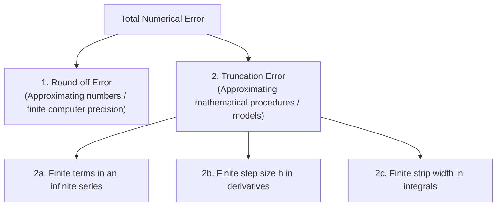

> [!info] Navigation & Sources
> - **Quiz Hub:** [[NM Quiz 1]] | **Previous:** [[1. Introduction & Bisection Method]] | **Next:** [[3. Newton- Raphson Method]]
> - **Course Materials:** [[SWE-Math4543-Lecture2.pdf]] | [[measuringerror.pdf]] | [[sourcesoferror.pdf]]

> [!tip] My In-Class Note: Why Gradient Descent Uses Approximate Error for Steps
> > *"Gradient Descent -> Why we use Approximate Error in this? for Steps? — When true value of a function is unknown."*
>
> **Expanding on that exact class insight:**
> In iterative optimization like **Gradient Descent** ($\theta_{k+1} = \theta_k - \eta \nabla L(\theta_k)$) or root finding (Bisection, Newton–Raphson), we are searching for a minimum $\theta^*$ or root $x^*$ whose **true value is unknown beforehand**! Because $x_{\text{true}}$ is unknown, we cannot compute the True Error ($E_t = x_{\text{true}} - x_{\text{approx}}$) or Relative True Error ($\epsilon_t$).
> Instead, at each step we measure how much our estimate changed from the previous step using **Approximate Error** ($E_a = x_{\text{present}} - x_{\text{previous}}$) or **Relative Approximate Error** ($\epsilon_a = \frac{E_a}{x_{\text{present}}}$), and stop once $\lvert \epsilon_a \rvert \le \epsilon_s$ (or $\lvert E_a \rvert \le \text{tol}$). Even in Machine Learning training loops, stopping when parameter steps $\lVert \theta_{k+1} - \theta_k \rVert$ or loss changes $\lvert L_{k+1} - L_k \rvert$ fall below a threshold is literally applying **Approximate Error**!

---

## 1. Error Management & Quantifying Errors

Because numerical methods return **approximations**, engineers must handle error across three goals:
1. **Identify** where the error comes from (round-off vs. truncation).
2. **Quantify** how large the error is (true vs. approximate; absolute vs. relative).
3. **Minimize** the error within acceptable computational cost and tolerance $\epsilon_s$.

### The Four Core Error Formulas

| Error Metric | Formula | When Used | Carries Units? |
| :--- | :--- | :--- | :--- |
| **True Error** ($E_t$) | $E_t = \text{True Value} - \text{Approximate Value}$ *(True Value is also called the **Ground Truth value**)* | Mainly to verify/benchmark a numerical program against known analytical cases (`measuringerror.pdf` p. 3) | Yes |
| **Relative True Error** ($\epsilon_t$) | $\epsilon_t = \dfrac{\text{True Value} - \text{Approximate Value}}{\text{True Value}}$ *(or $\times 100\%$)* | Comparing accuracy across different scales (**scale-invariant**) | No (dimensionless / %) |
| **Approximate Error** ($E_a$) | $E_a = \text{Present Approximation} - \text{Previous Approximation}$ | Iterative methods when true value is **unknown** | Yes |
| **Relative Approximate Error** ($\epsilon_a$) | $\epsilon_a = \dfrac{\text{Present Approximation} - \text{Previous Approximation}}{\text{Present Approximation}}$ *(or $\times 100\%$)* | Iterative stopping criterion ($\lvert \epsilon_a \rvert \le \epsilon_s$, **scale-invariant**) | No (dimensionless / %) |

> [!important] Why Do We Need **Relative** Errors Instead of Absolute Errors?
> Absolute error ($E_t$ or $E_a$) is **not scale-invariant**—a $1\text{ cm}$ error measuring a microchip vs. a $1\text{ cm}$ error measuring a suspension bridge mean completely different levels of precision! Both $\epsilon_t$ and $\epsilon_a$ remain unchanged when a quantity is scaled (`Slides 14 & 16`).
>
> **Proof (Scale Invariance Example on $f(x) = 7e^{0.5x}$ at $x = 2$, $h = 0.3$):**
> Suppose we approximate the derivative $f'(2)$ of $f(x) = 7e^{0.5x}$ using the forward difference $\frac{f(x+h) - f(x)}{h}$ with $h = 0.3$:
> - Exact value: $f'(x) = 3.5e^{0.5x} \implies f'(2) = 3.5e^1 = 9.5140$ (`measuringerror.pdf` keeps extra precision: $9.5140275$).
> - Forward difference (5-sig-digit table values): $f'(2) \approx \frac{f(2.3) - f(2)}{0.3} = \frac{22.107 - 19.028}{0.3} = 10.263$ *(higher precision: $10.265$)*.
> - True error: $E_t = 9.5140 - 10.263 = -0.749$ $\implies$ $\epsilon_t = \frac{-0.749}{9.5140} = -0.078726 = -7.8726\%$ *(textbook: $E_t = -0.75061, \epsilon_t = -0.078895 = -7.8895\%$; note `measuringerror.pdf` p. 3 prints `-0.0758895 × 100% = -7.58895%` as a minor digit transposition typo)*.
>
> ![[lec2_slide06_true_error_derivative.png]]
>
> Now scale the function down by $10^{-6}$ to $g(x) = 7 \times 10^{-6} e^{0.5x}$:
> - Exact $g'(2) = 9.5140 \times 10^{-6}$, approximate $g'(2) \approx 10.263 \times 10^{-6}$.
> - True error drops by a million times: $E_t = -0.749 \times 10^{-6}$ (looks tiny, misleading!).
> - **Relative True Error stays identical:** $\epsilon_t = \frac{-0.749 \times 10^{-6}}{9.5140 \times 10^{-6}} = -7.8726\%$!
>
> *(Think of thermal expansion of steel at $6.47\ \mu\text{in/in/}^\circ\text{F}$: an absolute error of $10^{-6}\text{ in}$ sounds tiny until you realize the true value itself is $O(10^{-6})$!)*

### Computing Approximate Error Between Step Sizes
Continuing $f(x) = 7e^{0.5x}$ at $x = 2$, suppose we do **not** know the exact derivative, so we refine step size from $h = 0.3$ (previous) to $h = 0.15$ (present):
- Previous ($h = 0.3$): $f'(2)_{\text{prev}} = 10.263$
- Present ($h = 0.15$): $f'(2)_{\text{pres}} = \frac{f(2.15) - f(2)}{0.15} = \frac{20.510 - 19.028}{0.15} = 9.8800$ *(higher precision: $9.8799$)*
- Approximate Error: $E_a = 9.8800 - 10.263 = -0.38300$ *(higher precision: $-0.38474$)*
- Relative Approximate Error: $\epsilon_a = \frac{-0.38300}{9.8800} = -0.038765 = -3.8765\%$ *(higher precision: $-3.8942\%$)*
*(Scaling $f$ by $10^{-6}$ scales $E_a$ by $10^{-6}$, while $\epsilon_a = -3.8765\%$ stays identical—proving $\epsilon_a$ is scale-invariant too.)*

![[lec2_slide13_approx_error_derivative.png]]

> [!note] Hillsborough County Population Illustration (Adapted from `measuringerror.pdf` p. 6)
> `measuringerror.pdf` p. 6 uses Hillsborough County's census population (`1,079,587` vs. rounded `1,000,000`) to motivate significant digits; computing true errors on those numbers gives extra intuition:
> $$E_t = 1{,}079{,}587 - 1{,}000{,}000 = 79{,}587, \qquad \epsilon_t = \frac{79{,}587}{1{,}079{,}587} \times 100\% = 7.372\%$$

---

## 2. Significant Digits & Tolerance Stopping Criterion

*(Tested in **Quiz-01 Q2a & Q2b**)*

**Significant digits** are the reliable digits in a number that represent meaningful precision (specifically, starting from the leftmost nonzero digit through the rightmost guaranteed/certain digit).

### The 5 Rules for Counting Significant Digits

| Rule | Description | Example | Significant Digits |
| :---: | :--- | :--- | :---: |
| **1. Nonzero digits** | All digits `1–9` are always significant | `81`, `26.2` | `81` $\to$ **2**, `26.2` $\to$ **3** |
| **2. Captive zeros** | Zeros *between* nonzero digits are significant | `5200.38` | **6** |
| **3. Leading zeros** | Zeros to the *left* of the first nonzero digit are placeholders only (**never** significant) | `0.007` | **1** |
| **4. Trailing zeros + decimal point** | Trailing zeros at the right are significant **if and only if a decimal point is present** (in Slide 18: *"zeros that are willingly considered to be significant"*) | `380.0`, `78800.` | `380.0` $\to$ **4**, `78800.` $\to$ **5** |
| **5. Trailing zeros, NO decimal point** | Ambiguous in plain integers! Minimum guaranteed sig figs **drops** trailing zeros (use scientific notation to clarify) | `78800` | **At least 3** ($7.88 \times 10^4$) |
| **6. Exact / Counted Numbers** | Exact integer counts and defined constants carry **infinite ($\infty$)** significant digits | `5` apples $= 5.000\dots$, `2` in $2\pi r$ | **Infinite ($\infty$)** |

> [!tip] Eliminating Ambiguity with Scientific Notation (`measuringerror.pdf`)
> Writing `1079` vs `1079000` is clearer in scientific notation:
> - $1.079 \times 10^3$ has **4** significant digits.
> - $1.0790 \times 10^3$ has **5** significant digits.
> - Only the coefficient (mantissa) before $\times 10^k$ counts toward significant digits—the exponent ($10^k$, even $10^{911}$) contributes **zero** significant digits!

> [!question]- Mini-Quiz: Count Minimum Significant Digits
> State the **minimum number of significant digits** for each of the following numbers:
> `81`, `26.2`, `0.007`, `5200.38`, `380.0`, `78800`, `78800.`
>
> > [!success]- Answer
> > - `81` $\to$ **2** (both nonzero)
> > - `26.2` $\to$ **3** (all nonzero)
> > - `0.007` $\to$ **1** (`0.00` are leading placeholder zeros)
> > - `5200.38` $\to$ **6** (zeros are captive between `2` and `3`)
> > - `380.0` $\to$ **4** (decimal point present $\implies$ trailing zero counts)
> > - `78800` $\to$ **3** (no decimal point $\implies$ trailing zeros are not guaranteed significant)
> > - `78800.` $\to$ **5** (explicit trailing decimal point makes all five digits significant)
> >
> > ![[lec2_slide21_sigfig_miniquiz.png]]

### Relating $\lvert \epsilon_a \rvert$ to Significant Digits ($m$) — *Scarborough's Criterion*

> [!important] Significant Digits Stopping Formula (Quiz-01 Q2a!)
> If the absolute relative approximate error satisfies:
> $$\lvert \epsilon_a \rvert \le 0.5 \times 10^{2 - m}\% \qquad \text{(or in fractional form: } \lvert \epsilon_a \rvert \le 0.5 \times 10^{-m}\text{)}$$
> then the result is *expected to be correct* to **at least $m$ significant digits** (`Slide 23`).
> - **Quick intuition:** Rounding at the $m$-th significant digit causes at most a half-unit error ($0.5 \times 10^{-m}$) relative to the worst-case leading digit `1`, which equals $0.5 \times 10^{2-m}\%$.
> - **Rule-of-thumb caveat:** Scarborough's criterion is a heuristic—if an iterative method stalls or converges very slowly, $\lvert \epsilon_a \rvert$ can temporarily look small even while $\lvert \epsilon_t \rvert$ is still large.
>
> For quick table checks, solve for $m$ from a non-zero percentage $\lvert \epsilon_a \rvert\% > 0$ (clamped at $0$ when $\lvert \epsilon_a \rvert > 50\%$):
> $$m = \max\!\left(0,\ \left\lfloor 2 - \log_{10}\!\left(2 \lvert \epsilon_a \rvert\%\right) \right\rfloor\right)$$
> *(In a 35-minute quiz, don't type logs on your calculator—just memorize the **`5%, 0.5%, 0.05%, 0.005%`** thresholds below!)*

| Minimum Significant Digits ($m$) | Required Threshold $\epsilon_s = 0.5 \times 10^{2-m}\%$ | Mnemonic |
| :---: | :---: | :--- |
| $m = 1$ | $\le 5\%$ | $0.5 \times 10^1\%$ |
| $m = 2$ | $\le 0.5\%$ | $0.5 \times 10^0\%$ |
| $m = 3$ | $\le 0.05\%$ | $0.5 \times 10^{-1}\%$ |
| $m = 4$ | $\le 0.005\%$ | $0.5 \times 10^{-2}\%$ |
| $m = 5$ | $\le 0.0005\%$ | $0.5 \times 10^{-3}\%$ |

### Worked Example: Maclaurin Series for $e^{0.7}$

Approximate $e^x = 1 + x + \frac{x^2}{2!} + \frac{x^3}{3!} + \frac{x^4}{4!} + \frac{x^5}{5!} + \cdots$ at $x = 0.7$:
- **5-term sum (up to $\frac{x^4}{4!}$):**
  $$1 + 0.7 + \frac{0.49}{2} + \frac{0.343}{6} + \frac{0.2401}{24} = 1 + 0.7 + 0.245 + 0.05717 + 0.010004 \approx 2.0122$$
- **6-term sum (adding $\frac{0.7^5}{5!}$):**
  $$2.0122 + \frac{0.16807}{120} \approx 2.0122 + 0.00140 = 2.0136$$
- **Relative Approximate Error:**
  $$\lvert \epsilon_a \rvert = \left|\frac{2.0136 - 2.0122}{2.0136}\right| \times 100\% = 0.069527\%$$
- **Guaranteed Significant Digits ($m$):**
  $$0.069527\% \le 0.5 \times 10^{2-m}\% \implies 10^{2-m} \ge 0.139054 \implies 2 - m \ge -0.85682 \implies m \le 2.85682$$
  *(Note: Slide 24 rounds $0.139054$ to $0.1391$ first, giving $\log_{10}(0.1391) = -0.8567$; either way $m \le 2.85$.)* So **at least $m = 2$ significant digits** are **expected to be correct** (`2.0`). *(Quick lookup check: $0.0695\% \le 0.5\%$ gives $m=2$, not yet $\le 0.05\%$ for $m=3$.)*

---

## 3. Sources of Numerical Error

*(Tested in **Mid Q2a** & **Final Q2a**)*

Before looking at inherent numerical errors, remember that engineering computations also suffer from **non-inherent error sources** (`sourcesoferror.pdf` p. 1 & `Slide 25`):
- **Program mistakes (bugs):** implementation errors in code or calculator entry.
- **Physical measurement errors:** inaccurate sensors, rulers, or lab instruments.
- **Modeling errors:** simplifying physical assumptions (e.g., modeling aerodynamic car drag as $\propto v$ when it is actually $\propto v^2$; Lecture 2 Slide 25 groups modeling choice under *Truncation Error* broadly, whereas `sourcesoferror.pdf` separates it from the two inherent algorithm errors below).

Once the model and code are bug-free, **inherent numerical errors** arise from two fundamental sources:

### A. Round-Off Error *(Final Exam Q2a)*

**Definition:** Error caused by approximating exact numbers due to finite precision (finite decimal digits on paper, or finite bits/registers in computer hardware).

**How Round-Off Error Is Introduced (with Examples):**
1. **Chopping or rounding non-terminating/irrational decimal numbers:**
   - Writing $\frac{1}{3} \approx 0.333333$ introduces round-off error:
     $$\frac{1}{3} - 0.333333 = 0.0000003\overline{3}$$
   - Approximating $\pi \approx 3.14159$ or $\sqrt{2} \approx 1.4142$.
2. **Base-2 binary representation of base-10 fractions:**
   Even exact decimal numbers like $0.1_{10}$ become infinite repeating fractions in binary ($0.0001100110011\dots_2$) and must be chopped or rounded to fit a fixed register width (e.g., IEEE 754 32-bit/64-bit).
3. **Accumulation across millions of operations & subtractive cancellation:**
   Subtracting two nearly equal rounded numbers wipes out leading significant digits and leaves mostly rounding noise behind.

> [!error] Historic Case Study: The 1991 Dhahran Patriot Missile Failure (`sourcesoferror.pdf`)
> On **February 25, 1991**, during the Gulf War in Dhahran, Saudi Arabia, a Patriot missile battery failed to intercept an incoming Scud missile (killing 28 US soldiers). The root cause was **accumulated round-off error**:
> - The Patriot computer measured time in tenths of a second ($0.1\text{ s}$) stored in a **24-bit fixed-point register**:
>   $$0.1_{10} = (0.0001100110011001100110011\dots)_2 \xrightarrow{\text{24-bit chop}} 0.00011001100110011001100_2$$
> - Truncating bits beyond the 24th bit introduced a tiny error of **$9.537 \times 10^{-8}\text{ s}$ per $0.1\text{ s}$ tick** ($\approx 9.537 \times 10^{-7}\text{ s}$ per second).
> - After running continuously for **$100\text{ hours}$** ($360{,}000\text{ s}$):
>   $$\text{Time drift} \approx 9.537 \times 10^{-7}\text{ s/s} \times 360{,}000\text{ s} \approx 0.3433\text{ s}$$
> - At the textbook's assumed Scud velocity of $\sim 2000\text{ m/s}$, a $0.3433\text{ s}$ clock drift shifted the predicted range gate by $0.3433 \times 2000 \approx \mathbf{687\text{ m}}$—completely outside the radar's **$137\text{ m}$ range gate**! *(Historians often cite nominal Scud speed around $1676\text{ m/s}$, which gives $\sim 575\text{ m}$—still well past $137\text{ m}$—while `sourcesoferror.pdf` uses the $\sim 2000\text{ m/s} \implies 687\text{ m}$ figure.)*
>
> ![[lec2_patriot_missile_fig1.png]]

---

### B. Truncation Error *(Mid Exam Q2a)*

**Definition:** Error caused by **approximating a mathematical procedure** (replacing an infinite, continuous, or exact analytical operation with a finite, discrete approximation). *(Slide 25 also notes that simplifying physical modeling assumptions introduces truncation error in the broader sense.)*

![[lec2_slide26_truncation_intro.png]]

#### Three Classic Avenues of Truncation Error

1. **Using a Finite Number of Terms in an Infinite Series:**
   For $e^x = \sum_{k=0}^{\infty} \frac{x^k}{k!}$, stopping at $n$ terms drops all terms $k \ge n$.

   ![[lec2_slide27_truncation_maclaurin.png]]

   - **How to reduce it (Slide 27):** Keep **more terms** in the series, or expand around a Taylor center closer to $x$.
   - *Example (Maclaurin $e^{1.2}$ Table):*
     Let's track the Maclaurin approximation of $e^{1.2}$ until $\lvert \epsilon_a \rvert < 1\%$:

     | Terms ($n$) | $S_n$ | $E_a$ | $\lvert \epsilon_a \rvert$ (%) |
     | :---: | :---: | :---: | :---: |
     | 1 | $1$ | — | — |
     | 2 | $2.2$ | $1.2$ | $54.545\%$ |
     | 3 | $2.92$ | $0.72$ | $24.658\%$ |
| 4 | $3.208$ | $0.288$ | $8.9776\%$ |
     | 5 | $3.2944$ | $0.0864$ | $2.6226\%$ |
     | **6** | **$3.3151$** | **$0.020736$** | **$0.62550\%$ ($< 1\%$)** |

2. **Using a Finite Step Size ($h$ or $\Delta x$) Instead of $\lim_{\Delta x \to 0}$ in Differentiation:**
   Approximating $f'(x)$ via forward difference $\frac{f(x+h) - f(x)}{h}$ ignores higher-order Taylor terms ($\frac{f''(x)}{2!}h + \cdots$).

   ![[lec2_slide28_truncation_stepsize.png]]

   - **How to reduce it:** Decrease step size $h$ (while avoiding excessive round-off cancellation!) or switch to a higher-order formula like central difference $\frac{f(x+h)-f(x-h)}{2h}$.
   - *Example:* $f(x) = x^2$ at $x = 3$ has exact derivative $f'(3) = 6$. Using $h = 0.2$:
     $$f'(3) \approx \frac{f(3.2) - f(3)}{0.2} = \frac{10.24 - 9}{0.2} = 6.2 \implies \text{Truncation Error} = 6 - 6.2 = -0.2$$
     *(Why $f(x) = x^2$? Both this example and the integral below use exact decimal polynomials so **round-off error $= 0$**, isolating **pure truncation error**!)*

3. **Using a Finite Strip Width ($\Delta x$) in Definite Integration (Riemann Sums):**
   Approximating $\int_a^b f(x)\, dx$ using $n$ finite-width rectangles of width $\Delta x = \frac{b-a}{n}$ omits the curved slivers under/over each rectangle.
   - *Example:* Exact integral $\int_3^9 x^2\, dx = \left[\frac{x^3}{3}\right]_3^9 = \frac{729 - 27}{3} = 234$.
     - **2 left-rectangles ($\Delta x = 3$):**
       $$I_2 = (3^2)(3) + (6^2)(3) = 27 + 108 = 135 \implies E_t = 234 - 135 = 99$$

     ![[lec2_riemann_2_rectangles.png]]

     - **4 left-rectangles ($\Delta x = 1.5$):**
       $$I_4 = 1.5\left(3^2 + 4.5^2 + 6^2 + 7.5^2\right) = 1.5(9 + 20.25 + 36 + 56.25) = 182.25 \implies E_t = 234 - 182.25 = 51.75$$
       Notice halving $\Delta x$ from $3$ to $1.5$ roughly halves left-Riemann truncation error ($99 \to 51.75$).

     ![[lec2_riemann_4_rectangles.png]]

> [!question]- Mini-Quiz: Truncation vs. Round-Off Trade-Off ($h = 10^{-20}$)
> In $\dfrac{f(x+h) - f(x)}{h}$ for $f(x) = x^2$ at $x = 3$, larger $h$ causes larger truncation error. So why not just pick $h = 10^{-20}$ on a computer to drive truncation error virtually to zero?
>
> ![[lec2_slide31_miniquiz_h1e20.png]]
>
> > [!success]- Answer
> > Picking $h = 10^{-20}$ causes **catastrophic round-off error** on finite-precision hardware!
> >
> > - Standard IEEE 754 double precision carries only about $15\text{–}17$ decimal digits ($\epsilon_{\text{mach}} \approx 2.22 \times 10^{-16}$).
> > - When computing $3 + 10^{-20}$, the $10^{-20}$ falls far below the least significant bit of $3$, so floating-point addition rounds $3 + 10^{-20}$ straight back to $3.0$!
> > - Therefore $f(3 + 10^{-20}) - f(3)$ evaluates to $9.0 - 9.0 = 0$, giving $0 / 10^{-20} = 0$ (**100% error!**).
> > - **Fundamental Trade-off:** As $h$ shrinks, **truncation error decreases** ($O(h)$), while **round-off / cancellation error increases** ($O(\epsilon_{\text{mach}}/h)$). There is always an optimal sweet spot for $h$ (around $\sqrt{\epsilon_{\text{mach}}} \approx 10^{-8}$ for forward difference in double precision).

---

> [!error] High-Yield Exam Traps
> 1. **Exact Sign in $E_t$ and $E_a$:** Remember **True minus Approx** and **Present minus Previous**! Many questions don't ask for absolute value $\lvert \epsilon_a \rvert$ when stating $E_t$ or $E_a$ specifically—keep the sign unless $\lvert \cdot \rvert$ is written!
> 2. **Denominator of $\epsilon_a$:** Always divide by the **Present** (newest) approximation, NOT the Previous one!
> 3. **Significant Digits of Zero-Padded Numbers (`Quiz-01 Q2b`):**
>    - Leading zeros (`069420`, `0.069420`) **never** count.
>    - Trailing zeros in integers without a decimal point (`69,420`, `78,800`) **do NOT count** toward *minimum* significant digits.
>    - Scientific notation exponents (`6.94200 \times 10^{911}`) **never** count—only count the mantissa (`6.94200` $\to 6$).
> 4. **Scarborough Percentage Traps:** The formula $\lvert \epsilon_a \rvert \le 0.5 \times 10^{2-m}\%$ expects $\lvert \epsilon_a \rvert$ **already in percent (`%`)**! If you computed fractional $\epsilon_a = 0.004$, convert to $0.4\%$ first ($\implies m = 2$, because $0.4\% \le 0.5\%$, NOT $m=4$!). *(Or use fractional form $\lvert \epsilon_a \rvert \le 0.5 \times 10^{-m}$.)*
> 5. **35-Minute Calculator Habits (`Casio fx-991ES / EX`):** Keep **`RAD` mode** active for $\sin/\cos$, use `ANS + term` chaining for Maclaurin sums, and keep **full register precision** across intermediate steps ($D_1, D_2, S_n$) before rounding the final answer to avoid cumulative drift!

---

## 4. Practice Problems

### Problem 1 (Significant Digits — IUT Quiz-01 Q2a & Q2b)
1. Define **significant digits** and write the inequality relating relative approximate error $\lvert \epsilon_a \rvert\%$ to $m$ significant digits.
2. Find the **minimum number of significant digits** in each of the following numbers:
   (i) `69.0` &nbsp; (ii) `69,420` &nbsp; (iii) `6.94200 × 10^{911}` &nbsp; (iv) `69.00420` &nbsp; (v) `069420` &nbsp; (vi) `0.069420`

> [!success]- Solution (Problem 1)
> 1. **Definition & Formula:** Significant digits are the digits in a numerical value that carry reliable, meaningful precision (from the first nonzero digit through the last certain digit).
>    $$\lvert \epsilon_a \rvert \le 0.5 \times 10^{2-m}\%$$
>    guarantees at least **$m$ significant digits** are correct.
>
> 2. **Significant Digit Counts:**
>    - (i) `69.0` $\to$ **3** (decimal point present $\implies$ trailing `0` counts)
>    - (ii) `69,420` $\to$ **4** (no decimal point $\implies$ trailing `0` is not guaranteed significant)
>    - (iii) `6.94200 × 10^{911}` $\to$ **6** (count only mantissa `6.94200`; decimal point makes trailing `00` significant)
>    - (iv) `69.00420` $\to$ **7** (captive zeros `00` and post-decimal trailing zero `0` all count)
>    - (v) `069420` $\to$ **4** (leading `0` does not count; integer without decimal drops trailing `0`)
>    - (vi) `0.069420` $\to$ **5** (leading `0.0` does not count; decimal makes trailing `0` count $\implies$ `69420` = 5)

---

### Problem 2 (Error Computation & Scale Invariance)
Consider $f(x) = 3 \sin(2x)$ at $x = \frac{\pi}{6}$ radians *(put calculator in `RAD` mode!)*.
1. Find the **exact derivative** $f'\!\left(\frac{\pi}{6}\right)$.
2. Estimate $f'\!\left(\frac{\pi}{6}\right)$ using forward difference $\frac{f(x+h)-f(x)}{h}$ with $h = 0.2$ and $h = 0.1$.
3. Compute $E_t$ and $\epsilon_t\%$ for $h = 0.1$, and $E_a$, $\epsilon_a\%$, and guaranteed sig figs $m$ comparing $h = 0.1$ (present) vs. $h = 0.2$ (previous).
4. If the function is rescaled to $g(x) = 10^{-5} f(x)$, how do $E_t$ and $\epsilon_t\%$ change at $h = 0.1$?

> [!success]- Solution (Problem 2)
> 1. **Exact Derivative:** $f'(x) = 6\cos(2x) \implies f'\!\left(\frac{\pi}{6}\right) = 6\cos\!\left(\frac{\pi}{3}\right) = 6(0.5) = 3.0$.
> 2. **Forward Difference Approximations:** ($x = \pi/6 \approx 0.523599$, $f(x) = 3\sin(\pi/3) = \frac{3\sqrt{3}}{2} \approx 2.598076$)
>    - For $h = 0.2$: $x + h = 0.723599 \implies f(0.723599) = 3\sin(1.447198) \approx 2.977114$
>      $$D_1 = \frac{2.977114 - 2.598076}{0.2} = 1.89519$$
>    - For $h = 0.1$: $x + h = 0.623599 \implies f(0.623599) = 3\sin(1.247198) \approx 2.844292$
>      $$D_2 = \frac{2.844292 - 2.598076}{0.1} \approx 2.46215 \quad \text{(unrounded calculator precision; printed 6-dp subtraction gives } 2.46216\text{)}$$
> 3. **Errors & Significant Digits (at $h = 0.1$, carrying full calculator precision):**
>    - **True Error:** $E_t = 3.0 - 2.46215 = +0.53785$
>    - **Relative True Error:** $\epsilon_t = \frac{0.53785}{3.0} \times 100\% = +17.928\%$
>    - **Approximate Error:** $E_a = D_2 - D_1 = 2.46215 - 1.89519 = +0.56696$
>    - **Relative Approximate Error:** $\epsilon_a = \frac{0.56696}{2.46215} \times 100\% = +23.027\%$
>    - **Significant Digits:** Since $\lvert \epsilon_a \rvert = 23.027\% > 5\%$, **$m = 0$** significant digits are guaranteed yet!
> 4. **Scale Invariance Check:** Both $E_t$ and the approximate value scale by $10^{-5}$ ($E_t = +5.3785 \times 10^{-6}$), while **relative true error stays invariant** at $\epsilon_t = +17.928\%$!

---

### Problem 3 (Tolerance vs. Significant Digits Threshold)
An iterative root finder stops when $\lvert \epsilon_a \rvert = 0.032\%$.
1. How many significant digits $m$ are **guaranteed**?
2. If you want **at least $m = 4$** significant digits guaranteed, what tolerance $\epsilon_s$ (in `%`) must you set?

> [!success]- Solution (Problem 3)
> 1. Check $\lvert \epsilon_a \rvert \le 0.5 \times 10^{2-m}\%$:
>    - For $m = 3$: $0.5 \times 10^{-1}\% = 0.05\%$. Since $0.032\% \le 0.05\%$, $m = 3$ holds.
>    - For $m = 4$: $0.5 \times 10^{-2}\% = 0.005\%$. Since $0.032\% > 0.005\%$, $m = 4$ fails.
>    - *(Using formula: $m = \lfloor 2 - \log_{10}(2 \times 0.032) \rfloor = \lfloor 2 - (-1.1938) \rfloor = \lfloor 3.1938 \rfloor = 3$.)*
>    - **Answer:** **$m = 3$ significant digits** are guaranteed.
> 2. For $m = 4$:
>    $$\epsilon_s = 0.5 \times 10^{2-4}\% = 0.5 \times 10^{-2}\% = \mathbf{0.005\%}$$

---

### Problem 4 (Maclaurin Series Truncation Error)
Approximate $\cos(0.5)$ using its Maclaurin series:
$$\cos(x) = 1 - \frac{x^2}{2!} + \frac{x^4}{4!} - \frac{x^6}{6!} + \cdots$$
Stop as soon as you achieve **at least $m = 3$ significant digits** ($\lvert \epsilon_a \rvert \le 0.05\%$). Compare your final result with exact $\cos(0.5) \approx 0.87758256$.

> [!success]- Solution (Problem 4)
> Let $x = 0.5$:
> - **1 term ($S_1$):** $S_1 = 1$
> - **2 terms ($S_2$):** $S_2 = 1 - \frac{0.5^2}{2} = 1 - 0.125 = 0.875$.
>   $$\lvert \epsilon_a \rvert = \left|\frac{0.875 - 1}{0.875}\right| \times 100\% = 14.286\% > 0.05\%$$
> - **3 terms ($S_3$):** $S_3 = 0.875 + \frac{0.5^4}{24} = 0.875 + 0.00260417 = 0.87760417$.
>   $$\lvert \epsilon_a \rvert = \left|\frac{0.87760417 - 0.875}{0.87760417}\right| \times 100\% = 0.29674\% > 0.05\%$$
> - **4 terms ($S_4$):** $S_4 = 0.87760417 - \frac{0.5^6}{720} = 0.87760417 - 0.00002170 = 0.87758247$.
>   $$\lvert \epsilon_a \rvert = \left|\frac{0.87758247 - 0.87760417}{0.87758247}\right| \times 100\% = 0.002473\% \le 0.05\%$$
>
> **Stop at 4 terms!** Final value $S_4 = 0.87758247$ ($\lvert \epsilon_a \rvert = 0.002473\%$, actually giving $m = 4$ sig figs too!). True error $E_t = 0.87758256 - 0.87758247 = +9.0 \times 10^{-8}$ *(unrounded exact difference: $+9.7 \times 10^{-8}$)*.

---

### Problem 5 (Truncation Error in Integration & Round-Off Classification — Mid Q2a & Final Q2a Pattern)
1. Distinguish between **round-off error** and **truncation error** in one clear sentence each, and list the three avenues of truncation error.
2. Compute the true error of approximating $\int_1^5 x^2\, dx$ using **$2$ equal-width left Riemann rectangles**.

> [!success]- Solution (Problem 5)
> 1. **Distinction & Avenues:**
>    - **Round-off error** comes from approximating numbers due to finite precision/digits (e.g., chopping $\frac{1}{3}$ to $0.3333$, or storing $0.1_{10}$ in a 24-bit register).
>    - **Truncation error** comes from approximating a mathematical procedure/model. Its three main avenues are:
>      (a) using finitely many terms of an infinite series;
>      (b) using finite step size $\Delta x$ instead of $\lim_{\Delta x \to 0}$ in differentiation;
>      (c) using finitely many strips/rectangles of width $\Delta x$ in integration.
> 2. **Left Riemann Sum for $\int_1^5 x^2\, dx$ with $n = 2$:**
>    - Exact integral: $\left[\frac{x^3}{3}\right]_1^5 = \frac{125 - 1}{3} = \frac{124}{3} \approx 41.3333$.
>    - Rectangle width: $\Delta x = \frac{5 - 1}{2} = 2$. Left endpoints: $x_0 = 1$, $x_1 = 3$.
>    - Approximation: $I_2 = \Delta x \left(f(1) + f(3)\right) = 2(1^2 + 3^2) = 2(1 + 9) = 20$.
>    - True Error: $E_t = 41.3333 - 20 = +21.3333$ ($\epsilon_t = \frac{21.3333}{41.3333} \times 100\% = 51.61\%$).

---

### Problem 6 (Subtractive Cancellation — Round-Off Trap)
Suppose a simplified 4-significant-digit floating-point calculator evaluates $f(x) = \sqrt{x + 1} - \sqrt{x}$ at $x = 1234$:
1. Compute the naive direct value rounding each square root to **4 significant digits** first.
2. Rewrite $f(x)$ algebraically by multiplying by the conjugate $\frac{\sqrt{x+1}+\sqrt{x}}{\sqrt{x+1}+\sqrt{x}}$, evaluate again rounding each root to 4 significant digits, and compare the relative true errors against exact $f(1234) \approx 0.0142306$.

> [!success]- Solution (Problem 6)
> Exact intermediate values: $\sqrt{1235} \approx 35.142567$, $\sqrt{1234} \approx 35.128336$, exact $f(1234) \approx 0.014230641$.
> 1. **Direct Evaluation (4 sig figs):**
>    - $\sqrt{1235} \to 35.14$, $\sqrt{1234} \to 35.13$.
>    - $f_{\text{direct}} = 35.14 - 35.13 = 0.01$ (lost all but 1 sig fig!).
>    - Relative true error: $\lvert \epsilon_t \rvert = \left|\frac{0.0142306 - 0.01}{0.0142306}\right| \times 100\% \approx \mathbf{29.73\%}$!
> 2. **Algebraically Reformulated ($f(x) = \dfrac{1}{\sqrt{x+1} + \sqrt{x}}$):**
>    - Using the exact same 4-sig-fig square roots:
>      $$f_{\text{rationalized}} = \frac{1}{35.14 + 35.13} = \frac{1}{70.27} \approx 0.0142308 \xrightarrow{\text{4 sig figs}} 0.01423$$
>    - Relative true error: $\lvert \epsilon_t \rvert = \left|\frac{0.0142306 - 0.01423}{0.0142306}\right| \times 100\% = \mathbf{0.0042\%}$ *(using unrounded $0.014230641$: $\frac{6.41\times 10^{-7}}{0.014230641}\times 100\% = \mathbf{0.0045\%}$, vs. $\approx 0.001\%$ if kept unrounded before comparing)*.
>    **Takeaway:** Avoid subtracting nearly equal rounded numbers whenever algebraic reformulation is possible.
