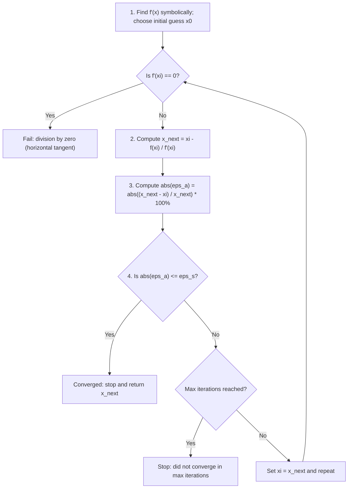

> [!info] Navigation & Sources
> - **Quiz Hub:** [[NM Quiz 1]] | **Previous:** [[2. Errors]] | **Next:** [[4. Secant & False Position Method]]
> - **Course Materials:** [[SWE-Math4543-Lecture3.pdf]] | [[newton.pdf]]

---

## 1. Intuition & Mathematical Derivations

Unlike Bisection, the **Newton–Raphson Method** is an **open method**:
- Requires only **one** initial guess $x_0$ (no bracketing interval needed!).
- Requires both the function $f(x)$ **and its first derivative** $f'(x)$.
- Replaces the curve $y = f(x)$ at the current guess $(x_i, f(x_i))$ with its **tangent line**, and uses where that tangent hits the $x$-axis as the next guess $x_{i+1}$.
- ==Convergence is **not guaranteed**==—depending on $f(x)$ and your initial guess $x_0$, iterates can diverge, oscillate, or divide by zero (see Section 4).

### Quick Geometric Warm-Up
Consider $y = f(x) = 0.13x^3$ at $x = 7$:
- Function value: $f(7) = 0.13(343) = 44.59$
- Tangent slope: $f'(x) = 0.39x^2 \implies f'(7) = 0.39(49) = 19.11$
- Follow the tangent line down from $(7, 44.59)$ to $y = 0$:
  $$\text{slope} = \frac{44.59 - 0}{7 - x_{\text{int}}} = 19.11 \implies x_{\text{int}} = 7 - \frac{44.59}{19.11} = \frac{14}{3} \approx 4.6667$$

![[lec3_slide04_tangent_warmup.png]]

---

### Two Classic Derivations of the Iteration Formula

> [!question]- Derivation 1: Geometric Derivation (Tangent Triangle)
> Let $(x_i, f(x_i))$ be the current point on $y = f(x)$. Draw the tangent line at this point, making angle $\theta$ with the $x$-axis and crossing the $x$-axis at $(x_{i+1}, 0)$:
> 1. In the right triangle formed by $(x_{i+1}, 0)$, $(x_i, 0)$, and $(x_i, f(x_i))$:
>    $$\text{slope of tangent} = \tan\theta = f'(x_i) = \frac{f(x_i) - 0}{x_i - x_{i+1}}$$
> 2. Solve for $x_{i+1}$:
>    $$x_i - x_{i+1} = \frac{f(x_i)}{f'(x_i)} \implies \boxed{x_{i+1} = x_i - \frac{f(x_i)}{f'(x_i)}}$$
>
> ![[lec3_slide05_geometric_derivation.png]]
>
> ![[lec3_slide06_geometric_derivation.png]]

> [!question]- Derivation 2: Analytical Derivation (Taylor Series)
> Expand $f(x_{i+1})$ in a Taylor series around $x_i$:
> $$f(x_{i+1}) = f(x_i) + f'(x_i)(x_{i+1} - x_i) + \frac{f''(x_i)}{2!}(x_{i+1} - x_i)^2 + \cdots$$
> Assuming $x_{i+1}$ is close to the root ($f(x_{i+1}) = 0$) and truncating after the linear (1st-order) term:
> $$0 \approx f(x_i) + f'(x_i)(x_{i+1} - x_i)$$
> Solving for $x_{i+1}$ gives:
> $$\boxed{x_{i+1} = x_i - \frac{f(x_i)}{f'(x_i)}}$$
> **Bonus Insight (Why Convergence Is Quadratic — and When It Drops):**
> Because the dropped leading remainder term is $\frac{f''(\xi)}{2!}(x_{i+1} - x_i)^2$, the error near a **simple** root ($f'(r) \neq 0$) obeys $\lvert E_{i+1} \rvert \approx \left|\frac{f''(r)}{2 f'(r)}\right| \lvert E_i \rvert^2$. That means the number of accurate significant digits roughly **doubles every iteration**! *(Watch out: Slide 14 loosely writes that significant digits "gets approximately squared", whereas it is the **error** that gets squared—digits double! Also, at a **multiple root** where $f'(r) = 0$, e.g. $(x-r)^2 = 0$, standard Newton–Raphson degrades to **linear convergence**.)*
>
> ![[lec3_slide07_taylor_derivation.png]]

---

## 2. The 4-Step Newton–Raphson Algorithm

1. **Differentiate:** Compute $f'(x)$ symbolically.
2. **Iterate:** Starting from $i = 0$ with initial guess $x_0$, compute the next estimate:
   $$x_{i+1} = x_i - \frac{f(x_i)}{f'(x_i)}$$
   *(Safeguard: abort/warn if $f'(x_i) = 0$!)*
3. **Compute Approximate Relative Error:**
   $$\lvert \epsilon_a \rvert = \left| \frac{x_{i+1} - x_i}{x_{i+1}} \right| \times 100\%$$
   *(Notice $\lvert \epsilon_a \rvert$ is available from **Iteration 1** onward because $x_0$ already acts as the "previous" guess!)*
4. **Check Stopping Condition:** Compare $\lvert \epsilon_a \rvert$ with tolerance $\epsilon_s$:
   - If $\lvert \epsilon_a \rvert > \epsilon_s$, increment $i$ and go back to Step 2 *(also guard with a max-iterations cap in case of divergence!)*.
   - If $\lvert \epsilon_a \rvert \le \epsilon_s$, stop and report $x_{i+1}$.

> [!tip] 35-Minute Exam Speed Workflow (`Casio fx-991ES / EX` `ANS` Chaining + Sanity Checks)
> 1. **Put calculator in `RAD` mode immediately** if trig functions ($\sin, \cos$) appear!
> 2. **Fast `ANS` iteration chaining (for quick root verification):** Enter `x0` and press `=`. Then type `ANS - (f(ANS))/(f'(ANS))` and press `=` repeatedly—every press produces the next full-precision iterate $x_1, x_2, x_3, x_4$ in ~15 seconds!
> 3. **To also capture step marks (`f(x_i), f'(x_i)`):** Type your 3-variable expression using `ALPHA )` ($X$) or evaluate `f(X)` and `f'(X)` via `CALC` at each iterate while keeping full calculator register digits!
> 4. **1-Second Sanity Checks:** Verify that $\lvert f(x_{i+1}) \rvert$ shrinks rapidly toward $0$ (and for $k$-th roots, check $x_n^k \approx R$). If $\lvert f(x_i) \rvert$ blows up, check your symbolic derivative $f'(x)$ or `DEG/RAD` mode!

---

## 3. Worked Examples & Mini-Quiz

### Worked Example 1: Finding $\sqrt[3]{20}$

**Problem:** Find a root of $f(x) = x^3 - 20 = 0$ starting from $x_0 = 3$. Conduct 3 iterations.

- Derivative: $f'(x) = 3x^2$, so the update rule is:
  $$x_{i+1} = x_i - \frac{x_i^3 - 20}{3x_i^2}$$

- **Iteration 1 ($i = 0$):**
  $$x_1 = 3 - \frac{3^3 - 20}{3(3^2)} = 3 - \frac{7}{27} = 2.74074$$
  $$\lvert \epsilon_a \rvert = \left|\frac{2.74074 - 3}{2.74074}\right| \times 100\% = 9.459\% \quad (m = 0)$$

- **Iteration 2 ($i = 1$):**
  $$x_2 = 2.74074 - \frac{(2.74074)^3 - 20}{3(2.74074)^2} = 2.74074 - \frac{0.587495}{22.5350} = 2.71467$$
  $$\lvert \epsilon_a \rvert = \left|\frac{2.71467 - 2.74074}{2.71467}\right| \times 100\% = 0.960\% \quad (m = 1)$$

- **Iteration 3 ($i = 2$):**
  $$x_3 = 2.71467 - \frac{(2.71467)^3 - 20}{3(2.71467)^2} = 2.71467 - \frac{0.005579}{22.1083} = 2.71442$$
  $$\lvert \epsilon_a \rvert = \left|\frac{2.71442 - 2.71467}{2.71442}\right| \times 100\% = 0.00921\%$$
  Check significant digits: $0.00921\% \le 0.5 \times 10^{2-m}\% \implies m \le 3.73471 \implies$ **$m = 3$ significant digits**!

| Iteration | $x_{i+1}$ | $\lvert \epsilon_a \rvert$ (%) | Significant Digits ($m$) | Comparison vs. Bisection on $[1, 4]$ |
| :---: | :---: | :---: | :---: | :--- |
| 0 | $3.00000$ | — | — | *(Initial guess)* |
| 1 | $2.74074$ | $9.459\%$ | $0$ | Bisection Iter 1: $2.50000$ |
| 2 | $2.71467$ | $0.960\%$ | $1$ | Bisection Iter 2: $3.25000$ ($23.1\%$) |
| 3 | $2.71442$ | **$0.00921\%$** | **3** | Bisection Iter 3: $2.87500$ ($13.0\%$) |

---

### Worked Example 2: Floating Toilet Ball

**Problem:** Recall the spherical ball ($R = 5.5\text{ cm} = 0.055\text{ m}$, $SG = 0.6$, physical submerged depth $0 < x < 0.11\text{ m}$):
$$f(x) = x^3 - 0.165x^2 + 3.993 \times 10^{-4} = 0, \qquad f'(x) = 3x^2 - 0.33x$$
Estimate $x$ starting from $x_0 = 0.05$.

- **Iter 1 ($x_0 = 0.05$):** $f(0.05) = +1.118 \times 10^{-4}$, $f'(0.05) = -0.0090 \implies x_1 = 0.05 - \frac{1.118\times 10^{-4}}{-0.0090} = \mathbf{0.062422}$, $\lvert \epsilon_a \rvert = 19.90\%$.
- **Iter 2 ($x_1 = 0.062422$):** $f(x_1) = -3.978 \times 10^{-7}$, $f'(x_1) = -0.008910 \implies x_2 = \mathbf{0.062378}$, $\lvert \epsilon_a \rvert = 0.07157\%$.
- **Iter 3 ($x_2 = 0.062378$):** $f(x_2) = +4.429 \times 10^{-11} \implies x_3 = \mathbf{0.062378}$ (converged!).

| Iteration | $x_{i+1}$ | $\lvert \epsilon_a \rvert$ (%) *(textbook 4-sig-fig)* | $m$ |
| :---: | :---: | :---: | :---: |
| 0 | $0.05000$ | — | — |
| 1 | $0.06242$ | $19.90\%$ | $0$ |
| 2 | $0.06238$ | $0.0716\%$ | $2$ |
| 3 | $0.06238$ | $0.0000\%$ | $4$ |

*(Precision note: `newton.pdf` pp. 4–5 prints `0.0716%` from unrounded `0.062422 -> 0.062378`, then `0.0000%` ($m=4$) using the rounded 5-decimal value `0.06238`; carrying full calculator precision actually gives Iter 3 $\lvert \epsilon_a \rvert \approx 0.000008\%$ or $m = 6$!)*

Notice Newton–Raphson reaches **4 significant digits in 3 iterations**, whereas Bisection took **10 iterations** just to get $m = 2$!

> [!error] Dangerous Initial Guesses in Floating Ball
> Notice $f'(x) = 3x(x - 0.11) = 0$ at $x = 0$ and $x = 0.11$. Those are the **exact endpoints** $[0, 0.11]$ we used in Bisection! If you blindly passed $x_0 = 0$ or $x_0 = 0.11$ into Newton–Raphson, it would crash on the very first step with **division by zero**!

---

> [!question]- Mini-Quiz: Piecewise Linear Graph
> Consider a piecewise linear function $f(x)$ with a sharp corner at $(-10, -5)$:
> - To the left ($x \le -10$), the line passes through $(-12, -9)$ and $(-10, -5)$.
> - To the right ($x \ge -10$), the line passes through $(-10, -5)$ and hits its root at $(10, 0)$.
>
> Starting at initial guess **$x_0 = -12$**, how many iterations does Newton–Raphson take to converge to the root?
>
> ![[lec3_slide13_miniquiz_piecewise.png]]
>
> > [!success]- Answer
> > **2 iterations!**
> > - **Iteration 1 (at $x_0 = -12$):**
> >   Slope of left segment: $m_L = \frac{-5 - (-9)}{-10 - (-12)} = \frac{4}{2} = 2$. Since $f(-12) = -9$:
> >   $$x_1 = -12 - \frac{-9}{2} = -12 + 4.5 = -7.5$$
> > - **Iteration 2 (at $x_1 = -7.5$):**
> >   $x_1 = -7.5 > -10$ now lies on the **right line segment**, whose $x$-intercept is $(10, 0)$! The tangent line of any straight line is the line itself, so:
> >   $$m_R = \frac{0 - (-5)}{10 - (-10)} = \frac{5}{20} = \frac{1}{4}, \qquad f(-7.5) = -5 + \frac{1}{4}(-7.5 - (-10)) = -4.375$$
> >   $$x_2 = -7.5 - \frac{-4.375}{1/4} = -7.5 + 17.5 = \mathbf{10}$$
> > Exact root reached in **2 iterations**!

---

## 4. Advantages & Drawbacks (Failure Modes)

### Advantages (2)
1. **Extremely fast (quadratic) convergence** once near a simple root.
2. **Only requires one initial guess** $x_0$—no root bracketing interval needed.

### Drawbacks (4) — *Know the Failure Equations & Mechanisms!*

| Drawback | Mechanism | Classic Failure Case |
| :--- | :--- | :--- |
| **1. Divergence Near Inflection Points ($f''(x) = 0$)** | Tangents shoot progressively farther away or swing wildly if curvature bends away from the $x$-axis near an inflection point | $f(x) = \arctan(x) = 0$ diverges into an expanding spiral for $\lvert x_0 \rvert \ge 1.39175$ *(exact 2-cycle threshold $\lvert x^* \rvert \approx 1.391745$; e.g. $x_0 = 1.3917$ still slowly converges)*; $f(x) = (x - 1)^3 + 0.512 = 0$ with $x_0 = 5$ reaches $x_5 = 0.92589$ near the inflection point $x=1$ (where both $f'(1)=0$ and $f''(1)=0$), shooting to $-30.119$ at Iter 6 before finally recovering to $0.2$ at Iter 18 |
| **2. Division by Zero / Near-Zero ($f'(x_i) \approx 0$)** | Horizontal or near-horizontal tangent shoots the next iterate toward $\pm\infty$ or divides by zero | $f(x) = x^3 - 0.03x^2 + 2.4 \times 10^{-6} = 0$ has $f'(x) = 0$ at $x = 0$ and $x = 0.02$. Starting at $x_0 = 0.01999$ fails catastrophically |
| **3. Oscillations Near Local Extrema** | Iterates bounce endlessly around a local minimum/maximum (especially if no real root exists nearby) | $f(x) = x^2 + 2 = 0$ starting at $x_0 = -1$ bounces chaotically back and forth across $x = 0$ forever |
| **4. Root Jumping** | Tangent at a flat/tilted spot jumps across multiple humps to an unintended distant root instead of the closest root | $f(x) = \sin(x) = 0$ starting at $x_0 = 2.4\pi \approx 7.539822$ walks away from the closest root $2\pi$ via $7.53982 \to 4.46214 \to 0.54990 \to -0.06307 \to 0$ (`newton.pdf` p. 8 Table 4) |

> [!important] Inflection Point Theorem & $x^4 - 16$ Counterexample (`newton.pdf` Appendix A)
> - **Theorem:** *If $f'(c)$ exists and $f''(c)$ **changes sign** at $x = c$, then $(c, f(c))$ is an inflection point.*
> - **Warning ($f''(c) = 0$ is NOT enough!):** Take $f(x) = x^4 - 16$. At $x = 0$, $f''(0) = 12(0)^2 = 0$, **but** $f''(x) = 12x^2 \ge 0$ on both sides of $0$ (no sign change in concavity). Therefore $(0, -16)$ is **not** an inflection point—just a flat local minimum!

#### Visual Reference Plots of the 4 Failure Modes

![[lec3_slide15_drawback_inflection.png]]

![[lec3_slide16_drawback_div_zero.png]]

![[lec3_slide17_drawback_oscillation.png]]

![[lec3_slide18_drawback_root_jumping.png]]

> [!note] Additional Practical Limitation
> You **must** know the analytical derivative $f'(x)$ explicitly! When $f(x)$ comes from a black-box simulation, noisy experimental curve, or has an ugly symbolic derivative, Newton–Raphson cannot be used directly—which motivates **[[4. Secant & False Position Method#1. The Secant Method|The Secant Method]]**!

---

## 5. Hardware Engineering Application: Fast Division & Roots in CPUs

*(Wong & Flynn 1991, tested in **Quiz-01 Q1**)*

Why do CPU microarchitects use Newton–Raphson inside arithmetic logic units (ALUs / FPUs)? Look at typical instruction latencies and issue rates (`Slide 19`):

| Instruction | Typical Latency (Clock Cycles) | Issue Rate (Cycles / Next Op) |
| :--- | :---: | :---: |
| `iadd / isub`, `and / or`, `shift / rotate` | $1$ | $1$ |
| `load / store` | $1\text{–}2$ | $1$ |
| `imul` (integer multiply) | $3\text{–}15$ | $1$ |
| `fadd` (floating-point add) | $3$ | $1$ |
| `fmul` (floating-point multiply) | $3$ | $1$ |
| **`fdiv` (floating-point divide)** | **$15\text{–}25$** | **$15\text{–}25$** |
| **`fsqrt` (floating-point square root)** | **$15\text{–}25$** | **$15\text{–}25$** |

![[lec3_slide19_hardware_division.png]]

Because `fdiv` takes **5–8× longer** than `fmul` or `fadd` (and isn't pipelined like `fmul`, blocking new divides for $15\text{–}25$ cycles!), processors compute $\dfrac{b}{a} = b \cdot \left(\dfrac{1}{a}\right)$ by first computing the reciprocal $c = \dfrac{1}{a}$ **using only multiplies and subtracts**!

### A. Division-Free Hardware Reciprocal ($c = 1/a$)
To solve for $c = \frac{1}{a}$, rewrite the root equation as **$f(c) = a - \frac{1}{c} = 0$** (never put $1/c$ in the final update!):
1. Derivative: $f'(c) = +\frac{1}{c^2}$.
2. Apply Newton–Raphson:
   $$c_{i+1} = c_i - \frac{a - 1/c_i}{1/c_i^2} = c_i - c_i^2\left(a - \frac{1}{c_i}\right) = c_i - c_i^2 a + c_i$$
   $$\boxed{c_{i+1} = c_i(2 - c_i a)}$$
   *(Zero divisions! Using separate ops `fmul + fsub + fmul` takes $3 + 3 + 3 = 9$ cycles per step; using a fused `fmsub` (`2 - c_i a`) + `fmul` needs only $2$ instructions—Slide 19 notes this optimization too—and only $1\text{–}6$ iterations total, just $2$ when seeded by an initial Lookup Table (LUT)! Then return $b/a = b \cdot c_n$.)*

### B. Square Root ($\sqrt{R}$) & Division-Free Inverse Square Root ($1/\sqrt{R}$)
- **Standard NR for $\sqrt{R}$ (Heron's Method):** Solve $f(x) = x^2 - R = 0 \implies f'(x) = 2x$:
  $$x_{i+1} = x_i - \frac{x_i^2 - R}{2x_i} = \boxed{\frac{1}{2}\!\left(x_i + \frac{R}{x_i}\right)}$$
  *(Fast, but still needs one division $R / x_i$ every iteration.)*
- **Division-Free Hardware Trick (compute $x = 1/\sqrt{R}$, then multiply $\sqrt{R} = R \cdot x$):**
  Solve $f(x) = \frac{1}{x^2} - R = 0 \implies f'(x) = -\frac{2}{x^3}$:
  $$x_{i+1} = x_i - \frac{x_i^{-2} - R}{-2 x_i^{-3}} = x_i + \frac{x_i}{2}(1 - R x_i^2) = \boxed{\frac{1}{2}\, x_i (3 - R x_i^2)}$$
  *(Zero divisions! Famous in computer graphics / Quake III's fast inverse square root!)*

### C. General $k$-th Root Formula ($\sqrt[k]{R}$) *(IUT Quiz-01 Q1)*
Solve $f(x) = x^k - R = 0 \implies f'(x) = k x^{k-1}$:
$$x_{i+1} = x_i - \frac{x_i^k - R}{k x_i^{k-1}} = \frac{k x_i^k - x_i^k + R}{k x_i^{k-1}} = \boxed{\frac{1}{k}\!\left[(k-1)x_i + \frac{R}{x_i^{k-1}}\right]}$$

---

> [!error] High-Yield Exam Traps
> 1. **Iteration 1 Has a Valid $\lvert \epsilon_a \rvert$ in Open Methods:** Unlike Bisection (where Iteration 1 has no prior midpoint), Newton–Raphson **does** compute $\lvert \epsilon_a \rvert = \left|\frac{x_1 - x_0}{x_1}\right|\times 100\%$ starting right on Iteration 1!
> 2. **Radians, Always Radians!** In trigonometric equations like Kepler's equation ($\theta - 0.017\sin\theta - \frac{2\pi t}{T} = 0$) or $\sin(x) = 0$, ALWAYS switch your calculator to **RAD** mode before taking derivatives or evaluating $\sin, \cos$!
> 3. **Picking the Wrong $f(c)$ for Division-Free Reciprocal:** If you accidentally choose $f(c) = ac - 1 = 0$, then $f'(c) = a$, so Newton–Raphson reduces to $c_{i+1} = c_i - \frac{ac_i - 1}{a} = \frac{1}{a}$—which *requires dividing by $a$* (useless in hardware without division!). Always choose $f(c) = a - \frac{1}{c} = 0$!
> 4. **Zero Derivative Crash:** Always inspect $f'(x_0) \neq 0$ before starting (remember $x_0 = 0$ or $0.11$ in Floating Ball!).

---

## 6. Practice Problems

### Problem 1 (Generalized Root Derivation & Numerical Run — IUT Quiz-01 Q1)
1. Derive the Newton–Raphson iterative formula for computing the $k$-th root $R^{1/k}$ ($k \in \mathbb{Z}^+, R > 0$) by setting up an appropriate $f(x) = 0$.
2. Using your formula, compute $\sqrt[4]{20}$ starting from $x_0 = 2$ for **3 iterations**, reporting $x_i$ and $\lvert \epsilon_a \rvert\%$ to 5 decimal places.

> [!success]- Solution (Problem 1)
> 1. **Derivation:** Let $x = R^{1/k} \iff f(x) = x^k - R = 0$.
>    Then $f'(x) = k x^{k-1}$. Substituting into Newton–Raphson $x_{i+1} = x_i - \frac{f(x_i)}{f'(x_i)}$:
>    $$x_{i+1} = x_i - \frac{x_i^k - R}{k x_i^{k-1}} = \frac{(k-1)x_i^k + R}{k x_i^{k-1}} = \frac{1}{k}\!\left[(k-1)x_i + \frac{R}{x_i^{k-1}}\right]$$
> 2. **Evaluating $\sqrt[4]{20}$ ($k = 4, R = 20, x_0 = 2$):** Formula becomes $x_{i+1} = \frac{1}{4}\!\left(3x_i + \frac{20}{x_i^3}\right)$.
>    - **Iter 1:** $x_1 = \frac{1}{4}\!\left(3(2) + \frac{20}{8}\right) = \frac{6 + 2.5}{4} = \mathbf{2.12500}$.
>      $$\lvert \epsilon_a \rvert = \left|\frac{2.12500 - 2}{2.12500}\right| \times 100\% = \mathbf{5.88235\%}$$
>    - **Iter 2:** $x_1^3 = (2.125)^3 = 9.595703$.
>      $$x_2 = \frac{1}{4}\!\left(3(2.125) + \frac{20}{9.595703}\right) = \frac{6.375 + 2.084266}{4} = 2.114817 \approx \mathbf{2.11482}$$
>      $$\lvert \epsilon_a \rvert = \left|\frac{2.114817 - 2.125000}{2.114817}\right| \times 100\% = \mathbf{0.48153\%} \quad (m = 2)$$
>    - **Iter 3:** Carrying unrounded $x_2 = 2.114817$ gives $x_2^3 = (2.114817)^3 = \mathbf{9.458415}$:
>      $$x_3 = \frac{1}{4}\!\left(3(2.114817) + \frac{20}{9.458415}\right) = \frac{6.344451 + 2.114517}{4} = \mathbf{2.11474}$$
>      $$\lvert \epsilon_a \rvert = \left|\frac{2.114743 - 2.114817}{2.114743}\right| \times 100\% = \mathbf{0.00350\%} \quad (m = 4)$$
>      *(Note: if you substitute 5-dp rounded $x_2 = 2.11482$ instead, $\lvert \epsilon_a \rvert = 0.00378\%$; either way $x_3 = 2.11474$ and $m = 4$.)*
>    *(Exact $\sqrt[4]{20} \approx 2.1147425$!)*

---

### Problem 2 (Kepler's Orbital Mechanics Equation — IUT Mid Exam Q1c)
In astrodynamics, Kepler's equation relates eccentric anomaly $\theta$ (in radians) to elapsed time $t$ and orbital period $T$:
$$\theta - 0.017\sin(\theta) - \frac{2\pi t}{T} = 0$$
Determine $\theta$ at time **$t = \frac{T}{8}$** using Newton–Raphson starting at **$\theta_0 = \pi$**. Conduct **4 iterations** (report to 6 decimal places in radians).

> [!success]- Solution (Problem 2)
> Substitute $t = \frac{T}{8}$:
> $$\frac{2\pi t}{T} = \frac{2\pi (T/8)}{T} = \frac{\pi}{4} \approx 0.78539816$$
> Define $f(\theta) = \theta - 0.017\sin(\theta) - \frac{\pi}{4}$ and $f'(\theta) = 1 - 0.017\cos(\theta)$.
> Update formula:
> $$\theta_{i+1} = \theta_i - \frac{\theta_i - 0.017\sin(\theta_i) - \pi/4}{1 - 0.017\cos(\theta_i)}$$
>
> - **Iter 1 ($\theta_0 = \pi \approx 3.141592654$):**
>   $f(\pi) = \pi - 0 - \pi/4 = \frac{3\pi}{4} \approx 2.356194490$; $\quad f'(\pi) = 1 - 0.017(-1) = 1.017000000$.
>   $$\theta_1 = \pi - \frac{3\pi/4}{1.017} = \mathbf{0.824783912}, \qquad \lvert \epsilon_a \rvert = 280.898876\% \quad (m = 0)$$
> - **Iter 2 ($\theta_1 = 0.824783912$):**
>   $f(\theta_1) = 0.824783912 - 0.017\sin(0.824783912) - \frac{\pi}{4} = 0.026900929$;
>   $f'(\theta_1) = 1 - 0.017\cos(0.824783912) = 0.988461834$.
>   $$\theta_2 = 0.824783912 - \frac{0.026900929}{0.988461834} = \mathbf{0.797568972}, \qquad \lvert \epsilon_a \rvert = 3.412237\% \quad (m = 1)$$
> - **Iter 3 ($\theta_2 = 0.797568972$):**
>   $f(\theta_2) = 4.5844 \times 10^{-6}$, $\quad f'(\theta_2) = 0.988126375$.
>   $$\theta_3 = 0.797568972 - \frac{4.5844 \times 10^{-6}}{0.988126375} = \mathbf{0.797564333}, \qquad \lvert \epsilon_a \rvert = 5.8171 \times 10^{-4}\% \quad (m = 4)$$
> - **Iter 4 ($\theta_3 = 0.797564333$):**
>   $f(\theta_3) \approx 1.309 \times 10^{-13}$ *(or $-2.0113 \times 10^{-11}$ if using 10-dp rounded $0.7975643327$ as in the official Mid key)*, $\quad f'(\theta_3) = 0.988126318$.
>   $$\theta_4 = \mathbf{0.797564333}, \qquad \lvert \epsilon_a \rvert \approx 2.5520 \times 10^{-9}\%\text{ (10-dp key; } 1.66\times 10^{-11}\%\text{ full precision)} \implies m = 10$$
>
> **Mid Exam Q1c Summary Table (`0.5 pt/cell` + `1 pt/iter` for showing substitutions above):**
>
> | Iteration | $\theta_i$ | $f(\theta_i)$ | $f'(\theta_i)$ | $\theta_{i+1}$ | $\lvert \epsilon_a \rvert\%$ | $m$ |
> | :---: | :---: | :---: | :---: | :---: | :---: | :---: |
> | 1 | $\pi$ | $\frac{3\pi}{4}$ | $1.017$ | $0.824783912$ | $280.8988764\%$ | $0$ |
> | 2 | $0.824783912$ | $0.026900929$ | $0.988461834$ | $0.797568972$ | $3.4122365\%$ | $1$ |
> | 3 | $0.797568972$ | $4.5844\times 10^{-6}$ | $0.988126375$ | $0.797564333$ | $5.8171\times 10^{-4}\%$ | $4$ |
> | 4 | $0.7975643327$ | $-2.0113\times 10^{-11}$ | $0.988126318$ | $0.7975643327$ | $2.5520\times 10^{-9}\%$ | $10$ |
>
> *(Exam note: Always state your working decimal precision and confirm `RAD` mode; any valid 5–6+ decimal rounding earns full rubric marks when the substitution steps above are shown!)*

---

### Problem 3 (Crossed Ladders Modeling & NR Setup — IUT Final Exam Q1c)
Two ladders of lengths $a > 0$ and $b > 0$ rest across a narrow alley of unknown width $x > 0$, touching opposite vertical walls and crossing each other at height $h$ above the ground. Suppose the shaded triangle formed between the ground (base $x$) and the crossing point (height $h$) has known area $A > 0$. Assume the configuration is physically realizable on the open domain **$0 < x < \min(a, b)$**.

![[lec3_crossed_ladders_diagram.png]]

*Diagram Variable Map:* $h_1 = \sqrt{a^2 - x^2}$ is the height where ladder $a$ meets the left wall; $h_2 = \sqrt{b^2 - x^2}$ is the height where ladder $b$ meets the right wall; $h$ is the crossing height above the alley floor; $x_1$ and $x_2$ are the left and right horizontal base segments directly under the crossing point ($x_1 + x_2 = x$).

1. Derive a single nonlinear equation $f(x) = 0$ (for $0 < x < \min(a, b)$) purely in terms of $a, b,$ and $A$.
2. Write the exact Newton–Raphson update formula $x_{i+1}$ for solving $f(x) = 0$.

> [!success]- Solution (Problem 3)
> 1. **Deriving $f(x) = 0$ on $0 < x < \min(a, b)$:**
>    *(Note the physical domain **$0 < x < \min(a, b)$** ensures both ladders span the alley without slipping flat, keeping $a^2 - x^2 > 0$ and $b^2 - x^2 > 0$.)*
>    - By the Pythagorean theorem, the wall heights reached by ladders $a$ and $b$ are:
>      $$h_1 = \sqrt{a^2 - x^2}, \qquad h_2 = \sqrt{b^2 - x^2}$$
>    - Splitting the base $x = x_1 + x_2$ directly beneath the crossing point $h$ and using similar right triangles:
>      $$\frac{h}{h_1} = \frac{x_2}{x} \quad \text{and} \quad \frac{h}{h_2} = \frac{x_1}{x}$$
>    - Adding both equations ($\frac{x_1 + x_2}{x} = 1$):
>      $$\frac{h}{h_1} + \frac{h}{h_2} = 1 \implies \frac{1}{h_1} + \frac{1}{h_2} = \frac{1}{h}$$
>    - Since the triangle has base $x$ and height $h$, its area is $A = \frac{1}{2} x h \implies \frac{1}{h} = \frac{x}{2A}$.
>    - Substituting $h_1, h_2,$ and $\frac{1}{h}$ gives:
>      $$\boxed{f(x) = \frac{1}{\sqrt{a^2 - x^2}} + \frac{1}{\sqrt{b^2 - x^2}} - \frac{x}{2A} = 0}$$
>
> 2. **Newton–Raphson Update Formula:**
>    Differentiating term by term using $\frac{d}{dx}(c - x^2)^{-1/2} = \frac{x}{(c - x^2)^{3/2}}$:
>    $$f'(x) = \frac{x}{(a^2 - x^2)^{3/2}} + \frac{x}{(b^2 - x^2)^{3/2}} - \frac{1}{2A}$$
>    Hence:
>    $$x_{i+1} = x_i - \frac{\dfrac{1}{\sqrt{a^2 - x_i^2}} + \dfrac{1}{\sqrt{b^2 - x_i^2}} - \dfrac{x_i}{2A}}{\dfrac{x_i}{(a^2 - x_i^2)^{3/2}} + \dfrac{x_i}{(b^2 - x_i^2)^{3/2}} - \dfrac{1}{2A}}$$

---

### Problem 4 (Division-Free Hardware Reciprocal $1/3$)
Using the hardware division-free Newton–Raphson formula $c_{i+1} = c_i(2 - c_i a)$, compute $c = \frac{1}{3}$ (so $a = 3$) starting from LUT seed **$c_0 = 0.3$** for **3 iterations**. Track $\lvert \epsilon_a \rvert\%$ and true value $\frac{1}{3}$.

> [!success]- Solution (Problem 4)
> Update rule with $a = 3$: $c_{i+1} = c_i(2 - 3c_i)$.
> - **Iter 1:** $c_1 = 0.3(2 - 3(0.3)) = 0.3(1.1) = \mathbf{0.33}$.
>   $$\lvert \epsilon_a \rvert = \left|\frac{0.33 - 0.3}{0.33}\right| \times 100\% = 9.091\%$$
> - **Iter 2:** $c_2 = 0.33(2 - 3(0.33)) = 0.33(1.01) = \mathbf{0.3333}$.
>   $$\lvert \epsilon_a \rvert = \left|\frac{0.3333 - 0.33}{0.3333}\right| \times 100\% = 0.9901\%$$
> - **Iter 3:** $c_3 = 0.3333(2 - 3(0.3333)) = 0.3333(1.0001) = \mathbf{0.33333333}$.
>   $$\lvert \epsilon_a \rvert = \left|\frac{0.33333333 - 0.3333}{0.33333333}\right| \times 100\% = 0.009999\% \quad (m = 3)$$
> Watch quadratic convergence in action: $0.3 \to 0.33 \to 0.3333 \to 0.33333333$ (digits of accuracy doubled every single cycle)!

---

### Problem 5 (Diagnosing Failure Modes)
Identify **which specific Newton–Raphson failure mode** occurs in each setup below:
1. $f(x) = x^3 - 0.03x^2 + 2.4 \times 10^{-6} = 0$ with $x_0 = 0.01999$
2. $f(x) = \sin(x) = 0$ with $x_0 = 2.4\pi$
3. $f(x) = x^2 + 2 = 0$ with $x_0 = -1$
4. $f(x) = \arctan(x) = 0$ with $x_0 = 2$

> [!success]- Solution (Problem 5)
> 1. **Division by zero / near-zero derivative:** $f'(x) = 3x^2 - 0.06x$ vanishes at $x = 0.02$, so $f'(0.01999) \approx -6 \times 10^{-7}$ launches the iterate way out of range.
> 2. **Root jumping:** Starting at $x_0 = 2.4\pi \approx 7.53982$, the flat-ish tangent near the peak skips past the nearby roots $2\pi$ and $\pi$ along the path $7.53982 \to 4.46214 \to 0.54990 \to -0.06307 \to 0$ (`newton.pdf` p. 8 Table 4), converging to the distant root $x = 0$ instead!
> 3. **Oscillation near local extremum (no real root):** $f(x) \ge 2$ everywhere; iterates bounce across the vertex $(0, 2)$ endlessly without converging.
> 4. **Divergence near an inflection point:** $\arctan(x)$ has an inflection point at its root $x = 0$; starting at or beyond $\lvert x_0 \rvert \ge 1.39175$ (past the exact 2-cycle threshold $\lvert x^* \rvert \approx 1.391745$) sends tangents spiraling outward to $\pm\infty$.

---

### Problem 6 (Transcendental Comparison vs. Bisection)
Solve $f(x) = e^{-x} - x = 0$ using Newton–Raphson starting at **$x_0 = 0.5$** for **3 iterations** (keep 6 decimal places). Compare your error at Iteration 3 with Iteration 4 of Bisection from [[1. Introduction & Bisection Method]] ($\approx 0.5625$, $\lvert \epsilon_a \rvert = 11.11\%$).

> [!success]- Solution (Problem 6)
> $f(x) = e^{-x} - x$, $\quad f'(x) = -e^{-x} - 1$.
> $$x_{i+1} = x_i - \frac{e^{-x_i} - x_i}{-e^{-x_i} - 1} = x_i + \frac{e^{-x_i} - x_i}{e^{-x_i} + 1}$$
> - **Iter 1 ($x_0 = 0.5$):** $e^{-0.5} = 0.606531$.
>   $$x_1 = 0.5 + \frac{0.606531 - 0.5}{0.606531 + 1} = 0.5 + \frac{0.106531}{1.606531} = \mathbf{0.566311}, \qquad \lvert \epsilon_a \rvert = 11.709\%$$
> - **Iter 2 ($x_1 = 0.566311$):** $e^{-0.566311} = 0.567616$.
>   $$x_2 = 0.566311 + \frac{0.567616 - 0.566311}{0.567616 + 1} = 0.566311 + \frac{0.001305}{1.567616} = \mathbf{0.567143}, \qquad \lvert \epsilon_a \rvert = 0.1467\% \quad (m = 2)$$
> - **Iter 3 ($x_2 = 0.567143$):** $e^{-0.567143} = 0.567143$.
>   $$x_3 = \mathbf{0.567143}, \qquad \lvert \epsilon_a \rvert \approx \mathbf{0.000022\%} \text{ (unrounded; } 0.000000\% \text{ at 6 dp, } m \ge 6)$$
> **Comparison:** After 3 iterations Newton–Raphson reaches $> 6$ significant digits ($0.567143$), while Bisection after 4 iterations was still at $0.5625$ ($11.11\%$ error, $m = 0$).
