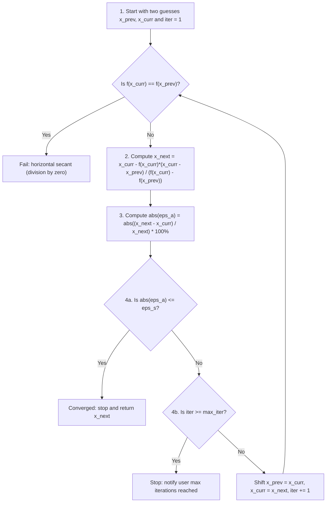
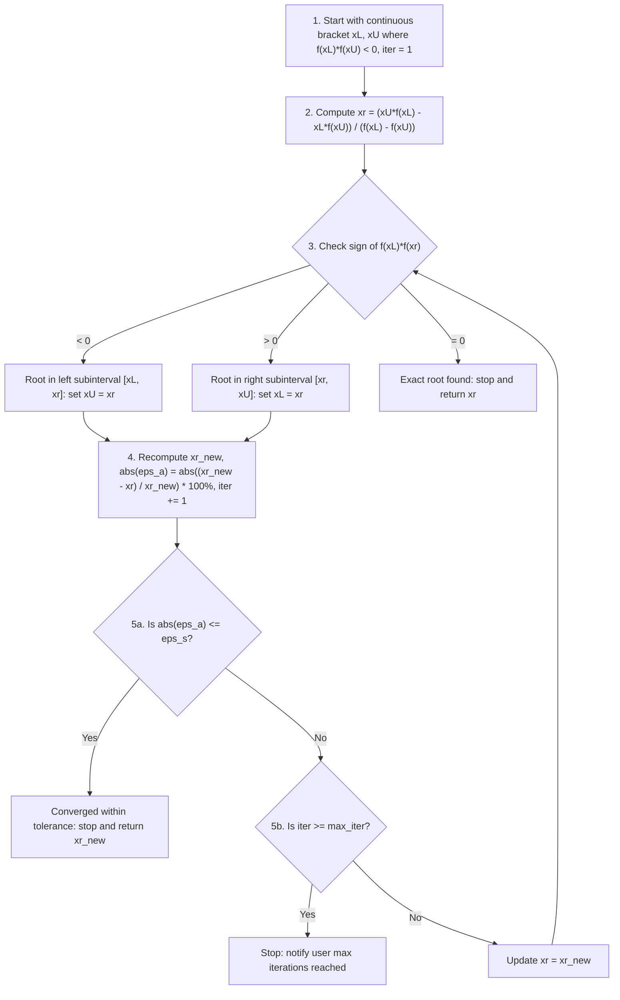

> [!info] Navigation & Sources
> - **Quiz Hub:** [[NM Quiz 1]] | **Previous:** [[3. Newton- Raphson Method]]
> - **Course Materials:** [[SWE-Math4543-Lecture4.pdf]] | [[secant.pdf]] | [[falseposition.pdf]]

---

## 1. The Secant Method

Newton–Raphson converges quadratically, but has one major bottleneck: **it requires the symbolic derivative $f'(x)$**. What if $f'(x)$ is too messy to differentiate, too expensive to compute, or $f(x)$ only comes from discrete experimental/black-box data?

The **Secant Method** solves this by replacing the tangent line with a **secant line** through the two most recent guesses $x_{i-1}$ and $x_i$!
- **Method Family:** Open method (does **not** require $f(x_{i-1})f(x_i) < 0$).
- **Inputs Needed:** Two initial guesses $x_{-1}$ and $x_0$, and evaluations of $f(x)$ only (no $f'(x)$!).

### Two Derivations of the Secant Formula

> [!question]- Derivation 1: Finite-Difference Approximation of Newton–Raphson
> Start with Newton–Raphson:
> $$x_{i+1} = x_i - \frac{f(x_i)}{f'(x_i)}$$
> Approximate the derivative $f'(x_i)$ using the backward finite difference between $x_i$ and $x_{i-1}$:
> $$f'(x_i) \approx \frac{f(x_i) - f(x_{i-1})}{x_i - x_{i-1}}$$
> Substituting this into Newton–Raphson gives:
> $$\boxed{x_{i+1} = x_i - \frac{f(x_i)(x_i - x_{i-1})}{f(x_i) - f(x_{i-1})}}$$
>
> ![[lec4_slide04_secant_fd_derivation.png]]

> [!question]- Derivation 2: Geometric Similar Triangles ($\triangle ABE \sim \triangle DCE$) *(IUT Mid Exam Q1b)*
> Plot two consecutive points $(x_{i-1}, f(x_{i-1}))$ and $(x_i, f(x_i))$ on $y = f(x)$, and draw the straight secant line connecting them until it crosses the $x$-axis at $(x_{i+1}, 0)$.
>
> Dropping vertical lines to the $x$-axis forms two right triangles that share the angle $\theta$ at the $x$-intercept $E = (x_{i+1}, 0)$:
> - Small triangle $\triangle ABE$ with vertices $A = (x_i, 0)$, $B = (x_i, f(x_i))$, $E = (x_{i+1}, 0)$
> - Large triangle $\triangle DCE$ with vertices $D = (x_{i-1}, 0)$, $C = (x_{i-1}, f(x_{i-1}))$, $E = (x_{i+1}, 0)$
>
> By similar triangles ($\triangle ABE \sim \triangle DCE$):
> $$\frac{AB}{AE} = \frac{DC}{DE} \implies \frac{f(x_i)}{x_i - x_{i+1}} = \frac{f(x_{i-1})}{x_{i-1} - x_{i+1}}$$
> Cross-multiply:
> $$f(x_i)(x_{i-1} - x_{i+1}) = f(x_{i-1})(x_i - x_{i+1})$$
> Group $x_{i+1}$ terms:
> $$x_{i+1}\bigl(f(x_i) - f(x_{i-1})\bigr) = x_{i-1} f(x_i) - x_i f(x_{i-1})$$
> Add and subtract $x_i f(x_i)$ inside the numerator to match the Newton-style step:
> $$x_{i+1} = \frac{x_i\bigl(f(x_i) - f(x_{i-1})\bigr) - f(x_i)(x_i - x_{i-1})}{f(x_i) - f(x_{i-1})} = x_i - \frac{f(x_i)(x_i - x_{i-1})}{f(x_i) - f(x_{i-1})}$$
>
> ![[lec4_slide05_secant_geometric_derivation.png]]

### 4-Step Secant Algorithm & Flowchart

1. Pick two initial guesses $x_{-1}$ and $x_0$ near the root ($f(x_{-1}) \neq f(x_0)$), and set `iter = 1` and `max_iter`.
2. Compute the next estimate:
   $$x_{i+1} = x_i - \frac{f(x_i)(x_i - x_{i-1})}{f(x_i) - f(x_{i-1})}$$
3. Compute the absolute relative approximate error:
   $$\lvert \epsilon_a \rvert = \left| \frac{x_{i+1} - x_i}{x_{i+1}} \right| \times 100\%$$
4. Stopping & max-iterations check:
   - If $\lvert \epsilon_a \rvert \le \epsilon_s$: converged $\implies$ stop and return $x_{i+1}$.
   - Else if $\text{iter} \ge \text{max\_iter}$: stop and notify the user that max iterations were reached without convergence.
   - Otherwise shift indices ($x_{i-1} \leftarrow x_i$, $x_i \leftarrow x_{i+1}$), increment `iter`, and repeat from Step 2.

> [!tip] 35-Minute Exam Speed Workflow (`Casio fx-991ES / EX` Registers + Sanity Check)
> - Check **`RAD` mode** first for trig functions!
> - Enter $f(X)$ once and press **`CALC`** to get $f(x_{i-1}), f(x_i)$, OR store $(x_{i-1}, x_i)$ in `A, B` and $(f(x_{i-1}), f(x_i))$ in `C, D` and evaluate `(B*C - A*D)/(C - D)` (remember Secant's intercept formula is identical to False Position's!).
> - Keep full register precision for the next step and verify $\lvert f(x_{i+1}) \rvert \to 0$.

### Worked Example: Floating Toilet Ball *(Textbook `secant.pdf`, Example 1)*

Solve $f(x) = x^3 - 0.165x^2 + 3.993 \times 10^{-4} = 0$ starting from **$x_{-1} = 0.02$** and **$x_0 = 0.05$**.

- $f(0.02) = 0.02^3 - 0.165(0.02)^2 + 3.993 \times 10^{-4} = 3.413 \times 10^{-4}$
- $f(0.05) = 0.05^3 - 0.165(0.05)^2 + 3.993 \times 10^{-4} = 1.118 \times 10^{-4}$
- **Iteration 1:**
  $$x_1 = 0.05 - \frac{1.118 \times 10^{-4}(0.05 - 0.02)}{1.118 \times 10^{-4} - 3.413 \times 10^{-4}} = \mathbf{0.064614}$$
  $$\lvert \epsilon_a \rvert = \left|\frac{0.064614 - 0.05}{0.064614}\right| \times 100\% = 22.62\% \quad (\text{using 5-dp } 0.06461 \text{ gives } 22.61\%, \ m = 0)$$

| Iteration ($i$) | $x_{i-1}$ | $x_i$ | $x_{i+1}$ | $\lvert \epsilon_a \rvert$ (%) | Significant Digits ($m$) |
| :---: | :---: | :---: | :---: | :---: | :---: |
| 1 | $0.02000$ | $0.05000$ | $0.06461$ | $22.62\%$ | $0$ |
| 2 | $0.05000$ | $0.06461$ | $0.06241$ | $3.525\%$ | $1$ |
| 3 | $0.06461$ | $0.06241$ | $0.06238$ | $0.0595\%$ | $2$ |
| 4 | $0.06241$ | $0.06238$ | $0.06238$ | $3.64 \times 10^{-4}\%$ | **5** |

*(Note: In Iter 4, $\lvert \epsilon_a \rvert = 3.64 \times 10^{-4}\% \le 0.5 \times 10^{2-5}\% = 0.0005\%$, guaranteeing **$m = 5$** significant digits! Also, `secant.pdf` p. 4 Table 1 prints a `-` sign before `3.64 × 10^-4`, which is simply a stray sign typo—both exact float arithmetic and absolute error give $+3.64\times 10^{-4}\%$.)*

### Advantages & Drawbacks of Secant

- **Advantages:**
  1. Superlinear convergence of **order $\phi = \frac{1 + \sqrt{5}}{2} \approx 1.618$** (much faster than Bisection's $1$, nearly as fast as Newton–Raphson's $2$!).
  2. **No analytical derivative $f'(x)$ required** (only one *new* function evaluation per step after Iteration 1!).
  3. Does not require bracketing opposite signs.
- **Drawbacks:**
  1. **Converges slower than Newton–Raphson** (`Slide 7`: order $\approx 1.618$ vs. $2$, since the derivative is approximated rather than exact).
  2. **Convergence is NOT guaranteed** (can diverge just like Newton–Raphson because it does not maintain a bracket).
  3. **Fails if $f(x_i) = f(x_{i-1})$:** A horizontal secant line is parallel to the $x$-axis and causes **division by zero**!
  4. Still vulnerable to root jumping and inflection/extremum divergence.

> [!question]- Mini-Quiz: Choosing Initial Guesses for $\sin(x) = 0$
> Using the Secant Method to find a root of $\sin(x) = 0$ *(remember `RAD` mode!)*, which of the following pairs from Slide 8 is a **bad initial guess pair**?
> - (A) $\frac{\pi}{4}$ and $\frac{\pi}{2}$
> - (B) $\frac{\pi}{4}$ and $\frac{3\pi}{4}$
> - (C) $-\frac{\pi}{2}$ and $\frac{\pi}{2}$
> - (D) $\frac{\pi}{3}$ and $\frac{\pi}{2}$
>
> ![[lec4_slide08_secant_miniquiz_sin.png]]
>
> > [!success]- Answer
> > **(B) $\dfrac{\pi}{4}$ and $\dfrac{3\pi}{4}$**
> >
> > **Why:** $\sin\!\left(\frac{\pi}{4}\right) = \sin\!\left(\frac{3\pi}{4}\right) = \frac{\sqrt{2}}{2}$, so $f(x_0) - f(x_{-1}) = 0$. The secant line connecting $(\frac{\pi}{4}, \frac{\sqrt{2}}{2})$ and $(\frac{3\pi}{4}, \frac{\sqrt{2}}{2})$ is completely horizontal and never crosses the $x$-axis—causing immediate **division by zero**! All other pairs have unequal $y$-values: $\sin(\frac{\pi}{4})\neq \sin(\frac{\pi}{2})$, $\sin(-\frac{\pi}{2})=-1 \neq +1$, and $\sin(\frac{\pi}{3})\neq \sin(\frac{\pi}{2})$.

---

## 2. False Position Method (Regula Falsi)

*(Originally appeared in the Rhind Mathematical Papyrus Problem-26, c. 1650 BC)*

Why did we need **False Position**?
- **Bisection** is guaranteed to converge, *but* it ignores the magnitudes of $f(x_l)$ and $f(x_u)$—cutting blindly at the midpoint even when one guess is right next to zero.
- **Secant** uses $f$-magnitudes to converge quickly, *but* is an open method that can diverge.
- **False Position (Regula Falsi)** combines the best of both ideas: ==**a bracketed Secant Method**==! It traps the root inside $[x_L, x_U]$ with $f(x_L)f(x_U) < 0$, and joins $(x_L, f(x_L))$ to $(x_U, f(x_U))$ with a straight chord whose $x$-intercept becomes $x_r$ (the "false position" of the root).

![[lec4_slide10_fp_motivation.png]]

### Derivation ($\triangle ABC \sim \triangle DAE$)

![[lec4_slide11_fp_geometric_derivation.png]]

Let $f(x_L)$ and $f(x_U)$ have opposite signs across the bracket $[x_L, x_U]$. Connect $D = (x_L, f(x_L))$ and $B = (x_U, f(x_U))$ by a straight chord intersecting the $x$-axis at $A = (x_r, 0)$ (with vertical projections $E = (x_L, 0)$ and $C = (x_U, 0)$):

1. By vertical opposite angles at $A$ and right angles at $C$ and $E$, $\triangle ABC \sim \triangle DAE$:
   $$\frac{DE}{AE} = \frac{BC}{AC} \implies \frac{0 - f(x_L)}{x_r - x_L} = \frac{0 - f(x_U)}{x_r - x_U} \qquad \text{(Eq. 4)}$$
   *(Equivalently, $\frac{f(x_U)}{x_U - x_r} = \frac{-f(x_L)}{x_r - x_L}$ — both slopes from endpoint to $(x_r, 0)$ match.)*
2. Cross-multiplying and collecting $x_r$ terms (`falseposition.pdf` p. 2):
   $$(x_r - x_L) f(x_U) = (x_r - x_U) f(x_L) \implies x_U f(x_L) - x_L f(x_U) = x_r \bigl\{f(x_L) - f(x_U)\bigr\}$$
   gives the predicted root $x_r$ (**Eq. 5**), and simple algebraic rearrangement (adding/subtracting $x_U f(x_U)$ or $x_L f(x_L)$ and dividing top and bottom by $x_L - x_U$) produces Slide 11's **Eqs. (6)–(7)** highlighting its secant resemblance:
   $$\boxed{x_r = \frac{x_U f(x_L) - x_L f(x_U)}{f(x_L) - f(x_U)}} \qquad \text{(Eq. 5 — Symmetric cross-product)}$$
   $$\boxed{x_r = x_U - \frac{f(x_U)}{\left\{\dfrac{f(x_L) - f(x_U)}{x_L - x_U}\right\}}} \qquad \text{(Eq. 6 — Resembles Secant around } x_U\text{)}$$
   $$\boxed{x_r = x_L - \frac{f(x_L)}{\left\{\dfrac{f(x_U) - f(x_L)}{x_U - x_L}\right\}}} \qquad \text{(Eq. 7 — Resembles Secant around } x_L\text{)}$$

> [!tip] Which Formula + 35-Minute Exam Trick (`Casio fx-991ES / EX`)?
> - **Hand exams & calculator registers:** Store $x_L \to A,\ x_U \to B,\ f(x_L) \to C,\ f(x_U) \to D$ using `SHIFT STO`, then evaluate `(B*C - A*D)/(C - D)` (Eq. 5) for $x_r$, and press `CALC` on $f(X)$ to get $f(x_r)$! Update only whichever endpoint shares the same sign as $f(x_r)$.
> - **1-Second Sanity Check:** Right after writing down $x_r$, verify **$x_L < x_r < x_U$**! Because False Position draws a straight chord between opposite signs, $x_r$ *must* lie strictly inside $[x_L, x_U]$—if it falls outside, you swapped $x_L/x_U$ or flipped a minus sign!
> - **Floating-point software code:** Pivot forms Eq. (6) / Eq. (7) reduce subtractive cancellation when $x_L$ and $x_U$ are very close.

### 5-Step False Position Algorithm

1. Choose $x_L$ and $x_U$ bracketing the root such that $f(x)$ is continuous on $[x_L, x_U]$ and $f(x_L)f(x_U) < 0$. Set `iter = 1` and `max_iter`.
2. Compute the root estimate $x_r$ using the False Position formula (Eq. 5).
3. Update the bracket using the **exact same sign test as Bisection**:
   - If $f(x_L)f(x_r) < 0$: root is in $[x_L, x_r] \implies$ set $x_U = x_r$.
   - If $f(x_L)f(x_r) > 0$: root is in $[x_r, x_U] \implies$ set $x_L = x_r$.
   - If $f(x_L)f(x_r) = 0$: $x_r$ is exact $\implies$ stop!
4. Recompute $x_r^{\text{new}}$ from the updated bracket (and from Iteration 2 onward, compute $\lvert \epsilon_a \rvert = \left| \frac{x_r^{\text{new}} - x_r^{\text{old}}}{x_r^{\text{new}}} \right| \times 100\%$).
5. Stop if $\lvert \epsilon_a \rvert \le \epsilon_s$ or `iter >= max_iter` (notify user if `max_iter` reached); otherwise set $x_r^{\text{old}} = x_r^{\text{new}}$, increment `iter`, and repeat from Step 3.

### Worked Examples (`falseposition.pdf`)

#### Example 1: Floating Toilet Ball *(starting on $[0, 0.11]$)*
For $f(x) = x^3 - 0.165x^2 + 3.993 \times 10^{-4} = 0$, $f(0) = +3.993 \times 10^{-4}$ and $f(0.11) = -2.662 \times 10^{-4}$:
- **Iteration 1:**
  $$x_r = \frac{0.11(3.993 \times 10^{-4}) - 0(-2.662 \times 10^{-4})}{3.993 \times 10^{-4} - (-2.662 \times 10^{-4})} = \mathbf{0.0660}$$
  $f(0.0660) = -3.1944 \times 10^{-5} < 0$. Since $f(0)f(0.0660) < 0$, new bracket $[0, 0.0660]$.
- **Iteration 2:**
  $$x_r = \frac{0.0660(3.993 \times 10^{-4}) - 0(-3.1944 \times 10^{-5})}{3.993 \times 10^{-4} - (-3.1944 \times 10^{-5})} = \mathbf{0.0611}$$
  $$\lvert \epsilon_a \rvert = \left|\frac{0.0611 - 0.0660}{0.0611}\right| \times 100\% = 8.00\% \quad (m = 0)$$
  $f(0.0611) = +1.1320 \times 10^{-5} > 0 \implies$ new bracket $[0.0611, 0.0660]$. *(Note: `falseposition.pdf` Table 1 prints a minus sign typo on $+1.1320 \times 10^{-5}$ and labels the column $f(x_m)$; the running text confirms $+1.1320 \times 10^{-5}$.)*
- **Iteration 3:**
  $$x_r = \mathbf{0.0624}, \qquad \lvert \epsilon_a \rvert = 2.05\% \quad (m = 1)$$

#### Example 2: Polynomial Root on $[-2.5, -1.0]$ *(`falseposition.pdf` Example 2)*
Solve $f(x) = (x - 4)^2 (x + 2) = 0$ on $[-2.5, -1.0]$ with tolerance $\epsilon_s = 0.1\%$:
*(Notice this polynomial actually has two roots: a **double root at $x = 4$**—which is a tangent point that False Position/Bisection cannot bracket—and a **simple root at $x = -2$**, which $[-2.5, -1.0]$ brackets because $f(-2.5) = -21.13 < 0$ and $f(-1.0) = +25.00 > 0$! Notice how $x_L = -2.5$ stays fixed while $x_U$ moves inward:)*

| Iteration | $x_L$ | $x_U$ | $f(x_L)$ | $f(x_U)$ | $x_r$ | $\lvert \epsilon_a \rvert$ (%) | $f(x_r)$ |
| :---: | :---: | :---: | :---: | :---: | :---: | :---: | :---: |
| 1 | $-2.500$ | $-1.000$ | $-21.13$ | $25.00$ | $-1.813$ | N/A | $6.319$ |
| 2 | $-2.500$ | $-1.813$ | $-21.13$ | $6.319$ | $-1.971$ | $8.024\%$ | $1.028$ |
| 3 | $-2.500$ | $-1.971$ | $-21.13$ | $1.028$ | $-1.996$ | $1.229\%$ | $0.1542$ |
| 4 | $-2.500$ | $-1.996$ | $-21.13$ | $0.1542$ | $-1.999$ | $0.1828\%$ | $0.02286$ |
| 5 | $-2.500$ | $-1.999$ | $-21.13$ | $0.02286$ | **$-2.000$** | **$0.02706\%$** ($m=3$) | $0.003383$ |

### Advantages & Drawbacks of False Position (`Slide 13`)

![[lec4_slide13_fp_pros_cons.png]]

- **Advantages:**
  1. **Always converges** (since it maintains a valid opposite-sign bracket $f(x_L)f(x_U) < 0$ on a continuous curve).
  2. **Often converges faster than Bisection** because it uses the *magnitudes* of $f(x_L)$ and $f(x_U)$, not just their signs.
- **Disadvantages:** *(Slide 13 prompts: "Almost the same as the drawbacks of the Bisection method!")*
  1. **One-sided bracket stalling:** If $f(x)$ stays strongly curved (convex/concave) between $[x_L, x_U]$, one endpoint gets pinned forever while $x_r$ creeps from one side (**making False Position much slower than Bisection**, as in $x^{10}-1$ below!).
  2. **Cannot bracket even-multiplicity (tangent) roots** such as $x^2 = 0$ or $(x-4)^2 = 0$ (same sign on both sides).
  3. **Trapped by singularities with sign change** such as $f(x) = \frac{1}{x}$ on $[-2, 3]$ (discontinuity violates IVT).

---

### Mini-Quiz & Quiz-01 Q3: False Position vs. Bisection!

> [!question]- Mini-Quiz: When Does False Position Beat Bisection — and When Does Bisection Win?
> Compare how Bisection and False Position behave depending on the shape of $f(x)$ inside $[x_L, x_U]$.
>
> ![[lec4_slide14_miniquiz_fp_vs_bisection.png]]
>
> > [!success]- Answer (Crucial for IUT Quiz-01 Q3!)
> > **1-Line Decision Rule for Exam Sketches:** The straight chord *always* lands closer to the **smaller-$\lvert f \rvert$ endpoint**!
> > 1. **False Position beats Bisection ($f_1(x)$)** when:
> >    - The curve is mildly curved / near-linear across $[x_L, x_U]$, OR the root sits right next to the endpoint with **tiny $\lvert f \rvert$** while the other endpoint has large $\lvert f \rvert$ (so the chord aims straight toward the root while Bisection's midpoint jumps away into the far half).
> > 2. **Bisection beats False Position ($f_2(x)$)** when:
> >    - $f(x)$ stays **very flat with tiny $\lvert f \rvert$ near one endpoint** while the root actually sits **far away near the steep, high-$\lvert f \rvert$ endpoint** (strong one-sided curvature, e.g. $f(x) = x^{10} - 1$ on $[0, 1.3]$).
> >    - *Why (**One-Sided Bracket Stalling**):* Because the chord aims toward the flat small-$\lvert f \rvert$ endpoint on *every single step*, the steep endpoint **gets pinned and NEVER updates**, so $x_r$ crawls slowly while Bisection cleanly halves the bracket!

---

## 3. Master Comparison of All 4 Root-Finding Methods

| Feature | Bisection (Lec 1) | False Position (Lec 4) | Newton–Raphson (Lec 3) | Secant (Lec 4) |
| :--- | :---: | :---: | :---: | :---: |
| **Category** | Bracketing | Bracketing | Open | Open |
| **Initial Guesses** | $2$ ($x_l, x_u$) | $2$ ($x_L, x_U$) | $1$ ($x_0$) | $2$ ($x_{-1}, x_0$) |
| **Bracket Condition Required?** | Yes ($f(x_l)f(x_u) < 0$) | Yes ($f(x_L)f(x_U) < 0$) | **No** | **No** |
| **Derivative $f'(x)$ Needed?** | No | No | **Yes** | No |
| **Convergence Order** | Linear ($1$) | **Linear ($1$)** *(asymptotically one endpoint stalls, so $e_{k+1}/e_k \to C \neq 0$; fast-linear when $\lvert C\rvert \ll 1$, slow-linear when $C \to 1$)* | **Quadratic ($2$)** | **Superlinear ($\approx 1.618$)** |
| **Guaranteed Convergence?** | **Yes** (if continuous) | **Yes** (if continuous) | **No** (can diverge) | **No** (can diverge) |
| **$\lvert \epsilon_a \rvert$ Defined at Iter 1?** | **No** | **No** | **Yes** (uses $x_1$ vs $x_0$) | **Yes** (uses $x_1$ vs $x_0$) |
| **Floating Ball (Iters to $m \ge 2$)** | **$9$ iters** ($0.3436\%$; Iter 10: $0.172\%$) | `falseposition.pdf` stops at Iter 3 ($m=1, 2.05\%$); hits **$m=3$ at Iter 4** ($0.0203\%$) | **$2$ iters** ($0.0716\%$) | **$3$ iters** ($0.0595\%$; Iter 4: $m=5$) |
| **Signature Failure Mode** | Tangent roots ($x^2$), singularities ($1/x$) | One-sided stalling ($x^{10}-1$), tangent roots ($x^2$), singularities ($1/x$) | $f'(x)=0$, inflection points, extrema, root jumping | $f(x_i)=f(x_{i-1})$ horizontal secant, divergence |

---

> [!error] High-Yield Exam Traps
> 1. **Confusing Secant vs. False Position Indices:**
>    - **Secant** **always drops the oldest guess** ($x_{i-1}$) and keeps ($x_i, x_{i+1}$) — regardless of sign! It is an *open* method.
>    - **False Position** checks $f(x_L)f(x_r)$'s **sign** and discards whichever endpoint has the *same sign* as $f(x_r)$, guaranteeing $f(x_L)f(x_U) < 0$ stays true at every step!
> 2. **Horizontal Secant Trap:** In Secant, if $f(x_i) = f(x_{i-1})$ (for example $\sin(\pi/4) = \sin(3\pi/4)$), the formula divides by zero! In False Position, this can *never* happen while $f(x_L)f(x_U) < 0$ because opposite signs ensure $f(x_L) \neq f(x_U)$.
> 3. **False Position Stopping Trap During Stalling:** When one bound stalls (e.g., $x^{10} - 1$), $x_r$ can creep slowly so $\lvert \epsilon_a \rvert$ shrinks even while $x_r$ is still noticeably off from the root—checking $\lvert f(x_r) \rvert$ is a helpful sanity check in practice.

---

## 4. Practice Problems

### Problem 1 (Regula Falsi — Plastic Ratio — IUT Quiz-01 Q4)
The **Plastic Ratio** $\rho$ ($\psi$) is the unique real solution of:
$$f(x) = x^3 - x - 1 = 0$$
Using the **False Position (Regula Falsi)** method starting on the bracket **$[-1, 2]$**, conduct **4 iterations** and fill out the 6-column summary table (`x_l, x_u, x_r, |\epsilon_a|%, m, f(x_r)`). Keep 4 decimal places.

> [!success]- Solution (Problem 1)
> Check initial bracket $[-1, 2]$:
> $$f(-1) = (-1)^3 - (-1) - 1 = -1 < 0, \qquad f(2) = 2^3 - 2 - 1 = 5 > 0$$
> Opposite signs ($f(-1)f(2) = -5 < 0$), so valid bracket! Formula: $x_r = \dfrac{x_U f(x_L) - x_L f(x_U)}{f(x_L) - f(x_U)}$.
>
> - **Iteration 1 ($[x_L, x_U] = [-1, 2]$):**
>   $$x_r^{(1)} = \frac{2(-1) - (-1)(5)}{-1 - 5} = \frac{-2 + 5}{-6} = \mathbf{-0.5}$$
>   $$f(-0.5) = (-0.5)^3 - (-0.5) - 1 = -0.125 + 0.5 - 1 = \mathbf{-0.625} < 0$$
>   Since $f(x_L)f(x_r) > 0$, update $x_L = -0.5 \implies$ bracket $[-0.5, 2]$. ($\lvert \epsilon_a \rvert$: —)
>
> - **Iteration 2 ($[x_L, x_U] = [-0.5, 2]$):**
>   $$x_r^{(2)} = \frac{2(-0.625) - (-0.5)(5)}{-0.625 - 5} = \frac{-1.25 + 2.5}{-5.625} = -\frac{2}{9} \approx \mathbf{-0.2222}$$
>   $$\lvert \epsilon_a \rvert = \left|\frac{-0.22222 - (-0.5)}{-0.22222}\right| \times 100\% = \mathbf{125.00\%} \quad (m = 0)$$
>   $$f(-0.22222) = (-0.22222)^3 - (-0.22222) - 1 = -0.78875 \quad (\text{4-dp from } -0.2222\text{: } -0.7888\text{; chopped: } -0.7887)$$
>   Update $x_L = -0.2222 \implies$ bracket $[-0.2222, 2]$.
>
> - **Iteration 3 ($[x_L, x_U] = [-0.22222, 2]$ carrying full precision):**
>   $$x_r^{(3)} = \frac{2(-0.78875) - (-0.22222)(5)}{-0.78875 - 5} = \frac{-1.57750 + 1.11111}{-5.78875} = \mathbf{0.08057}$$
>   *(If you use 4-dp rounded inputs $x_L = -0.2222$ and $f(x_L) = -0.7888$: $-(-0.2222)(5) = +1.1110$, giving $x_r^{(3)} = \frac{-1.5776 + 1.1110}{-5.7888} = 0.0806$; chopping `0.080571` to 4 decimals gives **`0.0805`**, as in the official Quiz-01 key below!)*
>   $$\lvert \epsilon_a \rvert = \left|\frac{0.08057 - (-0.22222)}{0.08057}\right| \times 100\% = \mathbf{375.82\%} \quad (m = 0), \qquad f(0.08057) = -1.08005 < 0$$
>   Update $x_L = 0.08057$.
>
> - **Iteration 4 ($[x_L, x_U] = [0.08057, 2]$ carrying full precision):**
>   $$x_r^{(4)} = \frac{2(-1.08005) - (0.08057)(5)}{-1.08005 - 5} = \frac{-2.16009 - 0.40284}{-6.08005} = \mathbf{0.42153}$$
>   $$\lvert \epsilon_a \rvert = \left|\frac{0.42153 - 0.08057}{0.42153}\right| \times 100\% = \mathbf{80.89\%} \quad (m = 0), \qquad f(0.42153) = -1.34663$$
>   *(Rounding check: using `0.4215` and `0.0806` gives $80.88\%$; strict 4-dp rounding gives $x_r^{(4)} = 0.4216$ and $80.88\%$; chopping `0.0805 -> 0.4215` gives **`80.9015%`**, matching the official Quiz-01 solution key!)*
>
> **Official IUT Quiz-01 Q4 6-Column Solution Key (`0.25 pt/cell`, 4-dp chopped intermediates):**
>
> | Iteration | $x_l$ | $x_u$ | $x_r$ | $\lvert \epsilon_a \rvert$% | $m$ | $f(x_r)$ |
> | :---: | :---: | :---: | :---: | :---: | :---: | :---: |
> | 1 | $-1$ | $2$ | $-0.5$ | — | — | $-0.625$ |
> | 2 | $-0.5$ | $2$ | $-0.2222$ | $125\%$ | $0$ | $-0.7887$ |
> | 3 | $-0.2222$ | $2$ | $0.0805$ | $376.0248\%$ | $0$ | $-1.08$ |
> | 4 | $0.0805$ | $2$ | $0.4215$ | $80.9015\%$ | $0$ | $-1.3466$ |
>
> *(Notice how $x_u = 2$ has stalled on all 4 iterations while $x_r$ slowly marches across from $-0.5 \to -0.2222 \to 0.0805 \to 0.4215$ toward true $\rho \approx 1.3247$!)*

---

### Problem 2 (Graphing Comparison: False Position vs. Bisection — IUT Quiz-01 Q3)
Sketch two continuous curves on $[x_l, x_u]$ (with $f(x_l) < 0$ and $f(x_u) > 0$) where:
1. $f_1(x)$: **False Position** outperforms Bisection significantly.
2. $f_2(x)$: **Bisection** outperforms False Position significantly.
Explain the geometric reason in each sketch, and illustrate Case 2 numerically on $f(x) = x^{10} - 1$ with $[x_l, x_u] = [0, 1.3]$ (compute Iteration 1 & 2 of both methods!).

> [!success]- Solution (Problem 2)
> 1. **$f_1(x)$ (False Position Wins):** Sketch a gently curved / nearly straight increasing curve crossing near one endpoint—or rising smoothly so that $\frac{f(x_l)}{f(x_u)}$ accurately interpolates the $x$-intercept close to the true root (especially when $|f(x_l)| \ll |f(x_u)|$ and the root sits very close to $x_l$, whereas $\frac{x_l + x_u}{2}$ lies far away).
> 2. **$f_2(x)$ (Bisection Wins — One-Sided Stalling):** Sketch an upward-curving (strongly convex) curve that stays very flat and slightly below the axis across most of $[x_l, x_u]$, then bends sharply upward near $x_u$ (large $f(x_u) \gg |f(x_l)|$). Every secant line crosses far to the left of the root, pinning $x_u$ permanently while $x_l$ creeps agonizingly slowly.
>
> **Official Past-Exam Solution Sketches:**
> ![[lec4_quiz01_q3_sketches.png]]
>
> **Numerical Demonstration on $f(x) = x^{10} - 1$ over $[0, 1.3]$ (True root $= 1.0$):**
> Endpoint values: $f(0) = -1$, $f(1.3) = 1.3^{10} - 1 = 13.78585 - 1 = 12.78585$.
> - **Bisection:**
>   - Iter 1: $x_m = 0.65$ ($f(0.65) = -0.9865 < 0 \implies [0.65, 1.3]$)
>   - Iter 2: $x_m = \frac{0.65 + 1.3}{2} = \mathbf{0.975}$ (true error only $0.025$!)
> - **False Position:**
>   - Iter 1: $x_r = \frac{1.3(-1) - 0(12.78585)}{-1 - 12.78585} = \frac{-1.3}{-13.78585} = \mathbf{0.09430}$ ($f(0.09430) \approx -1.0000 \implies [0.09430, 1.3]$)
>   - Iter 2: $x_r = \frac{1.3(-1.0000) - 0.09430(12.78585)}{-1.0000 - 12.78585} = \mathbf{0.18176}$ (still $0.818$ away from $1.0$ while Bisection is already at $0.975$!)

---

### Problem 3 (Secant Geometric Derivation — IUT Mid Exam Q1b)
Starting from two consecutive guesses $(x_{i-1}, f(x_{i-1}))$ and $(x_i, f(x_i))$, show how similar triangles produce the Secant Method iteration formula:
$$x_{i+1} = x_i - \frac{f(x_i)(x_i - x_{i-1})}{f(x_i) - f(x_{i-1})}$$
Briefly explain the main difference between the Secant update and False Position when choosing the next pair of points.

> [!success]- Solution (Problem 3)
> **Geometric Derivation:** Let the secant line through $C = (x_{i-1}, f(x_{i-1}))$ and $B = (x_i, f(x_i))$ intersect the $x$-axis at $E = (x_{i+1}, 0)$. Dropping vertical segments to $D = (x_{i-1}, 0)$ and $A = (x_i, 0)$ yields similar right triangles $\triangle ABE \sim \triangle DCE$:
> $$\frac{AB}{AE} = \frac{DC}{DE} \implies \frac{f(x_i)}{x_i - x_{i+1}} = \frac{f(x_{i-1})}{x_{i-1} - x_{i+1}}$$
> Cross-multiplying:
> $$f(x_i)(x_{i-1} - x_{i+1}) = f(x_{i-1})(x_i - x_{i+1})$$
> $$x_{i+1}\bigl(f(x_i) - f(x_{i-1})\bigr) = x_{i-1} f(x_i) - x_i f(x_{i-1})$$
> Adding and subtracting $x_i f(x_i)$ inside the numerator:
> $$x_{i+1} = \frac{x_i(f(x_i) - f(x_{i-1})) - f(x_i)(x_i - x_{i-1})}{f(x_i) - f(x_{i-1})} = x_i - \frac{f(x_i)(x_i - x_{i-1})}{f(x_i) - f(x_{i-1})}$$
>
> **Key Difference from False Position:**
> - **Secant** is an open method: it **blindly replaces the oldest point** $x_{i-1}$ with $x_i$ and keeps $x_i$ with $x_{i+1}$, without checking signs.
> - **False Position** checks $f(x_L)f(x_r)$'s sign so that the new interval **always maintains opposite signs** bracketing the root.

---

### Problem 4 (Secant Hand Calculation — Transcendental Benchmark)
Use the **Secant Method** to estimate the root of $f(x) = e^{-x} - x = 0$ starting from **$x_{-1} = 0$** and **$x_0 = 1$** for **3 iterations** (keep 5 decimal places). Compare your error after Iteration 3 with Bisection and Newton–Raphson on the same equation!

> [!success]- Solution (Problem 4)
> Initial evaluations:
> $$f(0) = e^0 - 0 = 1.00000, \qquad f(1) = e^{-1} - 1 = 0.36788 - 1 = -0.63212$$
>
> - **Iteration 1:**
>   $$x_1 = 1 - \frac{(-0.63212)(1 - 0)}{-0.63212 - 1.00000} = 1 - \frac{-0.63212}{-1.63212} = 1 - 0.38730 = \mathbf{0.61270}$$
>   $$\lvert \epsilon_a \rvert = \left|\frac{0.61270 - 1}{0.61270}\right| \times 100\% = 63.212\%$$
>   $$f(0.61270) = e^{-0.61270} - 0.61270 = 0.54189 - 0.61270 = -0.07081$$
>
> - **Iteration 2 ($x_0 = 1, x_1 = 0.61270$):**
>   $$x_2 = 0.61270 - \frac{(-0.07081)(0.61270 - 1)}{-0.07081 - (-0.63212)} = 0.61270 - \frac{0.02742}{0.56131} = \mathbf{0.56384}$$
>   $$\lvert \epsilon_a \rvert = \left|\frac{0.56384 - 0.61270}{0.56384}\right| \times 100\% = 8.666\%$$
>   $$f(0.56384) = e^{-0.56384} - 0.56384 = 0.56902 - 0.56384 = +0.00518$$
>
> - **Iteration 3 ($x_1 = 0.61270, x_2 = 0.56384$):**
>   $$x_3 = 0.56384 - \frac{(0.00518)(0.56384 - 0.61270)}{0.00518 - (-0.07081)} = 0.56384 - \frac{-0.0002531}{0.07599} = \mathbf{0.56717}$$
>   $$\lvert \epsilon_a \rvert = \left|\frac{0.56717 - 0.56384}{0.56717}\right| \times 100\% = \mathbf{0.587\%} \quad (m = 1)$$
>
> **3-Way Comparison on $e^{-x} - x = 0$ (True root $0.567143$):**
> - Bisection (4 iters from $[0, 1]$): $0.56250$, $\lvert \epsilon_a \rvert = 11.11\%$ ($m = 0$)
> - Secant (3 iters from $0, 1$): $0.56717$, $\lvert \epsilon_a \rvert = 0.587\%$ ($m = 1$, within $0.00003$ of true root!)
> - Newton–Raphson (3 iters from $x_0 = 0.5$): $0.567143$, $\lvert \epsilon_a \rvert \approx 0.000022\%$ ($m = 6$)

---

### Problem 5 (Secant Horizontal-Slope Failure vs. False Position Safety)
Suppose you apply **Secant Method** to $f(x) = x^2 - 4$ with initial guesses $x_{-1} = -2$ and $x_0 = 2$. What happens at Iteration 1? What if $x_{-1} = -1$ and $x_0 = 1$? Could False Position ever be started with $[-1, 1]$ or $[-2, 2]$?

> [!success]- Solution (Problem 5)
> 1. **$x_{-1} = -2, x_0 = 2$ (Secant):** Notice $f(-2) = 0$ and $f(2) = 0$! Although both points happen to be roots, mechanically $f(x_0) - f(x_{-1}) = 0 - 0 = 0$, so the Secant update formula divides by $0$ (of course, checking $f(x_i) = 0$ first immediately catches both as exact roots!).
> 2. **$x_{-1} = -1, x_0 = 1$ (Secant):** $f(-1) = (-1)^2 - 4 = -3$ and $f(1) = 1^2 - 4 = -3$. Again $f(1) - f(-1) = 0 \implies$ **horizontal secant line & immediate division by zero**!
> 3. **Could False Position start on $[-1, 1]$?** **No!** Because $f(-1)f(1) = (-3)(-3) = +9 > 0$ violates the bracketing requirement $f(x_L)f(x_U) < 0$. (And $[-2, 2]$ already hits roots at the endpoints!)

---

### Problem 6 (False Position Geometric Derivation & Secant Divergence)
1. Using similar triangles ($\triangle ABC \sim \triangle DAE$ for a chord connecting $(x_L, f(x_L))$ and $(x_U, f(x_U))$ crossing the $x$-axis at $x_r$), derive:
   $$x_r = \frac{x_U f(x_L) - x_L f(x_U)}{f(x_L) - f(x_U)}$$
2. Run **3 iterations** of the **Secant Method** on $f(x) = \arctan(x) = 0$ *(remember **`RAD` mode**!)* starting from $x_{-1} = 3$ and $x_0 = 4$. Does it converge to $x = 0$ or diverge?

> [!success]- Solution (Problem 6)
> 1. **Geometric Derivation:** Let $D = (x_L, f(x_L))$, $E = (x_L, 0)$, $A = (x_r, 0)$, $C = (x_U, 0)$, and $B = (x_U, f(x_U))$ with $f(x_L) < 0 < f(x_U)$. Since right triangles $\triangle ABC \sim \triangle DAE$ share vertical opposite angles at $A$:
>    $$\frac{DE}{AE} = \frac{BC}{AC} \implies \frac{-f(x_L)}{x_r - x_L} = \frac{f(x_U)}{x_U - x_r} \iff \frac{0 - f(x_L)}{x_r - x_L} = \frac{0 - f(x_U)}{x_r - x_U}$$
>    Cross-multiplying: $(x_r - x_L) f(x_U) = (x_r - x_U) f(x_L) \implies x_r f(x_U) - x_L f(x_U) = x_r f(x_L) - x_U f(x_L)$.
>    Rearranging $x_r$ to one side gives $x_r\bigl(f(x_L) - f(x_U)\bigr) = x_U f(x_L) - x_L f(x_U)$, hence:
>    $$x_r = \frac{x_U f(x_L) - x_L f(x_U)}{f(x_L) - f(x_U)}$$
>
> 2. **Secant Divergence on $f(x) = \arctan(x)$ with $x_{-1} = 3, x_0 = 4$ (`RAD`):**
>    $f(3) = \arctan(3) = 1.249046$, $\quad f(4) = \arctan(4) = 1.325818$.
>    - **Iter 1:** $x_1 = 4 - \frac{1.325818(4 - 3)}{1.325818 - 1.249046} = \mathbf{-13.2696}$ ($f(x_1) = -1.4956$)
>    - **Iter 2 ($x_0=4, x_1=-13.2696$):** $x_2 = -13.2696 - \frac{-1.4956(-13.2696 - 4)}{-1.4956 - 1.3258} = \mathbf{-4.1152}$ ($f(x_2) = -1.3324$)
>    - **Iter 3 ($x_1=-13.2696, x_2=-4.1152$):** $x_3 = \mathbf{+70.6417}$ ($f(x_3) = +1.5566$)
>    **Conclusion:** It **diverges violently outward** ($4 \to -13.27 \to -4.12 \to +70.64 \to +30.36 \to -3270.05\dots$) because the secant across the flat tails of $\arctan(x)$ overshoots farther away on each jump! *(If we used False Position on $[-3, 4]$ instead, opposite signs would keep every iterate safely inside the bracket.)*
