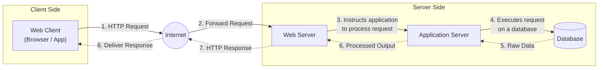
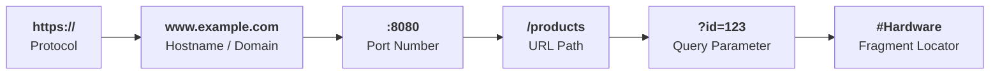
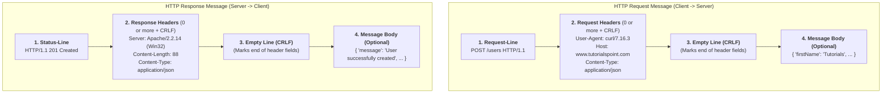

# Lecture 1: The Client & Server, Digital Addressing, and HTTP

> [!info] Navigation & Source
> - **Quiz Hub:** [[SP Quiz 1]] | **Next Lecture:** [[Lec 2|Lecture 2: Web Services, Web API, REST, MVC]]
> - **Slide Deck:** [[Lecture-1.pdf]] (*SWE 4537: Server Programming — Ishmam Tashdeed | Asaduzzaman Herok*)

---

## 1. The Client–Server Architecture

At its core, web communication happens between two sides over the **Internet**: the **Client Side** (which requests resources) and the **Server Side** (which processes requests and delivers resources).

### 1.1 Web Client (Slide 4)
A **Web Client** is the software on your device (computer, phone, or tablet) that you use to access the web.

- **What it does (4-Step Lifecycle):**
  1. **Takes the web address (URL)** you type in (e.g., `https://www.google.com`).
  2. **Sends an HTTP request** to the correct server, asking for the content of that page.
  3. **Receives the response** from the server (which can be code like `HTML`, `CSS`, and `JavaScript`, or data files like `JSON`).
  4. **Interprets and renders** this code into the visual webpage you see and interact with.
- **Examples:**
  - Any web browser (**Google Chrome**, **Microsoft Edge**, Firefox, Safari).
  - **Any application software that connects to the internet** (e.g., mobile apps, `curl`, Postman, desktop email/chat clients).

---

### 1.2 Web Server (Slides 5–8)
A **Web Server** is the system that **stores, processes, and delivers** web content to clients. Crucially, the term "Web Server" can refer to **two things**:

| Dimension | Definition | Core Responsibility |
| :--- | :--- | :--- |
| **1. Hardware** | The physical computer (or virtual machine) that stores all the website's data and web applications. | Provides compute, memory, storage, and network connectivity. |
| **2. Software** | The application running on the hardware. | Understands **URLs** and the **Hypertext Transfer Protocol (HTTP)**. |

#### What a Web Server Does (3 Steps)
1. **Receives Requests:** The server is always **"on"** and **"listening"** on a specific port for incoming requests from clients.
2. **Processes Requests:** Action depends on what the client asked for:
   - **For a Static File:** The server simply finds that specific file on disk.
   - **For a Dynamic Request:** It runs the web application's backend code (often via an Application Server and Database).
3. **Sends a Response:** Upon finding the file or generating the data, it packages it up and sends it back to the client as an **HTTP response** along with a **status code**.

#### Static vs. Dynamic Web Server
| Server Type | How It Works | Content Behavior |
| :--- | :--- | :--- |
| **Static Web Server** | Consists of a computer (hardware) and an HTTP server (software). It sends hosted files **"as is"** directly to the client. | Every user receives the exact same file (e.g., plain `.html`, `.css`, images). |
| **Dynamic Web Server** | Consists of a static web server **plus extra software** — most commonly an **Application Server** and a **Database**. | Creates content **"on the fly"** before sending it. Content can be **personalized** for each user. |

- **Common Web Server Software Examples:**
  - **Apache HTTP Server**
  - **Nginx** (pronounced *"Engine-X"*)
  - **Microsoft IIS** (Internet Information Services)

---

### 1.3 Web Application / Web App (Slide 9)
A **Web Application** is a dynamic, interactive program that can be accessed from a browser.
- It runs in **both places** — **client side** and **server side** — by parts.
- Many users access the **same deployed application**, but each user may have **different sessions, permissions, and data**.

| Part | Where It Runs | Core Responsibility |
| :--- | :--- | :--- |
| **Client-Side (Frontend)** | Inside the user's **browser**. | Responsible for the **User Interface (UI)** you see and click on. |
| **Server-Side (Backend)** | On the **web server**. | Contains the **"business logic"** (rules, data processing, authentication). |

- **Common Examples:** Gmail, Outlook 365, Google Workspace (Docs, Sheets), Microsoft Office Online, Facebook, X (Twitter), Instagram.

> [!error] High-Yield Exam Traps: Client–Server Architecture
> 1. **"Is a Web Client only a browser?"** $\rightarrow$ **No!** The slide explicitly defines examples as *"Any browser (Chrome, Edge), Application software that connects to internet."* In a scenario where a Python script (`requests`/`curl`) or mobile app calls a server, that script/app is the **Web Client**.
> 2. **"Web Server" Dual Meaning:** If an MCQ asks whether a Web Server is hardware or software, the **best answer** is **both** (physical computer/VM storing data *and* the HTTP-understanding software running on it).
> 3. **Web Server vs. Application Server (Slide 3 Diagram):**
>    - The **Web Server** receives the HTTP request from the internet and **instructs the Application Server** to process dynamic requests.
>    - The **Application Server** executes business logic and **queries the Database**.

---

## 2. Digital Address: IP, Port, Socket, and URL

How does a client locate the exact server and the exact application running on that server?

### 2.1 IP Address, Port Number, and Socket (Slides 10–11)

| Concept | Definition | Format / Range | Purpose & Analogy |
| :--- | :--- | :--- | :--- |
| **IP (Internet Protocol) Address** | A unique numerical label assigned to every device (server or computer) on a network. | e.g., `172.217.14.228` or `192.168.1.10` | **Single purpose:** Identification of a device in a network *(Like a building's street address)*. |
| **Port Number** | A **16-bit number** used to identify a specific application or service on a machine. | **`0` to `65535`** ($2^{16} = 65,536$ values) | Directs traffic to the right program on the device *(Like an apartment/room number inside the building)*. |
| **Socket** | The combination of an **IP address + Port number** (`IP:Port`). | e.g., `192.168.1.10:51255` | Identifies a **network endpoint**. A socket is the **software endpoint** used for network communication. |

#### Two Main Types of Ports (Slide 10)
1. **Server Ports (Well-Known Ports):**
   - **Standardized and predictable.**
   - The server permanently listens on a specific, well-known port for incoming requests.
   - **Must-Know Examples:**
     - **Port `80`** $\rightarrow$ **HTTP** (unencrypted web traffic)
     - **Port `443`** $\rightarrow$ **HTTPS** (encrypted/secure web traffic)
2. **Client Ports (Temporary / Ephemeral Ports):**
   - **Private ports** that the client operating system opens dynamically for itself when initiating a connection.
   - Generally a **high-value number** (e.g., `51255`).

---

### 2.2 Uniform Resource Locator — URL (Slides 11–12)
A **URL** is the **human-readable address** that ties everything together. It is the single instruction a client uses to find the right server and resource.

#### URL Deconstruction Examples from Slides
- **Example A:** `https://www.example.com:8080/products?id=123`
- **Example B:** `https://en.wikipedia.org/wiki/Web%20server#Hardware`

| URL Component | Slide Example | Role & Meaning |
| :--- | :--- | :--- |
| **1. Protocol / Scheme** | `https://` | The protocol/language for the client–server conversation (`http` or `https`). |
| **2. Hostname / Domain** | `www.example.com` / `en.wikipedia.org` | The **human-friendly name** for the server (maps to an IP address via DNS). |
| **3. Port Number** | `:8080` | Specific port on the server. *(Optional in URL if using default `80` for HTTP or `443` for HTTPS).* |
| **4. URL Path** | `/products` or `/wiki/Web%20server` | Specifies the exact **resource** the client wants on the server. |
| **5. Query Parameter** | `?id=123` | Extra key-value parameters sent in the URL (used for filtering, searching, etc.). Starts with `?`; multiple params joined by `&`. |
| **6. URL Encoding** | `%20` | Replaces unsafe/special characters in URLs (`%20` represents a **space** character in `Web server`). |
| **7. Fragment Locator** | `#Hardware` | **Optional final part.** Points to a specific section/anchor *inside* the returned document. |

> [!error] High-Yield Exam Traps: Digital Addressing & URLs
> 1. **Socket vs. Port vs. IP:**
>    - If asked *"What uniquely identifies a device on a network?"* $\rightarrow$ **IP Address**.
>    - If asked *"What identifies a specific application/service on a server machine?"* $\rightarrow$ **Port Number**.
>    - If asked *"What is the software endpoint (`IP:Port`) used for network communication?"* $\rightarrow$ **Socket**.
> 2. **Server Port vs. Client Port Scenario:** When your browser connects to `https://google.com`, the **destination (server) port** is well-known (`443`), while your browser's **source (client) port** is a temporary high-numbered port (e.g., `51255`).
> 3. **Fragment `#Hardware` Behavior:** The fragment (`#...`) is an **optional final part** used by the browser to jump to a heading/section on the page. It is **not** used by the server to locate the file.

---

## 3. Language / Protocol of Communication: HTTP

### 3.1 HTTP Overview & Basic Features (Slide 13)
**HTTP (Hypertext Transfer Protocol)** is the set of rules that web clients and web servers use to communicate with each other.

| Basic Feature | Explanation & Exam Nuances |
| :--- | :--- |
| **1. Stateless** | Each request is treated as a **brand-new, independent request**. Both client and server **forget about each other** after completion of a request **unless** *cookies, tokens, or sessions* are used. |
| **2. Request–Response Model** | A client sends a request, and the server returns a response. **Important Note:** *The underlying network (TCP) connection may be reused for multiple exchanges* (via `Connection: Keep-Alive`). |
| **3. HTTP Methods** | HTTP defines standard verbs/methods for different actions on a resource (`GET`, `POST`, `PUT`, `DELETE`, etc.). |
| **4. Caching Support** | HTTP provides built-in support for caching, which **improves performance** by storing copies of responses and reusing them later without re-fetching from the server. |

---

### 3.2 Anatomy of an HTTP Message (Slides 14–19)
An **HTTP Message** is either a **Request** (client $\rightarrow$ server) or a **Response** (server $\rightarrow$ client). Both share a **4-component structure**:

#### Component-by-Component Comparison

| Component | HTTP Request Message (Slides 15–17) | HTTP Response Message (Slides 18–19) |
| :--- | :--- | :--- |
| **1. Start Line** | **Request-Line:** `<Method> <Request-URI> <HTTP-Version>` *Example:* `POST /users HTTP/1.1` | **Status-Line:** `<HTTP-Version> <Status-Code> <Reason-Phrase>` *Example:* `HTTP/1.1 201 Created` |
| **2. Headers** | **Request Headers:** Zero or more header fields followed by `CRLF`. Passes additional info about the **request** and about the **client itself** to the server. | **Response Headers:** Zero or more header fields followed by `CRLF`. Passes additional info about the **response** (which cannot fit in the Status-Line) and about the **server**. |
| **3. Empty Line** | An empty line (nothing preceding the `CRLF`) indicating the **end of the header fields**. | An empty line (nothing preceding the `CRLF`) indicating the **end of the header fields**. |
| **4. Message Body** | **Optional.** Contains content sent to the server. - For `GET`: **Empty**. - For `POST`, `PUT`: **Contains data**. | **Optional.** Contains the returned resource representation (e.g., JSON object, HTML page). |

> [!tip] What is `CRLF`?
> `CRLF` stands for **Carriage Return + Line Feed** (`\r\n`). In HTTP messages, every header line ends with `CRLF`, and a standalone `CRLF` (an empty line) strictly separates the **Headers** from the **Message Body**.

---

### 3.3 Core HTTP Request Methods in Lecture 1 (Slide 16)
The request method indicates the action to be performed on the resource identified by the given `Request-URI`. *(More methods like `HEAD`, `PATCH`, and `OPTIONS` are expanded in [[Lec 2#4.3 Additional HTTP Methods (Slide 16)|Lecture 2]]).*

- **`GET`**: Used to **retrieve information** from the given server using a given URI. *(Message body is empty).*
- **`POST`**: Used to **send data** to the server — for example, customer information, file uploads, etc., using HTML forms. *(Message body contains data).*
- **`PUT`**: **Replaces all** the current representations of the target resource with the uploaded content. *(Message body contains data).*
- **`DELETE`**: **Removes all** the current representations of the target resource given by the URI.

---

### 3.4 HTTP Status Codes (Slide 19)
- A **Status Code** is a **3-digit integer** in the Response Status-Line.
- **Categorization Rule:** The **first digit** defines the **class of response**. The **last two digits have no categorization role**.

| Class | Category Name | Slide Definition | Common Examples to Know |
| :---: | :--- | :--- | :--- |
| **`1xx`** | **Informational** | The request was received and the process is continuing. | `100 Continue`, `101 Switching Protocols` |
| **`2xx`** | **Success** | The action was successfully received, understood, and accepted. | `200 OK` (Standard success) `201 Created` (Resource created via `POST`/`PUT`) `204 No Content` (Success, but empty response body, e.g., after `DELETE`) |
| **`3xx`** | **Redirection** | Further action must be taken in order to complete the request. | `301 Moved Permanently` `302 Found` (Temporary redirect) `304 Not Modified` (Use cached version) |
| **`4xx`** | **Client Error** | The request contains incorrect syntax or cannot be fulfilled due to client fault. | `400 Bad Request` (Invalid syntax/malformed JSON) `401 Unauthorized` (Not logged in / missing or invalid token) `403 Forbidden` (Logged in, but lacks permission) `404 Not Found` (Resource URI doesn't exist) |
| **`5xx`** | **Server Error** | The server failed to fulfill an **apparently valid request**. | `500 Internal Server Error` (Unhandled backend crash/bug) `502 Bad Gateway` `503 Service Unavailable` (Server overloaded/down) |

> [!error] High-Yield Exam Traps: HTTP Protocol & Messages
> 1. **Request-Line vs. Status-Line Order (Classic MCQ Trap!):**
>    - In a **Request**, `<HTTP-Version>` comes **LAST**: `<Method> <Request-URI> <HTTP-Version>` (`POST /users HTTP/1.1`).
>    - In a **Response**, `<HTTP-Version>` comes **FIRST**: `<HTTP-Version> <Status-Code> <Reason-Phrase>` (`HTTP/1.1 201 Created`).
> 2. **4xx vs. 5xx Scenario Distinction:**
>    - If a client sends a valid request (e.g., `GET /todos`), and the database crashes or a SQL syntax error occurs in your backend code, what status class is returned? **`5xx` (Server Error)** — because the client's request was *apparently valid*, and the server failed to fulfill it!
>    - If the client sends malformed JSON or requests an ID that doesn't exist, it's **`4xx` (Client Error)**.
> 3. **"Stateless" vs. "Connection Reuse":**
>    - Don't confuse **HTTP Statelessness** with TCP connections. Slide 13 explicitly notes: *"The underlying connection may be reused for multiple exchanges"* (e.g., `Connection: Keep-Alive`), yet HTTP is still **stateless** because the server does not remember application state between those requests unless cookies/tokens/sessions are used.

---

## 4. Lecture 1 Practice Questions (MCQ & "Best Answer" Scenarios)

> [!question]- Q1 (Scenario — Best Answer): A mobile weather app on an Android phone sends a request to `https://api.weather.com:8443/forecast?city=Dhaka` and displays the temperature. In this scenario, which statement is the MOST accurate?
> **Options:**
> - A) The mobile app is not a Web Client because only web browsers (like Chrome or Edge) are Web Clients.
> - B) The mobile app acts as a Web Client communicating with socket `<Server-IP>:443`.
> - C) The mobile app acts as a Web Client, and the server is listening on port `8443` while the phone uses a temporary high-numbered client port.
> - D) `?city=Dhaka` is the URL path that identifies the server hardware.
>
> ---
> **Best Answer:** **C**
> - **Why C is best:** Slide 4 defines a Web Client as *"Any browser (Chrome, Edge), Application software that connects to internet."* The URL explicitly specifies port `:8443` (overriding the default HTTPS port `443`), and the client opens a temporary high-value port for itself (Slide 10).
> - **Why B is wrong:** Even though `https://` defaults to `443`, the URL explicitly overrides the port to `8443`.

> [!question]- Q2 (MCQ — URL Deconstruction): Given the URL `https://en.wikipedia.org/wiki/Web%20server#Hardware`, what are `%20` and `#Hardware` respectively?
> **Options:**
> - A) Query parameter and URL path
> - B) URL encoding and Fragment locator
> - C) Port number and Query parameter
> - D) Fragment locator and Protocol header
>
> ---
> **Best Answer:** **B**
> - **Explanation:** Per Slide 12, `%20` is **URL encoding** (representing a space), and `#Hardware` is the **Fragment locator** (the optional final part of the URL).

> [!question]- Q3 (MCQ — HTTP Message Format): Which of the following correctly represents the first line (Start Line) of an HTTP Request and an HTTP Response?
> **Options:**
> - A) Request: `HTTP/1.1 GET /users` | Response: `200 OK HTTP/1.1`
> - B) Request: `GET /users HTTP/1.1` | Response: `HTTP/1.1 200 OK`
> - C) Request: `GET HTTP/1.1 /users` | Response: `HTTP/1.1 OK 200`
> - D) Request: `/users GET HTTP/1.1` | Response: `200 HTTP/1.1 OK`
>
> ---
> **Best Answer:** **B**
> - **Explanation:**
>   - **Request-Line (Slide 15):** `<Method> <Request-URI> <HTTP-Version>` $\rightarrow$ `GET /users HTTP/1.1`
>   - **Status-Line (Slide 18):** `<HTTP-Version> <Status-Code> <Reason-Phrase>` $\rightarrow$ `HTTP/1.1 200 OK`

> [!question]- Q4 (Scenario — Best Answer): An HTTP parser reads an incoming HTTP request stream line by line. How does the parser know where the Request Headers end and the optional Message Body begins?
> **Options:**
> - A) It looks for the `Content-Type` header, which is always the final header.
> - B) It encounters an empty line (a line with nothing preceding the `CRLF`).
> - C) It waits for the TCP connection to close.
> - D) It reads the Status-Line at the bottom of the headers.
>
> ---
> **Best Answer:** **B**
> - **Explanation:** Slides 15 & 18 specify that the third component of every HTTP message is **an empty line (i.e., a line with nothing preceding the `CRLF`)** indicating the end of the header fields.

> [!question]- Q5 (Scenario — Status Codes): A user submits a valid registration form (`POST /register`), and your server receives the request properly. However, while inserting the user into the database, the database server runs out of disk space and throws an exception. Which class of HTTP status code MUST the server return?
> **Options:**
> - A) `2xx` Success
> - B) `3xx` Redirection
> - C) `4xx` Client Error
> - D) `5xx` Server Error
>
> ---
> **Best Answer:** **D (`5xx` Server Error)**
> - **Explanation:** Slide 19 defines `5xx: Server Error` as: *"The server failed to fulfill an apparently valid request."* Since the client's request was valid and the failure happened on the server/database side, `5xx` (specifically `500 Internal Server Error`) is the best answer.

> [!question]- Q6 (Scenario — Static vs. Dynamic): You visit an online banking portal. When you log in, you see your account balance; when your friend logs into the exact same URL, they see their own balance. Which server-side architecture is powering this?
> **Options:**
> - A) A Static Web Server sending pre-built HTML files as-is.
> - B) A Dynamic Web Server working with an Application Server and a Database to generate personalized content on the fly.
> - C) A Client-only application that does not use HTTP.
> - D) A DNS server translating ports into HTML.
>
> ---
> **Best Answer:** **B**
> - **Explanation:** Slide 8 states that a **Dynamic Web Server** *"works with other components (like an application server and a database) to create content on the fly. The content can be personalized for the user."*
