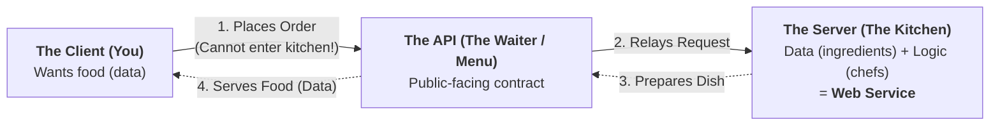
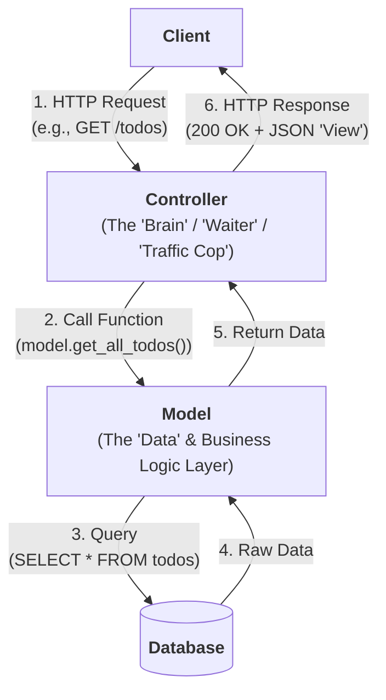

# Lecture 2: Web Services, Web API, REST, and MVC

> [!info] Navigation & Source
> - **Quiz Hub:** [[SP Quiz 1]] | **Previous Lecture:** [[Lec 1|Lecture 1: The Client & Server]]
> - **Slide Deck:** [[Lecture-2.pdf]] (*SWE 4537: Server Programming — Ishmam Tashdeed | Asaduzzaman Herok*)

---

## 1. Web Application vs. Web Service (Slides 2–4)

In [[Lec 1]], we saw the core loop: a **Client** sends an **HTTP Request** to a server at a specific **IP and Port**, and the **Server** processes it and sends back an **HTTP Response**.

**The Bridge Question:** *What is the actual program on the server responsible for listening for requests, deciding what to do with them, and creating that response?*
- In its **broadest sense**, this program is a **Web Service** (Slide 3).
- However, in software engineering, we make a **key distinction** between a **Web Application** and a **Web Service** based on *who the primary user is* and *what the output looks like* (Slide 4):

| Feature | Web Application (For Humans) | Web Service (For Machines) |
| :--- | :--- | :--- |
| **Primary "User"** | A **Human** interacting via a browser. | **Another Program (a Machine)** (e.g., mobile app, frontend SPA, another server). |
| **Primary Output** | A **User Interface (UI)**. | **Raw Data**. |
| **Response Format** | Sends **`HTML`, `CSS`, and `JavaScript`** for a browser to render visually. | Sends **`JSON` (or `XML`)** for another program to parse and use. |
| **Slide Analogy** | **A fully-assembled car** (ready for a human to drive). | **The engine from the car factory** (meant to be plugged into another machine/body). |

---

## 2. What is an API & Paradigms of Web Services (Slides 5–11)

### 2.1 What is an API? (Slides 9–10)
**API (Application Programming Interface)** is the **"public-facing"** part of the server. It is the **contract** that defines *how* other programs can talk to your service.
- It's the **"waiter"** for the kitchen.
- It's the **"menu"** that lists the rules.
- It's the **technical specification manual**.

#### The Restaurant Analogy (Slide 10)


---

### 2.2 Paradigms of Web Services: How Do Machines Talk? (Slides 5, 11, 13)
Over time, three major paradigms evolved for how a client program uses the "waiter" (API) to talk to the server:

| Paradigm | Core Idea & Mechanism | Restaurant Analogy (Slide 11) | Strengths | Problems / Weaknesses |
| :--- | :--- | :--- | :--- | :--- |
| **1. RPC**<br>*(Remote Procedure Call)* | **The oldest idea:** *"Just call a function on another server."*<br>Focuses on **Actions (Verbs)**.<br>Client calls `getUsers()`, `calculateTotal(orderID)`, `/getAllTodos`, `/createNewTodo`. | You shout directly into the kitchen: `"getMeSteak()"`. | Simple and intuitive at small scale. | **Brittle (Tightly Coupled):**<br>- What if the chef's function is renamed to `fetchSteak(temp)`?<br>- How do you discover functions?<br>- Need todos by date? You must invent a *new function & endpoint*: `/getAllTodosByDate`. |
| **2. SOAP**<br>*(Simple Object Access Protocol)* | A **formal protocol** (strict set of rules) for web services.<br>- Uses complex **`XML`** for all messages.<br>- Requires a rigid contract (**`WSDL`**) defining all functions. | The waiter hands you a **legal document (WSDL)** written in **Latin (XML)**. You must fill out a specific form *exactly* to order. | Very powerful (built-in enterprise security, ACID transactions, strict type checking). | **Very heavyweight, complex, and slow** to parse and work with. |
| **3. REST**<br>*(Representational State Transfer)* | An **architectural style** (philosophy defined by constraints).<br>Focuses on **Resources (Nouns)** (`/todos`) + **HTTP Verbs** (`GET`, `POST`, `PUT`, `DELETE`) + **Query Params** (`/todos?date=2025-11-13`). | The waiter gives you a **simple, well-organized menu** (API endpoints). You use simple words (**Verbs**) to pick items (**Nouns**): *"I'll `GET` the steak."* | Clean, predictable, scalable, evolvable; leverages the **built-in power of HTTP** instead of inventing new URLs. | Requires discipline to follow REST constraints (especially statelessness and uniform interface). |

> [!error] High-Yield Exam Trap: Protocol vs. Architectural Style
> - **SOAP is a Protocol** (a strict, rigid set of rules and XML message formats).
> - **REST is an Architectural Style** (a philosophy defined by 6 guiding constraints — **not** a protocol! It *uses* the existing HTTP protocol).

---

## 3. WSDL Deep Dive (Slides 6–8)

### 3.1 What is WSDL?
**WSDL (Web Services Description Language)** is an **XML-based file** that acts as a formal **"contract"** or **"user manual"** for a SOAP web service.
- It tells a client application *exactly* how to structure a request and what to expect in response.

#### WSDL vs. SOAP (Slide 6 — Must Memorize!)
- **WSDL** is the **description** (the **"menu"**).
- **SOAP** is the **message format** (the **"order"**).
- *Workflow:* You read the **WSDL** to learn how to build the **SOAP** message.

---

### 3.2 The 5 Key Components of a WSDL File (Slides 7–8)
A WSDL file answers **5 specific questions** using 5 XML tags (in order from abstract data to physical URL):

| Order | WSDL XML Tag | The Question It Answers (Slide 7) | Concrete Role in XML (Slide 8) |
| :---: | :--- | :--- | :--- |
| **1** | **`<types>`** | **What are the data types?** | Defines XML Schema (`<schema>`) data types like `UserID` (`xs:int`) and `UserName` (`xs:string`). |
| **2** | **`<message>`** | **What do the payloads look like?** | Defines request/response messages (e.g., `getUserRequest` containing `UserID`, and `getUserResponse` containing `UserName`). |
| **3** | **`<portType>`** | **What are the abstract operations?** | Defines the abstract functions/operations (e.g., `<operation name="getUser">`) and links their `<input>` and `<output>` messages. |
| **4** | **`<binding>`** | **What concrete protocol do we use?** | Binds the abstract `portType` to a concrete protocol like **SOAP** (`<soap:binding style="rpc"/>`, `soapAction="getUser"`). |
| **5** | **`<service>`** | **Where is the service's physical URL?** | Specifies the actual network address/endpoint (`<soap:address location="http://api.example.com/UserService"/>`). |

> [!tip] Mnemonic for the 5 WSDL Tags: **T–M–P–B–S** (*"Types Make Ports Bind Services"*)
> 1. **`<types>`** $\rightarrow$ Data types (`xs:int`, `xs:string`)
> 2. **`<message>`** $\rightarrow$ Payloads (`Request` / `Response` parts)
> 3. **`<portType>`** $\rightarrow$ Abstract operations / functions (`getUser`)
> 4. **`<binding>`** $\rightarrow$ Concrete protocol (`SOAP`)
> 5. **`<service>`** $\rightarrow$ Physical URL (`http://...`)

> [!example]- View Annotated WSDL XML from Slide 8
> ```xml
> <!-- 1. The data types we will use -->
> <types>
>   <schema>
>     <element name="UserID" type="xs:int"/>
>     <element name="UserName" type="xs:string"/>
>   </schema>
> </types>
> 
> <!-- 2. The request/response messages (payloads) -->
> <message name="getUserRequest">
>   <part name="id" element="tns:UserID"/>
> </message>
> <message name="getUserResponse">
>   <part name="name" element="tns:UserName"/>
> </message>
> 
> <!-- 3. The abstract operations (functions) -->
> <portType name="UserPortType">
>   <operation name="getUser">
>     <input message="tns:getUserRequest"/>
>     <output message="tns:getUserResponse"/>
>   </operation>
> </portType>
> 
> <!-- 4. The concrete protocol (SOAP) -->
> <binding name="UserBinding" type="tns:UserPortType">
>   <soap:binding style="rpc" ... />
>   <operation name="getUser">
>     <soap:operation soapAction="getUser"/>
>     <input><soap:body .../></input>
>     <output><soap:body .../></output>
>   </operation>
> </binding>
> 
> <!-- 5. The physical address (URL) -->
> <service name="UserService">
>   <port name="UserPort" binding="tns:UserBinding">
>     <soap:address location="http://api.example.com/UserService"/>
>   </port>
> </service>
> ```

---

## 4. REST: Representational State Transfer (Slides 12–18)

### 4.1 The 6 Guiding Constraints of REST (Slide 12)
REST is an **architectural style** defined by **6 guiding constraints** that, if followed, lead to a scalable, evolvable system:

| # | Constraint | Required? | Meaning & Slide Emphasis |
| :---: | :--- | :---: | :--- |
| **1** | **Client–Server** | Mandatory | Enforces **Separation of Concerns** between the UI/client and data storage/server. |
| **2** | **Stateless** | Mandatory | **The most important constraint!** The server does not store any client session state between requests. |
| **3** | **Cacheable** | Mandatory | Responses must implicitly or explicitly define themselves as cacheable or non-cacheable so clients can cache responses. |
| **4** | **Uniform Interface** | Mandatory | **The key to REST!** Standardized way of interacting with resources (Nouns + HTTP Verbs + Representations). |
| **5** | **Layered System** | Mandatory | Intermediaries like proxies, gateways, or load balancers can exist between client and server without the client knowing. |
| **6** | **Code on Demand** | **Optional** | Server can temporarily extend client functionality by sending executable code (e.g., `JavaScript`). |

---

### 4.2 The RESTful "Menu": Resource Design & HTTP Verbs (Slides 13–15)
The core of the **Uniform Interface** constraint is shifting from **Actions (Verbs)** in RPC to **Resources (Nouns)** in REST:
- **RPC (Wrong for REST):** `/getAllTodos`, `/createNewTodo`, `/getAllTodosByDate`
- **REST (Right):** One resource noun `/todos`, HTTP Verbs for actions, and query parameters for filtering (`/todos?date=2025-11-13`).

#### Part 1: The Collection Resource (`/todos`) — Slide 14
Refers to the **collection of ALL todos**.

| HTTP Verb + Endpoint | CRUD Action | Meaning | Where is Data Sent & Why? |
| :--- | :--- | :--- | :--- |
| **`GET /todos`** | **Read** | *"Get me a list of all todos."* | Data (like filters) is sent in the **URL** via query parameters (e.g., `/todos?user=1`). |
| **`POST /todos`** | **Create** | *"Create a new todo."* | Data is sent in the **Request Body**, **not** visible in the URL. **Good for sensitive data** and large payloads. |

#### Part 2: A Specific Item Resource (`/todos/123`) — Slide 15
Refers to a **single, specific todo** with ID `123`.

| HTTP Verb + Endpoint | CRUD Action | Meaning |
| :--- | :--- | :--- |
| **`GET /todos/123`** | **Read** | *"Get details for todo #123."* |
| **`PUT /todos/123`** | **Update (Full Replace)** | *"Replace todo #123."* (Replaces the entire resource representation). |
| **`DELETE /todos/123`** | **Delete** | *"Delete todo #123."* |

---

### 4.3 Additional HTTP Methods (Slide 16)

| HTTP Method | How It Works | Specific Use Case (Slide 16) |
| :--- | :--- | :--- |
| **`HEAD`** | Identical to `GET`, **but it does NOT return the message body** (returns only Status-Line + Headers). | Check if a resource exists or get its metadata (like `Content-Length`) **without downloading the whole file**. |
| **`PATCH`** | Applies a **partial replacement** to a resource. | **Unlike `PUT` (which replaces everything)**, `PATCH` is for changing **just one field** (e.g., updating *only* a todo's title). |
| **`OPTIONS`** | Asks the server to list the **supported HTTP methods** for a given URL. | Used to describe the communication options for the target resource (e.g., returning `Allow: GET, POST, OPTIONS` or CORS preflight checks). |

> [!error] High-Yield Exam Edge Cases: `PUT` vs. `PATCH` vs. `POST` & Idempotency
> In "choose the best answer" scenarios, know these crucial distinctions:
> 1. **`PUT` vs. `PATCH` Scenario:**
>    - Suppose a user object has 10 fields (`name`, `email`, `bio`, `avatar`, etc.) and the client wants to update **only** the `email` field by sending `{"email": "new@iut.edu"}`.
>    - Which method is the **BEST answer**? **`PATCH`** (partial replacement). If you used `PUT`, it would replace the entire resource, potentially overwriting the other 9 fields with `null`/defaults!
> 2. **Safe vs. Idempotent Methods:**
>    - **Safe** (does not modify server state): `GET`, `HEAD`, `OPTIONS`.
>    - **Idempotent** (making the exact same request 1 time or 10 times produces the exact same state on the server): `GET`, `HEAD`, `OPTIONS`, **`PUT`**, **`DELETE`**.
>    - **NOT Idempotent:** **`POST`** (calling `POST /todos` 5 times creates 5 separate todo items!).

---

### 4.4 The "Representation" in REST & Content Negotiation (Slide 17)
Why is it called *Representational* State Transfer?
- **Key Concept:** The server **does not** send you the actual database object. It sends a **representation** of that resource.
  - `GET /todos/123` $\rightarrow$ returns **`JSON`** (for a mobile app)
  - `GET /todos/123` $\rightarrow$ returns **`HTML`** (for a website)

#### Content Negotiation (Slide 17)
How does the server know which representation format (`JSON` vs. `HTML` vs. `XML`) the client wants? Through **Content Negotiation** using two specific HTTP headers:
1. **Client sends in Request Header:** `Accept: application/json` *(Tells server what format the client wants to receive).*
2. **Server replies in Response Header:** `Content-Type: application/json` *(Tells client what format the server actually sent in the body).*

*(Note: In SWE 4537, our APIs will always use `JSON`.)*

---

### 4.5 REST's Most Important Constraint: Statelessness (Slide 18)

> [!important] Definition of Statelessness
> **The server does not store any client "session" state between requests.**
> Every single request from the client must contain **all the information** needed for the server to process it.

#### Stateful (Bad for REST) vs. Stateless (Good for REST)
| Approach | Step 1 (Login) | Step 2 (Subsequent Request) | Why It Fails or Succeeds |
| :--- | :--- | :--- | :--- |
| **Bad (Stateful)** | `1. POST /login` | `2. GET /my-todos`<br>*(Server just "remembers" who you are in server RAM/session).* | **Fails Scalability:** If Server A remembers your login, and a load balancer routes Request #2 to Server B, Server B has no idea who you are! |
| **Good (Stateless)** | `1. POST /login`<br>*(Server returns an `access_token`).* | `2. GET /todos`<br>*(Client sends `Authorization: Bearer <token>` in the request header).* | **Enables Massive Scalability:** Any server in a **1,000-server cluster** can handle any request, because no server needs to remember "who you are." |

---

## 5. "The Big Messy File" & The MVC Pattern (Slides 19–28)

### 5.1 The Problem: "The Big Messy File" (Slides 19–21)
When building a backend (e.g., using **FastAPI** in Python), the naive temptation is to put everything into a single `main.py` file:

```python
# main.py (The "Messy" File Example — Slide 20)
@app.get("/todos")
def get_all_todos():
    # 1. Connect to the database...
    # 2. Write a SQL query...
    # 3. Format the data into JSON...
    # 4. Return the JSON...

@app.post("/todos")
def create_todo():
    # 1. Get the JSON from the request body...
    # 2. Connect to the database...
    # 3. Write a SQL 'INSERT' query...
    # 4. Return a '201 Created' status...
```

#### Why is this a problem when we add `/users`, `/posts`, `/comments`? (Slide 21)
1. Our `main.py` file becomes **5,000+ lines long**!
2. All our **database code**, **business logic**, and **API routing code** are mixed together.
3. It becomes **impossible to test, debug, or maintain**.
4. **Core Principle Violated:** **Separation of Concerns**.

---

### 5.2 The Solution: MVC (Model–View–Controller) Pattern (Slides 22–27)
An **Architectural Pattern** is a template for organizing your code — a reusable solution to a common problem. To enforce **Separation of Concerns**, we separate our server code into **three distinct jobs**: **Model (M)**, **View (V)**, and **Controller (C)**.

#### The 6-Step MVC API Flow (Slide 23 & 27)


#### Detailed Breakdown of M, V, and C (Slides 24–26)

| Component | Nickname (Slides) | Core Responsibilities | Crucial Exam Boundaries |
| :--- | :--- | :--- | :--- |
| **M — Model** | **The "Data" Layer** / **"Database" Layer** | - Handles all **data** and **business logic**.<br>- Its *only* job is to talk to the database (e.g., `SELECT * FROM todos`).<br>- Contains **all your SQL queries**.<br>- Enforces business/data rules (e.g., *"password must be 8 characters"*). | **It does NOT know the API or HTTP exists!** It never sees URLs, headers, or status codes; it just returns raw data. |
| **C — Controller** | **The "Brain"** / **"Waiter"** / **"Traffic Cop"** | - Directs the flow of the operation.<br>- **Handles the HTTP Request** (e.g., `GET /todos`).<br>- Calls the Model (`model.get_all_todos()`).<br>- Receives raw data from the Model.<br>- Formats that data into a Response (the **"View"**) and sends the `200 OK` HTTP Response. | Contains **no SQL queries**. Acts strictly as the coordinator between HTTP requests/responses and the Model. |
| **V — View** | **The "Presentation" Layer** | Formats the data for the "user".<br>- **In a traditional website (Web App):** The `HTML` file / template.<br>- **For our API (Web Service):** Since the "user" is a machine, the **"View" is simply the `JSON`** that the Controller sends back. | In a JSON REST API, there are no `.html` templates — the serialized **JSON response** *is* the View! |

#### Why MVC is Better: The Maintenance Litmus Test (Slide 27)
- **Scenario 1:** *What if we change the database (e.g., change SQL queries, rename a table, or migrate from SQLite to PostgreSQL)?*
  - $\rightarrow$ **Only touch the Model.**
- **Scenario 2:** *What if we change the URL endpoint (e.g., rename `/todos` to `/tasks`) or change HTTP status codes/headers?*
  - $\rightarrow$ **Only touch the Controller.**

---

## 6. Lecture 2 Practice Questions (MCQ & "Best Answer" Scenarios)

> [!question]- Q1 (Scenario — App vs. Service): Company X builds two systems: System A returns HTML, CSS, and JavaScript so customers can browse products in Chrome. System B returns raw JSON inventory data so third-party warehouse software can sync stock levels automatically. According to Lecture 2, which statement is the BEST characterization?
> **Options:**
> - A) Both System A and System B are Web Applications because both use HTTP.
> - B) System A is a Web Service ("the car engine"), while System B is a Web Application ("the fully-assembled car").
> - C) System A is a Web Application (for humans, "fully-assembled car"), while System B is a Web Service (for machines, "the engine from the car factory").
> - D) System B cannot use HTTP because it returns JSON instead of HTML.
>
> ---
> **Best Answer:** **C**
> - **Explanation:** Slide 4 explicitly contrasts **Web Application** (primary user = human, output = UI via HTML/CSS/JS, analogy = *fully-assembled car*) with **Web Service** (primary user = another program/machine, output = raw data via JSON/XML, analogy = *engine from the car factory*).

> [!question]- Q2 (Scenario — RPC vs. REST): A junior developer designs an API with the following endpoints: `GET /getAllUsers`, `POST /createNewUser`, `GET /getUsersByRole?role=admin`, and `POST /deleteUserById`. Which critique BEST explains why this design violates REST principles?
> **Options:**
> - A) It uses JSON instead of XML and WSDL.
> - B) It uses RPC-style action/verb endpoints instead of a Uniform Interface with resource nouns (`/users`) and standard HTTP verbs (`GET`, `POST`, `DELETE`).
> - C) It uses query parameters (`?role=admin`), which are forbidden in REST.
> - D) It separates client and server concerns.
>
> ---
> **Best Answer:** **B**
> - **Explanation:** Slide 13 ("REST vs. RPC: A Shift in Thinking") explains that RPC uses **Actions (Verbs)** as endpoints (`/getAllTodos`, `/createNewTodo`), which is brittle. REST's **Uniform Interface** uses a single **Resource (Noun)** (`/users`) combined with **HTTP Verbs** (`GET`, `POST`, `DELETE`) for actions and query parameters (`?role=admin`) for filtering.

> [!question]- Q3 (MCQ — WSDL & SOAP): Which of the following accurately describes the relationship between WSDL and SOAP, and identifies the WSDL tag that specifies the concrete protocol?
> **Options:**
> - A) SOAP is the "menu" (description) and WSDL is the "order" (message format); `<portType>` specifies the concrete protocol.
> - B) WSDL is the "menu" (description/contract) and SOAP is the "order" (message format); `<binding>` specifies the concrete protocol (e.g., SOAP).
> - C) WSDL is used only for REST APIs; `<service>` defines the data types.
> - D) WSDL is the "menu" and SOAP is the "order"; `<types>` specifies the physical URL of the server.
>
> ---
> **Best Answer:** **B**
> - **Explanation:**
>   - Slide 6: **WSDL** is the description (the *"menu"*); **SOAP** is the message format (the *"order"*).
>   - Slide 7 & 8: `<binding>` answers *"What protocol do we use? (e.g., SOAP)"*, whereas `<portType>` defines abstract operations, `<types>` defines data types, and `<service>` defines the physical URL.

> [!question]- Q4 (Scenario — Best HTTP Method): You are building a RESTful API for user profiles at `/users/42`. Each profile has 15 fields (name, address, phone, bio, etc.). The mobile app wants to update ONLY the user's `bio` field without sending or overwriting the other 14 fields. Meanwhile, another service wants to check if `/users/42` exists and see its `Content-Length` without downloading the profile body. Which pair of HTTP methods is the BEST choice?
> **Options:**
> - A) `PUT` for updating the bio; `GET` for checking metadata without the body.
> - B) `POST` for updating the bio; `OPTIONS` for checking metadata without the body.
> - C) `PATCH` for updating the bio; `HEAD` for checking metadata without the body.
> - D) `PATCH` for updating the bio; `OPTIONS` for checking metadata without the body.
>
> ---
> **Best Answer:** **C**
> - **Explanation:** Slide 16 explicitly states:
>   - **`PATCH`**: Applies a **partial replacement** to a resource (changing *just one field*, unlike `PUT` which replaces everything).
>   - **`HEAD`**: Identical to `GET`, **but does not return the message body** — used to check if a resource exists or get metadata like `Content-Length` without downloading the whole file.
>   - (`OPTIONS` lists supported HTTP methods for a URL, not resource existence/length).

> [!question]- Q5 (Scenario — Statelessness & Scalability): Your company's API currently stores logged-in user sessions in the server's local memory after `POST /login`, so subsequent calls to `GET /my-todos` rely on the server "remembering" the client. When traffic spikes and you scale from 1 server to a 1,000-server cluster behind a load balancer, users randomly get logged out. What is the BEST RESTful fix?
> **Options:**
> - A) Switch from REST to RPC so functions run faster on a single server.
> - B) Enforce the **Stateless** constraint: return an `access_token` on `POST /login` and require the client to send `Authorization: Bearer <token>` in the header of every `GET /todos` request.
> - C) Send the user's password in the URL query string of every `GET` request.
> - D) Move all SQL queries from the Model into `main.py`.
>
> ---
> **Best Answer:** **B**
> - **Explanation:** Slide 18 ("REST's Most Important Constraint: Statelessness") directly gives this exact scenario! Storing session state on the server violates statelessness. Returning an `access_token` and sending `Authorization: Bearer <token>` in every request allows any server in a 1,000-server cluster to handle any request independently.

> [!question]- Q6 (Scenario — Content Negotiation): A mobile client wants to ensure the REST API returns data formatted as JSON rather than HTML. Which header should the client send in the HTTP Request, and which header will the server send back in the HTTP Response?
> **Options:**
> - A) Client sends `Content-Type: application/json`; Server replies `Accept: application/json`.
> - B) Client sends `Accept: application/json`; Server replies `Content-Type: application/json`.
> - C) Client sends `User-Agent: application/json`; Server replies `Server: application/json`.
> - D) Both Client and Server send `Accept: application/json`.
>
> ---
> **Best Answer:** **B**
> - **Explanation:** Slide 17 ("Content Negotiation"):
>   - Client sends: `Accept: application/json`
>   - Server replies: `Content-Type: application/json`
>   *(Note: A client only sends `Content-Type` when the client itself is sending a request body, such as in a `POST` or `PUT` request).*

> [!question]- Q7 (Scenario — MVC Responsibilities): You are refactoring a "Big Messy File" (`main.py`) into the MVC pattern for a REST API. You have three tasks:
> 1. Enforce a business rule that a user's password must be at least 8 characters long and run `INSERT INTO users ...`.
> 2. Change the route path from `POST /register` to `POST /users`.
> 3. Return the newly created user formatted as a JSON payload.
> According to Lecture 2's MVC definition, where do Tasks 1, 2, and 3 belong?
> **Options:**
> - A) 1: Controller, 2: Model, 3: Database
> - B) 1: Model, 2: Controller, 3: View (JSON formatted & sent back by Controller)
> - C) 1: View, 2: Controller, 3: Model
> - D) 1: Controller, 2: Controller, 3: Model
>
> ---
> **Best Answer:** **B**
> - **Explanation:**
>   - **Slide 24 (Model):** *"Handles all data and business logic... contains all your SQL queries... enforces rules (e.g., 'password must be 8 characters')."* $\rightarrow$ Task 1 is in the **Model**! (A very common trap is thinking business rules like password length live in the Controller — Slide 24 explicitly places them in the **Model**).
>   - **Slide 25 & 27 (Controller):** Handles the HTTP Request/URL route (`GET /todos`) and coordinates flow. *"If we change the URL? Only touch the Controller."* $\rightarrow$ Task 2 is in the **Controller**.
>   - **Slide 26 (View):** *"For our API: The 'user' is a machine. The 'View' is simply the JSON that the Controller sends back."* $\rightarrow$ Task 3 represents the **View**.
